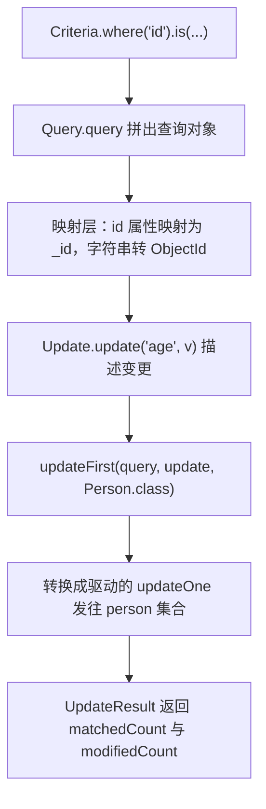

# MongoTemplate 查改删实战：Query 与 Criteria 是整套 API 的主轴

上一节把 Spring Boot 整合 MongoDB 的环境搭好，`PersonDAO` 里也跑通了 `save`。但一个只有保存方法的 DAO 撑不起业务，这一节把剩下的三大件补齐：条件查询、分页查询、按主键更新与删除。补完之后会发现一个规律，`MongoTemplate` 的所有操作都绕着三个对象转：`Criteria` 拼条件，`Query` 把条件组装成一次查询，`Update` 描述怎么改，三者两两组合就覆盖了查询、更新、删除的全部场景。

驱动原生 API 里的 `Filters`、`Sorts`、`Projections` 在这一层换了个面孔出现，两套 API 的对应关系也会一并对照清楚。

## 先给结论

- 条件查询两步走：`Criteria.where("name").is(name)` 生成条件，`Query.query(criteria)` 包成查询对象，`find(query, Person.class)` 返回 `List<Person>`，第二个参数既定返回类型也定集合名。
- 分页没有专用方法，靠 `Query` 上的 `skip` 与 `limit` 组合：第 `page` 页每页 `rows` 条就是 `skip((page - 1) * rows).limit(rows)`。
- 更新用 `updateFirst(query, update, Person.class)` 三个参数：条件、更新内容、返回类型；只改匹配的第一条，批量改要换 `updateMulti`。
- 删除用 `remove(query, Person.class)`，返回 `DeleteResult`，`deletedCount` 是删除条数。
- 查询条件里写 `Criteria.where("id")` 即可命中 `_id` 主键，传字符串时映射层会按实体主键类型自动转成 `ObjectId`。

## 一、按名字查询：Criteria 与 Query 的固定搭档

给 `PersonDAO` 补第一个查询方法，按名字查人：

```java
public List<Person> queryPersonListByName(String name) {
    // Criteria 定义条件字段与值，Query 包装成一次查询
    Query query = Query.query(Criteria.where("name").is(name));
    return this.mongoTemplate.find(query, Person.class);
}
```

`find` 需要两个参数。第一个是 `Query`，它是 Spring Data 定义的查询对象，条件、分页、排序最终都挂在它身上；第二个是 `Person.class`，作用有二：告诉映射层返回值反序列化成什么类型，同时按类名推导出要操作的集合（`person`）。条件部分用 `Criteria.where("字段").is(值)` 构造，`is` 就是等于，与驱动 `Filters.eq` 同义。

测试方法里查一把李四：

```java
@Test
public void testQueryPersonListByName() {
    List<Person> list = this.personDAO.queryPersonListByName("李四");
    for (Person person : list) {
        System.out.println(person);
    }
    // Person(id=5c0c8a19235e19494a6e6cc, name=李四, age=21, address=Address(street=北京西路, city=上海市, zip=666666))
}
```

有个小插曲值得记录：先查的其实是张三，结果一条没查到。原因不在代码，库里前面的删除测试已经把张三清掉了，换成李四立刻出数据。写测试遇到「查询为空」，先确认数据在不在，再怀疑代码，这个排查顺序能省不少时间。

## 二、分页查询：skip 与 limit 的组合拳

`MongoTemplate` 没有给分页单独开方法，分页就是条件查询带上跳过条数与返回条数。`PersonDAO` 里加一个：

```java
public List<Person> queryPagePersonList(Integer page, Integer rows) {
    Query query = new Query();
    // 跳过前 (page - 1) * rows 条，再取 rows 条
    query.skip((page - 1) * rows).limit(rows);
    return this.mongoTemplate.find(query, Person.class);
}
```

`limit(rows)` 是「这一页取几条」，`skip` 是「跳过前面几条」，跳过量按 `(page - 1) * rows` 计算，第一页跳 0 条，第二页跳过第一页的全部。这个算法与 SQL 分页的 offset 一模一样，只是从 SQL 关键字变成了链式方法。测试里第一页每页两条：

```java
@Test
public void testQueryPagePersonList() {
    List<Person> list = this.personDAO.queryPagePersonList(1, 2);
    list.forEach(System.out::println);
    // 第一页：李四、王五
    // 把 page 改成 2 再执行
    // 第二页：赵六、孙七
}
```

`page` 从 1 改成 2，输出的两组人正好错开，数据按存储顺序一页一页翻过去。这套写法是 MongoDB 分页的地基，后面微聊系统里拉取聊天记录还会遇到它的变体（按消息时间倒序再分页）。

## 三、更新与删除：条件不变，出口变 Result

更新按主键改年龄，`updateFirst` 收三个参数：查询条件、更新内容、返回类型。更新内容由 `Update` 构造，`Update.update("age", 值)` 对应驱动 `Updates.set`：

```java
public UpdateResult update(Person person) {
    // 按主键定位文档
    Query query = Query.query(Criteria.where("id").is(person.getId()));
    // 只更新 age 字段
    Update update = Update.update("age", person.getAge());
    return this.mongoTemplate.updateFirst(query, update, Person.class);
}
```

测试时先造一个只带主键与年龄的对象，把李四的年龄从 21 改成 23：

```java
@Test
public void testUpdates() {
    Person person = new Person();
    person.setId(new ObjectId("5c0c8a19235e19494a6e6cc"));
    person.setAge(23);
    UpdateResult update = this.personDAO.update(person);
    System.out.println(update);
    // AcknowledgedUpdateResult{matchedCount=1, modifiedCount=1, upsertedId=null}
}
```

主键是 `ObjectId` 类型，从库里复制出十六进制字符串后用 `new ObjectId("...")` 包一层再 set 进去。输出匹配 1 条、修改 1 条，回查李四的年龄已经是 23。

删除按主键删人，方法名是 `remove`：

```java
public DeleteResult deleteById(String id) {
    Query query = Query.query(Criteria.where("id").is(id));
    return this.mongoTemplate.remove(query, Person.class);
}
```

```java
@Test
public void testDelete() {
    // 传入刘德华那条数据的 _id 字符串
    DeleteResult deleteResult = this.personDAO.deleteById("5c0c8a19235e19494a6533ad");
    System.out.println(deleteResult);
    // AcknowledgedDeleteResult{deletedCount=1}
}
```

注意一个细节：这里传的是裸字符串而不是 `ObjectId` 对象，照样删成功了。因为实体类的主键字段声明为 `ObjectId`，映射层在生成驱动条件时会按目标字段类型把字符串自动转换过去，`Criteria.where("id")` 中的 `id` 也被映射成了文档的 `_id` 键。这两层「自动」是 Spring Data 比驱动原生 API 省心的典型体现。

## 四、两套 API 对照：迁移成本在哪

到这里 CRUD 在两套 API 里各走了一遍，方法与概念的对应关系如下：

| 操作 | 驱动原生 API | MongoTemplate |
|---|---|---|
| 等值条件 | `Filters.eq("name", v)` | `Criteria.where("name").is(v)` |
| 查询载体 | `collection.find(filter)` | `find(query, Person.class)` |
| 返回类型 | `MongoCollection<Document>`，手工转型 | 泛型直接给 `List<Person>` |
| 分页 | `skip(n).limit(m)` 链在 find 结果上 | `query.skip(n).limit(m)` 挂在 Query 上 |
| 更新 | `updateMany(filter, Updates.set(...))` | `updateFirst / updateMulti(query, update, class)` |
| 删除 | `deleteOne / deleteMany(filter)` | `remove(query, class)` |
| 结果 | `UpdateResult`、`DeleteResult` | 同名 Result 对象，字段一致 |

一次 `updateFirst` 从入口到落库的路径如下：



图里第三步是模板层独有的加工：属性名到文档键的映射、主键类型转换都在这一步发生，调用方全程面向对象字段写代码。整套迁移下来，`Filters` 换 `Criteria`、`Updates` 换 `Update`，条件语义一致，学习成本主要在方法名的记忆上。

## 常见误区

- **把 `updateFirst` 当成批量更新。** 它只改匹配的第一条，条件宽泛时其余匹配数据纹丝不动。批量改要用 `updateMulti`，写法相同只换方法名，拿不准时先想清楚业务语义是「改一条」还是「改一批」。
- **条件写 `Criteria.where("_id")` 以为更「底层」。** 属性名应写实体字段名 `id`，映射层负责翻译成 `_id`；直接写 `_id` 反而绕过映射，主键类型转换也跟着失效。
- **`remove` 的条件传空 `new Query()`。** 空条件匹配所有文档，等价于清空集合。删除前先用同一个 Query 跑一遍 `find` 看影响面，确认无误再执行，`deletedCount` 是事后唯一能对账的数字。
- **分页公式记反。** 是 `skip((page - 1) * rows)` 而不是 `skip(page * rows)`，从第一页跳 0 条倒推一遍就能验证；`limit` 放在 `skip` 之后表示取本页，顺序写反结果照样错。
- **查询没数据先查代码。** 先到 shell 里确认数据是否还在，条件值类型是否与库里一致（数字写成字符串同样查不到），最后才怀疑 `Criteria` 写法。

## 面试可能被问到的问题

1. 面试官追问：「MongoTemplate 里 Criteria、Query、Update 三个类分别承担什么？」
   答：`Criteria` 用 `where(...).is(...)`、`and`、`or` 等方法描述单个条件，语义对应驱动的 `Filters`；`Query` 把条件与分页、排序信息组装成一次查询的完整描述；`Update` 用 `set`、`inc`、`unset` 等方法描述字段级变更，对应 `Updates`。三者组合后交给 `find`、`updateFirst`、`remove` 等入口方法执行。

2. 面试官追问：「`find(query, Person.class)` 的第二个参数起什么作用？」
   答：一是声明返回类型，映射层据此把 BSON 文档反序列化成 `Person` 对象；二是推导目标集合名，默认类名首字母小写。查询结果直接得到 `List<Person>`，不需要像驱动原生 API 那样从 `Document` 逐字段取值。

3. 面试官追问：「MongoDB 里怎么做分页，有什么隐患？」
   答：用 `skip((page - 1) * rows).limit(rows)`，与 SQL 的 offset 分页同构。隐患在深分页：skip 越大，需要扫描并丢弃的文档越多，页码深了性能急剧下降。大偏移量场景应改成基于排序字段（如 `_id` 或时间）的范围条件翻页，先取上一页末尾值再查大于它的前 N 条。

4. 面试官追问：「条件里传字符串 id 为什么能匹配 ObjectId 主键？」
   答：实体主键字段声明为 `ObjectId` 时，映射层在生成驱动条件前会按目标属性类型转换参数值，`String` 会被转成 `ObjectId`，同时属性名 `id` 映射为文档的 `_id` 键。这是 QueryMapper 的类型协商，绕开模板层直接用驱动时就得自己转换。

5. 面试官追问：「updateFirst、updateMulti 和驱动的 updateOne、updateMany 是什么关系？」
   答：语义一一对应，`updateFirst` 改匹配的第一条，`updateMulti` 改全部匹配，底层就是调驱动的 `updateOne` 与 `updateMany`。区别在入口：模板层收 `Query` 与 `Update` 对象并完成条件映射，返回的 `UpdateResult` 字段（matchedCount、modifiedCount、upsertedId）与驱动完全一致。

6. 面试官追问：「save 也能更新数据，为什么还要用 updateFirst？」
   答：`save` 是整条文档替换，调用方必须先查出完整对象、改完再存回去，两次网络往返且并发下会覆盖别人刚写入的字段；`updateFirst` 加 `Update` 是字段级原地更新，一次往返只动指定字段。改个别字段用更新操作符，整体替换才考虑 `save`。

## 配套资料

- day08 资料包未收录源码：`materials/code/03/day08-MongoDB入门以及实现微聊即时通讯功能/` 目录存在，其解压清单 `_extracted.json` 记录解压文件数为 0
- 文中 `queryPersonListByName`、分页查询、`update` 加 `updateFirst`、`deleteById` 加 `remove` 的 DAO 与测试代码取自课程讲义画面（3.x 查询、更新、删除小节）；包名统一改为 `com.study.mongodb`，查询结果与 Result 输出为按库中实际数据补全的示例，两套 API 对照表为按本课写法整理
