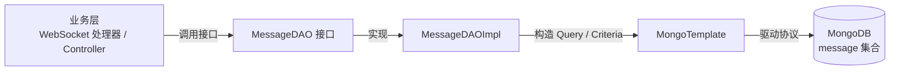

# 微聊数据层落地：MessageDAO 的接口设计与 MongoDB 实现

`Message`、`User` 实体就位之后，消息的读写还没有入口：两个人之间的聊天记录怎么查、未读状态怎么改、新消息怎么落库，这些动作都需要一个数据访问层来承载。这一节把 `MessageDAO` 的接口定义出来，再用 `spring-data-mongodb` 完整实现并用单元测试跑通。核心难点只有一个：点对点聊天记录是「A 发给 B」与「B 发给 A」两个方向的消息，要合成一条按时间正序排列的时间线。

## 先给结论

- DAO 层一共五个方法：分页查点对点聊天记录、按消息 id 查单条、更新消息状态、保存消息、按消息 id 删除。删除暂时用不到也保留，保证增删改查完整。
- 双向聊天记录的查询条件是「or 连接的两个 and」：`from.id = A 且 to.id = B`，或者 `from.id = B 且 to.id = A`。
- 分页用 `PageRequest.of`，page 从 0 起算，前端传来的页码要减 1；排序按发送时间正序，最早的消息在最上面，最新的永远在最下面。
- 查询条件与排序里的字段名走映射层，写属性名 `sendDate` 或文档键 `send_date` 都能识别，`@Field` 注解是两者之间的桥。
- 保存消息时补齐发送时间与未读状态；主键可以不设，MongoDB 会自动生成 `_id`，想统一风格就显式调 `ObjectId.get()`。

## 一、接口先行：五个方法各管一件事

数据访问层的惯例是先定接口再写实现，业务侧只依赖接口，实现换成什么都影响不到上层。在 im 模块里新建与 `pojo` 平级的 `dao` 包，写一个纯接口：

```java
package com.study.haoke.im.dao;

import com.study.haoke.im.pojo.Message;
import com.mongodb.client.result.DeleteResult;
import com.mongodb.client.result.UpdateResult;
import org.bson.types.ObjectId;

import java.util.List;

public interface MessageDAO {

    /**
     * 查询点对点聊天记录
     * @param fromId 发送者 id
     * @param toId   接收者 id
     * @param page   页码
     * @param rows   每页条数
     */
    List<Message> findListByFromAndTo(Long fromId, Long toId, Integer page, Integer rows);

    /**
     * 根据消息 id 查询消息
     */
    Message findMessageById(String id);

    /**
     * 更新消息状态，1 已发送未读，2 已读
     */
    UpdateResult updateMessageState(ObjectId id, Integer status);

    /**
     * 新增消息
     */
    Message saveMessage(Message message);

    /**
     * 根据消息 id 删除数据
     */
    DeleteResult deleteMessage(String id);
}
```

五个方法的语义逐个过一遍：

**第一，`findListByFromAndTo` 是整个 DAO 的灵魂。** 传入发送者 id 与接收者 id，把两人之间的双向聊天记录查出来。`page` 与 `rows` 做分页，和刷微信时往上拉历史消息是一个体验：一次只取一屏，不可能把几年的聊天记录一次性拉回内存。

**第二，`updateMessageState` 服务于已读未读机制。** 消息刚发出时状态是 1（已发送，即未读），对方看过之后改成 2（已读）。返回值用 `UpdateResult`，里面封装了匹配条数、修改条数这些执行结果，调用方能知道这次更新有没有命中。

**第三，`saveMessage` 与 `deleteMessage` 是增删的底线。** 新消息必须落库自不必说；按 id 删除的业务场景暂时没有，但一个完整的 DAO 应当增删改查齐全，所以一并声明。`DeleteResult` 同样封装了删除条数。

**第四，id 参数类型不一致是刻意的。** 查询与删除用 `String` 接收，更新状态用 `ObjectId`。`ObjectId` 是 MongoDB 默认的主键类型，`ObjectId.get()` 生成的对象转成字符串就是那串十六进制文本；而 Spring Data 做按 id 查询时会把 `String` 自动转换成 `@Id` 字段声明的目标类型，所以两种写法都能正确命中 `_id`。

方法定义好之后，一次调用背后的数据流长这样：



图里业务层只认识 `MessageDAO` 接口，`MongoTemplate` 的存在被隔离在实现类里。将来如果存储层要做读写分离或者换分片集群，动的只有 `MessageDAOImpl`。

## 二、核心实现：用 or 连接两个方向

实现类放在 `dao` 包下的 `impl` 子包，打上 `@Component` 交给 Spring 管理，注入 `MongoTemplate` 就能干活：

```java
package com.study.haoke.im.dao.impl;

import com.study.haoke.im.dao.MessageDAO;
import com.study.haoke.im.pojo.Message;
import org.springframework.beans.factory.annotation.Autowired;
import org.springframework.data.domain.PageRequest;
import org.springframework.data.domain.Sort;
import org.springframework.data.mongodb.core.MongoTemplate;
import org.springframework.data.mongodb.core.query.Criteria;
import org.springframework.data.mongodb.core.query.Query;
import org.springframework.stereotype.Component;

import java.util.List;

@Component
public class MessageDAOImpl implements MessageDAO {

    @Autowired
    private MongoTemplate mongoTemplate;

    @Override
    public List<Message> findListByFromAndTo(Long fromId, Long toId, Integer page, Integer rows) {
        // 条件一：用户 A 发给用户 B 的消息
        Criteria criteriaFrom = new Criteria().andOperator(
                Criteria.where("from.id").is(fromId),
                Criteria.where("to.id").is(toId));

        // 条件二：用户 B 发给用户 A 的消息
        Criteria criteriaTo = new Criteria().andOperator(
                Criteria.where("from.id").is(toId),
                Criteria.where("to.id").is(fromId));

        // 两个方向 or 在一起，才是一份完整的聊天记录
        Criteria criteria = new Criteria().orOperator(criteriaFrom, criteriaTo);

        // 分页：page 从 0 起算，页面传来的页码要减 1；按发送时间正序
        PageRequest pageRequest = PageRequest.of(page - 1, rows,
                Sort.by(Sort.Direction.ASC, "sendDate"));

        Query query = Query.query(criteria).with(pageRequest);
        return this.mongoTemplate.find(query, Message.class);
    }
}
```

几个容易出错的点值得逐个展开：

**嵌套字段的路径写法。** `Message` 里 `from` 和 `to` 是内嵌的用户子文档，查询条件要定位到子文档里的 `id`，路径就是 `from.id` 与 `to.id`。写成 `from_id` 是常见笔误，那是在找一个顶层不存在的键，结果永远是空。

**`Criteria` 与 `Query` 的包别导错。** 它们都出自 `org.springframework.data.mongodb.core.query` 包，IDE 补全时同名类不少，导成别的包轻则编译不过，重则行为诡异。类上那句「query 是 core 包下面的，别搞错」就是给这个坑提的醒。

**page 减 1 是硬性动作。** `PageRequest.of` 的第一个参数从 0 起算，0 代表第一页。前端习惯从 1 数起，不减 1 的话，请求第 1 页实际拿到第 2 页的数据，最后一页还会凭空多出一个空页，这类错在页面上表现得很隐晦。

**排序字段的两种写法等价。** `Sort.by(ASC, "sendDate")` 传的是 Java 属性名，映射层结合 `@Field("send_date")` 注解会把它翻译成文档键 `send_date` 再下发给 MongoDB；直接写 `send_date` 也能查。选属性名写法的好处是与实体保持一致，重构属性名时 IDE 能一并改到。

最终发到 MongoDB 的查询长这个形状：

```json
{
    "$or": [
        { "from.id": 1001, "to.id": 1002 },
        { "from.id": 1002, "to.id": 1001 }
    ]
}
```

外层 `$or` 里装两组条件，每组内部是 `$and` 语义，排序 `{"send_date": 1}` 正序，`limit` 取每页条数。把 `query` 对象打印出来核对结构，是验证条件拼装是否正确的最直接手段。

## 三、剩下四个方法：一行主逻辑加一点业务细节

**保存消息。** 主逻辑一行 `save`，前后各补一个业务默认值：

```java
@Override
public Message saveMessage(Message message) {
    // 发送时间以服务端为准，新消息一律未读
    message.setSendDate(new Date());
    message.setStatus(1);
    return this.mongoTemplate.save(message);
}
```

时间由服务端写入而不信任客户端，杜绝两端时钟不一致造成的时间线错乱；状态写 1，与「已发送即未读」的业务约定对齐。`id` 不设置也完全可以，MongoDB 会自动生成 `_id`；如果工程有统一要求，保存前调一次 `ObjectId.get()` 显式生成，两种做法结果一致。

**按 id 查单条。** `MongoTemplate` 直接提供了按主键查询的方法：

```java
@Override
public Message findMessageById(String id) {
    return this.mongoTemplate.findById(id, Message.class);
}
```

**更新状态。** 主逻辑之外有个联动的小逻辑必须记住：状态改回 1 时刷新发送时间，状态改成 2 时把读取时间记成当前时间，`read_date` 就是靠这里填上的：

```java
@Override
public UpdateResult updateMessageState(ObjectId id, Integer status) {
    Query query = Query.query(Criteria.where("id").is(id));
    Update update = Update.update("status", status);
    if (status.intValue() == 1) {
        // 未读：刷新发送时间
        update.set("send_date", new Date());
    } else if (status.intValue() == 2) {
        // 已读：记录读取时间
        update.set("read_date", new Date());
    }
    return this.mongoTemplate.updateFirst(query, update, Message.class);
}
```

**按 id 删除。** 构造条件后交给 `remove`：

```java
@Override
public DeleteResult deleteMessage(String id) {
    Query query = Query.query(Criteria.where("id").is(id));
    return this.mongoTemplate.remove(query, Message.class);
}
```

## 四、跑通验证：启动类、配置与单元测试

DAO 写完要能证明它对。先补上工程的启动类与配置文件：

```java
package com.study.haoke.im;

import org.springframework.boot.SpringApplication;
import org.springframework.boot.autoconfigure.SpringBootApplication;

@SpringBootApplication
public class ImApplication {

    public static void main(String[] args) {
        SpringApplication.run(ImApplication.class, args);
    }
}
```

```properties
spring.application.name=haoke-im
server.port=18081
spring.data.mongodb.uri=mongodb://172.16.55.185:27017/testdb
```

`spring.data.mongodb.uri` 是连接 MongoDB 的关键配置，没写它容器启动都过不去。再写两个测试方法，一个造数据、一个验证查询：

```java
@RunWith(SpringRunner.class)
@SpringBootTest
public class TestMessageDAO {

    @Autowired
    private MessageDAO messageDAO;

    @Test
    public void testSave() {
        Message message = Message.builder()
                .id(ObjectId.get())
                .msg("你好")
                .from(UserData.USER_MAP.get(1001L))
                .to(UserData.USER_MAP.get(1002L))
                .build();
        this.messageDAO.saveMessage(message);

        message = Message.builder()
                .id(ObjectId.get())
                .msg("你好")
                .from(UserData.USER_MAP.get(1002L))
                .to(UserData.USER_MAP.get(1001L))
                .build();
        this.messageDAO.saveMessage(message);

        message = Message.builder()
                .id(ObjectId.get())
                .msg("我正在学习开发 IM")
                .from(UserData.USER_MAP.get(1001L))
                .to(UserData.USER_MAP.get(1002L))
                .build();
        this.messageDAO.saveMessage(message);

        message = Message.builder()
                .id(ObjectId.get())
                .msg("很好啊，继续加油")
                .from(UserData.USER_MAP.get(1002L))
                .to(UserData.USER_MAP.get(1001L))
                .build();
        this.messageDAO.saveMessage(message);
    }

    @Test
    public void testQueryList() {
        List<Message> list = this.messageDAO.findListByFromAndTo(1001L, 1002L, 1, 10);
        for (Message message : list) {
            System.out.println(message);
        }
    }
}
```

`testSave` 模拟了一段真实对话：张三（1001）与李四（1002）你来我往共四条，两个方向都有，时间取自服务端。`testQueryList` 按 1001 与 1002 双向查询第一页拿 10 条，执行后控制台打出的正是那四条消息，而且顺序与发送顺序一致：两个方向的消息合进了一条正序时间线，说明 or 条件与排序都生效了。反过来把排序临时改成 `DESC` 再跑一遍，输出顺序整体颠倒，这也从侧面确认排序参数确实下传到了 MongoDB。

## 常见误区

- **page 忘了减 1。** `PageRequest.of` 从 0 起算，前端传 1 就得转成 0。不减会整体错位一页，且列表末尾多出一个空页，很难第一时间联想到分页参数。
- **嵌套字段写成 `from_id`。** `from` 是内嵌对象，路径必须写成 `from.id`。`from_id` 匹配的是顶层键，集合里根本不存在，查询永远返回空。
- **`Criteria`、`Query` 导错包。** 同名类分布在好几个包里，认准 `org.springframework.data.mongodb.core.query`。
- **改状态不联动时间。** 只把 `status` 从 1 改成 2 而不写 `read_date`，之后想统计「消息多久被读到」就没有数据可依。
- **把模拟用户当成了正式数据来源。** 测试里的用户来自上一节准备好的 `UserData` 静态表，真实场景用户信息来自登录态，接入时替换取数来源即可，DAO 层不用动。

## 面试可能被问到的问题

1. 面试官追问：「查两个人的聊天记录，查询条件怎么设计？」
   答：消息按单份存储，`from` 记发送者、`to` 记接收者，两个方向的对话都要取，所以条件是 `$or` 连接两组 `$and`：一组匹配 `from.id = A 且 to.id = B`，另一组匹配 `from.id = B 且 to.id = A`，再按发送时间正序排列合并成一条时间线。

2. 面试官追问：「`Query` 对象里除了条件还能装什么？」
   答：条件之外还能带分页与排序，通过 `with(PageRequest)` 附加，`PageRequest.of` 同时承载页码、条数和 `Sort`。生成 SQL 时这些会被翻译成 MongoDB 的 `limit`、`skip` 与 `sort`，一次 `find` 全部完成。

3. 面试官追问：「分页从 0 还是从 1 开始？怎么协调前端？」
   答：Spring Data 的 `PageRequest` 从 0 开始，前端习惯从 1 开始，服务端要做 `page - 1` 的转换。更稳妥的做法是接口层把这种约定封装掉，Controller 收页码、DAO 收偏移，避免每个调用点都记得减一。

4. 面试官追问：「保存消息时 id 不设置会怎样？」
   答：MongoDB 会自动为 `_id` 生成 `ObjectId`，功能上没有任何问题；显式调 `ObjectId.get()` 的价值在于统一生成时机，比如保存前就要用 id 做日志关联或幂等判断的场景，两类写法最终落库结果一致。

5. 面试官追问：「`UpdateResult` 和 `DeleteResult` 里有什么？」
   答：这是 MongoDB 驱动的操作结果对象，`UpdateResult` 记录匹配条数、修改条数与 upsert 的 id，`DeleteResult` 记录删除条数。拿它们能做结果校验，比如更新已读状态后发现修改条数为 0，就能识别出消息不存在或状态已经变过的并发情况。

6. 面试官追问：「为什么时间字段用 `@Field` 映射成下划线？」
   答：Java 侧遵循驼峰、存储侧遵循下划线是两套团队都能接受的规范，`@Field("send_date")` 把 `sendDate` 属性与文档键显式绑定，查询、排序时写属性名，映射层自动翻译，两侧各自保持规范又互不将就。

## 配套资料

- day08 资料包未收录源码：`materials/code/03/day08-MongoDB入门以及实现微聊即时通讯功能/` 目录存在，其解压清单 `_extracted.json` 记录解压文件数为 0
- 文中 `MessageDAO` 接口、`MessageDAOImpl` 实现、`ImApplication` 启动类、`TestMessageDAO` 测试与 `application.properties` 取自课程讲义画面（编写 MessageDAO、实现、测试小节）；工程与包名按中性命名重写为 `haoke-im` 与 `com.study.haoke.im`，测试对话文案与打印查询 JSON 为按本课写法补全
