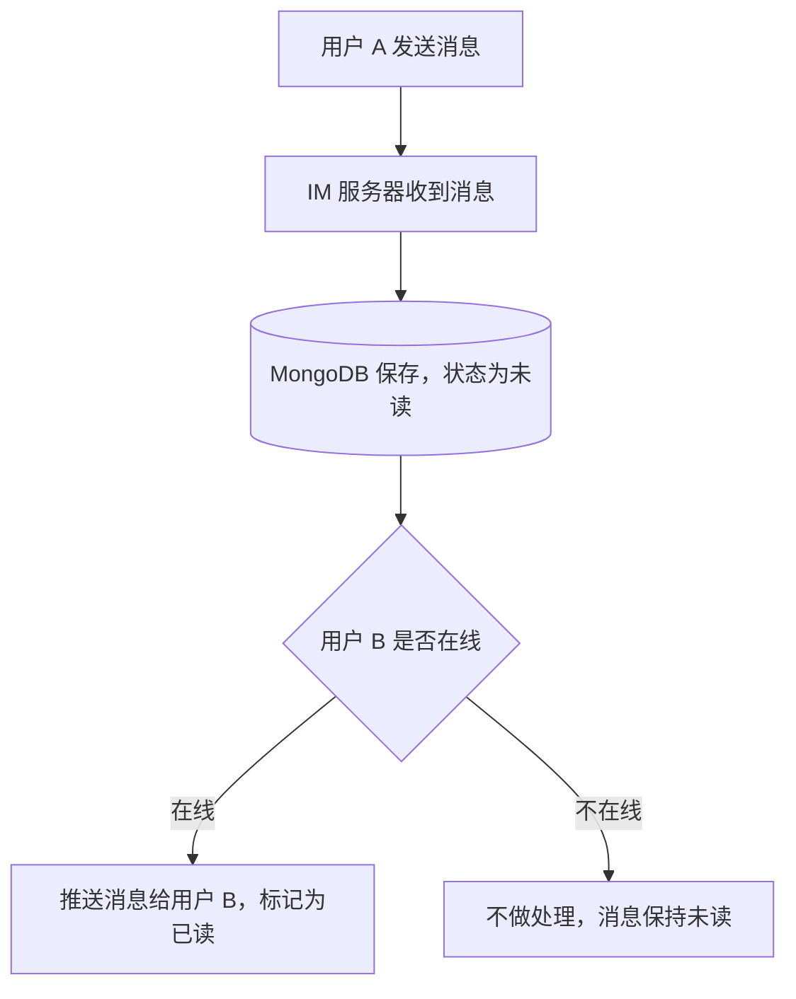
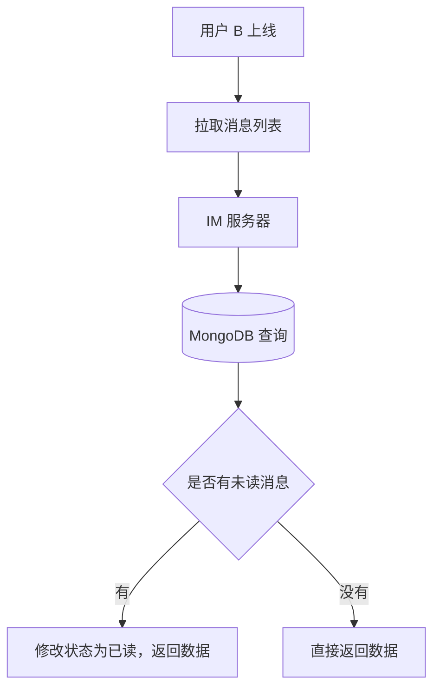
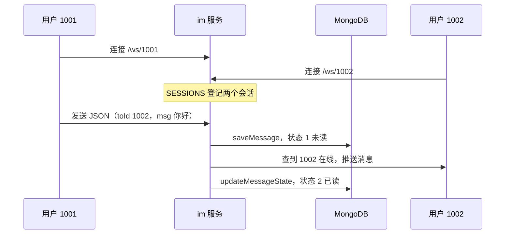

# WebSocket 消息收发闭环：上线登记、按在线状态转发与已读回执

消息的存与查在 DAO 层已经就绪，剩下的问题是实时性：A 发出的消息怎么在 B 的浏览器里立刻冒出来？答案是 WebSocket 通道加一张在线登记表。动键盘之前先把发送与接收两条流程画清楚，再照着流程落地四个部件：连接处理器、握手拦截器、消息处理逻辑、配置类。代码不多，但每一行都对应流程图上的一个节点。

## 先给结论

- 发送流程四步走：收到消息先落库并置为未读，再判断接收方是否在线，在线就推送并把状态改成已读，不在线则什么都不做。
- 消息永远先落库，在线与否只影响「要不要顺手推一把」，离线消息不需要任何额外的存储，这就是这套设计的精妙处。
- 判断在线的依据是一张静态的 `Map<Long, WebSocketSession>` 登记表，连接建立时放入，能查到就是在线。
- 用户的 uid 在握手拦截器里从连接地址 `ws://host:18081/ws/{uid}` 中解析出来，放进 `attributes`，处理器里再取回。
- 连接断开要把会话移出登记表，不然会把离线的人误判成在线，还会造成会话对象堆积。

## 一、两条流程：发送与接收各自怎么走

发送消息时，用户 A 把消息交给服务器，服务器的动作有明确的先后顺序：



图上最关键的分支是「用户 B 是否在线」：在线就推送并改成已读，不在线则直接结束。因为消息在此之前已经写进 MongoDB 且状态是未读，B 下次上线拉取时自然能看到，离线场景被「先落库」这一步天然兜住了。

接收侧是 B 上线后的动作：



两条流程合起来看，未读状态的迁移只有两处：推送成功后由发送链路改成已读，B 主动拉取历史时由查询链路改成已读。前者覆盖实时在线，后者覆盖上线补拉，配合起来已读语义才算完整。后面两节实现的服务正是照这两张图写的。

## 二、连接处理器：先把在线登记表建起来

WebSocket 的消息处理逻辑落在 `WebSocketHandler` 里。创建 `websocket` 包，写一个继承 `TextWebSocketHandler` 的处理器，并登记上线用户：

```java
package com.study.haoke.im.websocket;

import com.fasterxml.jackson.databind.ObjectMapper;
import com.study.haoke.im.dao.MessageDAO;
import org.springframework.beans.factory.annotation.Autowired;
import org.springframework.stereotype.Component;
import org.springframework.web.socket.WebSocketSession;
import org.springframework.web.socket.handler.TextWebSocketHandler;

import java.util.HashMap;
import java.util.Map;

@Component
public class MessageHandler extends TextWebSocketHandler {

    @Autowired
    private MessageDAO messageDAO;

    private static final ObjectMapper MAPPER = new ObjectMapper();

    /**
     * 在线用户的会话登记表：key 是用户 id，value 是该用户的连接会话
     */
    private static final Map<Long, WebSocketSession> SESSIONS = new HashMap<>();

    @Override
    public void afterConnectionEstablished(WebSocketSession session) throws Exception {
        Long uid = (Long) session.getAttributes().get("uid");
        // 将当前用户的 session 放置到 map 中，后面会使用相应的 session 通信
        SESSIONS.put(uid, session);
    }
}
```

这张 `SESSIONS` 表就是「是否在线」的数据来源：`static final` 保证整个应用共享一份，用户一连接就 `put` 进去，之后任何一次发送只需要 `SESSIONS.get(目标 uid)`，拿到非空对象就是在线。注意 `afterConnectionEstablished` 里暂时取不到 uid 的来源，这个悬念由下一节的拦截器解开。

## 三、握手拦截器：把 uid 从连接地址里拎出来

WebSocket 握手借道 HTTP，连接建立时并没有携带业务参数的地方。惯用做法是把参数编进连接地址，客户端这样连：

```text
ws://127.0.0.1:18081/ws/1001
```

路径最后一段就是用户 id。握手发生之前，`HandshakeInterceptor` 有机会对请求做检查与加工，uid 就在这里解析并塞进 `attributes`：

```java
package com.study.haoke.im.websocket;

import org.apache.commons.lang3.StringUtils;
import org.springframework.http.server.ServerHttpRequest;
import org.springframework.http.server.ServerHttpResponse;
import org.springframework.stereotype.Component;
import org.springframework.web.socket.WebSocketHandler;
import org.springframework.web.socket.server.HandshakeInterceptor;

import java.util.Map;

@Component
public class MessageHandshakeInterceptor implements HandshakeInterceptor {

    @Override
    public boolean beforeHandshake(ServerHttpRequest request, ServerHttpResponse response,
                                   WebSocketHandler wsHandler, Map<String, Object> attributes) {
        String path = request.getURI().getPath();
        // 按斜杠切分，期望得到 ws 与 uid 两段
        String[] ss = StringUtils.split(path, '/');
        if (ss.length != 2) {
            return false;
        }
        if (!StringUtils.isNumeric(ss[1])) {
            return false;
        }
        attributes.put("uid", Long.valueOf(ss[1]));
        return true;
    }

    @Override
    public void afterHandshake(ServerHttpRequest request, ServerHttpResponse response,
                               WebSocketHandler wsHandler, Exception exception) {
        // 无需处理
    }
}
```

拦截器返回 `false` 就是直接拒绝握手，连接建立不起来，所以它天然承担了入口校验的职责：路径段数不对、尾段不是数字，都过不去。校验是必要的，登记表的 key 是 `Long`，来了一个 `abc` 就会在类型转换时炸掉。通过校验的 uid 放进 `attributes`，这个 Map 会原样挂到随后创建的 `WebSocketSession` 上，处理器里 `session.getAttributes().get("uid")` 取到的正是它。

## 四、收发主干：handleTextMessage 按流程图写

客户端发来的消息约定为一段 JSON，包含目标用户与内容两个字段，比如 `{"toId": 1002, "msg": "你好"}`。处理器解析之后，严格沿着发送流程图的节点走：

```java
@Override
protected void handleTextMessage(WebSocketSession session, TextMessage textMessage) throws Exception {
    Long uid = (Long) session.getAttributes().get("uid");
    // 解析消息：目标用户与内容
    JsonNode jsonNode = MAPPER.readTree(textMessage.getPayload());
    Long toId = jsonNode.get("toId").asLong();
    String msg = jsonNode.get("msg").asText();

    // 组装消息对象，from 与 to 来自静态用户表
    Message message = Message.builder()
            .from(UserData.USER_MAP.get(uid))
            .to(UserData.USER_MAP.get(toId))
            .msg(msg)
            .build();

    // 第一步：将消息保存到 MongoDB，此时状态为未读
    message = this.messageDAO.saveMessage(message);

    // 第二步：判断接收方是否在线
    WebSocketSession toSession = SESSIONS.get(toId);
    if (toSession != null && toSession.isOpen()) {
        // TODO 具体推送格式需要和前端对接
        toSession.sendMessage(new TextMessage(MAPPER.writeValueAsString(message)));
        // 第三步：在线推送成功，更新消息状态为已读
        this.messageDAO.updateMessageState(message.getId(), 2);
    }
    // 不在线则到此为止，消息保持未读，等对方上线拉取
}
```

对照流程图读这段代码：`saveMessage` 对应「存 MongoDB 状态未读」，`SESSIONS.get(toId)` 对应菱形判断，`sendMessage` 与 `updateMessageState(id, 2)` 对应在线分支。几个细节值得点出：

**`toSession != null` 之外还要 `isOpen()`。** 会话对象还在登记表里不代表连接还活着，半途断开的连接可能尚未清理，`isOpen` 补上这层保险，条件不满足就当作不在线处理。

**推送内容是整个 `Message` 序列化成 JSON。** 前端最终要什么格式、字段怎么命名，需要与前端协商后再调整，代码里那句 TODO 注释留的就是这个口子。

**已读状态在推送成功后立刻写回。** 推送是异步世界里难得的同步确认点：`sendMessage` 没抛异常，就认为对方通道已收到，此时把状态置 2，`read_date` 也会在 DAO 里联动记录。

## 五、配置类与端口：把部件装到一起

处理器和拦截器都还是散件，需要 `WebSocketConfig` 注册并绑定：

```java
package com.study.haoke.im.config;

import org.springframework.context.annotation.Configuration;
import org.springframework.web.socket.config.annotation.EnableWebSocket;
import org.springframework.web.socket.config.annotation.WebSocketConfigurer;
import org.springframework.web.socket.config.annotation.WebSocketHandlerRegistry;
import org.springframework.beans.factory.annotation.Autowired;

@Configuration
@EnableWebSocket
public class WebSocketConfig implements WebSocketConfigurer {

    @Autowired
    private MessageHandler messageHandler;

    @Autowired
    private MessageHandshakeInterceptor messageHandshakeInterceptor;

    @Override
    public void registerWebSocketHandlers(WebSocketHandlerRegistry registry) {
        registry.addHandler(this.messageHandler, "/ws/**")
                .addInterceptors(this.messageHandshakeInterceptor)
                .setAllowedOrigins("*");
    }
}
```

`/ws/**` 对应客户端连接的 `ws://host:18081/ws/{uid}`，尾段通配才能让带 uid 的地址命中处理器；`setAllowedOrigins("*")` 放开跨域，方便前端页面调试。别忘了给服务一个独立端口，避免和主工程冲突：

```properties
spring.application.name=haoke-im
server.port=18081
spring.data.mongodb.uri=mongodb://172.16.55.185:27017/testdb
```

## 六、联调验证：两个客户端对发一轮

测试用两个 WebSocket 客户端工具分别扮演 1001 与 1002。两边先后点「开启连接」，调试断点里能看到：请求路径被切分成 `ws` 与 uid 两段，校验通过后各自把会话放进了 `SESSIONS`，登记表里有了两个条目。

1001 发送一条 JSON：

```json
{"toId": 1002, "msg": "你好"}
```

完整链路的时序如下：



断点逐行走完，1002 的客户端立刻弹出「你好」，数据库里这条消息的状态也从未读的 1 变成了 2。反向再发一条同样成功，双向链路都通。

更有价值的是不在线场景的验证：把 1002 的连接关掉，1001 再发「没事随便聊聊」，消息照常落库，但 `SESSIONS` 里查到的会话 `isOpen` 已是假，推送与改状态都不会执行，消息状态停在 1。这正暴露了一个需要收尾的问题：连接关闭后没有把会话移出登记表。补上连接关闭的回调即可（这是课程留给读者的完善点，实现如下）：

```java
@Override
public void afterConnectionClosed(WebSocketSession session, CloseStatus status) throws Exception {
    Long uid = (Long) session.getAttributes().get("uid");
    // 连接已断开，移出在线登记表
    SESSIONS.remove(uid);
}
```

补上之后，断开的用户会从登记表消失，后续消息对他一律按离线处理，等上线拉取，语义重新闭合。

## 常见误区

- **只判 `null` 不判 `isOpen`。** 会话对象残留不代表连接存活，漏了 `isOpen` 会把推送发向一个死通道，抛出 IO 异常还误把状态改成已读。
- **登记表用 `HashMap` 还随手并发写。** 课程演示可以接受，生产环境多个连接同时 `put`、`get` 有可见性与扩容风险，应换成 `ConcurrentHashMap`。
- **不写握手拦截器直接取 uid。** `getAttributes().get("uid")` 永远是 null，第一次发送就在拆箱处抛空指针。uid 的注入点只有一个，就是握手阶段。
- **连接断开不清理登记表。** 轻则把离线用户误判为在线、推送全部失败，重则会话对象越积越多，属于典型的内存泄漏。
- **把 uid 校验当可选项。** 登记表的 key 是 `Long`，不校验路径段是否数字，一个非数字请求就能让握手阶段抛类型转换异常，入口必须挡住。

## 面试可能被问到的问题

1. 面试官追问：「怎么判断一个用户在不在线？」
   答：以用户 id 为 key 维护一张全局的会话登记表，连接建立时把 `WebSocketSession` 放进去。判断在线就是按 id 取一次，取到且 `isOpen` 为真即在线。它适合单实例场景，多实例部署时登记表各自独立，需要引入 Redis 或消息中间件做跨节点的会话路由。

2. 面试官追问：「握手拦截器和消息处理器是怎么配合的？」
   答：拦截器在握手前执行，负责从连接地址解析业务参数并做入口校验，返回 false 可以直接拒绝连接；解析结果放进 `attributes`，这个 Map 会挂到之后创建的 `WebSocketSession` 上，处理器里通过 `getAttributes()` 取回。相当于把 HTTP 阶段的参数搬运进 WebSocket 会话。

3. 面试官追问：「离线消息这套设计是怎么支持的？」
   答：消息永远先落库且状态为未读，在线与否只决定要不要实时推送。不在线就不推送，用户上线后通过 REST 接口拉取历史，服务端把未读批量改成已读。不需要独立的离线消息存储，可靠性与数据库对齐。

4. 面试官追问：「已读状态在什么时机改？」
   答：两个时机。实时链路上，推送成功后立刻改为已读并记录读取时间；补拉链路上，用户上线拉取消息列表时，服务端把返回前的未读消息统一改为已读。两条链路分别覆盖在线与离线场景，避免状态长期滞留在 1。

5. 面试官追问：「WebSocket 连接建立的过程和 HTTP 有什么关系？」
   答：握手阶段就是一个特殊的 HTTP 请求，头里带 `Upgrade: websocket`，服务端同意后返回 101 状态码，协议从 HTTP 升级为 WebSocket，之后的通信复用这条 TCP 长连接。这也是握手拦截器能拿到 HTTP 请求对象的原因。

6. 面试官追问：「`TextWebSocketHandler` 为什么能直接收 JSON？」
   答：WebSocket 的文本帧本身就是字符串，`handleTextMessage` 拿到的是原始文本，配合 Jackson 的 `readTree` 解析成树模型再取字段。服务端回推时把对象序列化成 JSON 包进 `TextMessage`，两端用文本帧传递结构化数据是 IM 系统最常见的做法。

## 配套资料

- day08 资料包未收录源码：`materials/code/03/day08-MongoDB入门以及实现微聊即时通讯功能/` 目录存在，其解压清单 `_extracted.json` 记录解压文件数为 0
- 文中 `MessageHandler`、`MessageHandshakeInterceptor`、`WebSocketConfig` 代码取自课程讲义画面（WebSocket 实现小节）与视频画面抄录，流程图结构取自讲义 4.5 发送与接收消息流程小节；工程与包名按中性命名重写为 `haoke-im` 与 `com.study.haoke.im`，`afterConnectionClosed` 清理逻辑、联调消息文案为按本课写法补全
