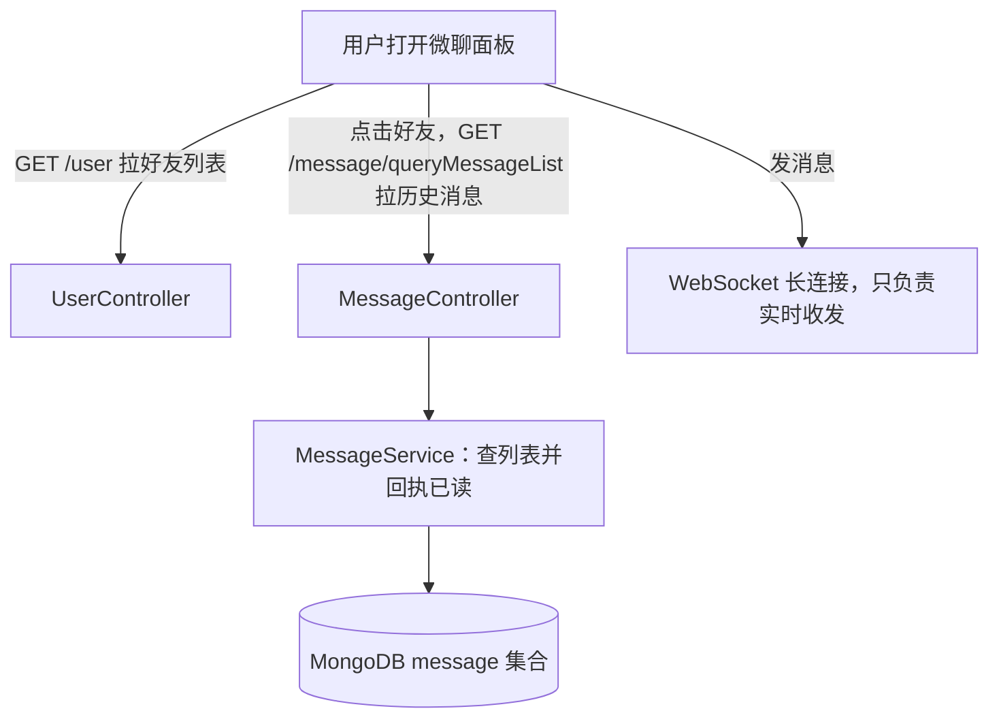

# 实现微聊系统之查询历史消息与好友列表的服务：RESTful 接口补全与头像地址排错

WebSocket 的收发链路跑通之后，前端微聊面板还差两块数据：打开微聊时展示的好友列表，点进某个好友后展示的历史聊天记录。这两块都不走 WebSocket，历史数据靠 RESTful 接口拉取，长连接只负责之后的实时收发。这一课把两个接口补齐，再顺手解决一个测试时暴露的小问题：用户头像的图片死活打不开。

## 先给结论

- 微聊面板的两个数据源都是 RESTful 接口：好友列表走 `GET /user`，历史消息走 `GET /message/queryMessageList`；WebSocket 连接只用于发送与实时推送消息，不承担拉取历史的职责。
- 查询历史消息时，Service 层顺手做已读回执：查出的列表里 `status` 为 1 的未读消息，逐条更新为已读状态 2，再原样返回列表。
- 分页参数 `page` 与 `rows` 服务端必须支持，缺省值 1 与 10；前端目前没做分页，但接口先把能力留好，后端补分页远比事后改造便宜。
- 好友列表是 mock 实现：用户数据来自 `UserData.USER_MAP` 静态 Map，头像与最近一条消息拼进返回结构，结构按前端抓包得到的字段对齐。
- 图片打不开的原因是整理代码格式时把 URL 里的一个 `/` 丢掉了，补回斜杠即可访问，图片本体早已上传到阿里云 OSS。

## 第1部分：实现微聊系统之实现查询历史消息与好友列表的服务

### 两个服务各自的职责

打开前端微聊面板，点开微聊入口出现的列表是好友列表，表达当前用户有哪些好友，需要一个提供用户列表的服务。点击任一好友进入会话，展示的是两人之间的聊天记录，需要一个查询历史消息的服务。用户进入会话时确实会与服务端建立 WebSocket 连接，但这条连接不是为了拉消息，而是为了之后发送消息，列表内容仍然要从 RESTful 接口拿。

两条数据通路分工明确：



### MessageController：查询历史消息的入口

Controller 只负责收参数。前端点开与某个好友的会话时传 `fromId` 与 `toId`，标识「我与好友」两个用户，再带上 `page` 与 `rows` 做分页：

```java
package com.study.haoke.im.controller;

import com.study.haoke.im.pojo.Message;
import com.study.haoke.im.service.MessageService;
import org.springframework.beans.factory.annotation.Autowired;
import org.springframework.web.bind.annotation.*;
import java.util.List;

@RestController
@RequestMapping("message")
@CrossOrigin
public class MessageController {

    @Autowired
    private MessageService messageService;

    // 查询历史消息
    @RequestMapping(value = "/queryMessageList")
    public List<Message> queryMessageList(@RequestParam("fromId") Long fromId,
                                          @RequestParam("toId") Long toId,
                                          @RequestParam(value = "page", defaultValue = "1") Integer page,
                                          @RequestParam(value = "rows", defaultValue = "10") Integer rows) {
        return this.messageService.queryMessageList(fromId, toId, page, rows);
    }
}
```

`page` 与 `rows` 都给了默认值：前端没有传时按第 1 页、每页 10 条处理。前端此刻还没实现分页，但服务端先把分页能力备好，之后前端做分页只是传参的事。

### MessageService：查询列表顺手做已读回执

业务逻辑集中在 Service，除查询外多了一步状态处理：拉到的消息列表里如果发现有未读的（`status` 为 1），要把它修改为已读状态 2。这个规则在前面设计消息结构时就定下了，此刻到了落地的地方：

```java
package com.study.haoke.im.service;

import com.study.haoke.im.dao.MessageDAO;
import com.study.haoke.im.pojo.Message;
import org.springframework.beans.factory.annotation.Autowired;
import org.springframework.stereotype.Service;
import java.util.List;

@Service
public class MessageService {

    @Autowired
    private MessageDAO messageDAO;

    public List<Message> queryMessageList(Long fromId, Long toId, Integer page, Integer rows) {
        List<Message> list = this.messageDAO.findListByFromAndTo(fromId, toId, page, rows);
        for (Message message : list) {
            if (message.getStatus().intValue() == 1) {
                // 将未读消息修改为已读状态
                this.messageDAO.updateMessageState(message.getId(), 2);
            }
        }
        return list;
    }
}
```

查询复用 `MessageDAO` 的 `findListByFromAndTo`，未读回执复用 `updateMessageState`，两个 DAO 方法都是之前定义过的，Service 层只是把它们串成一条业务流：先查，发现有未读就改成已读，没有就直接返回。

### UserController：模拟实现的好友列表

用户列表这一步仅做 mock，项目还没有真正的用户登录体系，先用静态数据顶上。目标返回结构取自前端请求抓包，一条用户数据长这样：

```json
{
    "id": 5,
    "from_user": 1,
    "to_user": 3,
    "chat_time": 1531045313395,
    "chat_msg": "12",
    "info_type": null,
    "username": "Spike",
    "avatar": "public/icon.png"
}
```

除了用户信息本身，好友列表里每个条目还要展示最近一条聊天消息。拉最近消息复用 `MessageService` 的查询能力，取每页 1 条：

```java
package com.study.haoke.im.controller;

import com.study.haoke.im.pojo.Message;
import com.study.haoke.im.pojo.User;
import com.study.haoke.im.pojo.UserData;
import com.study.haoke.im.service.MessageService;
import org.springframework.beans.factory.annotation.Autowired;
import org.springframework.web.bind.annotation.*;
import java.util.ArrayList;
import java.util.HashMap;
import java.util.List;
import java.util.Map;

@RestController
@CrossOrigin
@RequestMapping("user")
public class UserController {

    @Autowired
    private MessageService messageService;

    // 获取用户列表（模拟实现）
    @GetMapping
    public List<Map<String, Object>> queryUserList(@RequestParam("fromId") Long fromId) {
        List<Map<String, Object>> result = new ArrayList<>();
        for (Map.Entry<Long, User> userEntry : UserData.USER_MAP.entrySet()) {
            Map<String, Object> map = new HashMap<>();
            map.put("id", userEntry.getValue().getId());
            map.put("avatar", "http://haoke-image.oss-cn-qingdao.aliyuncs.com/images/2018/12/08/15442410962743524.jpg");
            map.put("from_user", fromId);
            map.put("info_type", null);
            map.put("to_user", map.get("id"));
            map.put("username", userEntry.getValue().getUsername());
            // 获取最后一条消息 TODO 没有获取最新消息，而是获取了最早的那个消息
            List<Message> messages = this.messageService.queryMessageList(fromId, userEntry.getValue().getId(), 1, 1);
            if (messages != null && !messages.isEmpty()) {
                Message message = messages.get(0);
                map.put("chat_msg", message.getMsg());
                map.put("chat_time", message.getSendDate().getTime());
            }
            result.add(map);
        }
        return result;
    }
}
```

这里有一处课程刻意留下的简化：按 `rows = 1` 查出来的其实是「最早的一条消息」而不是最新一条，代码里用 TODO 注释标明。真正取最新消息只需让 DAO 的查询按时间倒序取第一条，留作练习，思路已经给出。装数据的过程就是照抓包结构逐字段 `map.put`，头像地址统一指向已上传到阿里云 OSS 的一张图。

### 接口测试

重启服务后用 REST 客户端逐个验证。历史消息接口带上 `fromId` 与 `toId`，返回之前测试时发出的消息列表，「你好」「在的」「有什么事」「没事随便聊聊」，记录完整。用户列表接口传 `fromId = 1001`，五个模拟用户全部返回，`username`、`avatar`、最近一条消息的时间与内容都在结构里。两个服务到此提供完毕。

## 第2部分：实现微聊系统之实现查询历史消息与好友列表的服务（解决图片访问不了的问题）

### 一个斜杠引发的头像加载失败

测试用户列表接口时，点击返回数据里的头像地址，图片打不开。地址看着没毛病，域名是阿里云 OSS 的，路径也在。排查发现代码里的 URL 少了东西：整理从讲义拷贝过来的代码时，格式一调整，把地址里的一个 `/` 丢掉了，协议分隔符不完整，浏览器自然解析不出正确的主机名。

```text
丢失斜杠前（正确）：http://haoke-image.oss-cn-qingdao.aliyuncs.com/images/.../15442410962743524.jpg
丢失斜杠后（错误）：http:/haoke-image.oss-cn-qingdao.aliyuncs.com/images/.../15442410962743524.jpg
```

把横杠补回去，再访问，头像正常显示，图片本身早已上传到 OSS，链路本来就是通的。整个问题与后端逻辑无关，是纯代码搬运事故，但它暴露了一个真实痛点：URL 这类整体不可拆分的字面量，粘贴与格式化时最容易被悄悄破坏，报错又往往指向别处，排错成本远高于一个字符。

## 常见误区

- **以为 WebSocket 负责微聊的一切数据。** 长连接只承载实时收发，好友列表与历史消息这类「打开页面就需要」的数据走 RESTful 接口，两者的职责在动手前就要分清。
- **Controller 里写业务逻辑。** 查询、已读回执这些动作都在 Service 层完成，Controller 只做参数接收与默认值兜底；逻辑下沉之后，换协议（比如同样逻辑给 WebSocket 调用）时 Controller 层可以直接复用。
- **前端不做分页就不在服务端留分页参数。** 接口的分页能力要在服务端先立住，默认值保证不传也能工作；等前端要做分页时再改造接口，牵连的就不止一层了。
- **URL 排错只盯服务端。** 图片打不开不一定网络或权限有问题，先把 URL 原样贴进浏览器独立验证，协议分隔符、多余空格这类字面量损伤一眼就能看出来。

## 面试可能被问到的问题

1. 面试官追问：「即时通讯系统里，WebSocket 与 RESTful 接口怎么分工？」
   答：历史数据查询、列表展示这类请求响应式的读取走 RESTful，语义清晰、可缓存、易测试；实时推送与在线收发走 WebSocket 长连接。同一个页面两种协议并存，进页面先 RESTful 拉全量，建立连接后靠 WebSocket 增量。

2. 面试官追问：「已读回执为什么放在查询历史消息的 Service 里做，有没有问题？」
   答：好处是集中，拉过历史就把未读清掉，一次完成。但它把「查看」与「标记已读」两个动作耦合在查询里，查询接口因此有了写副作用，重复拉历史不会重复改状态（状态已是 2 就跳过），更严谨的做法是由客户端显式发已读确认再更新。

3. 面试官追问：「好友列表里要展示最近一条消息，接口该怎么设计？」
   答：可以在用户列表接口里顺带查询，本课就是复用消息查询按每页 1 条取；数据量大时更好的做法是给每个会话维护一条「最后一条消息」的冗余记录，列表页直接读，避免 N 个好友各发一次查询。

4. 面试官追问：「消息的未读、已读状态用数据库字段怎么设计？」
   答：用 `status` 区分，1 未读、2 已读，配合 `send_date` 与 `read_date` 两个时间字段。未读数统计按接收者加状态做计数，字段上建索引；更新已读时同时写入 `read_date`，审计与排序都有据可查。

5. 面试官追问：「用户体系没接入前，接口层怎么为将来留余地？」
   答：用户数据先用静态 Map 模拟，但接口的入参（如 `fromId`）、返回结构完全按真实形态设计；接入真实用户时只替换数据来源，上层结构与前端约定不动。mock 与正式实现的边界要划在数据获取这一点上。

## 配套资料

- day08 资料包未收录源码：`materials/code/03/day08-MongoDB入门以及实现微聊即时通讯功能/` 目录存在，其解压清单 `_extracted.json` 记录解压文件数为 0。
- 正文 `MessageController`、`MessageService`、`UserController` 代码取自课程讲义画面（包名沿用本阶段统一的中性命名 `com.study.haoke.im`）；讲义画面中 `queryUserList` 省略了 `result.add(map)` 一行，文中按可运行形式补全；头像 URL 的 OSS 桶名按中性命名改写，原始地址结构与路径保持课程原样。
