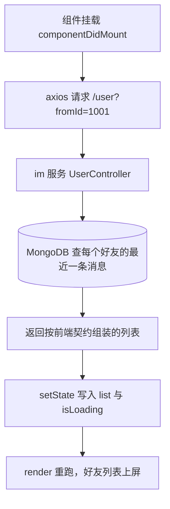

# 前端接入微聊服务：好友列表渲染与聊天记录拉取

后端两件套已经就绪：`/user` 出好友列表，`/message` 出点对点聊天记录。可前端页面里还是一套写死的假数据，点开微聊看到的名字、头像、预览消息全是摆设。这一篇把 React 页面接到真实接口上：列表页挂载就拉好友，点进某个好友再拉两人之间的历史消息，自己发的消息靠右、对方发的靠左。联调过程中还有两个极具代表性的现场：改完代码忘了重启服务，以及从文档拷代码丢了斜杠和连字符。

## 先给结论

- 好友列表在 `chat.js` 里拉：组件挂载后用 axios 请求 `GET /user?fromId=`，返回值写进 `state`，React 的数据驱动渲染接管剩下的活。
- 聊天记录在 `chat-window.js` 里拉：窗口组件挂载时按 `to_user`、`from_user` 请求历史消息，渲染成时间线。
- 消息归属靠一条比较：`currentUser === item.from.id` 成立的靠右，否则靠左，两个样式类对应两种气泡。
- 联调阶段 `fromId` 先写死 1001，等登录打通后再从登录态取，先把数据链路跑通。
- 两个现场坑：改完代码不重启服务，接口行为像「没生效」；从文档拷代码丢了斜杠与连字符，URL 和样式类名双双失效。

## 一、好友列表：把假数据换成真接口

聊天页的数据请求原本写在 `chat.js` 的组件里，内容是造好的静态数组。改造就是把静态来源换成接口调用，落在 React 组件挂载完成的生命周期里：

```javascript
componentDidMount = () => {
    // 联调阶段先写死当前用户 id，接入登录后换成登录态
    axios.get('http://127.0.0.1:18081/user?fromId=1001').then((data) => {
        this.setState({
            list: data,
            isLoading: true
        })
    })
}
```

请求打向后端上一篇写好的好友列表接口，参数 `fromId` 标记「以谁的视角看列表」。返回值是按前端契约组装的数组，每一项带 `id`、`username`、`avatar`、`from_user`、`to_user`、`chat_msg`、`chat_time`。渲染部分按这几个字段取值：

```javascript
if (this.state.isLoading) {
    list = this.state.list.map(item => {
        return (
            <div key={item.id} onClick={(e) => this.toChat(e, item)}>
                
                <span className="name">{item.username}</span>
                <span className="info">{item.chat_msg}</span>
                <span className="time">{item.chat_time}</span>
            </div>
        )
    })
}
```

每一项就是一张好友卡片：头像、昵称、最近一条消息的预览、时间。`key` 用 `item.id` 保证列表复用稳定，`onClick` 绑定 `toChat`，点击卡片就带着这个好友的信息打开聊天窗口。数据从请求到上屏的路径一图看完：



图里真正干活的是 setState 那一步：React 不做 DOM 操作，`state` 一变 `render` 重跑，页面跟着数据走。前端代码里没有一处「把数据塞进页面」的命令式语句，这正是它好维护的原因。

## 二、点进好友：窗口挂载即拉历史消息

点击好友卡片触发 `toChat`，它把当前好友的信息放进聊天窗口组件的 `props`，窗口组件挂载后立刻按两人的 id 拉历史消息：

```javascript
componentDidMount = () => {
    let {to_user, from_user} = this.props.chatInfo;
    axios.get('http://127.0.0.1:18081/message', {params: {
        toId: to_user,
        fromId: from_user
    }}).then(data => {
        this.setState({
            infos: data,
            isLoading: true
        })
    })
}
```

参数是一对 id：`fromId` 是当前用户，`toId` 是聊天的对象，后端拿这两个条件去 MongoDB 里查点对点记录，分页参数沿用接口默认值。这里有个路径细节值得点出：后端定义的映射是 `/message/queryMessageList`，前端代码里调用的是 `/message`，联调时把两边对齐即可，改 Controller 的映射或改前端地址都行，能力是同一个 Service 方法。窗口的结构分三段：

```javascript
return (
    <div className="chat-window">
        <div className="chat-window-title">
            <Icon onClick={this.props.hideChat} name='angle left' className='chat-ret-btn' size='large'/>
            <span>{username}</span>
        </div>
        <div className="chat-window-content">
            <ul>{infolist}</ul>
        </div>
        <div className="chat-window-input">
            <Form>
                <TextArea value={this.state.msgContent} onChange={this.handleMsgChange} placeholder="请输入"/>
                <Button onClick={this.hideChat}>关闭</Button>
                <Button primary onClick={this.sendMsg}>发送</Button>
            </Form>
        </div>
    </div>
)
```

标题栏放返回图标与对方昵称，中间的 `ul` 由历史消息列表填满，底部是输入区，`TextArea` 的值绑定在 `state.msgContent` 上，输入变化由 `handleMsgChange` 同步回状态。发送按钮挂的 `sendMsg` 方法是下一篇的主角。

## 三、左右分栏：消息归属的判断

历史消息里有自己发的也有对方发的，聊天界面的惯例是自己靠右、对方靠左。判断依据是消息里嵌套的发送者 id 与当前用户 id 的比较：

```javascript
let currentUser = parseInt(this.state.fromId, 10);
infolist = this.state.infos.map(item => {
    return (
        <li key={item.id}
            className={currentUser === item.from.id ? 'chat-info-right' : 'chat-info-left'}>
            <span>{item.msg}</span>
        </li>
    )
})
```

`currentUser` 来自当前登录用户（联调阶段就是写死的 `fromId`），`item.from.id` 是每条消息的发送者。相等就是自己发的，挂 `chat-info-right` 靠右显示；不等就是对方发的，挂 `chat-info-left`。头像与昵称按消息里嵌套的 `from`、`to` 用户对象取，不用再发请求。

这里有一个本次联调踩出来的低级但高频的坑：样式怎么调都不对，气泡全部堆在一边。排查下来不是判断逻辑错，而是从文档拷代码时把样式类名里的连字符挤掉了，`chat-info-right` 变成了 `chat-inforight`，CSS 选择器对不上，样式自然失效。上一篇丢的是 URL 里的斜杠，这一篇丢的是类名里的连字符，根因相同：拷贝代码后分隔符最容易被误伤。

## 四、联调验证

改造完成后有个小插曲：刷新页面数据还是不出来，一度以为代码有问题，实际是修改代码之后忘了重启服务。内嵌 Tomcat 是常驻进程，改的是磁盘上的字节码，跑的还是旧的那一份，重启服务后好友列表立刻正常，头像也显示出来了（斜杠问题上一篇已修复）。

点击好友列表里的李四，开发者工具的 Network 面板里能看到这次请求：

```http
Request URL: http://127.0.0.1:18081/message?fromId=1001&toId=1002
Request Method: GET
Status Code: 200
```

返回的是两人此前对发的全部记录：你好、您也好、我在学习、很好、在的、有什么事、没事随便聊聊。渲染出来后，张三发的消息全部靠右，李四的靠左，与真实聊天软件的观感一致。至此好友列表与历史消息两条链路都在页面上活了过来，剩下的实时收发在下一篇接通。

## 常见误区

- **改完代码不重启服务。** 内嵌容器是常驻进程，接口行为永远对应当前运行的那份代码。前端「怎么刷新都没变化」时，先确认后端重启过没有，再查别处。
- **拷贝代码丢分隔符。** URL 少一根斜杠会直接解析失败，样式类名少一个连字符会让整条规则失效。从文档或网页拷代码后，先核对分隔符再联调。
- **把列表请求塞进 WebSocket 通道。** 好友列表与历史消息都是一次查询一份结果的请求响应模式，走 HTTP 语义清晰；长连接留给实时推送，两种通道各干各的。
- **归属判断拿用户名比较。** 用户名可重复也可修改，`id` 才是稳定唯一标识。用字符串名字判断消息归属，遇到重名用户气泡就分错边。

## 面试可能被问到的问题

1. 面试官追问：「数据请求为什么放在 componentDidMount 里，而不是 constructor？」
   答：constructor 只负责初始化 state 与绑定方法，此时组件尚未挂载；componentDidMount 在首次渲染完成后触发，适合发异步请求，请求回来再 setState 触发二次渲染。请求放构造器里既拿不到挂载后的上下文，也会把初始化和副作用搅在一起。

2. 面试官追问：「React 里 setState 之后发生了什么？」
   答：setState 先把改动合并进 state，然后标记组件为脏组件，React 重新执行 render 生成新的虚拟 DOM，与旧的做 diff，把差异部分更新到真实 DOM。页面不是被命令式改出来的，而是状态变化后重新算出来的。

3. 面试官追问：「前后端分离联调，跨域问题一般怎么解决？」
   答：浏览器同源策略会拦下不同端口的请求，服务端放行是根本解法，Spring 里在 Controller 加 @CrossOrigin 或做全局 CORS 配置；开发期也可以在前端工程配代理，让请求同源转发。两者不冲突，生产环境常用网关统一处理。

4. 面试官追问：「列表渲染的 key 有什么用，能不能用数组下标？」
   答：key 是 React 做 diff 时识别元素的依据，稳定的 key 能让列表更新时正确复用节点、保留状态。用数组下标在插入、删除时会引发错位复用，可能出现输入框内容串行、动画错乱等问题，优先用业务唯一 id。

5. 面试官追问：「联调时说『接口没生效』，你的排查顺序是什么？」
   答：先看 Network 面板确认请求真的发出去了、地址和参数对不对；再看服务端是不是改完没重启、跑的还是旧代码；然后核对响应内容与前端取值路径是否一致。顺序是从现象往两端靠，不凭感觉改代码。

## 配套资料

- day08 资料包未收录源码：`materials/code/03/day08-MongoDB入门以及实现微聊即时通讯功能/` 目录存在，其解压清单 `_extracted.json` 记录解压文件数为 0
- 文中 `chat.js`、`chat-window.js` 的挂载请求与渲染代码取自课程视频画面抄录（讲义 5.1 查询好友列表、5.2 好友单聊小节）；接口字段按第 145 篇 `/user`、`/message` 的契约对齐，消息归属判断中头像与昵称的取值、样式类名修复说明为按本课写法补全
