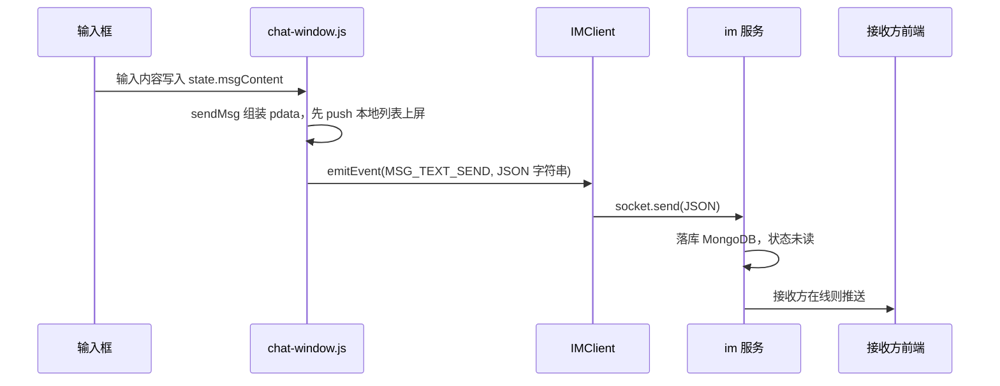

# 微聊实时收发打通：前端发送链路与 onmessage 接收链路

好友列表和聊天记录已经上了页面，但真正的聊天还没开始：输入框里敲一行字点发送，对面毫无反应。问题出在前端封装与后端约定的错位上：前端这套 IM 封装会先把消息包一层再发，还会在连接建立后多发一步「注册身份」，连接地址又是写死的，不带用户标识。这一篇把发送与接收两条实时链路接通，顺带拆掉三处错位，中间踩到的坑每一个都有普遍性。

## 先给结论

- 发送链路两步走：`sendMsg` 组装消息体，先本地 `push` 进消息列表立刻上屏，再交给长连接发给服务端。
- 服务端 `handleTextMessage` 按裸 JSON 解析 `toId` 与 `msg` 两个字段，前端封装里多出来的 DataPacket 包装层必须拆掉，否则服务端取不到值。
- 连接地址要带 uid：`common.js` 里的 `wsBaseUrl` 去掉写死的尾段，建立连接时拼成 `ws://host:18081/{uid}`，服务端握手拦截器靠尾段识别身份。
- 连接建立后不需要再发「注册身份」报文，连接路径本身就是身份，注册逻辑整段注释。
- 接收链路是一条回调：把页面处理函数传进 IMClient 构造器，`socket.onmessage` 收到数据原样回调，页面 `setState` 后消息立刻上屏。
- 推送报文解析直接 `JSON.parse(data)`，不要再取 `data.content`，服务端推的就是消息本身，没有再包一层。

## 一、发送消息：本地先渲染，再交给长连接

聊天窗口底部的发送按钮挂着 `sendMsg` 方法，它的职责分两半，一半是渲染，一半是传输：

```javascript
sendMsg = () => {
    let {to_user, from_user, avatar} = this.props.chatInfo;
    // toId 与 msg 是服务端约定的字段，其余字段供本地渲染使用
    let pdata = {
        id: this.guid(),
        from_user: from_user,
        to_user: to_user,
        avatar: avatar,
        chat_msg: this.state.msgContent,
        toId: to_user,
        msg: this.state.msgContent
    };
    let newList = [...this.state.infos];
    newList.push(pdata);
    this.setState({
        infos: newList
    });
    this.state.client.emitEvent(IMEvent.MSG_TEXT_SEND, JSON.stringify(pdata));
}
```

`guid` 用随机数拼出消息的唯一 id，保证本地渲染的 `key` 稳定。先 `push` 再发送是有讲究的：服务端收到消息后只会推给接收方，不会回显给发送方，发送方要看到自己的消息，只能靠自己本地先渲染。这种不等响应就先更新界面的做法叫乐观渲染，代价是万一发送失败需要本地补救，收益是零延迟的输入反馈。整条发送链路的走向如下：



## 二、拆掉多余的包装：服务端要的是裸 JSON

`emitEvent` 触发的事件由 IMClient 里的监听器接住，原始写法在发送前还要做一次包装：

```javascript
client.addEventListener(IMEvent.MSG_TEXT_SEND, data => {
    let dataPacket = new DataPacket({
        type: IMEvent.MSG_TEXT_SEND,
        content: data
    });
    client.sendDataPacket(dataPacket)
});
```

`DataPacket` 是这套封装自己定义的信封结构，消息被塞进 `content` 再整体发送。可服务端那边 `handleTextMessage` 拿到文本后是直接 `readTree` 解析的，它要的第一层字段就是 `toId` 和 `msg`，多出来的信封会让解析直接落空。这套封装是为通用消息协议设计的，本课的服务端用不上，处理方式是把包装注释掉，让监听器把 JSON 字符串原样交给底层 socket（示例按本课写法补全）：

```javascript
client.addEventListener(IMEvent.MSG_TEXT_SEND, data => {
    // 原逻辑会先 new DataPacket 包装，服务端要的是裸 JSON，直接发送
    this._socket.send(data);
});
```

同理，封装在连接建立后还会发一条「注册身份」报文，类型是 `USER_REG`，意图是把当前用户名告诉服务端。而本课的服务端从握手阶段就知道你是谁：连接地址尾段就是 uid，握手拦截器解析后挂在会话的 `attributes` 上。身份已经在握手里定了，注册报文纯属多余，整段注释：

```javascript
// 连接路径已带 uid，服务端握手时已识别身份，注册步骤不需要
// client.addEventListener(IMEvent.CONNECTED, () => {
//     let dataPacket = new DataPacket({
//         type: IMEvent.USER_REG,
//         content: currentUser
//     });
//     client.sendDataPacket(dataPacket)
// });
```

拆包装这一步的教训值得记住：通用封装与具体服务端对接时，第一件事是对齐报文契约，封装自带的层级结构不是服务端的义务。

## 三、连接地址：把 uid 编进路径

前端工程的全局地址配置在 `common.js` 里，其中 `wsBaseUrl` 是 WebSocket 地址。原始值把整条地址写死，改成只留主机与端口，尾段留空：

```javascript
export default {
    imgBaseUrl: 'http://127.0.0.1:8086/',
    apiBaseUrl: 'http://127.0.0.1:8086/',
    wsBaseUrl: 'ws://127.0.0.1:18081'
};
```

尾段在建立连接时按当前用户拼上去。组装连接的逻辑在 `wsmain.js` 的 `handle` 函数里，它同时把页面回调传进了构造器：

```javascript
const handle = (currentUser, handleMsg) => {
    const client = new IMClient(config.wsBaseUrl + "/" + currentUser, handleMsg);
    // 发送消息
    client.addEventListener(IMEvent.MSG_TEXT_SEND, data => {
        client.sendDataPacket(data)
    });
};
```

最终连出的地址形如 `ws://127.0.0.1:18081/1001`。这正是后端 `MessageHandshakeInterceptor` 期待的形状：握手前按斜杠切分路径，校验段数与数字格式，把尾段 uid 塞进 `attributes`，处理器里 `session.getAttributes().get("uid")` 取到的就是它。前后端在这里完成了一次无声的握手约定：不靠请求头、不靠额外报文，靠路径本身。

页面侧的调用在 `chat-window.js` 挂载时完成，拿到历史消息的同时建立连接：

```javascript
this.setState({
    infos: data,
    isLoading: true,
    fromId: from_user,
    client: handle(from_user, (data) => {
        let newList = [...this.state.infos];
        newList.push(JSON.parse(data));
        this.setState({
            infos: newList
        })
    })
});
```

## 四、接收消息：一个回调从页面一路传到 socket

接收侧的改造思路是把「收到数据干什么」决定权交还给页面。IMClient 构造器多收一个参数，把它存成实例属性：

```javascript
constructor(url, onMyMessage) {
    this._url = url;
    this._autoConnect = true;
    this._handlers = {};
    this._DataPacketQueue = [];
    this._isOpened = false;
    this._onMyMessage = onMyMessage;
    // 连接与断开的生命周期监听保持不变
    this.addEventListener(IMEvent.CONNECTED, () => {
        this.serverOnConnected();
    })
    this.addEventListener(IMEvent.DISCONNECTED, () => {
        this.serverOnDisconnected();
    })
}
```

连接建立后，原生的 `onmessage` 是所有数据的唯一入口，在这里把数据分发给外部回调：

```javascript
connect() {
    if (!this._socket) {
        this._socket = new WebSocket(this._url);
        this._socket.onmessage = (evt) => {
            this.onMessage(evt.data);
            // 外部传入的回调：页面把收到的消息塞进 state
            if (this._onMyMessage) {
                this._onMyMessage(evt.data);
            }
        }
        this._socket.onopen = (ws) => {
            this.onOpen(ws);
        }
        this._socket.onclose = ws => {
            this.onClose(ws);
        }
    }
}
```

数据流就一条直线：服务端推送 → `onmessage` → `_onMyMessage` → 页面回调里 `push` 进 `infos` → `setState` → 消息上屏。中间有一处解析小坑：回调最初写成 `JSON.parse(data.content)`，联调时报错，排查发现服务端推的就是消息本身，`data` 已经是 JSON 字符串，没有 `content` 这一层，直接 `JSON.parse(data)` 即可。又是「多包的一层」，与发送侧的 DataPacket 遥相呼应。

## 五、联调实录：发出去、存下来、推到位

先用 1001 登录页面点开与李四的聊天窗口，输入 hello 点击发送。服务端断点里能看到报文到达，MongoDB 里多了这条消息，历史消息接口也能查到它，说明「发送加落库」这条链路是通的。但接收方没有动静：1002 的 WebSocket 调试工具里什么都没出现。

原因不在代码，在连接的生命周期：此前服务重启过一次，测试工具里 1002 的连接早已随服务关闭而死，服务端推消息时查登记表，那个会话的 `isOpen` 已经是假，推送被跳过。重新点「开启连接」后再发一条，1002 立刻收到。这个现象的普适结论是：WebSocket 连接是脆弱资源，服务重启、网络抖动都会掐断它，客户端必须感知断线并重连，否则推送静默丢失。

修好连接后做双向对发：1002 发「我是李四」，1001 立刻收到并靠右显示；1001 回「当然记得，老朋友」，1002 同样秒收。关掉窗口再点开李四，历史消息里两条新记录都在，实时与落库两条线闭合。

## 常见误区

- **迷信通用封装自带的结构。** DataPacket 包装、注册身份报文都是封装的设计，不是服务端的契约。对接前先看服务端解析代码认哪些字段，多包一层就是解析失败。
- **连接地址写死不带 uid。** 尾段缺了或不是数字，握手拦截器直接返回 false，连接建立不起来，报错信息往往只有一句连接失败，很难想到是地址的问题。
- **以为服务重启不影响已建立的连接。** 连接绑定在服务进程上，进程重启连接全灭。客户端要有断线感知与重连机制，不然推送丢了连报错都没有。
- **解析推送时多取一层。** 契约里推的就是消息对象本身，取 `data.content` 得到 undefined，push 进列表后渲染一片空白。解析前先 `console.log` 看真实形状。
- **忘了服务端不回显。** 等着服务端把消息推回来给自己，界面就永远少自己发的消息。发送方本地先 push，这是 IM 前端的固定动作。

## 面试可能被问到的问题

1. 面试官追问：「WebSocket 前后端的报文格式怎么约定的？」
   答：WebSocket 本身只保证传字节流与文本帧，应用层格式由两端约定。常见做法是定一份 JSON 契约，明确字段名与含义，服务端按契约解析，前端按契约组装。约定一旦定下，两端各自实现，联调时只对字段对不对，不猜格式。

2. 面试官追问：「乐观渲染是什么，什么场景适用？」
   答：不等服务端确认就先按「一定会成功」更新界面。IM 发消息是典型场景：服务端不回显，本地先渲染才有即时反馈。适用前提是失败率低且有补救手段，比如失败后标红重发；对资金扣减这类强一致操作就不能乐观。

3. 面试官追问：「把页面回调传进构造器和挂事件监听器，两种设计怎么选？」
   答：构造器回调适合「只有一个消费者、消息统一处理」的场景，链路直观，好调试；事件监听适合多个模块关心不同事件类型的场景，解耦更彻底。本课接收链路用回调是因为页面只有一个消费者，发送链路保留事件机制是因为事件类型多。

4. 面试官追问：「连接路径里带 uid 有什么安全隐患？」
   答：知道别人的 uid 就能冒充对方建立连接，等于身份认证形同虚设。生产环境应把认证凭证放进握手请求，比如 URL 参数或首包带 token，握手拦截器里校验通过才把 uid 写进 attributes，让「路径上的 uid」变成「验证过的 uid」。

5. 面试官追问：「WebSocket 断线重连一般怎么做？」
   答：在 onclose 里触发重连，通常配合指数退避避免服务端恢复瞬间被连接风暴打垮，重连成功后重新登记身份并补拉离线期间的未读消息。心跳是配套手段：定时发探测帧，及时感知半开连接，别等发消息失败才发现断了。

6. 面试官追问：「这套前端为什么要在页面 state 里存 client 实例？」
   答：把连接实例挂进组件状态，生命周期就跟着页面走：进聊天窗口建立连接，离开销毁或复用，不会在整站范围遗留无用连接。代价是 React 对非渲染数据放进 state 并不推荐，工程里更常见的做法是放进模块级变量或 context，用生命周期钩子管理连接。

## 配套资料

- day08 资料包未收录源码：`materials/code/03/day08-MongoDB入门以及实现微聊即时通讯功能/` 目录存在，其解压清单 `_extracted.json` 记录解压文件数为 0；课程提供的前端修改后代码未随资料包收录
- 文中 `sendMsg`、`wsmain.js` 的 `handle`、`IMClient` 构造器与 `connect` 代码取自课程视频画面抄录（讲义 5.3 发送消息小节与接收消息改造过程）；发送报文字段按服务端 `handleTextMessage` 解析契约对齐，拆包装后的发送代码、联调消息文案为按本课写法补全
