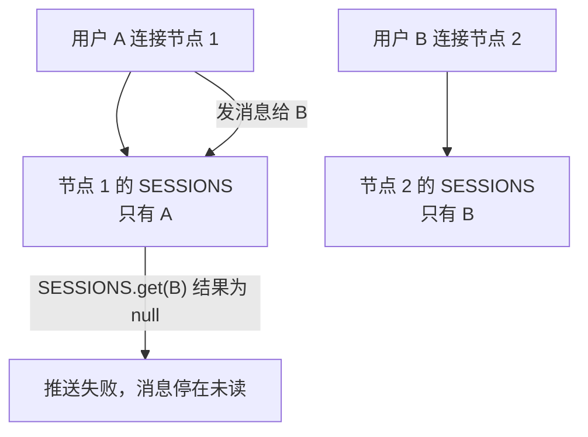
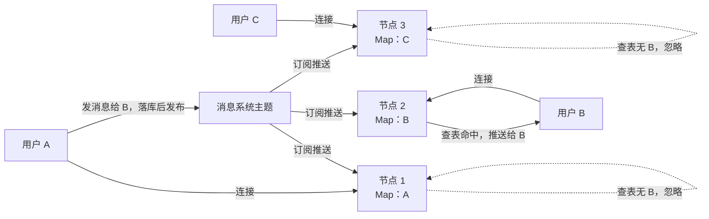

# 分布式 WebSocket 方案分析：Session 出不了进程怎么办

先还一笔测试时欠下的小账：点开与李四的聊天窗口，记录只回来十条，这不是数据丢了，是接口的 `rows` 参数有默认值 10，前端又没传分页参数。把默认值调大或者让前端支持分页都能解决，属于一句话的事。真正的主角是单机跑通之后的下一道坎：服务一旦部署成两个实例，实时推送就断了。这一篇只分析方案不动手，落地在学完消息中间件之后的课程里完成。

## 先给结论

- 单机版的在线登记表是进程内的 `static Map`，多实例部署时每个节点各有一份，A 连在节点 1，节点 2 查不到 B，推送在代码上就断掉。
- `WebSocketSession` 是活的连接端点，持有底层 socket 与流，无法序列化，「把 Map 挪进 Redis 共享」这条路走不通。
- 可行的方向是消息系统：每个节点订阅同一个主题，客户端消息发布上去，各节点收到后各查各的登记表，有会话就推，没有就忽略。
- 粘性会话能缓解但不能根治，节点宕机、扩缩容、重连都会打乱绑定关系。
- 消息永远先落库的原则不受部署形态影响，分布式方案只解决「推」，不解决「存」。

## 一、问题重演：进程内的登记表出不了门

回顾单机版在线判断的实现，核心就是一张挂在处理器上的静态登记表：

```java
@Component
public class MessageHandler extends TextWebSocketHandler {

    private static final Map<Long, WebSocketSession> SESSIONS = new HashMap<>();

    @Override
    public void afterConnectionEstablished(WebSocketSession session) throws Exception {
        Long uid = (Long) session.getAttributes().get("uid");
        // 将当前用户的 session 放置到 map 中，后面会使用相应的 session 通信
        SESSIONS.put(uid, session);
    }
}
```

`static` 保证整个进程共享一份，连接建立就登记，发送时按目标 uid 一查，拿到非空且 `isOpen` 的会话就推。这个设计在单进程里天衣无缝，坏就坏在它只属于这一个进程。部署成两个实例后，负载均衡把用户随机分到两个节点，问题立刻出现：



A 发给 B 的消息到达节点 1，节点 1 的登记表里没有 B，因为 B 的连接挂在节点 2 上。消息本身不会丢，落库与未读状态都在，B 上线拉历史也能看到，但「实时」没了，IM 退化成留言板。

## 二、为什么 Session 不能塞进 Redis

直觉上这是个存储共享问题：Map 放不进另一个进程，那就放进所有进程都能看到的 Redis，各节点都去 Redis 里取会话。思路顺，结论错，错的根本处在于混淆了两种东西：数据与端点。

`WebSocketSession` 是一次 TCP 长连接在服务端的代表，它内部持有底层 socket、输入输出流、缓冲区，这些资源与「接收这条连接的那台机器」物理绑定。序列化能搬走的是对象的字段快照，搬到节点 2 之后你得到的是一堆数据残影，背后的连接还在节点 1 的进程里活着，节点 2 拿着一个反序列化出来的空壳调用 `sendMessage`，只会得到异常。换句话说，能序列化的都不重要，重要的都序列化不了。

Redis 适合存的是可再生的状态元数据，比如「uid 1001 在线，挂在节点 1」这样的路由信息，节点挂了重写一份就是。而连接本身不是状态，是资源，资源的归属随网络连接而定，共享不了。这也是很多分布式组件的通用判据：能搬的是描述，搬不动的是本体。

## 三、消息系统方案：订阅广播加各自查表

课程给出的方案是把「投递」外包出去。每个节点向消息系统订阅同一个主题，客户端消息不再只发给本节点的处理逻辑，而是发布到主题上，所有节点都能收到，收到后各查各的登记表：



这张图的关键路径有三条：A 所在的节点 1 收到客户端消息后照旧落库并发布；节点 2 收到发布后查自己的 Map，命中 B 的会话，推送并把消息状态改为已读；节点 3 同样收到发布，查表无 B，什么都不做。广播的成本是每个节点都会收到每条消息，代价随集群规模线性增长，但它换来的是无状态的路由：不需要知道 B 在哪，只需要每个节点自查。

节点侧的处理逻辑与单机版的推送分支几乎一样，只是触发源从「收到客户端报文」变成「收到主题消息」，按本课写法给出示意（示例按本课写法补全，落地实现使用 RocketMQ）：

```java
/**
 * 节点订阅到消息后的处理（示意）
 */
public void onTopicMessage(Message message) {
    // 本节点持有该用户的会话才推送，没有说明他连在别的节点上
    WebSocketSession session = SESSIONS.get(message.getTo().getId());
    if (session != null && session.isOpen()) {
        session.sendMessage(new TextMessage(MAPPER.writeValueAsString(message)));
        this.messageDAO.updateMessageState(message.getId(), 2);
    }
}
```

与单机版的分工差别只有一条铁律：落库只做一次。谁收客户端的钱谁记账，收到客户端消息的节点负责落库并发布，订阅方只负责推送，绝不再落一次库，否则一条消息在 MongoDB 里出现 N 份，未读、已读状态全乱。

这套方案与「先落库再推送」的既有原则严丝合缝：广播只影响实时推送这一段，离线的用户依旧靠上线拉取补读，消息可靠性由数据库背书，广播丢一条也只是晚一点看到，不丢数据。

## 四、主流方案横向对比

业界对这个问题的答案不止一种，把几条路线摆在一起看，各自的地盘就清楚了（此表为通行做法的补充梳理，课程采用消息系统路线）：

| 方案 | 思路 | 优点 | 代价 |
|---|---|---|---|
| 消息系统广播 | 各节点订阅主题，收到消息各查各的登记表 | 节点无状态可随意扩缩，落库照旧 | 每条消息广播到全集群，靠查表过滤 |
| Redis 发布订阅 | 用 Redis 的 Pub/Sub 当广播通道 | 引入成本低，Redis 通常现成 | 不持久化，订阅端断线期间的消息拿不回来，可靠性弱于消息队列 |
| 逐节点 RPC 调用 | 收到消息后逐个调用其他节点的推送接口 | 无需中间件，逻辑直白 | 节点间强耦合，要维护节点列表与失败重试 |
| 粘性会话 | 负载均衡按 uid 把同一用户固定到同一节点 | 改动最小，逻辑仍是单机版 | 节点宕机或扩缩容时连接重散，聊天对象常分属两个节点，绕不开跨节点场景 |

粘性会话最容易被当成免费午餐，它只对「同一用户的多次请求落在同一节点」有效，而聊天的本质是两个用户的连接几乎总在不同节点上，A 粘住了节点 1 也够不着连在节点 2 的 B。所以它顶多作为辅助手段，消息系统广播才是这类场景的主答案，day10 会用 RocketMQ 把这套分析变成可运行的实现。

## 常见误区

- **把 Session 当普通数据存。** 想当然放进 Redis、放进数据库都行不通，连接端点不可序列化，能恢复的只是残影。要共享的是「谁在哪个节点」的路由信息，不是连接。
- **以为粘性会话能解决一切。** 粘性只保证单个用户的归属，保证不了聊天双方同节点，而 IM 恰恰是双方跨节点的场景最多。
- **订阅方收到消息也落库。** 广播让每个节点都收到消息，谁落库谁不落库必须一刀切：只有接收客户端消息的节点落库，其余节点只推不存，否则数据翻倍、状态错乱。
- **以为分布式方案要替代落库设计。** 「先落库、未读状态、上线补拉」在多节点下原样成立，消息系统只补上实时推送这一段，动得越少越稳。

## 面试可能被问到的问题

1. 面试官追问：「WebSocket 服务多实例部署后消息会丢吗？」
   答：不丢，但实时性没了。消息仍会落库，接收方上线或拉历史时能看到，丢的是实时推送。原因是各实例的会话登记表互相独立，持有接收方连接的节点收不到另一节点上的发送事件，推送在查表处中断。

2. 面试官追问：「为什么不能把 WebSocketSession 放进 Redis 实现共享？」
   答：Session 是长连接的服务端端点，持有底层 socket 与流，物理绑定在建立连接的机器上。序列化得到的只是字段快照，恢复不出活的连接，调它的发送方法只会异常。Redis 里能放的是「用户在哪」的路由元数据，不是连接本身。

3. 面试官追问：「Redis 发布订阅和消息队列做广播，差别在哪？」
   答：两者都能做节点间广播，差别在可靠性与运维成本。Redis Pub/Sub 是即发即失，订阅端断线期间的消息拿不回来；消息队列可持久化、可确认、可回溯，还能做消费组。推送失败有落库兜底时 Redis 方案可用，对可靠性要求高或集群大就用消息队列。

4. 面试官追问：「广播方案下一条消息会被推几次、存几次？」
   答：理论上每个节点都会收到广播，但只有持有目标会话的节点真正推送，其余节点查表未命中直接忽略。落库必须只做一次，由接收客户端消息的节点完成，订阅方只推不存，这是一条不能破的分工铁律。

5. 面试官追问：「如果让你优化广播的浪费，有什么思路？」
   答：把无差别广播改成定向投递。各节点连接或上线时把自己的会话登记到 Redis 的路由表里，发布消息前先查目标用户在哪个节点，只把消息发给那个节点，或者按节点做消费组过滤。规模上去之后，定向路由加本地查表的组合是主流演进方向。

## 配套资料

- day08 资料包未收录源码：`materials/code/03/day08-MongoDB入门以及实现微聊即时通讯功能/` 目录存在，其解压清单 `_extracted.json` 记录解压文件数为 0
- 问题与方案结构取自课程讲义画面（6、分布式 Socket 解决方案分析小节）与视频架构图抄录；`MessageHandler` 登记表代码与第 144 篇一致，`onTopicMessage` 为按本课写法补全的示意实现，方案对比表为业界通行做法的补充梳理，RocketMQ 落地见 day10（`materials/code/03/day10-RocketMQ集群、分布式WebSocket实现以及地图找房功能实现/`）
