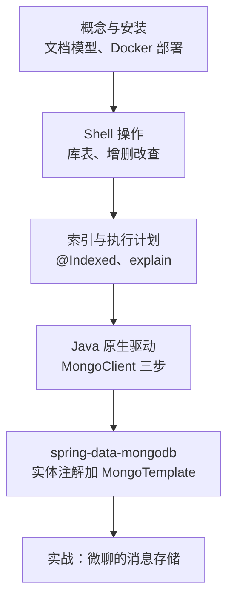
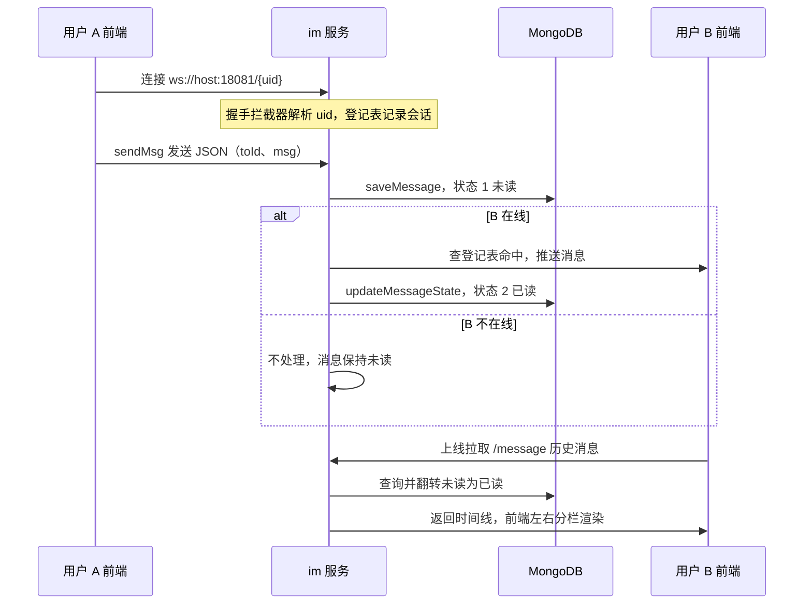

# day08 复习课：MongoDB 与微聊即时通讯全景回顾

day08 是整个阶段三信息密度最高的一天：前半场从零认识 MongoDB，从概念、安装一路走到 spring-data-mongodb；后半场立刻实战，把项目里的微聊功能从建工程、设计文档结构、实现 WebSocket 收发，一直做到前端整合上线。收尾还留了一个分布式方案的分析题。复习这一篇的目的不是重复细节，而是把整章串成一条能讲出来的线：哪些是必会的、哪些是原理层的、哪些是要带去下一天的问题，各归各位。

## 先给结论

- 一条主线贯穿全天：MongoDB 扛存储，WebSocket 扛实时，前端整合把两者变成用户看得见的微聊。
- MongoDB 部分四层递进：概念与安装、Shell 增删改查与索引执行计划、Java 原生驱动、spring-data-mongodb 封装。
- 微聊系统五个部件：`Message` 与 `User` 实体、`MessageDAO`、`MessageHandler` 加握手拦截器、历史消息与好友列表两个 REST 服务、前端整合。
- 前端整合动的是四个文件：`chat.js` 拉好友列表，`chat-window.js` 拉历史并发送消息，`wsmain.js` 组装连接，`IMClient.js` 封装 socket。
- 遗留问题记三件：分布式 Socket 方案（下一天用 RocketMQ 落地）、历史消息默认只回十条的 `rows` 参数、断线重连与连接地址带 token 的安全补强。

## 一、MongoDB 这半场：四层递进一条线

整场学习是一个由浅入深的漏斗，先看路径再看要点：

**第一层是概念与部署。** MongoDB 把数据存成文档而不是行，一条消息连着发送者、接收者两个嵌套用户对象，一个集合装下，省掉多表关联，这是聊天记录选它的根本原因。用 Docker 拉起镜像即装即用，客户端工具连上就能看数据。

**第二层是 Shell 的增删改查。** 库与集合的操作、`insert`、`update`、`remove`、`find` 的各种条件写法，这一层练的是文档模型的手感：字段可以灵活嵌套，查询条件跟着结构走。

**第三层是索引与执行计划。** 按查询需求建索引，`status`、`sendDate`、`from`、`to` 这些要参与查询的字段都该有索引；`explain` 看执行计划验证索引有没有生效，这一层是从「会用」到「用对」的分水岭。

**第四层是 Java 侧的两级封装。** 原生驱动 `MongoClient` 的连接、选库、选集合三步走是理解底层的基础；spring-data-mongodb 则把日常操作收敛成注解加模板，重点记这几样：

| 知识点 | 关键类或注解 | 一句话记忆点 |
|---|---|---|
| 集合映射 | `@Document` | 自定义集合名，不写按类名 |
| 主键 | `@Id` | 不指定则自动生成 ObjectId |
| 字段映射 | `@Field` | 驼峰属性对下划线字段 |
| 索引 | `@Indexed` | 保存时自动建索引 |
| 操作模板 | `MongoTemplate` | 查、改、删都找它 |
| DAO 接口 | `MessageDAO` | 业务语义的封装层，供 Service 调用 |

微聊的 `MessageDAO` 正是踩着这套封装实现的：保存消息、按两个 id 分页查点对点记录、更新状态，全部落在 `MongoTemplate` 上，Service 与 Controller 只做业务编排。

## 二、微聊这半场：一条消息的完整旅程

把后端到前端的全链路合成一张图，复习时对着它逐段回忆实现：

**实体与 DAO 是地基。** `Message` 的核心字段是 `msg`、`status`（1 未读 2 已读）、`send_date`、`read_date`、嵌套的 `from` 与 `to`；`MessageDAO` 提供 `saveMessage`、`findListByFromAndTo`、`updateMessageState` 三个能力。

**连接与登记是心脏。** 握手拦截器从地址尾段解析 uid 并做校验，`MessageHandler` 在连接建立时把会话放进静态登记表，发送时查表判断在线，在线就推送并改已读，不在线就等上线补拉。断开时移出登记表，防止把离线误判成在线。

**两个 REST 服务是查询口。** `/message/queryMessageList` 分页查点对点记录并在返回前翻转未读状态，`/user` 按前端契约组装好友列表，数据结构里的 `chat_msg`、`chat_time` 预览复用了查询服务。

**前端整合是临门一脚。** 列表与聊天窗口都是「挂载即拉数据、setState 驱动渲染」；发送走 `sendMsg`，本地先渲染再交给长连接；接收把页面回调传进 `IMClient`，`onmessage` 原样回传；中间拆掉了与服务端契约不符的 DataPacket 包装与注册身份报文。

## 三、遗留问题：带去下一天的三件事

**主问题是分布式。** 登记表是进程内的 Map，多实例部署时推送会断；`WebSocketSession` 是活的连接端点，塞不进 Redis；出路是消息系统广播加各自查表，方案已分析完毕，下一天学完 RocketMQ 就落地。这是全天唯一只分析不动手的点，也是面试里最值钱的一个。

**两个小问题顺手补。** 历史消息接口的 `rows` 默认值是 10，前端没传分页参数，长对话只能看到十条，调大默认值或让前端补分页都行；连接地址带明文 uid 有冒充风险，生产环境要在握手阶段校验 token，断线重连机制也要补上，这两处是上线的必修课。

## 四、自测清单：能答上来就算过关

- 为什么聊天记录选 MongoDB 而不是 MySQL？文档模型省掉了什么？
- `@Document`、`@Id`、`@Field`、`@Indexed` 各管什么？
- 索引建在哪几个字段上，怎么用 `explain` 验证生效？
- 未读与已读状态有哪两个迁移时机，分别覆盖什么场景？
- uid 是怎么从连接地址走到 `session.getAttributes()` 里的？
- 消息先落库再判断在线，这个顺序换过来会怎样？
- 前端发送为什么要本地先渲染？服务端为什么不回显？
- 多实例部署下推送会断在哪一行，方案为什么选消息系统？

八条都能脱稿讲清楚，day08 就真正属于你了；答不上来的，回到对应篇章重读实现段落，比从头再看一遍视频省一半时间。

## 常见误区

- **重 API 轻原理。** 把 CRUD 背熟就跳过索引与执行计划，等于只学了半门数据库。面试里「查询慢了怎么办」问的正是后者。
- **把 WebSocket 当 HTTP 用。** 列表查询塞进长连接通道、拉数据靠推送，通道分工一乱，链路难排查。记住分工：长连接管实时，RESTful 管查询。
- **注解混淆。** `@Field` 是属性到字段的映射不是索引，`@Indexed` 才建索引，两个写反了不会报错，只会在查询时静默变慢。
- **复习只背流程。** 流程图背得再熟，答不出「为什么先落库」「为什么本地渲染」也是白背。每个箭头背后都有一个 why，why 才是面试与工程里值钱的部分。

## 面试可能被问到的问题

1. 面试官追问：「项目里为什么用 MongoDB 存聊天记录？」
   答：消息是写多读多、结构灵活的数据，一条消息嵌套发送者与接收者两个用户对象，文档模型一个集合装下，省去多表关联；消息量随业务线性膨胀，MongoDB 的分片扩展也契合这个场景。MySQL 要拆表关联，字段扩展也受限。

2. 面试官追问：「未读消息体系怎么设计的？」
   答：消息带 status 字段，1 未读 2 已读。写入时一律未读；实时推送成功后立刻改已读，覆盖在线场景；用户上线拉历史时服务端在返回前批量翻转，覆盖离线场景。两个迁移点合起来，已读语义才完整，也不需要单独的离线消息存储。

3. 面试官追问：「WebSocket 对比轮询、长轮询，优势在哪？」
   答：轮询定时空请求，浪费大、延迟高；长轮询挂住请求等数据，减少了空转但每次都是完整 HTTP 请求，头部开销大；WebSocket 一次握手后复用 TCP 长连接，双向随时可发，延迟与开销都最低，代价是需要自己管理连接生命周期、心跳与重连。

4. 面试官追问：「spring-data-mongodb 相比原生驱动简化了什么？」
   答：把连接管理交给 Spring 容器，把文档与实体的映射交给注解，把常用操作收敛到 MongoTemplate 与仓库接口，手写的集合获取、结果解析、字段映射全部消失。开发者面对的是对象与业务方法，底层细节在需要时仍能透下去处理。

5. 面试官追问：「让你复盘这个微聊，你会怎么讲？」
   答：按一条消息的生命周期讲：前端组装消息先本地渲染，长连接发给服务端；服务端先落库置未读，再查登记表判断接收方在线，在线推送并置已读，离线则等其上线拉取；拉取接口返回前翻转未读。再补一句多实例下的演进：登记表出不了进程，用消息系统广播加各自查表解决实时推送。一条线讲完，起点终点和取舍都在。

## 配套资料

- day08 资料包未收录源码：`materials/code/03/day08-MongoDB入门以及实现微聊即时通讯功能/` 目录存在，其解压清单 `_extracted.json` 记录解压文件数为 0，文中示例均为按本课写法补全
- 分布式 Socket 的后续实现与消息系统相关代码见 day10：`materials/code/03/day10-RocketMQ集群、分布式WebSocket实现以及地图找房功能实现/`；全章各篇的代码出处与补全说明逐篇标注在第 142 至 149 篇的配套资料小节
