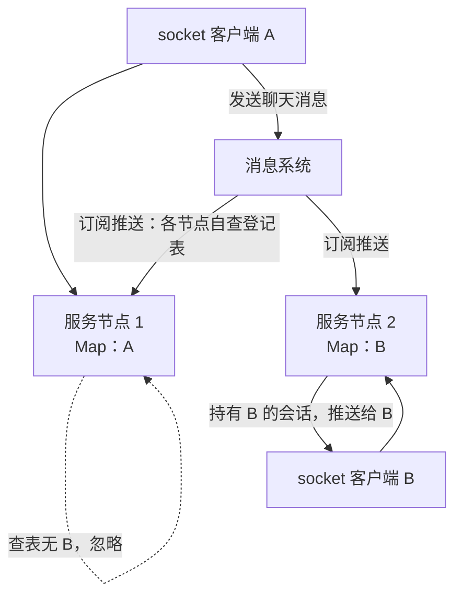
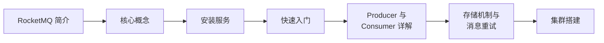

# 消息队列进场的时刻：day09 开启 RocketMQ 学习导览

微聊功能在 day08 单机跑通了，实时推送的爽感还没捂热，day08 的最后一课就把话挑明：服务一旦部署多个实例，实时推送立刻哑火，根子是进程内那张 `static Map` 登记表出不了进程。当时的结论只有一句：采用消息系统解决。消息系统究竟长什么样、凭什么能补上这个口子、怎么装怎么用，从 day09 开始回答。

day09 整天的任务，是把「消息系统」这个抽象名词具体化成一个产品：RocketMQ。学完这一天，它应当从「听说过」变成「装得上、连得通、发得出、收得到」。

## 先给结论

- 上一课的分析停在「采用消息系统」，本课开始把它兑现，选定的产品是 RocketMQ。
- day09 是概念与入门日：先把 Producer、Consumer、NameServer、Broker、Topic、MessageQueue 这组概念立住，再动手安装、写快速入门代码。
- 学习路径共七站：简介、核心概念、安装、快速入门、Producer 与 Consumer 详解、存储机制与消息重试、集群搭建，顺序背后有明确的因果。
- 核心概念是整章地基，NameServer 与 Broker 的分工一旦理解错，后面装集群、看报错都像在读天书。
- day09 资料包未提供源码，示例按本课写法补全；真正的落地工程在 day10，那时分布式 WebSocket 推送才会真正写进项目。

## 一、上一课的结论，本课开始兑现

把 day08 收尾时的架构再摆出来看一眼。单机版微聊的核心是一张挂在处理器上的静态登记表：

```java
@Component
public class MessageHandler extends TextWebSocketHandler {

    // 进程内共享的会话登记表，多实例部署时每个节点各有一份
    private static final Map<Long, WebSocketSession> SESSIONS = new HashMap<>();

    @Override
    public void afterConnectionEstablished(WebSocketSession session) throws Exception {
        Long uid = (Long) session.getAttributes().get("uid");
        SESSIONS.put(uid, session);
    }
}
```

课程 PPT 对问题的定性是：将 Session 对象放到全局的 Map 中，当连接变得非常多时，这将成为系统瓶颈，因为不能进行分布式部署；解决方案：采用消息系统。所谓消息系统，就是所有节点共享的一个「广播站」，各节点订阅它、往它发消息，收到了就各查各的登记表：



这张图的关键路径在于：消息系统替所有节点扛下了「投递」这件事，节点从此不需要知道对方的存在。谁能当这个广播站？这就是 RocketMQ 要回答的问题，也是 day09 整天的主线。

## 二、七站学习地图：每一站的顺序都有因果

day09 的内容可以画成一条线，但要当成因果链来读，而不是目录：



**简介与核心概念放最前面，是因为它们决定后面能否看懂。** 简介回答「它是什么、凭什么被选上」；核心概念回答「它由哪些角色组成、消息从哪到哪」。NameServer、Broker、Topic、MessageQueue 这几个词会在安装目录、启动日志、控制台报错里反复出现，概念不清就去动手，每一步都在猜。

**安装紧跟概念，因为装的过程就是概念的具象化。** 装好之后面对的第一屏就是两个进程的启动，命令来自同系列 RocketMQ 专题讲义（Windows 下脚本名带 `.cmd` 后缀）：

```bash
# 启动 NameServer，注册中心
mqnamesrv

# 启动 Broker，-n 指定 NameServer 地址
mqbroker -n 127.0.0.1:9876
```

上一课的架构预览里说 Broker 要注册自己、Producer 要查找 Broker，这两条命令恰好对应那两个角色，装完这两步，概念就落了地。

**快速入门之后才谈详解与原理。** 掌握基本 API 的收发之后，Producer 与 Consumer 的细节（发送方式、消费模式、分组语义）才有依托；存储机制解释它为什么快；错误消息的重试机制解释它为什么可靠；集群搭建收尾，因为单机可玩不可上生产。越往后越贴近生产，越往前越接近入门，这一天的节奏就是由浅入深四个字。

## 三、学完 day09 手里有什么

最直观的收获是能写出最小可用的一发一收。用 Spring Boot 整合后的发送代码只有一行核心调用（示例按本课写法补全，整合方式在快速入门一站展开）：

```java
// 注入 RocketMQTemplate 后，同步发送一条消息到指定主题
rocketMQTemplate.syncSend("topic-hello", "hello RocketMQ");
```

比代码更重要的是判断力：之后再遇到「接口太慢」「服务互相牵连」「瞬时流量把下游打挂」这类问题，会立刻想到消息队列这个工具箱，并且知道工具箱里每个工具的名字。

再往后看一步，day10 会把本课的产出真正接进项目：用 RocketMQ 重做分布式 WebSocket 推送，顺带完成地图找房功能。day08 留下的那笔债，到那天还清。

## 常见误区

- **跳过概念课直接装环境。** 觉得概念讲解太虚，上来就敲启动命令，结果 NameServer 起了 Broker 连不上、日志里的路由报错一个都看不懂。概念是后面七站的地基，跳不得。
- **以为消息队列只为聊天推送服务。** 微聊只是引子，异步下单、日志收集、流量削峰这些场景它都在场，day09 学的是通用中间件，不是一个聊天插件。
- **以为装完单机就算会用。** 单机 Broker 挂了消息系统就瘫了，生产环境必须集群，而集群涉及主从、刷盘、路由等多套策略，day10 的集群搭建专门处理这件事。
- **把消息系统当数据库的替代品。** 广播只解决「推」，不解决「存」，先落库再推送的原则在引入 RocketMQ 之后一条都不能松动。

## 面试可能被问到的问题

1. 面试官追问：「你们的 WebSocket 分布式方案为什么引入消息队列？」
   答：多实例部署后每个节点的会话登记表互相独立，A 发给 B 的消息到达的节点上没有 B 的连接。引入消息队列后，所有节点订阅同一主题，收到消息各查各的登记表，有会话就推、没有就忽略，节点从此无状态，可以随意扩缩容。

2. 面试官追问：「引入消息队列会带来哪些新问题？」
   答：至少三个。可用性上多了一个必须存活的中间件，它挂了上下游全断；一致性上消息可能重复、可能延迟，消费端要幂等；复杂度上多了一套安装、监控、运维成本。所以同步够用就不上 MQ，上了就要把这三种代价管住。

3. 面试官追问：「学习 RocketMQ 应该抓住哪几条主线？」
   答：三条。架构主线是 NameServer 与 Broker 的分工和路由查找；数据主线是 Topic 到 MessageQueue 的两级结构；可靠性主线是消息重试与集群高可用。抓住这三条，API 层面的东西都是水到渠成。

4. 面试官追问：「单机版 RocketMQ 能直接上生产吗？」
   答：不建议。单机意味着单点，Broker 宕机服务即不可用，消息堆积也只能押在一台机器上。生产至少要 Broker 主从加 NameServer 集群，配置策略上还要考虑同步双写还是异步复制、同步刷盘还是异步刷盘。

5. 面试官追问：「把同步接口改成异步，响应快了，代价是什么？」
   答：调用方拿到的只是「请求已受理」，不是「处理完成」，下游失败时主流程无法第一时间感知，需要补偿与重试机制；排查问题的链路也变长了，要靠消息轨迹和日志把异步链路串起来。响应时间换的是系统韧性与吞吐，不是白赚的。

## 配套资料

- 本课（day09）资料包未提供源码：`materials/code/03/day09-分布式消息系统RocketMQ的入门/` 目录下仅有解压清单 `_extracted.json`，记录解压文件数为 0，文中代码示例为按本课写法补全
- 同系列 RocketMQ 专题讲义：`materials/docs/10/RocketMQ研究v1.0.md`（含 MQ 应用场景、技术选型对比、组成结构、安装与快速入门，启动命令即取自该讲义）
- RocketMQ 官方发行包配置样例：`materials/code/10/rocketmq-all-4.5.0-bin-release/rocketmq-all-4.5.0-bin-release/conf/broker.conf`
- 问题背景与方案图取自课程视频「6、分布式 Socket 解决方案分析」一节的画面内容
