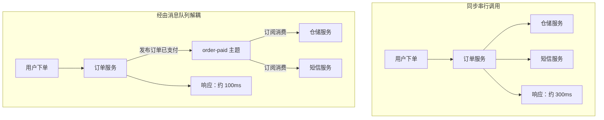

# 认识 RocketMQ：名字、身世与消息队列的三大价值

真要往项目里引入一个新中间件，第一个问题从来不是怎么装，而是为什么是它。消息队列产品一抓一把：ActiveMQ、RabbitMQ、Kafka、RocketMQ，个个开源，个个说自己是分布式消息系统。这一篇把 RocketMQ 的名字、身世、核心价值与同类产品的定位差异摆到一起，回答「凭什么选它」。

## 先给结论

- RocketMQ 全称 Apache RocketMQ，是 Java 语言开发的分布式消息系统，由阿里团队开发，2016 年底捐赠给 Apache，成为 Apache 顶级项目。
- 名字就是卖点：Rocket 是火箭，主打一个快；官网对它的定位是开源的分布式消息与流数据平台，天然支持分布式，可以水平扩展。
- 消息队列的三大价值：异步提速、应用解耦、流量削峰，此外日志收集也是一类典型场景。
- 定位差异一句话：RabbitMQ 灵活轻量但单机吞吐低，Kafka 吞吐最强但偏日志流场景，RocketMQ 介于两者之间、面向业务消息，事务消息与延迟消息是招牌。
- 它不是实验室产品：阿里内部上千个应用在用，2017 年双十一当天经由它流转的消息达到万亿级。

## 一、名字与身世：一支火箭的来历

从名字拆起：Rocket 是火箭，MQ 是 Message Queue 即消息队列，合起来就是「跑得飞快的消息队列」。名字起得张扬，但确实点出了这类系统的核心竞争力指标之一：低延迟、高吞吐。

全称 Apache RocketMQ 里的 Apache 指明了它的归属。它由阿里团队开发，采用 Java 语言编写，2016 年底被捐赠给 Apache 软件基金会，随后成为 Apache 顶级项目。Java 开发这一点对使用者是实打实的好处：源码可读、问题可查，出问题时能顺着调用栈往下追，而不像某些 C 或 Erlang 写的中间件，排查到应用层就断了线索。

官网 rocketmq.apache.org 对它的介绍是：一个开源的分布式消息与流数据平台。这句话里最值钱的词是分布式：它天生就是按集群设计的，组件都可以水平扩展，做系统架构时不用担心「量上去了怎么办」这种问题。课程录制时期它的版本在 4.3.x，GitHub 上的 Star 已有六千多个，对一个基础中间件来说，这个关注度不算低。

## 二、背书：万亿级消息不是 PPT 数据

技术选型最怕听信宣传，RocketMQ 的说服力来自实战。在阿里内部，它服务了集团大大小小上千个应用；每年双十一对系统都是极限压测，2017 年双十一当天，整个阿里巴巴集团经由 RocketMQ 流转的消息达到万亿级别。同系列讲义还给出一个更具体的数据：峰值 TPS 达到 5600 万。

这两个数字的含义可以这么理解：电商大促的瞬间流量是平时的几十倍，消息洪峰、订单洪峰、支付回调全部挤在同一秒进来，扛不住就是事故。RocketMQ 能在这样的场景里稳定运转多年，说明它的高可用、高吞吐、海量堆积能力不是文档里写写，而是被反复验证过的。这也是它有资格被捐给 Apache 并迅速成为顶级项目的底气：Apache 收录的不叫「新产品」，叫「经受过生产检验的方案」。

## 三、三大价值：异步、解耦、削峰

选型说完了出身，再说用途。消息队列在系统里的价值可以归纳为三条，每一条都对应一类具体的痛。

**第一，异步提速。** 用户下单后要扣库存、发短信，同步串行地调用三个服务，任何一个慢都会拖住下单接口：

```java
// 同步串行：用户要等所有下游都执行完才能拿到响应
orderService.create(order);        // 100ms
inventoryService.deduct(order);    // 150ms
smsService.sendNotify(order);      // 50ms
// 总耗时约 300ms
```

引入消息队列后，主流程只做下单与发消息，短信、库存各自订阅主题异步处理：

```java
// 异步化：主流程只管发消息，用户 100ms 出头拿到响应
orderService.create(order);                          // 100ms
rocketMQTemplate.syncSend("order-paid", order);      // 约 3ms
// 库存服务、短信服务订阅 order-paid，各自消费各自处理
```

（以上两段为按本课写法补全的示例。）响应时间从 300ms 降到 100ms 出头，省下的时间全是下游处理的耗时，被消息队列从主流程里挪了出去。

**第二，应用解耦。** 同步调用的时代，订单服务直接依赖仓储服务与物流服务的接口，仓储接口一改签名，订单服务跟着发版。经由消息队列中转后，订单服务只负责发布「订单已支付」这条消息，谁需要谁订阅，加一个物流分析系统也不用动订单服务一行代码。MQ 在这里扮演的角色是一个中介，把上下游的代码依赖切成消息契约。

**第三，流量削峰。** 秒杀开始的瞬间，请求洪峰比平时高几十倍，数据库按平时的容量配的，直接被打穿。把请求先写进消息队列，下游按自己的消费能力匀速处理，洪峰被摊平成一条平稳的曲线。队列在中间起到蓄水池的作用，宁可慢一点处理完，也不能把系统压垮。

同系列讲义还列了第四类场景：日志收集。采集系统把日志文件的数据发到消息队列，各日志需求方从队列里接消息做分析，队列充当日志数据的中转站，Kafka 在这个场景里更为常用。

三种改造前后的链路差别，用一张图看最直观：



关键路径在于右边这张图里，订单服务与下游之间不再有实线调用，只剩一条消息契约，这就是解耦在结构上的样子。

## 四、与 RabbitMQ、Kafka 的定位差异

三大价值是消息队列的共性，差异在个性。同系列讲义给出过一版选型对比，摘其要点如下：

| 维度 | RabbitMQ | RocketMQ | Kafka |
|---|---|---|---|
| 开发语言 | Erlang | Java | Scala、Java |
| 单机吞吐 | 1～2 万 TPS | 5～10 万 TPS | 与 RocketMQ 同级或更高 |
| 事务消息 | 不支持 | 支持 | 早期版本不支持 |
| 延迟消息 | 支持有限 | 支持 | 不支持 |
| 顺序消息 | 支持有限 | 支持 | 支持 |
| 失败重发 | 需手动设置 | 支持指定次数与间隔 | 不支持 |
| 集群与扩容 | 不支持水平扩容 | 天然支持 | 天然支持 |
| 生态 | 管理页面友好 | 贴近业务场景 | 使用人数多，生态最完善 |

**RabbitMQ 的地盘是中小规模的业务消息。** 基于 Erlang 开发，并发性能好，工作模式灵活，后台管理页面友好，上手快。短板是单机吞吐低，不支持水平扩容，消息堆积一多性能下降明显。

**Kafka 的地盘是日志与流式数据。** 吞吐量三者最强，生态最完善，日志收集、大数据管道几乎默认选它。短板在业务消息特性：早期版本不支持事务消息，消费者数量受限于分区数，单机消息过多时性能下降明显。

**RocketMQ 的地盘是电商级的业务消息。** 吞吐介于两者之间，但业务特性最全：事务消息、延迟消息、顺序消息、消息过滤、消息轨迹、指定次数与间隔的失败重发，天然支持集群与负载均衡。短板是生态圈比不过 Kafka，消息吞吐与堆积能力也略逊。课程项目选它，看中的正是「贴合业务场景」这一条：支付结果获取这类场景需要事务与重试，Kafka 当时给不了。

## 常见误区

- **以为吞吐量是选型的唯一指标。** 只看 TPS 会直接选 Kafka，但业务消息要的是事务、延迟、重试这些特性，吞吐过了及格线之后，特性匹配度比极限吞吐更重要。
- **以为用了消息队列就万事大吉。** MQ 解决的是投递，不解决一致性：消息重复消费、消费失败、上下游数据不一致这些新问题会随之而来，幂等与补偿是引入 MQ 后必须补的课。
- **以为 RocketMQ 只在阿里内部用。** 它是 Apache 顶级项目，社区独立于阿里运转，任何公司都可以直接采用，不必担心「绑定某家公司」的问题。
- **以为 Java 开发只是个巧合。** 语言选型直接决定排查成本，线上出问题时能看懂源码的中间件和看不懂源码的中间件，运维难度差一个量级。

## 面试可能被问到的问题

1. 面试官追问：「为什么要用消息队列？」
   答：核心是三条：异步，把耗时的下游操作挪出主流程，缩短响应时间；解耦，上下游从接口依赖变成消息契约，新增订阅方不需要改发布方；削峰，用队列当蓄水池，把瞬时洪峰摊平成平稳的消费曲线。日志收集等中转场景也是它的常用武之地。

2. 面试官追问：「RocketMQ 和 Kafka 怎么选？」
   答：看场景。日志收集、大数据流处理选 Kafka，吞吐最强、生态最全；业务消息，尤其是需要事务消息、延迟消息、失败重试的场景选 RocketMQ。两者吞吐都在十万级 TPS 上下，真正的分水岭在业务特性支持度。

3. 面试官追问：「RocketMQ 和 RabbitMQ 相比优势在哪？」
   答：吞吐量高一个量级，RabbitMQ 单机约 1 到 2 万 TPS，RocketMQ 约 5 到 10 万；支持水平扩展，RabbitMQ 不支持；支持事务消息与更灵活的重发机制，RabbitMQ 需要手动设置且不支持事务。RabbitMQ 的优势是管理页面友好、轻量易上手，小规模场景用它没毛病。

4. 面试官追问：「异步化之后，主流程怎么知道下游处理成功了？」
   答：不知道，也不需要即时知道，这正是异步的语义：主流程只保证消息发出去了。下游成败靠三件事兜底：消费失败的重试机制、多次重试仍失败进死信队列或落库人工处理、消费端幂等设计防止重复消费造成脏数据。

5. 面试官追问：「消息队列削峰，队列里堆的消息会不会无限多？」
   答：不会无限多，但要评估两个上限：磁盘容量决定堆积上限，消费速度决定清峰时间。设计时要算清楚洪峰总量、队列容量与下游消费速率，保证消费速度乘以可接受时间大于洪峰量，否则堆积会一直涨到打爆磁盘。

## 配套资料

- 同系列 RocketMQ 专题讲义：`materials/docs/10/RocketMQ研究v1.0.md`（MQ 应用场景、RocketMQ 介绍、消息队列技术选型对比的数据均出自此讲义）
- 本课（day09）资料包未提供源码：`materials/code/03/day09-分布式消息系统RocketMQ的入门/` 目录下仅有解压清单 `_extracted.json`，记录解压文件数为 0，文中代码示例为按本课写法补全
