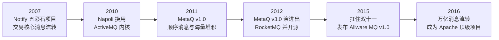

# 从 Notify 到 Apache 顶级项目：RocketMQ 的十年演进

一个中间件能写进简历，通常是因为它经受过极限场景的检验。RocketMQ 的这份资历，是用十年时间和每一年的双十一攒出来的。这段历史当故事听完全可以，但每个时间点背后都有一个明确的工程动因：业务长到哪里，中间件就换到哪里。把动因看懂，比把年份背下来值钱得多。

## 先给结论

- 演进链条是 Notify、Napoli、MetaQ、RocketMQ 一路走来，RocketMQ 的前身是 MetaQ。
- 每一次换代都是业务倒逼：先是交易消息流转，后来 ActiveMQ 内核撑不住，再后来为了顺序消费与海量消息堆积走上自研。
- 2012 年 MetaQ 发展到 3.0，抽象出通用的消息引擎 RocketMQ 并开源，阿里消息中间件从此进入公众视野。
- 2015 年扛住双十一的洗礼，推出阿里云版 Aliware MQ 1.0；2016 年双十一承载万亿级消息流转，同年进入 Apache 孵化并在年底成为顶级项目。
- 早期开源版删减过事务消息等核心功能，捐给 Apache 后重新补齐，开源版与自用版并非一直同步。

## 一、起点：五彩石项目与 Notify

故事从阿里巴巴内部的一个架构改造项目讲起。为了支撑交易系统的拆分与扩展，阿里启动了五彩石项目，它的核心产出之一就是自研的消息中间件 Notify，用途是交易核心消息的流转：下单、扣款、发货这些环节从同步调用改成消息驱动，交易链路才能拆成独立的服务各自演进。

课程讲义的时间轴把这一步标在 2007 年。Notify 解决的问题非常单一：让交易系统内部的消息可靠流转。它是工具，不是平台，离「通用消息中间件」还有相当距离，但生产者、消费者、消息存储这套骨架已经立起来了。

## 二、第一次换内核：借力 ActiveMQ 的 Napoli

到 2010 年前后，阿里内部 B2B 业务开始大规模使用 Napoli 作为消息系统，而 Napoli 的消息内核是 ActiveMQ。ActiveMQ 本身也是 Apache 的老牌顶级项目，社区成熟、文档齐全，借用现成内核是当时最合理的选择。

借力的代价也很快显现：ActiveMQ 的能力边界挡在了业务前面。阿里的消息规模持续膨胀，社区版的消息吞吐、堆积能力、功能特性都开始吃紧，而内核不在自己手里，想改也改不动。这一段历史给出的教训很直白：中间件被业务依赖到一定程度，内核必须握在自己手里。

## 三、自研 MetaQ：为顺序消息与海量堆积而生

2011 年，基于两个明确的需求，阿里决定自研：业务需要支持顺序消费的消息系统，同时要有海量消息堆积能力。这两个需求 ActiveMQ 都给不了，于是 MetaQ 项目诞生，时间轴上标注的版本是 MetaQ v1.0，特性栏写的正是「顺序消息、海量堆积能力」。

MetaQ 这个名字本身有一段掌故（背景补充）：它取自卡夫卡小说《变形记》的英文 Metamorphosis，同时也在向 Kafka 的设计思想致敬。MetaQ 1.0 借鉴了 Kafka 的消息模型，但实现是阿里自己的，为的就是把顺序与堆积这两件事做到极致。

2012 年，MetaQ 发展到 3.0 版本。这一代做了一件影响深远的事：把消息引擎抽象成通用的内核，并给它起了新名字 RocketMQ，随后对公众开源。从这一刻起，阿里消息中间件不再只是内部工具，而是任何 Java 团队都能下载、部署、阅读源码的开源产品。

这里有个容易被忽略的细节：早期开源的 RocketMQ 是做过功能删减的，事务消息这类核心能力最初并不在开源版里。开源不等于全盘开放，阿里把完整版留在了内部，直到这个项目捐给 Apache 之后，这些被删减的能力才随开源版重新补齐。

## 四、双十一洗礼与云化：从内部工具到对外产品

开源之后紧接着就是最严苛的验收。2015 年，RocketMQ 经历了双十一的洗礼：被直接扔进超大并发的交易场景里运转，可靠性、可用性、稳定性各方面表现出色。极限场景的背书比任何测试报告都有分量，这也是课程在介绍阶段反复强调「万亿级消息」的原因。

同一年，云计算业务正处风口，阿里把这套消息引擎搬上云，推出了阿里云版的消息产品 Aliware MQ 1.0（时间轴上同时标注了 Notify v3.0），为阿里云上的企业客户提供消息服务。内部自用、对外开源、上云售卖三条线并行，产品形态齐了。

## 五、进入 Apache：万亿消息与顶级项目

2016 年的时间轴上写了两件事。第一件：MetaQ（也就是 RocketMQ）在双十一期间承载了万亿计的消息流转，规模再次刷新纪录。第二件：RocketMQ 进入 Apache 基金会孵化，同年年底正式毕业，成为 Apache 顶级项目。

把整条时间线连起来看：



六个节点串成的规律只有一条：业务驱动。交易拆分催生了 Notify，规模膨胀逼走了 ActiveMQ 内核，顺序与堆积催生了 MetaQ，通用化催生了开源，极限流量催生了云产品，最终正是每年双十一的锤炼把它送进了 Apache。一个从解决单一问题起步的系统，随业务发展逐步演进成通用平台，这是整套演进史最值得带走的方法论。

## 六、历史落到现在：一个还能跑的发行包

这段历史并不只存在于故事里，演进十多年的成果今天仍能直接下载验证。官方提供二进制发行包，解压即可启动（同系列讲义使用的版本为 4.5.0，Windows 下脚本名带 `.cmd` 后缀）：

```bash
# 解压发行包到无空格、无中文的目录
unzip rocketmq-all-4.5.0-bin-release.zip -d /opt/rocketmq
cd /opt/rocketmq/bin

# 启动 NameServer，注册中心
mqnamesrv

# 启动 Broker，-n 指定 NameServer 地址
mqbroker -n 127.0.0.1:9876
```

Broker 的行为由发行包内的 `conf/broker.conf` 控制，这份真实的配置文件里藏着几个演进史的注脚：

```properties
brokerClusterName = DefaultCluster
brokerName = broker-a
brokerId = 0
deleteWhen = 04
fileReservedTime = 48
brokerRole = ASYNC_MASTER
flushDiskType = ASYNC_FLUSH
autoCreateTopicEnable=true
namesrvAddr=127.0.0.1:9876
```

`brokerRole` 与 `flushDiskType` 两项对应主从复制与刷盘策略，正是 2015 年双十一洗礼时打磨出的可靠性开关；`brokerClusterName` 则宣告这个单机配置天生就是集群的一部分。十年演进最终收敛成一份二十行的配置文件，历史并未远去。

## 常见误区

- **以为 RocketMQ 是 Kafka 的换皮。** MetaQ 1.0 确实借鉴了 Kafka 的消息模型，名字里也有致敬的成分，但实现是自研的，后来的顺序消息、事务消息、延迟消息都是 Kafka 早期版本没有的能力，两者早已是不同的产品。
- **以为时间线需要死记硬背。** 面试里讲演进史，讲的是动因链：业务拆分、内核受制、顺序堆积、通用开源、极限验证。年份记个大概，动因讲清楚，比逐字背年份有说服力。
- **以为捐给 Apache 后阿里就撒手了。** 捐赠之后阿里云版与 Apache 社区版并行演进，集团内部业务仍在持续使用与反哺，顶级项目身份改变的是治理结构，不是投入力度。
- **以为开源版从一开始就功能完整。** 早期开源版删减了事务消息等核心功能，使用开源版时要留意版本说明，能力是否完整以官方文档为准。

## 面试可能被问到的问题

1. 面试官追问：「简单讲讲 RocketMQ 的发展史？」
   答：2007 年前后阿里以五彩石项目自研 Notify 做交易消息流转；2010 年 B2B 大规模使用基于 ActiveMQ 内核的 Napoli；因需要顺序消费与海量堆积，2011 年自研 MetaQ v1.0；2012 年 MetaQ 3.0 抽象出通用消息引擎 RocketMQ 并开源；2015 年扛住双十一并推出阿里云版 Aliware MQ 1.0；2016 年承载万亿级消息流转，年底成为 Apache 顶级项目。

2. 面试官追问：「阿里为什么放弃 ActiveMQ 自研？」
   答：业务发展后需要顺序消费与海量消息堆积能力，ActiveMQ 给不了，而且内核不在自己手里，改造成本和响应速度都受制于社区。规模大到中间件成为命脉时，自研是必然选择，这也是 Napoli 到 MetaQ 换代的核心动因。

3. 面试官追问：「MetaQ 和 RocketMQ 是什么关系？」
   答：RocketMQ 是 MetaQ 演化到 3.0 之后抽象出的通用消息引擎的新名字，两者是同一血脉的先后两代。MetaQ 时期专注于顺序消息与堆积能力，到 RocketMQ 完成内核通用化并开源，此后以 RocketMQ 之名进入 Apache。

4. 面试官追问：「成为 Apache 顶级项目意味着什么？」
   答：意味着代码、商标、治理权移交基金会，按 Apache 的开源流程由社区决策，任何厂商都能自由使用与发行，不存在被单一公司控制的顾虑。对使用者而言，选型时多了一层信任背书：它经过基金会治理且社区独立运转。

5. 面试官追问：「开源版和企业版有什么区别？」
   答：以 RocketMQ 早期为例，开源版删减过事务消息等核心功能，完整能力保留在阿里内部，捐赠 Apache 后才随开源版补齐。云厂商托管版通常额外提供监控告警、消息轨迹、运维支持等增值能力，核心内核与开源版同源。

## 配套资料

- 同系列 RocketMQ 专题讲义：`materials/docs/10/RocketMQ研究v1.0.md`（演进史概述、安装步骤与发行包版本 4.5.0 出处）
- RocketMQ 官方发行包及其真实配置文件：`materials/code/10/rocketmq-all-4.5.0-bin-release/rocketmq-all-4.5.0-bin-release/conf/broker.conf`
- 本课（day09）资料包未提供源码：`materials/code/03/day09-分布式消息系统RocketMQ的入门/` 目录下仅有解压清单 `_extracted.json`，记录解压文件数为 0，文中示例为按本课写法补全
- 时间轴节点取自课程讲义「1.2、RocketMQ 的历史发展」小节及视频中的演进历史图抄录
