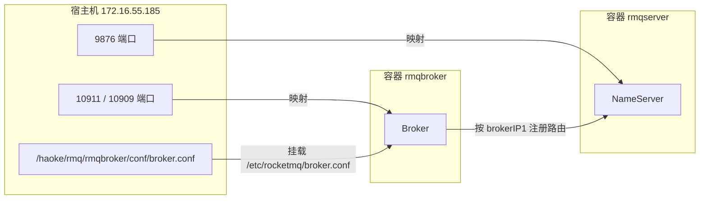

# 两条 docker 命令装好 RocketMQ：镜像选择、目录挂载与端口映射

非 Docker 方式装 RocketMQ，改 JVM 参数要手动编辑两个脚本，升级换机器还得再来一遍。Docker 化之后，内存、配置、数据目录全部变成 `docker create` 命令里的几个参数。不过镜像的选择有点反直觉：官方镜像反而不是首选。这一篇把镜像怎么选、两个容器怎么建、`broker.conf` 怎么挂进去讲清楚，最后用上一章的 Java 客户端验收。

## 先给结论

- 用社区维护的 `foxiswho/rocketmq` 镜像，不用官方镜像：官方镜像没推送到 Docker 中央仓库，拉不到；自己拉源码构建麻烦，后续追加配置也费劲。
- NameServer 容器只映射 `9876`；Broker 容器要映射 `10911` 与 `10909` 两个端口，前者是生产者消费者通信主端口，后者是 VIP 通道端口，集群场景才会用到。
- JVM 内存通过 `JAVA_OPT_EXT` 环境变量注入，128m 起步，不用进容器改任何脚本。
- 挂载三类目录：`conf` 把配置送进去，`logs`、`store` 把日志和消息数据留在宿主机，容器删了数据还在。
- `broker.conf` 里的 `brokerIP1` 照旧要配，容器内网 IP 对外不可达的问题与安装方式无关。

## 一、镜像怎么选：官方的反而不顺手

按直觉该用官方镜像，实际课程选了社区镜像 `foxiswho/rocketmq`，理由有两个。**其一，官方镜像没有推送到 Docker 中央仓库**，`docker pull` 直接拉不到。**其二，官方镜像要从源码构建**：拉源码、装扩展包、自己 build，就算建出来了，后面要给 Broker 追加配置时也相当费劲。

`foxiswho/rocketmq` 在官方版本基础上做了封装优化，NameServer 与 Broker 拆成两个镜像标签，拉下来就能用：

```bash
# 拉取镜像：server 对应 NameServer，broker 对应 Broker
docker pull foxiswho/rocketmq:server-4.3.2
docker pull foxiswho/rocketmq:broker-4.3.2
docker images
```

镜像版本与服务端版本对齐，课程录制时用 4.3.2，换成 4.5.0 只改标签数字，下面的步骤完全一样。

## 二、创建并启动两个容器

两个容器都用 `docker create` 先创建、再 `docker start` 启动，好处是创建阶段可以把挂载目录与配置文件准备好，确认无误再一次性拉起：

```bash
# 创建 NameServer 容器
docker create -p 9876:9876 --name rmqserver \
    -e "JAVA_OPT_EXT=-server -Xms128m -Xmx128m -Xmn128m" \
    -e "JAVA_OPTS=-Duser.home=/opt" \
    -v /haoke/rmq/rmqserver/logs:/opt/logs \
    -v /haoke/rmq/rmqserver/store:/opt/store \
    foxiswho/rocketmq:server-4.3.2

# 创建 Broker 容器
docker create -p 10911:10911 -p 10909:10909 --name rmqbroker \
    -e "JAVA_OPT_EXT=-server -Xms128m -Xmx128m -Xmn128m" \
    -e "JAVA_OPTS=-Duser.home=/opt" \
    -v /haoke/rmq/rmqbroker/conf/broker.conf:/etc/rocketmq/broker.conf \
    -v /haoke/rmq/rmqbroker/logs:/opt/logs \
    -v /haoke/rmq/rmqbroker/store:/opt/store \
    foxiswho/rocketmq:broker-4.3.2

# 启动（停止用 docker stop rmqbroker rmqserver）
docker start rmqserver rmqbroker
```

这段命令里每个参数都有明确职责：

**第一，`-e JAVA_OPT_EXT` 是内存的注入口。** 非 Docker 方式里改 `runbroker.sh` 的痛苦记忆可以放下了。发行包的启动脚本本身就预留了 `JAVA_OPT="${JAVA_OPT} ${JAVA_OPT_EXT}"` 这一行追加位（资料包 `bin/runbroker.sh` 原文可见），镜像只是把这个追加位做成了环境变量，128m 的测试机配置从外面一行写进去。

**第二，`-p` 的三组端口各司其职。** `9876` 是 NameServer 的路由查询端口；`10911` 是 Broker 接收生产者、消费者请求的主端口，客户端真正收发消息连的是它；`10909` 是 VIP 通道端口，普通收发用不到，搭集群时才会打交道。少映射 10911 是典型翻车点：路由能查到，消息发不出去。

**第三，`-v` 的三处挂载进出的东西不同。** `broker.conf` 是送进去的（容器内路径 `/etc/rocketmq/broker.conf`，镜像约定），`logs` 与 `store` 是引出来的：前者放日志，后者是 Broker 落盘的消息存储目录，挂到宿主机后容器删除重建，数据原封不动。

启动后用日志验收：

```bash
docker logs rmqserver
# The Name Server boot success. serializeType=JSON

docker logs rmqbroker
# The broker[broker_haoke_im, 172.16.55.185:10911] boot success.
# serializeType=JSON and name server is 172.16.55.185:9876
```

Broker 日志里的名字与 IP 来自挂载进去的配置文件，看到 `172.16.55.185` 而不是 `172.17.0.x`，说明配置生效了。整个部署的网络结构如下：



## 三、挂载进去的 broker.conf 与 brokerIP1

容器里的 `broker.conf` 内容与上一章手工方式完全一致，只是换了个方式喂给 Broker：

```properties
# Broker 对外注册的 IP，必须用宿主机的业务网卡地址
brokerIP1=172.16.55.185
namesrvAddr=172.16.55.185:9876
brokerName=broker_haoke_im
```

为什么容器里格外需要 `brokerIP1`？容器有自己的网络命名空间，里面的网卡地址通常是 `172.17.0.x` 这类网桥内网段，出了宿主机谁也路由不到。Broker 默认拿自己的第一块网卡地址去 NameServer 注册，客户端查到的就是那个不可达的内网 IP，发送全部超时。`brokerIP1` 明确指定注册地址后，NameServer 的路由表里挂的就是宿主机业务 IP，端口再经 `-p` 映射回容器，链路才通。

对照资料包发行版自带的 `conf/broker.conf` 模板，还能看到几个容器配置里没写但值得认识的键：`brokerClusterName = DefaultCluster`（所属集群名）、`brokerId = 0`（0 表示主节点）、`brokerRole = ASYNC_MASTER`（主从复制方式）、`flushDiskType = ASYNC_FLUSH`（刷盘方式）、`deleteWhen = 04` 与 `fileReservedTime = 48`（凌晨 4 点清理过期文件，保留 48 小时）。单机测试阶段用默认值即可，集群与可靠性篇章会逐个展开。

## 四、验证：工具与 Java 客户端各过一遍

服务端换成 Docker 跑，客户端无感知，验证手段照旧。先跑发行包自带工具：

```bash
export NAMESRV_ADDR=172.16.55.185:9876
bin/tools.sh org.apache.rocketmq.example.quickstart.Producer
# SendResult [sendStatus=SEND_OK, ...]

export NAMESRV_ADDR=172.16.55.185:9876
bin/tools.sh org.apache.rocketmq.example.quickstart.Consumer
# ConsumeMessageThread_ Receive New Messages: Hello RocketMQ ...
```

再把上一章的 `rocketmq-test` 工程直接重跑一遍，`SyncProducer` 打出 `SEND_OK`，`PushConsumer` 收到消息，两条链路全绿。对比一下安装成本：非 Docker 方式要解压、改两个脚本、盯启动日志，Docker 方式收敛成「拉镜像、建容器、起容器」三步，改参数全靠环境变量与挂载文件，这正是容器化交付的价值。

## 常见误区

- **端口只映射了 9876。** 客户端查路由正常，一到发送就超时，因为消息走的是 Broker 的 10911。两个容器的端口一个都不能省，10909 留给集群场景。
- **不挂载 `broker.conf` 或没写 `brokerIP1`。** Broker 按容器内网 IP 注册，路由查得到、连接连不上，现象与上一章的超时一模一样；容器化不会自动解决这个问题。
- **消息数据不挂载 `store`。** 数据默认写在容器可写层，容器一删消息全丢。`-v` 把 `store` 落到宿主机，才谈得上数据持久化。
- **小机器不设 `JAVA_OPT_EXT`。** 沿用镜像或脚本的默认堆大小，内存不够时容器反复被杀重启。128m 起步是测试机的稳妥值，生产按流量单独规划。

## 面试可能被问到的问题

1. 面试官追问：「Docker 部署 RocketMQ 至少要映射哪些端口，各是干什么的？」
   答：9876 是 NameServer 的路由服务端口，10911 是 Broker 接收生产者消费者请求的主端口，10909 是 Broker 的 VIP 通道端口。客户端链路用到 9876 与 10911，10909 在集群与 VIP 场景才会涉及。

2. 面试官追问：「容器里的 Broker 为什么必须配 brokerIP1？」
   答：容器网络命名空间内的地址（如 172.17.0.x 网段）外部客户端不可达，Broker 默认按自身网卡地址注册，路由表里挂的就是一个连不上的 IP。brokerIP1 强制它注册宿主机业务 IP，配合端口映射，客户端才能打通「查路由、连 Broker」两步。

3. 面试官追问：「容器删除后消息会丢吗？怎么避免？」
   答：不挂载就会丢，消息存储在容器可写层的 store 目录。用 `-v` 把容器的 /opt/store 与 /opt/logs 挂载到宿主机目录，数据落在宿主机文件系统，容器删除重建后数据仍在，这也是排查问题的第一现场。

4. 面试官追问：「不进容器，怎么调整 Broker 的 JVM 内存？」
   答：发行包启动脚本预留了 JAVA_OPT_EXT 追加位，社区镜像把它开放成同名环境变量。docker create 时用 `-e "JAVA_OPT_EXT=-server -Xms128m -Xmx128m -Xmn128m"` 注入即可，原理是把非 Docker 方式下编辑 runbroker.sh 的动作，前移到创建容器的命令行。

## 配套资料

- RocketMQ 发行包（配置模板与脚本佐证）：`materials/code/10/rocketmq-all-4.5.0-bin-release/rocketmq-all-4.5.0-bin-release/conf/broker.conf`（brokerClusterName、brokerRole、flushDiskType 等键为该文件原文）、`bin/runbroker.sh`（`JAVA_OPT_EXT` 追加位见脚本倒数几行）
- RocketMQ 专题讲义：`materials/docs/10/RocketMQ研究v1.0.md`（安装章节的环境要求与内存调参思路）
- 本课（day09）资料包未提供源码：`materials/code/03/day09-分布式消息系统RocketMQ的入门/` 下仅有解压清单 `_extracted.json`，记录解压文件数为 0；文中 docker 命令与 `broker.conf` 内容取自课程讲义画面原文，镜像为社区维护的 `foxiswho/rocketmq`
