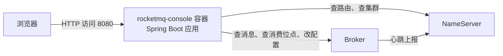

# rocketmq-console 控制台部署：给 RocketMQ 配一块可视化仪表盘

服务装好了、客户端也通了，但日常使用中真正高频的问题是：某个 Topic 现在积了多少消息、消费者组还活着没有、那条没消费掉的消息卡在哪。这些事用命令行查既慢又不直观，RocketMQ 官方提供的 Web 管理端 `rocketmq-console` 就是干这个的。部署它只要一条 Docker 命令，真正值得讲的是两个环境变量背后的含义，以及进去之后该看哪些页面。

## 先给结论

- `rocketmq-console` 是官方扩展仓库 `rocketmq-externals` 里的一个子项目，本质是个 Spring Boot 应用，支持 Docker 与源码两种部署方式，推荐 Docker。
- Docker 方式一行 `docker run` 搞定，关键是通过 `JAVA_OPTS` 传两个 `-D` 参数：NameServer 地址必改，VIP 通道开关建议关掉。
- 源码方式改 `application.properties` 三个键，Maven 打包后 `java -jar` 启动，与 Docker 方式本质相同，都是往 Spring Boot 里注参数。
- 控制台本身也是 RocketMQ 客户端：查 NameServer 拿路由、连 Broker 读数据，所以 NameServer 地址配错页面就全空。
- 最常用的三块页面是集群、主题、消费者，消息页可以按 Topic 与时间区间查消息轨迹。

## 一、console 是个什么东西

`rocketmq-console` 的项目地址在 GitHub 的 `apache/rocketmq-externals` 仓库下，属于官方外围工具，不在主仓库发行包里。它的界面做得相当清爽，而且是国人参与的项目，自带简体中文。

看它启动日志会很有亲切感：logback 初始化、Tomcat 启动、初始化 WebApplicationContext，一套熟悉的 Spring Boot 启动流程。对，它就是一个标准的 Spring Boot Web 应用，这决定了它的部署姿势：所有配置都能用属性文件或启动参数注入，没有特殊的安装动作。

它的工作方式也不是自己存数据，而是作为一个特殊的客户端挂在集群边上：向 NameServer 查路由，向 Broker 查状态、读消息、改配置。理清这层关系，后面的配置项就都好理解了：



## 二、Docker 方式：一条命令拉起

镜像用社区打包好的 `styletang/rocketmq-console-ng`：

```bash
# 拉取镜像
docker pull styletang/rocketmq-console-ng:1.0.0

# 创建并启动容器
docker run -e "JAVA_OPTS=-Drocketmq.namesrv.addr=172.16.55.185:9876 -Dcom.rocketmq.sendMessageWithVIPChannel=false" \
    -p 8080:8080 \
    -t styletang/rocketmq-console-ng:1.0.0
```

命令不长，有两个参数必须较真：

**第一，`-Drocketmq.namesrv.addr` 指向 NameServer。** 控制台所有页面数据的入口都是路由，这个地址写错或没写，界面能打开但全是空数据。它是容器里的地址，别写成 `127.0.0.1`，那指向容器自己。

**第二，`-Dcom.rocketmq.sendMessageWithVIPChannel=false` 关掉 VIP 通道。** 控制台自带「向 Topic 发测试消息」的功能，客户端默认开 VIP 通道时会去连 Broker 的 10909 端口（普通端口减 2）。环境里没映射这个端口或者想少开一个口子，就把开关置为 false，让它走普通的 10911。

两个实操小坑顺带记录：从项目主页复制这条命令时容易丢字符，`-p` 写成 `p` 之类的横杠缺失会导致参数解析错误；`JAVA_OPTS` 的值里有空格，引号必须包住整段值。宿主机的 8080 被占用时改映射左侧即可，比如 `-p 8082:8080`，访问地址相应变成 `http://<服务器IP>:8082`。启动日志里偶尔会滚几个异常堆栈，不影响主功能，先放着不用管。

## 三、源码方式：改三个配置再打包

不方便用 Docker 的环境可以走源码。讲义的流程是：从 `rocketmq-externals` 仓库下载 `rocketmq-console` 源码，改 `src/main/resources/application.properties`：

```properties
# 控制台自身的服务端口
server.port=9877
# NameServer 地址
rocketmq.config.namesrvAddr=127.0.0.1:9876
# 控制台本地数据路径
rocketmq.config.dataPath=/tmp/rocketmq-console/data
```

然后在项目目录下打包启动（要求 JDK 1.7 以上、Maven 3.2.x，依赖下载慢可以给 Maven 换镜像源）：

```bash
mvn clean package -Dmaven.test.skip=true
cd target
java -jar rocketmq-console-ng-1.0.1.jar --server.port=9877 --rocketmq.config.namesrvAddr=127.0.0.1:9876
```

注意两个细节：打包命令带 `-Dmaven.test.skip=true`，跳过测试能省掉对环境的额外依赖；jar 名里的 `1.0.1` 跟着版本走，以实际打包产物为准。启动参数 `--server.port=9877` 与属性文件重复出现，属于 Spring Boot 的常规操作：命令行参数优先级更高，改端口不用重新打包。访问 `http://127.0.0.1:9877` 即可进入控制台。

## 四、进去看什么：集群、主题、消费者与消息

控制台首页是仪表盘，摆着 Broker TOP 10 和近 5 分钟趋势两块图表，数据正常说明路由与 Broker 都连通了。往下几个页面按使用频率排：

**集群页**看 Broker 的存活与配置。点开任意一台 Broker 能看到完整配置项，比如延迟消息的级别定义 `messageDelayLevel: 1s 5s 10s 30s 1m 2m 3m 4m 5m 6m 7m 8m 9m 10m 20m 30m 1h 2h`，这些配置正是前面 `broker.conf` 里那些键的运行时值，改没改生效没生效，在这里一眼可见。

**主题页**是日常去得最多的地方。列表里能看到 `TopicTest` 这类自建 Topic，也有 `BenchmarkTest`、`DefaultCluster` 这类系统 Topic。每个 Topic 展开后是一排操作：状态（看消息量与堆积）、路由（看队列分布）、Consumer 管理、Topic 配置、发送消息（现场发一条测试）、查看消费位点、删除。排查「消息发了没消费」这类问题，就在这一页把发送量、堆积量、消费位点三个数对起来。

**消费者页**列出所有消费者组，能看每组下的客户端连接与消费详情，消费者掉线、组内分配不均在这里暴露。

**消息页**提供按 Topic、Key 与时间区间的消息查询，点进单条消息能看到它的存储与投递信息，配合消息轨迹能确认一条消息「发出去、存下来、被谁消费」的完整旅程。界面默认英文，右上角切换成简体中文后，所有功能菜单一目了然。

## 常见误区

- **把 NameServer 地址配成 `127.0.0.1`。** 控制台跑在容器里时，`127.0.0.1` 指容器自身，路由查不到，页面全部显示无数据。要写宿主机业务 IP 或容器可达的 NameServer 地址。
- **把控制台当消息存储。** 它只是管理视图，自己不存消息；控制台挂掉不影响任何收发链路，反过来 Broker 数据也只从 Broker 读，不会在控制台留副本。
- **端口冲突时去改容器内端口。** 容器里监听 8080 是镜像定好的，改映射左侧宿主机端口即可，`-p 8082:8080`，别钻进容器里改配置。
- **源码打包不跳测试。** 测试用例依赖外部环境，全量跑既慢又容易失败，讲义的命令显式带 `-Dmaven.test.skip=true`，照抄即可。

## 面试可能被问到的问题

1. 面试官追问：「rocketmq-console 在架构里扮演什么角色？」
   答：它是一个管理端 Web 应用，本质上是特殊的 RocketMQ 客户端：向 NameServer 查路由与集群状态，向 Broker 查消息、消费位点并修改配置。自身无状态、不存消息，挂掉不影响正常收发链路。

2. 面试官追问：「控制台页面打开全是空数据，怎么排查？」
   答：按客户端视角排查：`rocketmq.config.namesrvAddr` 或容器环境变量里的地址是否指向了控制台可达的 NameServer；NameServer 与 Broker 是否存活；控制台与集群之间的网络端口是否放通。三类都正常再看控制台与集群的版本兼容性。

3. 面试官追问：「生产环境要把控制台暴露到公网吗？」
   答：不建议。该工具掌握全部集群配置且这类老版本没有内置鉴权，一旦暴露等于把集群控制权交出去。放在内网运维网段，前端加访问认证与权限控制，按需开放。

4. 面试官追问：「日常巡检你会看控制台哪些指标？」
   答：集群页看 Broker 在线数量与最后心跳时间；主题页看各 Topic 的消息量与堆积量，堆积持续增长要查消费能力；消费者页看在线客户端数与消费位点推进是否正常；异常时用消息页按时间区间拉出具体消息看轨迹。

## 配套资料

- RocketMQ 专题讲义：`materials/docs/10/RocketMQ研究v1.0.md`（「安装管理端」小节给出 application.properties 三个配置键、`mvn clean package -Dmaven.test.skip=true` 打包命令与 `java -jar rocketmq-console-ng-1.0.1.jar` 启动命令，为讲义原文）
- RocketMQ 发行包：`materials/code/10/rocketmq-all-4.5.0-bin-release/rocketmq-all-4.5.0-bin-release/`（控制台所展示的 Broker 配置项与 `conf/broker.conf` 模板键值对应）
- 本课（day09）资料包未提供源码：`materials/code/03/day09-分布式消息系统RocketMQ的入门/` 下仅有解压清单 `_extracted.json`，记录解压文件数为 0；Docker 部署命令取自课程讲义画面内容，控制台镜像为社区打包的 `styletang/rocketmq-console-ng`
