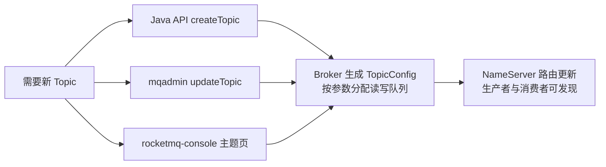
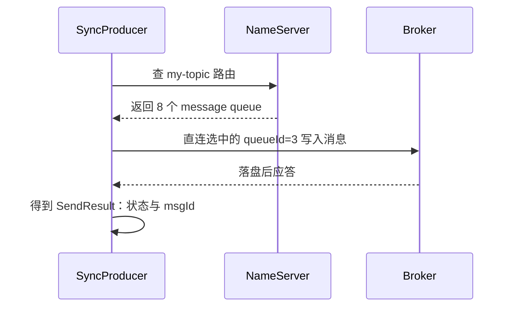
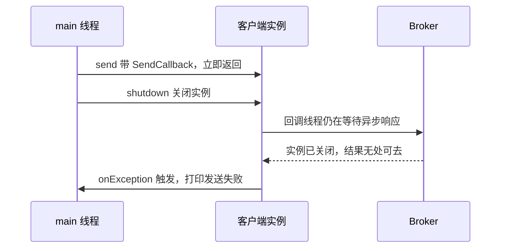
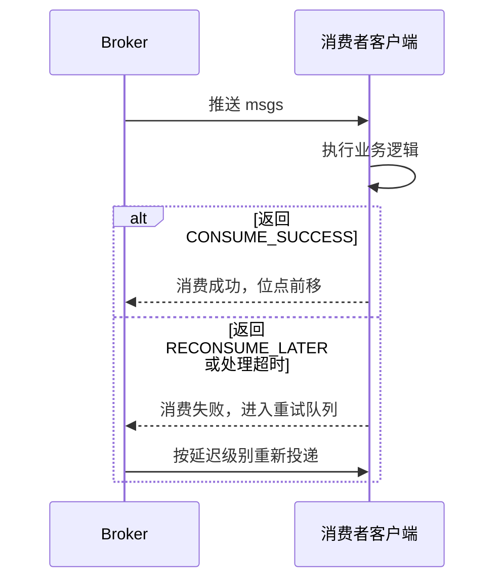
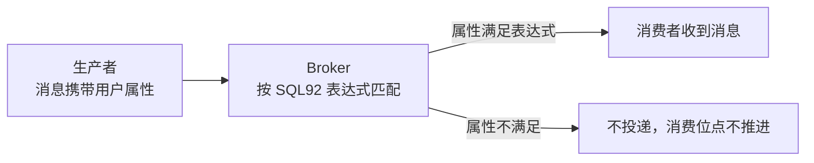

# RocketMQ快速入门之四连：Topic 创建、消息收发、消费订阅与 SQL92 过滤

## 先给结论

- 系列定位：RocketMQ 快速入门四连，把 Topic 创建、消息发送、消息消费与属性过滤四件入门事一次讲透。
- Topic 创建三条路：Java API 的 `createTopic`、命令行 `mqadmin updateTopic`、控制台主题页新增，最终都是给 Broker 提交一份 Topic 配置；生产环境应关闭 `autoCreateTopicEnable` 改为手动建。
- 发送侧先同步后异步：同步 send 阻塞拿 `SendResult`，凭 msgId 可在控制台检索；异步靠 `SendCallback` 回调，测试代码发完立刻 shutdown 会掐死回调。
- Message 必填只有 Topic 与消息体字节数组，Tags 与 Keys 是重要的选填项，Keys 放业务唯一键给消息轨迹留检索入口。
- 消费用 `DefaultMQPushConsumer`：订阅加监听器，返回 CONSUME_SUCCESS 推进位点、失败走重试队列；订阅表达式支持全量、精确与或匹配，同一消费组内订阅关系必须一致。
- SQL92 过滤是 Tag 之上的精筛：生产端 `putUserProperty` 挂属性，消费端 `bySql` 写表达式，Broker 必须开 `enablePropertyFilters` 才生效，过滤动作发生在 Broker 端。
- 全系列示例代码按课程视频屏幕整理，包名统一为 `com.example`，可在本地 Maven 工程直接运行验证。
- 选型口诀贯穿始终：要确认结果用同步，高吞吐又要结果用异步，允许丢失才用单向；粗分流用 Tag，复杂条件才上 SQL92。

## 第1部分：手动创建 RocketMQ Topic：Java API、mqadmin 命令与控制台三条路

前面测收发消息的时候，代码里从头到尾没有出现过「创建 Topic」这个动作，`my-topic` 这类名字随手一写，消息照样发了进去。到了生产环境，这种顺手就来的行为恰恰是要被禁止的：Topic 名称失控、权限边界混乱，都是自动创建惯出来的。这一篇把手动创建 Topic 的三条路走全，顺带说清楚那个默认开着的 `autoCreateTopicEnable` 开关该不该关。

### 一、没建过 Topic，消息是怎么发进去的
RocketMQ 的 Broker 上有一个开关，发行包的 `conf/broker.conf` 模板里就写着这一行：

```properties
autoCreateTopicEnable=true
```

它打开时，生产者对一个不存在的 Topic 调用 `send`，Broker 会参照默认 Topic 的路由模板自动创建出这个新 Topic，并给它分配默认数量的队列，讲义里的说法是默认一个 Topic 自动创建 4 个写队列、4 个读队列。开发环境靠它省了建 Topic 的步骤，测试代码里没有 createTopic 也能一路发下去。

**第一，自动创建的代价是 Topic 数量失控。** Topic 名是写代码的人随手起的字符串，一个拼写变体就是一个新 Topic，时间一长集群里堆满来历不明的主题，谁也说不清哪些还在用。

**第二，权限管理需要明确的 Topic 边界。** 生产环境往往要按 Topic 划分读写权限，自动创建出来的名字没有审批环节，权限模型形同虚设。所以生产环境会把 `autoCreateTopicEnable` 关掉，Topic 走手动创建，下面的三条路分别对应代码、命令行和界面三种场景。



三条路的终点相同：Broker 生成 Topic 配置，NameServer 的路由表随之更新，客户端才能查到它。区别只在于谁来发起。

### 二、Java API：createTopic 的三个参数
新建一个 `TopicDemo`，用生产者对象顺手建 Topic：

```java
package com.example.rocketmq.topic;

import org.apache.rocketmq.client.producer.DefaultMQProducer;

public class TopicDemo {

    public static void main(String[] args) throws Exception {
        DefaultMQProducer producer = new DefaultMQProducer("haoke");
        producer.setNamesrvAddr("172.16.55.185:9876");
        producer.start();
        // 创建topic, 参数分别是: broker的名称, topic的名称, queue的数量
        producer.createTopic("broker_haoke_im", "my-topic", 8);
        System.out.println("topic创建成功!");
        producer.shutdown();
    }
}
```

逐个参数拆开看：

**第一，`key` 用 Broker 名称。** 它决定把 Topic 建到哪台 Broker 上，这里填 `broker_haoke_im`，对应 Broker 配置文件里的 `brokerName`。名字从哪来，回看搭环境时写给 Broker 的那份配置就能找到。

**第二，`newTopic` 是 Topic 名。** 业务语义起名，示例里就是后续两节课要反复用的 `my-topic`。

**第三，`queueNum` 是队列数量。** 自动创建的默认值是 4，手动创建时可以按并发需求自己定，示例给 8。队列数决定了这个 Topic 的发送与消费并发上限，集群篇会展开。

跑完 `main` 方法，`shutdown` 之后进程直接退出，打印只留一句 `topic创建成功!`。验证方式是打开 rocketmq-console 的主题页，列表里出现 `my-topic`，说明 Broker 已接收、路由已注册。

### 三、命令行：mqadmin updateTopic
不写代码的场景，发行包 `bin` 目录自带的 `mqadmin` 工具一条命令建 Topic（day09 资料包未提供脚本清单，此命令按 4.5.0 发行包的标准用法补全）：

```bash
# -n 指定 NameServer；-c 指定集群，整个集群统一创建
sh bin/mqadmin updateTopic -n 172.16.55.185:9876 -c DefaultCluster -t my-topic -r 8 -w 8

# 只建到某台 Broker 上，用 -b 替代 -c
sh bin/mqadmin updateTopic -n 172.16.55.185:9876 -b 172.16.55.185:10911 -t my-topic -r 8 -w 8
```

`-r` 与 `-w` 分别是读队列数和写队列数。集群模式部署时用 `-c` 让同名的 Topic 在每台 Broker 上都有配置，单机调试用 `-b` 就够。运维脚本、发布流水线里建 Topic 走的就是这条路，比代码里调用 `createTopic` 更容易审计。

### 四、控制台：主题页的新增功能
rocketmq-console 的主题页提供界面入口，填集群或 Broker、Topic 名、读写队列数，确认即建。它不是什么特殊通道，后端就是一个标准的接口调用，控制台源码 `TopicController` 里的实现一目了然：

```java
// rocketmq-console 源码 TopicController（节选）
@RequestMapping(value = "/createOrUpdate.do", method = { RequestMethod.POST })
@ResponseBody
public Object topicCreateOrUpdateRequest(@RequestBody TopicConfigInfo topicCreateOrUpdateRequest) {
    Preconditions.checkArgument(
        CollectionUtils.isNotEmpty(topicCreateOrUpdateRequest.getBrokerNameList())
            || CollectionUtils.isNotEmpty(topicCreateOrUpdateRequest.getClusterNameList()),
        "clusterName or brokerName can not be all blank");
    topicService.createOrUpdate(topicCreateOrUpdateRequest);
    return true;
}
```

校验逻辑只有一条：集群名和 Broker 名不能同时为空，Topic 总得有个落脚点。界面操作最终也走 `createOrUpdate`，与 `mqadmin` 到达的是同一个 Broker 接口，三种方式只是入口不同。

### 五、autoCreateTopicEnable 关掉之后
**第一，关掉后发送不存在的 Topic 会直接失败。** 生产者查不到路由，同步发送抛出找不到 Topic 路由的异常。这不是故障，是开关在起作用：新建 Topic 必须先走手动创建流程，然后生产者才能发。

**第二，关的方式是改配置重启 Broker。** 把 `broker.conf` 里的 `autoCreateTopicEnable` 改成 `false`，重启 Broker 生效，控制台集群页能直接看到每个配置项的运行时值，改没改生效一眼可查。

**第三，`createTopic` 本身不受这个开关影响。** 手动创建的三条路走的是显式的创建接口，与自动创建是两套逻辑；关掉开关关的是「发送时顺手建」这条隐式通道。

## 第2部分：同步与异步发送 RocketMQ 消息：拆开 SendResult，再避开 shutdown 掐死回调的坑

同步发送一行 `send` 拿回一个 `SendResult`，打印出来一堆字段；换成异步写法，只多了一个回调参数，控制台却打出「消息发送失败」。两段代码的差别不在发送本身，而在 `main` 方法的最后一行。这一篇把同步发送的返回值拆开看透，把异步发送的回调机制讲清，最后给出三种发送方式的选型标准。

### 一、同步发送：一问一答的完整写法
在发送包里建一个 `SyncProducer`，三步固定动作之外，重点看返回值：

```java
package com.example.rocketmq.sendmsg;

import org.apache.rocketmq.client.producer.DefaultMQProducer;
import org.apache.rocketmq.client.producer.SendResult;
import org.apache.rocketmq.common.message.Message;

public class SyncProducer {

    public static void main(String[] args) throws Exception {
        DefaultMQProducer producer = new DefaultMQProducer("haoke");
        producer.setNamesrvAddr("172.16.55.185:9876");
        producer.start();
        // 发送消息
        String msg = "我的第一个消息!";
        // Message 三参构造：topic、tags、消息体字节数组
        Message message = new Message("my-topic", "mytag",
                msg.getBytes("UTF-8"));
        SendResult sendResult = producer.send(message);
        System.out.println("消息ID：" + sendResult.getMsgId());
        System.out.println("消息队列：" + sendResult.getMessageQueue());
        System.out.println("消息offset值：" + sendResult.getQueueOffset());
        System.out.println(sendResult);
        producer.shutdown();
    }
}
```

`producer.send(message)` 这一行在拿到 Broker 的应答之前不会往下走，所以叫同步。运行后打印的完整结果类似：

```text
SendResult [sendStatus=SEND_OK, msgId=AC1037B41C4418B4AAC260161DAE0000,
offsetMsgId=AC1037B900002A9F0000, messageQueue=MessageQueue [topic=my-topic,
brokerName=broker_haoke_im, queueId=3], queueOffset=0, ...]
```

每个字段都值得抠一下含义：

**第一，`sendStatus=SEND_OK` 表示发送成功。** 状态枚举还有其他取值，对应主从同步等中间态，出现非 `SEND_OK` 要按状态单独处理，不能当成成功计。

**第二，`messageQueue` 说明消息落在哪。** `topic` 是业务主题，`brokerName` 是目标 Broker，`queueId` 是该 Topic 下 8 个队列中的第 4 个（编号从 0 起）。生产者发送前从 NameServer 拿路由，再从队列里选中一个投递：



**第三，`queueOffset` 是这条消息在该队列里的位点。** 本次发送为 0，再发一条变 1。到控制台主题页展开状态，能看到 8 个队列各自的读写位点，`queueId=3` 的最大位点已经是 1，与返回值对得上。

**第四，`msgId` 用来查消息。** 控制台消息页按 Topic 加消息 ID 查询，能查到这条消息的完整内容「我的第一个消息」，排查丢消息时这就是入口。返回值里同时还有 `offsetMsgId`，那是 Broker 侧存储文件的位点 ID，翻 Broker 日志时看的是它，两个 ID 别混用。

### 二、Message 的七个字段，必填只有两个
视频里直接翻开了 `Message` 的源码，两个参构造一路委托到全参构造：

```java
public Message(String topic, byte[] body) {
    this(topic, "", "", 0, body, true);
}
```

全部字段与默认值如下：

| 字段 | 默认值 | 说明 |
|---|---|---|
| Topic | null | 必填，消息的一级分类，线下环境不用申请 |
| Body | null | 必填，二进制形式，最大 4M，序列化方式由应用两端协商 |
| Tags | null | 选填，二级分类，方便服务端过滤，一条消息只设一个 |
| Keys | null | 选填，业务关键词，服务端按它建哈希索引，尽量唯一 |
| Flag | 0 | 选填，RocketMQ 不做干预，留给应用 |
| DelayTimeLevel | 0 | 选填，延迟级别，0 不延迟，大于 0 按级别延迟消费 |
| WaitStoreMsgOK | true | 选填，消息是否在服务器落盘后才返回应答 |

**Tags 与 Keys 是日常最值得认真填的两个。** Tags 类似给邮件打标签，`add`、`update` 这类操作名放在这里，消费端就能按标签筛消息；Keys 建议放订单号、商品 ID 这种业务唯一键，控制台按 Key 检索消息全靠这个索引。视频里发送时只设了 Topic、Tags 和 Body 三个参数，其余字段保持默认，就够用了。

### 三、异步发送与 shutdown 掐死回调的坑
异步发送把 `SendResult` 换成了 `SendCallback`：

```java
package com.example.rocketmq.sendmsg;

import org.apache.rocketmq.client.producer.DefaultMQProducer;
import org.apache.rocketmq.client.producer.SendCallback;
import org.apache.rocketmq.client.producer.SendResult;
import org.apache.rocketmq.common.message.Message;

public class AsyncProducer {

    public static void main(String[] args) throws Exception {
        DefaultMQProducer producer = new DefaultMQProducer("haoke");
        producer.setNamesrvAddr("172.16.55.185:9876");
        producer.start();
        String msg = "我的第一个异步发送消息!";
        // 两参构造：只有 topic 与消息体
        Message message = new Message("my-topic", msg.getBytes("UTF-8"));
        producer.send(message, new SendCallback() {
            @Override
            public void onSuccess(SendResult sendResult) {
                // 发送成功的回调，结果对象与同步发送一致
                System.out.println("发送成功了!" + sendResult);
            }

            @Override
            public void onException(Throwable e) {
                // 发送失败的回调，可记录日志后补偿重发
                System.out.println("消息发送失败!" + e);
            }
        });
        // producer.shutdown();
    }
}
```

课程现场就翻车在这一行：`shutdown` 没有注释时运行，控制台打出「消息发送失败」，异常内容指向拿不到 Topic 的信息；把 `shutdown` 注释掉再跑，发送成功，控制台按消息 ID 能查到这条落在 `queueId=6` 的消息。

原因是时序问题。**异步 `send` 一调用就返回，`main` 线程立刻执行到 `shutdown`，客户端实例被关闭，连接与路由全部清掉；而回调线程还在等 Broker 的响应，等到的却是客户端已经不存在的结局，于是进 `onException`。** 失败的不是网络，是被自己掐掉的回调：



测试代码想等回调完成，用 `CountDownLatch` 或 `Thread.sleep` 拖住主线程即可；生产环境的服务常驻运行，`main` 线程不会退出，这个问题天然不存在。理解了时序，就不会把锅扣给 RocketMQ。

### 四、三种发送方式怎么选
讲义把发送方式归纳为三种：同步消息执行 API 时阻塞等待 Broker 返回结果；异步消息指定成功与异常的回调，调用后立即返回，发送线程不阻塞，回调任务在新线程里执行；单向消息直接返回，不等待 Broker 的结果。单向发送只需换一个方法：

```java
// 单向发送：只管发出去，不等结果也没有回调
producer.sendOneway(message);
```

选型可以按可靠性与吞吐两把尺子量：

| 方式 | 等结果吗 | 吞吐 | 典型场景 |
|---|---|---|---|
| 同步 | 阻塞等待 | 一般 | 订单、支付等关键链路，必须确认成功 |
| 异步 | 回调通知 | 高 | 通知、积分这类量大又要结果的操作 |
| 单向 | 完全不等 | 最高 | 日志采集、埋点，允许个别丢失 |

关键链路宁可慢也要确认，所以同步；量大到阻塞成本不可接受时用异步换吞吐；丢了也无所谓的数据才用单向，单向省下的每一毫秒，都是用可靠性换的。

## 第3部分：消费 RocketMQ 消息：PushConsumer 基本盘与订阅表达式的三种写法

生产端发消息已经跑通了，消费端一启动，之前发的几条消息全数到达；可把订阅表达式从 `*` 改成某个 Tag 之后，同一个消费者开始「挑食」，有的收、有的不收。消费端的手感就建立在这两件事上：监听器怎么写、订阅表达式怎么填。这一篇先把消费骨架搭稳，再把三种订阅写法逐一试过。

### 一、push 与 pull：两种消费者怎么分
RocketMQ 的消费者类是一对的：`DefaultMQPushConsumer` 与 `DefaultMQPullConsumer`，名字里的 push 和 pull 就是两种消息投递姿态。讲义的说法是，推模式由 Broker 主动推送给消费者，拉模式由消费者主动从 Broker 查询消息。

**PushConsumer 并不是真的有一根「推送」管道。** 它内部仍靠长轮询拉取，只是客户端把拉取动作封装掉了：消息一到就回调监听器，用起来像服务端推的。绝大多数业务选 push，写起来省心；pull 用在消费者要自主控制节奏的场景。本节以及后续课程全部围绕 push。

### 二、基础消费示例：从订阅到应答
新建 `consumer` 包与 `ConsumerDemo`，这是消费端的最小骨架：

```java
package com.example.rocketmq.consumer;

import org.apache.rocketmq.client.consumer.DefaultMQPushConsumer;
import org.apache.rocketmq.client.consumer.listener.ConsumeConcurrentlyContext;
import org.apache.rocketmq.client.consumer.listener.ConsumeConcurrentlyStatus;
import org.apache.rocketmq.client.consumer.listener.MessageListenerConcurrently;
import org.apache.rocketmq.common.message.MessageExt;

import java.io.UnsupportedEncodingException;
import java.util.List;

public class ConsumerDemo {

    public static void main(String[] args) throws Exception {
        DefaultMQPushConsumer consumer =
                new DefaultMQPushConsumer("haoke-consumer");
        consumer.setNamesrvAddr("172.16.55.185:9876");
        // 订阅消息，* 表示接收所有消息
        consumer.subscribe("my-topic", "*");
        consumer.registerMessageListener(new MessageListenerConcurrently() {
            @Override
            public ConsumeConcurrentlyStatus consumeMessage(
                    List<MessageExt> msgs, ConsumeConcurrentlyContext context) {
                try {
                    for (MessageExt msg : msgs) {
                        System.out.println("消息：" +
                                new String(msg.getBody(), "UTF-8"));
                    }
                } catch (UnsupportedEncodingException e) {
                    e.printStackTrace();
                }
                return ConsumeConcurrentlyStatus.CONSUME_SUCCESS;
            }
        });
        consumer.start();
    }
}
```

按代码顺序过一遍要点：

**第一，消费组要起业务名。** `haoke-consumer` 对应发送端的 `haoke` 生产组，组名相同的一批消费者共同分担一个 Topic 的消息，这是后面消息模式一节的主角。

**第二，`subscribe` 定下接收范围。** 第二个参数是订阅表达式，`*` 表示这个 Topic 下所有消息全收。

**第三，监听器是消费逻辑的落点。** `MessageExt` 继承自 `Message`，除了 `getBody()` 拿消息体，`getMsgId()`、`getTags()`、队列信息等元数据都在。消息体是字节数组，按发送时的编码用 `UTF-8` 还原成字符串。

**第四，返回值不是可有可无的。** 监听器要求返回一个状态，这个状态就是消费端给服务端的应答：服务端必须知道每条消息是处理成功还是失败，失败了才好触发重试机制。整条链路是这样闭合的：



验证方式是两头对照：先启动消费者，把此前发的两条消息一并收回，异步那条、同步那条都在；再把生产者的消息内容改成「我的第一个消息2」发一条，消费者立刻打印出来，收发闭环。至于监听器并发回调的线程数、顺序消息用 `MessageListenerOrderly` 的场景，留到后面的专题展开。

### 三、订阅表达式：全量、精确与或匹配
`subscribe` 的第二个参数能写的不止 `*`。按源码注释，它可以是一个订阅表达式，最常用的写法有三种：

| 写法 | 表达式示例 | 行为 |
|---|---|---|
| 全量 | `*` | 该 Topic 下所有消息都收 |
| 精确匹配 | `add` | 只收 Tag 等于 `add` 的消息 |
| 或匹配 | `add \|\| update` | 收 Tag 为 `add` 或 `update` 的消息 |

课程里的实测过程值得复述一遍，现象非常直观：

**精确匹配。** 把订阅表达式改成 `add`，消费者先跑起来；生产者发一条 Tag 为 `mytag` 的消息，消费者毫无反应；换成 Tag 为 `add` 的消息，立刻收到「我的第一个消息4」。Tag 是消息的二级分类，把操作类型（增、删、改）放进 Tag，消费端就能按需选取。

**或匹配。** 一个条件不够用就写多个，`add || update`，中间的竖线两边要留空格。这回发 Tag 为 `add` 的消息收到，发 `update` 的消息收到，再发 Tag 为 `delete` 的消息，消费者保持沉默。

Tag 过滤的执行位置主要在 Broker 端，消息不用全量发给客户端再丢弃，省的是网络与客户端开销；到达客户端后还会做一轮精确比对，保证不因哈希碰撞误投。要更复杂的条件，比如按业务属性组合筛选，就得用下一节的消息过滤器，那里支持类似 SQL 的表达式，但前提是 Broker 先打开 `enablePropertyFilters` 开关。

### 四、Spring Boot 风格对照
原生客户端的骨架理解之后，Spring Boot 项目的写法只是把它包了一层注解。讲义测试工程里的监听类是这样的（包名已改为 `com.example`）：

```java
package com.example.rocketmq.message;

import org.apache.rocketmq.spring.annotation.RocketMQMessageListener;
import org.apache.rocketmq.spring.core.RocketMQListener;
import org.springframework.stereotype.Component;

/**
 * 消费消息监听类
 */
@Component
@RocketMQMessageListener(topic = "my-topic", consumerGroup = "demo-consumer-group")
public class ConsumerSimple implements RocketMQListener<String> {
    // 接收到消息调用此方法
    @Override
    public void onMessage(String s) {
        System.out.println(s);
    }
}
```

注解里指定 Topic 与消费组，框架替你完成订阅、监听器注册与应答，`onMessage` 正常返回即视为消费成功、抛异常则进入重试。两种写法一一对应：注解的 `topic` 是 `subscribe` 的第一个参数，`consumerGroup` 是构造器的组名，理解了原生写法，注解版本只是换个皮。

## 第4部分：用 SQL92 按业务属性过滤 RocketMQ 消息：putUserProperty、bySql 与 Broker 的开关

Tag 过滤只有一层分类，`add`、`update` 这样的操作名够用，可一旦需求变成「只收性别为女且年龄不小于 18 的用户消息」，Tag 就无能为力了。RocketMQ 的消息过滤器允许在消息上挂用户自定义属性，消费端用类似 SQL 的 WHERE 表达式筛选。这个功能有一道很多人栽过的门槛：Broker 默认不开，代码写对也收不到消息。

### 一、Tag 之后，为什么还需要过滤器
订阅表达式已经解决了「按 Tag 挑消息」：`*` 全量、Tag 名精确匹配、`TagA || TagB` 或匹配。但这套表达式的粒度停在 Tag 上，Tag 每条消息只能有一个值，想表达「性别为女，并且年龄大于等于 18」这种多字段组合，Tag 体系就不够用了。

讲义对消息过滤器的定义是：RocketMQ 支持根据用户自定义属性进行过滤，过滤表达式类似 SQL 的 WHERE，例如 `a > 5 AND b = 'abc'`。属性由业务自己定义，想按什么维度筛就在生产端挂什么属性，消费端写表达式挑选，灵活度一下子打开了。

### 二、生产端：给消息挂上用户属性
复制同步发送的生产者改造，Topic 换成专用的 `my-topic-filter`，发送前挂两个属性：

```java
package com.example.rocketmq.filter;

import org.apache.rocketmq.client.producer.DefaultMQProducer;
import org.apache.rocketmq.client.producer.SendResult;
import org.apache.rocketmq.common.message.Message;

public class FilterProducer {

    public static void main(String[] args) throws Exception {
        DefaultMQProducer producer = new DefaultMQProducer("haoke");
        producer.setNamesrvAddr("172.16.55.185:9876");
        producer.start();
        String msg = "这是一个用户的消息";
        Message message = new Message("my-topic-filter", "delete",
                msg.getBytes("UTF-8"));
        // 用户自定义属性，与消息内容本身无关，供消费端过滤使用
        message.putUserProperty("sex", "女");
        message.putUserProperty("age", "18");
        SendResult sendResult = producer.send(message);
        System.out.println(sendResult);
        producer.shutdown();
    }
}
```

`putUserProperty` 的键名和值都由业务定，这里的 `sex` 与 `age` 描述的是用户画像，跟消息体里那句话没有关系。属性跟着消息一起存进 Broker，之后消费端的表达式就是对着这些键写的。

### 三、消费端：bySql 写表达式订阅
消费者代码骨架与前面一致，唯一变化在 `subscribe`：第二个参数从字符串表达式换成了 `MessageSelector.bySql`：

```java
package com.example.rocketmq.filter;

import org.apache.rocketmq.client.consumer.DefaultMQPushConsumer;
import org.apache.rocketmq.client.consumer.MessageSelector;
import org.apache.rocketmq.client.consumer.listener.ConsumeConcurrentlyContext;
import org.apache.rocketmq.client.consumer.listener.ConsumeConcurrentlyStatus;
import org.apache.rocketmq.client.consumer.listener.MessageListenerConcurrently;
import org.apache.rocketmq.common.message.MessageExt;

import java.io.UnsupportedEncodingException;
import java.util.List;

public class FilterConsumer {

    public static void main(String[] args) throws Exception {
        DefaultMQPushConsumer consumer =
                new DefaultMQPushConsumer("haoke-consumer");
        consumer.setNamesrvAddr("172.16.55.185:9876");
        // SQL92 表达式：性别为女，且年龄大于等于 18
        consumer.subscribe("my-topic-filter",
                MessageSelector.bySql("sex = '女' AND age >= 18"));
        consumer.registerMessageListener(new MessageListenerConcurrently() {
            @Override
            public ConsumeConcurrentlyStatus consumeMessage(
                    List<MessageExt> msgs, ConsumeConcurrentlyContext context) {
                try {
                    for (MessageExt msg : msgs) {
                        System.out.println("消息：" +
                                new String(msg.getBody(), "UTF-8"));
                    }
                } catch (UnsupportedEncodingException e) {
                    e.printStackTrace();
                }
                return ConsumeConcurrentlyStatus.CONSUME_SUCCESS;
            }
        });
        consumer.start();
    }
}
```

注意 Topic 名要与生产端一致，表达式里 `age >= 18` 的 18 不带引号，`'女'` 带单引号，这正体现了 SQL92 的类型习惯：属性值虽然都以字符串写入，数值比较时按数值处理，字符串比较时按原文比对。表达式里还能用 `TAGS`、`KEYS` 这类系统属性，与自定义属性组合出更复杂的条件。

### 四、Broker 不开开关，一切白搭
课程现场第一次联调就是在这里翻车的：消费者启动、生产者发送，消息发送成功，消费者却毫无动静；重启消费者后直接抛出异常，报错原文是：

```text
Exception in thread "main" org.apache.rocketmq.client.exception.MQClientException:
CODE: 1 DESC: The broker does not support consumer to filter message by SQL92
```

这条异常说得直白：Broker 不支持消费者用 SQL92 过滤消息。SQL92 过滤依赖 Broker 端执行表达式，这个能力默认是关着的，必须显式打开。在 Broker 的配置文件里追加一项：

```properties
# 加入 broker 配置项，启用自定义属性过滤
enablePropertyFilters=true
```

保存后重启 Broker 生效，课程环境里 Broker 跑在容器中，一条命令即可：

```bash
docker restart rmqbroker
```

开关的意义在于把过滤责任放到 Broker：



匹配与不匹配的消息都存在队列里，只是Broker 替这个消费者把关：不满足表达式的消息不投递，消费位点也不越过它。换一个订阅表达式不同的消费组来，同一条消息照常投递，过滤是按订阅者隔离的。

### 五、一组消息验证过滤逻辑
开关打开后重放课程里的测试序列，判定结果一目了然：

| 消息 | sex | age | 表达式判定 | 消费者是否收到 |
|---|---|---|---|---|
| 用户 1001 | 女 | 18 | 两项都满足 | 收到 |
| 用户 1002 | 女 | 15 | 年龄不满足 | 未收到 |
| 用户 1002 改为 20 | 女 | 20 | 两项都满足 | 收到 |
| 用户 1003 | 男 | 20 | 性别不满足 | 未收到 |

同一套代码，收与不收完全由属性值与表达式决定。比起 Tag 单维度筛选，这种按业务属性组合过滤的方式灵活得多，代价是 Broker 要执行表达式，粗分流仍应优先用 Tag，SQL92 留给真正需要多条件的场景。

## 常见误区

- **拿 `key` 当随便的字符串。** 传一个不存在的名字，创建请求找不到落点。它应当是 Broker 名称（或集群名），从 Broker 配置的 `brokerName` 里取。
- **队列数拍脑袋。** 自动创建默认 4 个队列是够用的下限，高并发 Topic 建成 8 或 16 合理；但盲目堆大数字会让队列空转，消费者个数超出队列总数时多出的消费者闲置。
- **开发环境验证完忘了关开关。** 测试环境开着自动创建没毛病，把这套配置原样搬到生产，Topic 治理就失效了。上线检查清单里应有一条：确认 `autoCreateTopicEnable=false`。
- **以为 Topic 建了消息就有序。** 队列数只决定并发能力，顺序消费需要生产端把消息路由到同一队列，属于 Producer 顺序消息那一篇的内容。
- **异步发送后立刻 `shutdown`。** 回调线程还没拿到结果，客户端实例已被关闭，`onException` 被触发。测试代码要用锁或 sleep 等回调完成，生产环境服务常驻则无此问题。
- **把 `msgId` 与 `offsetMsgId` 混为一谈。** `msgId` 是生产者侧的消息标识，控制台按它查消息；`offsetMsgId` 是 Broker 存储位点的标识，查 Broker 日志用它。排查问题前先分清在哪一侧查。
- **Body 直接传字符串。** `Message` 构造器收的是字节数组，字符串要显式 `getBytes` 指定编码，生产与消费两端约定同一种编码，否则消费端解出来是乱码。
- **Keys 永远空着。** 没有业务键，消息轨迹与按 Key 检索就少了一把索引，线上排查只能按 Topic 翻队列。订单号、商品 ID 这类唯一业务标识放进 Keys，检索成本立刻降下来。
- **监听器写完了却忘了 `consumer.start()`。** 订阅与监听器都只是「配置」，不启动实例一条消息也收不到，而且进程不退出时看起来一切正常，最不容易被发现。
- **对同一个 Topic 反复 `subscribe` 以为会叠加。** 后调用的表达式会覆盖先调用的，`*` 之后再 `subscribe` 精确 Tag，全量订阅就没了。一个 Topic 一条表达式，要放宽就写 `add || update`。
- **同一消费组内订阅关系不一致。** 组内消费者订阅的 Topic 或表达式不同，Broker 无法为整组维护一份一致的订阅视图，轻则部分消息没人消费，重则整组位点错乱。发布新订阅时全组同步更新。
- **异常被吞掉还返回成功。** 在监听器里 `catch` 住异常后仍返回 `CONSUME_SUCCESS`，Broker 视为消费成功，位点前移，这条业务失败的消息就被永远跳过了。失败要返回 `RECONSUME_LATER`，让重试机制接手。
- **只改了代码忘了改 Broker 配置。** `enablePropertyFilters` 不开，订阅直接报不支持 SQL92 的异常，个别版本表现为订阅成功却永远收不到消息。两种现象都先去查 Broker 配置并重启。
- **引号用法随意。** 数值比较写成 `age >= '18'`、字符串比较丢掉单引号，都会让判定结果不可预期。属性以字符串写入，表达式遵循 SQL 习惯：字符串加单引号，数值裸写。
- **以为过滤能替代消息分类。** 所有消息挤在一个 Topic 里靠表达式硬筛，Broker 的过滤压力随消息量线性上涨。大类先拆 Topic 或 Tag，SQL92 只做末端精筛。
- **属性键名随手起。** 键名会随消息存储，与 `TAGS`、`KEYS` 等系统属性同名或拼写混乱的表达式排查起来非常痛苦，属性名要有业务约定。

## 面试可能被问到的问题

1. 面试官追问：「生产者没有创建过 Topic，消息为什么能发成功？」
   答：Broker 的 autoCreateTopicEnable 打开时，发送不存在的 Topic 会触发自动创建，Broker 按默认 Topic 的模板生成路由，默认 4 个写队列 4 个读队列。生产环境会关闭该开关，Topic 改为手动创建。

2. 面试官追问：「生产环境为什么要关闭自动创建 Topic？」
   答：一是控制 Topic 数量，避免生产者随手起名造成主题泛滥；二是权限管理需要明确的 Topic 边界，自动创建绕过了审批环节。关闭后统一走手动创建，便于治理与审计。

3. 面试官追问：「`createTopic` 的三个参数分别是什么含义？」
   答：key 指定创建位置，通常传 Broker 名称；newTopic 是要创建的 Topic 名；queueNum 是队列数量。队列数决定该 Topic 的发送与消费并发上限，自动创建时默认为 4。

4. 面试官追问：「手动创建 Topic 有哪几种方式，最终落到哪里？」
   答：三种：Java 客户端的 createTopic、发行包的 mqadmin updateTopic 命令、rocketmq-console 主题页新增。三者最终都是向 Broker 提交 TopicConfig，NameServer 路由随之更新，只是入口分别为代码、命令行与界面。

5. 面试官追问：「关闭自动创建后，上线一个新 Topic 的正确流程是什么？」
   答：先手动创建 Topic 并确认路由可见，再上线生产者与消费者代码。顺序颠倒时生产者查不到路由会直接失败，报找不到 Topic 的路由信息。

6. 面试官追问：「同步发送和异步发送的本质区别是什么？」
   答：同步发送阻塞当前线程直到 Broker 返回落盘应答，结果直接作为返回值；异步发送调用后立即返回，结果通过 SendCallback 在新的线程里回调，onSuccess 给成功结果，onException 兜失败。差异在等待方式，消息本身的可靠性路径是一致的。

7. 面试官追问：「SendResult 里有哪些信息，分别用来做什么？」
   答：sendStatus 表示发送状态，SEND_OK 才算成功；msgId 是生产者侧标识，控制台按它查消息；offsetMsgId 是 Broker 存储位点标识，对日志用；messageQueue 给出 topic、brokerName 与 queueId，说明落点；queueOffset 是该队列内的位点，配合控制台看堆积。

8. 面试官追问：「异步发送在测试里总是失败，可能是什么原因？」
   答：最典型的是发送后立刻 shutdown，客户端实例关闭导致回调线程拿不到 Broker 的响应，onException 被触发。解决办法是等回调完成再退出，比如 CountDownLatch，生产环境服务常驻则不存在这个问题。

9. 面试官追问：「Message 的 Keys 字段是干什么的？」
   答：业务关键词，服务端按 Keys 建哈希索引，控制台可以根据 Topic 加 Key 快速定位消息。建议放订单号、商品 ID 这类尽量唯一的值，等于给每条消息挂了一个业务维度的检索入口。

10. 面试官追问：「单向发送不保证送达，什么场景敢用它？」
   答：日志采集、埋点上报这类允许个别丢失、量极大且不需要确认的场景。它不等待也不回调，吞吐最高，但消息可能因网络问题丢失，业务关键数据不能用。

11. 面试官追问：「消息体最大多大，超出会怎样？」
   答：默认上限 4M，发送前客户端会校验长度，超限直接抛异常。业务上大报文应拆分或改成传引用地址，把大内容放到对象存储，消息里只带定位信息。

12. 面试官追问：「push 消费者和 pull 消费者的区别是什么？」
   答：push 由客户端封装好长轮询，消息到达即回调监听器，业务只写消费逻辑；pull 由消费者自己控制拉取时机与位点，适合自主控制节奏的场景。push 内部本质仍是拉取，只是把轮询与位点管理封装掉了。

13. 面试官追问：「监听器的返回值有什么讲究？」
   答：返回 CONSUME_SUCCESS 表示消费成功，Broker 推进消费位点；返回 RECONSUME_LATER 或处理超时视为失败，消息进入重试队列按延迟级别重投，超过最大重试次数进入死信队列等待人工处理。

14. 面试官追问：「`MessageListenerConcurrently` 和 `MessageListenerOrderly` 怎么选？」
   答：并发消费多线程回调，吞吐高但不保证顺序；顺序消费保证同一队列内串行消费，适合依赖先后顺序的业务，如同一订单的状态变更。非顺序业务一律用并发，顺序消费要配合生产端按业务键路由到同一队列。

15. 面试官追问：「订阅表达式支持哪些写法？」
   答：星号表示全量；写具体 Tag 名做精确匹配；多个 Tag 用双竖线连接做或匹配；更复杂的条件用 MessageSelector.bySql 写 SQL92 表达式按用户属性过滤，前提是 Broker 开启 enablePropertyFilters。

16. 面试官追问：「同一个消费组内订阅关系不一致会发生什么？」
   答：RocketMQ 以消费组为单位维护订阅关系，组内必须一致。不一致时订阅信息互相覆盖，部分消息无法投递，消费位点错乱。保持整组订阅相同的唯一正解是发布时全组统一更新。

17. 面试官追问：「消费端为什么拿到的是字节数组，乱码怎么来的？」
   答：消息体以二进制传输，序列化形式由生产与消费两端协商，客户端不替你转码。发送端 getBytes 用 UTF-8，消费端 new String 也要用同一种编码，两端编码不一致就出现乱码。

18. 面试官追问：「SQL92 过滤和 Tag 过滤的区别是什么？」
   答：Tag 过滤基于消息的单一 tag 字段，支持全量、精确与或匹配，写法简单且开销小；SQL92 过滤针对用户自定义属性，支持多字段组合与数值比较，表达能力强。粗分流用 Tag，复杂条件组合才用 SQL92。

19. 面试官追问：「消息过滤发生在哪一端？」
   答：主要在 Broker 端。消费者把订阅表达式注册到 Broker，Broker 按表达式判断后再投递，不匹配的消息不发给该消费者，节省网络与客户端开销；到达客户端后还有一轮精确校验兜底。

20. 面试官追问：「Broker 没开 enablePropertyFilters 会怎样？」
   答：消费者用 MessageSelector.bySql 订阅时会收到 The broker does not support consumer to filter message by SQL92 的异常。解决方法是在 broker.conf 里加 enablePropertyFilters=true 并重启 Broker，客户端无需改动。

21. 面试官追问：「SQL92 表达式支持哪些语法？」
   答：支持数值比较与字符串比较、AND/OR/NOT 逻辑组合、BETWEEN、IN、IS NULL 判空等，还能引用 TAGS 这类系统属性与自定义属性组合。属性值均为字符串存储，数值比较按数值处理。

22. 面试官追问：「自定义属性会不会影响性能？」
   答：属性随消息存储，属性越多消息越大，Broker 端执行表达式也有计算开销。属性应精简、键名有约定；高频粗分流优先用 Tag 或拆分 Topic，SQL92 只用于确有多维筛选需求的场景。

## 配套资料

- RocketMQ 发行包：`materials/code/10/rocketmq-all-4.5.0-bin-release/rocketmq-all-4.5.0-bin-release/`（`conf/broker.conf` 模板中真实存在 `autoCreateTopicEnable=true` 一行；`bin/` 目录含 `tools.sh`、`mqadmin.xml` 等发行包工具条目，`mqadmin updateTopic` 命令为按发行包标准用法补全的示例）
- rocketmq-console 源码：`materials/code/10/rocketmq-console/rocketmq-console/`（`src/main/java/org/apache/rocketmq/console/controller/TopicController.java` 的 `createOrUpdate.do` 接口为文中引用原文）
- RocketMQ 专题讲义：`materials/docs/10/RocketMQ研究v1.0.md`（「消息发送过程」小节给出自动创建默认 4 写 4 读队列的说法）
- 本课（day09）资料包未提供源码：`materials/code/03/day09-分布式消息系统RocketMQ的入门/` 下仅有解压清单 `_extracted.json`，记录解压文件数为 0；文中 `TopicDemo` 按课程视频屏幕代码整理，包名统一改为 `com.example`
- RocketMQ 发行包：`materials/code/10/rocketmq-all-4.5.0-bin-release/rocketmq-all-4.5.0-bin-release/`（服务端 4.5.0 发行包，客户端依赖版本与其对齐）
- RocketMQ 专题讲义：`materials/docs/10/RocketMQ研究v1.0.md`（「消息结构」小节说明消息体最大 4M 与 topic、tag、keys 等扩展属性；「三种消息发送方式」小节给出同步、异步、单向的定义与 `rocketMQTemplate.asyncSend` 加 `SendCallback` 的示例代码）
- 本课（day09）资料包未提供源码：`materials/code/03/day09-分布式消息系统RocketMQ的入门/` 下仅有解压清单 `_extracted.json`，记录解压文件数为 0；文中 `SyncProducer`、`AsyncProducer` 按课程视频屏幕代码整理，包名统一改为 `com.example`
- RocketMQ 专题讲义：`materials/docs/10/RocketMQ研究v1.0.md`（「消费者工程」小节给出 `@RocketMQMessageListener` 加 `RocketMQListener` 的 Spring Boot 消费监听类原文；「消息发送过程」小节说明推模式与拉模式、集群与广播两种消费模式）
- RocketMQ 发行包：`materials/code/10/rocketmq-all-4.5.0-bin-release/rocketmq-all-4.5.0-bin-release/`（`bin/tools.sh` 调用的 `org.apache.rocketmq.example.quickstart.Consumer` 为官方消费示例）
- 本课（day09）资料包未提供源码：`materials/code/03/day09-分布式消息系统RocketMQ的入门/` 下仅有解压清单 `_extracted.json`，记录解压文件数为 0；文中 `ConsumerDemo` 按课程视频屏幕代码整理，包名统一改为 `com.example`
- RocketMQ 发行包：`materials/code/10/rocketmq-all-4.5.0-bin-release/rocketmq-all-4.5.0-bin-release/`（`conf/broker.conf` 为配置文件模板，文中 `enablePropertyFilters=true` 为在其基础上按本课写法追加的示例项）
- RocketMQ 专题讲义：`materials/docs/10/RocketMQ研究v1.0.md`（「消费者工程」小节提供消费监听类的真实写法，SQL92 过滤的报错文案与开关配置取自课程讲义画面）
- 本课（day09）资料包未提供源码：`materials/code/03/day09-分布式消息系统RocketMQ的入门/` 下仅有解压清单 `_extracted.json`，记录解压文件数为 0；文中 `FilterProducer`、`FilterConsumer` 按课程视频屏幕代码整理，包名统一改为 `com.example`
