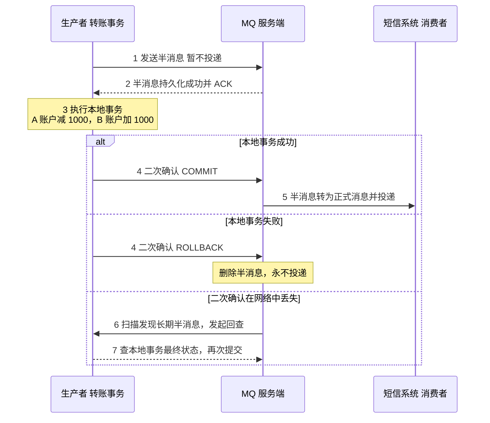

# RocketMQ 分布式事务消息：半消息、二次确认与状态回查

转账成功之后要给用户发一条短信。转账这件事在账户系统里，发短信在通知系统里，两个系统两个进程，谁也管不了谁的事务。如果转账失败短信却发出去了，或者转账成功短信永远没来，用户都会找上门。把「本地事务」和「发消息」绑成一个整体，就是 RocketMQ 事务消息要解决的问题。

这套机制在 RocketMQ 里是 Producer 侧最有亮点的能力之一，核心只有三个词：半消息、二次确认、回查。下面按「问题、原理、代码、回查」的顺序把它拆开。

## 先给结论

- 事务消息的做法：先发一条「暂不投递」的半消息，Broker 存好但不给消费者；本地事务执行完后，生产者再发一次二次确认，Broker 才决定投递还是删除。
- 二次确认只有两个方向：`COMMIT_MESSAGE` 半消息转为可投递，`ROLLBACK_MESSAGE` 半消息直接删除，消费者永远不会看到未确认的消息。
- 网络闪断或应用重启导致二次确认丢失时，Broker 会扫描长期处于半状态的消息，主动回查生产者，生产者查本地事务的最终状态后再答一次，这就是消息回查。
- 编码三件套：`TransactionMQProducer` 替代 `DefaultMQProducer`，实现 `TransactionListener` 的 `executeLocalTransaction` 与 `checkLocalTransaction` 两个方法，发送用 `sendMessageInTransaction`。
- 本地事务状态的返回值有三个：`COMMIT_MESSAGE`、`ROLLBACK_MESSAGE`、`UNKNOWN`，`UNKNOWN` 不是失败，是明确把判断权交给回查。

## 一、从本地事务到分布式事务

单体应用里的转账是一个教科书式的事务：用户 A 账户减 1000 元，用户 B 账户加 1000 元，两条 SQL 在同一个数据库事务里，要么同时成功，要么同时失败。如果减款之后进程崩溃，事务没提交，数据库自己回滚，A 的钱一分不少。这就是事务的原子性与一致性。

项目拆成微服务之后，情况变了。一次业务动作可能要串着调用三四个服务，比如先扣 A 的钱，再给 B 加钱，最后通知短信系统。调到第三个服务时挂了，前两步已经各自提交，没人替它们回滚，数据就不一致了。讲义把分布式事务的常见形态归成三类：基于单个 JVM 但数据库分库分表、跨了多个数据库的；基于多个 JVM、服务拆分了但不跨数据库的；多个 JVM、服务既拆分了数据库也分库分表的。形态不同，麻烦相同：跨进程的多个写操作没有共享的事务边界。

分布式事务的解决方案有很多，两阶段提交、TCC、消息最终一致都是。RocketMQ 的事务消息是消息方案的一种实现，它不追求强一致，而是保证「本地事务成功了，消息一定可达并被投递；本地事务失败了，消息一定不被投递」，让下游基于消息做出与上游一致的后续动作。

## 二、原理：半消息加二次确认，兜底靠回查

回到转账加短信的业务。转账事务方先把一条消息发给消息系统，并附带上要求：这条消息暂时不能给下游消费者，因为转账还没做完。这就是半消息（Half Message）：发送方已经把消息成功发送到了 MQ 服务端，但服务端还没收到生产者的二次确认，消息被标记为暂不能投递状态，处于这种状态的消息即半消息。

生产者接着执行本地事务：调用账户服务把 A 减 1000，再调用账户服务把 B 加 1000。两步都成功，转账成功，生产者向 MQ 发二次确认，告诉它前面那条消息可以投递给消费者了，短信系统这才收到消息并开始发短信。任何一步失败，转账失败，生产者同样给 MQ 一个确认，方向是回滚，MQ 把半消息删掉，短信系统什么都收不到。整条链路如下：



图中前五步覆盖了成功与失败两条正路，兜底的是后两步：如果二次确认因为网络闪断或生产者应用重启而丢失，消息会一直卡在半状态。MQ 服务端通过扫描发现某条消息长期处于半消息，就主动向消息生产者询问该消息的最终状态是 Commit 还是 Rollback，这个过程即消息回查（Message Status Check）。生产者收到回查后检查本地事务执行的最终结果，按结果再提交一次二次确认，MQ 仍按正常确认逻辑处理半消息。一次「发送半消息、本地事务、二次确认」的协议加上一个「回查」的补救机制，分布式两边的数据就绑在了一起。

## 三、代码实现：TransactionMQProducer 与两个回调

生产者用 `TransactionMQProducer`，多做的一件事是挂事务监听器，发送换成 `sendMessageInTransaction`：

```java
package com.example.rocketmq.transaction;

import org.apache.rocketmq.client.producer.TransactionMQProducer;
import org.apache.rocketmq.common.message.Message;

public class TransactionProducer {

    public static void main(String[] args) throws Exception {
        TransactionMQProducer producer =
                new TransactionMQProducer("transaction_producer");
        producer.setNamesrvAddr("172.16.55.185:9876");
        // 设置事务监听器
        producer.setTransactionListener(new TransactionListenerImpl());
        producer.start();
        // 发送事务消息
        Message message = new Message("pay_topic",
                "用户A给用户B转账1000元".getBytes("UTF-8"));
        producer.sendMessageInTransaction(message, null);
        Thread.sleep(999999);
        producer.shutdown();
    }
}
```

事务监听器是核心，接口有两个方法：`executeLocalTransaction` 在半消息发送成功后被回调，对应图里的第 3 步，本地业务逻辑写在这里；`checkLocalTransaction` 在 Broker 回查时被回调，对应第 6 步。课程实现里用一个静态 Map 记录每个事务 ID 对应的状态，业务用日志和休眠模拟：

```java
package com.example.rocketmq.transaction;

import org.apache.rocketmq.client.producer.LocalTransactionState;
import org.apache.rocketmq.client.producer.TransactionListener;
import org.apache.rocketmq.common.message.Message;
import org.apache.rocketmq.common.message.MessageExt;

import java.util.HashMap;
import java.util.Map;

public class TransactionListenerImpl implements TransactionListener {

    // 事务ID -> 本地事务状态，演示用；生产环境要落库或记事务日志
    private static Map<String, LocalTransactionState> STATE_MAP = new HashMap<>();

    /**
     * 半消息发送成功后回调，执行本地事务
     */
    @Override
    public LocalTransactionState executeLocalTransaction(Message msg, Object arg) {
        try {
            System.out.println("用户A账户减1000元.");
            Thread.sleep(500); // 模拟调用账户扣款服务
            // System.out.println(1/0); // 放开这行，模拟第二步之前出现故障
            System.out.println("用户B账户加1000元.");
            Thread.sleep(800); // 模拟调用账户加款服务
            STATE_MAP.put(msg.getTransactionId(),
                    LocalTransactionState.COMMIT_MESSAGE);
            // 二次提交确认
            return LocalTransactionState.COMMIT_MESSAGE;
        } catch (Exception e) {
            e.printStackTrace();
        }
        STATE_MAP.put(msg.getTransactionId(),
                LocalTransactionState.ROLLBACK_MESSAGE);
        // 回滚
        return LocalTransactionState.ROLLBACK_MESSAGE;
    }

    /**
     * Broker 回查时回调，返回该事务的最终状态
     */
    @Override
    public LocalTransactionState checkLocalTransaction(MessageExt msg) {
        System.out.println("状态回查 ---> " + msg.getTransactionId()
                + " " + STATE_MAP.get(msg.getTransactionId()));
        return STATE_MAP.get(msg.getTransactionId());
    }
}
```

消费者没有任何特殊之处，订阅 `pay_topic`、注册普通的并发监听即可。消费者这一端不涉及事务，有消息来就处理，没消息就不动，写法与之前的消费代码完全一致：

```java
package com.example.rocketmq.transaction;

import org.apache.rocketmq.client.consumer.DefaultMQPushConsumer;
import org.apache.rocketmq.client.consumer.listener.ConsumeConcurrentlyContext;
import org.apache.rocketmq.client.consumer.listener.ConsumeConcurrentlyStatus;
import org.apache.rocketmq.client.consumer.listener.MessageListenerConcurrently;
import org.apache.rocketmq.common.message.MessageExt;

import java.io.UnsupportedEncodingException;
import java.util.List;

public class TransactionConsumer {

    public static void main(String[] args) throws Exception {
        DefaultMQPushConsumer consumer =
                new DefaultMQPushConsumer("transaction_consumer");
        consumer.setNamesrvAddr("172.16.55.185:9876");
        // 订阅 topic，接收该主题下的所有消息
        consumer.subscribe("pay_topic", "*");
        consumer.registerMessageListener(new MessageListenerConcurrently() {
            @Override
            public ConsumeConcurrentlyStatus consumeMessage(
                    List<MessageExt> msgs, ConsumeConcurrentlyContext context) {
                try {
                    for (MessageExt msg : msgs) {
                        System.out.println("消息："
                                + new String(msg.getBody(), "UTF-8"));
                    }
                } catch (UnsupportedEncodingException e) {
                    e.printStackTrace();
                }
                return ConsumeConcurrentlyStatus.CONSUME_SUCCESS;
            }
        });
        consumer.start();
    }
}
```

课程做了两组对照测试。正常情况：生产者日志依次打印用户 A 减 1000、用户 B 加 1000，随后消费者收到「用户A给用户B转账1000元」。异常情况：把 `System.out.println(1/0)` 放开，第一步之后抛异常被捕获，方法走到末尾返回 `ROLLBACK_MESSAGE`，生产者控制台有异常栈，消费者端永远等不到那条 500 元的转账消息。两次测试都符合预期：返回 commit 状态时消费者能够接收到消息，返回 rollback 状态时消费者接收不到消息。

## 四、回查演示：UNKNOWN 触发的状态核对

前一组测试里二次确认是当场给出的，回查没机会出场。为了演示回查，课程把 `executeLocalTransaction` 正常路径的返回值从 `COMMIT_MESSAGE` 改成 `UNKNOWN`，只改这一处：

```java
// 本地事务执行成功，但当场不提交，返回未知，等 Broker 来问
STATE_MAP.put(msg.getTransactionId(), LocalTransactionState.COMMIT_MESSAGE);
return LocalTransactionState.UNKNOWN;
```

Broker 收到 UNKNOWN 不会删消息也不会投递，等半消息存在超过一定时间，它按回查机制回调 `checkLocalTransaction`。控制台先后打出本地事务的两行执行日志，隔了一段时间出现回查日志，随后消息才到达消费者：

```text
用户A账户减1000元.
用户B账户加1000元.
状态回查 ---> AC1037B419D818B4AAC2615A6866K0000 COMMIT_MESSAGE
```

回查日志里是事务 ID 加 Map 里存的状态，方法把它原样返回，Broker 拿到 COMMIT 后按正常二次确认处理，半消息转正投递，消费者拿到消息。如果回查取到的是 ROLLBACK，Broker 就删除半消息，消费者同样什么都收不到。到这里，第 6、7 步也闭环了。

Map 方案是教学简化，实际有两点必须升级：状态要能扛住应用重启，所以要查业务库的事务记录而不是内存；回查可能来多次，查询逻辑必须幂等，每次都基于事实作答，不能有副作用。

## 常见误区

- **把 `UNKNOWN` 当失败处理。** 返回 UNKNOWN 后 Broker 既不投递也不删除，而是发起回查，由本地事务的真实结果决定走向。回查期间消息一直安全地停在半状态，正确姿势是让回查去查事实，而不是立刻返回 ROLLBACK。
- **回查逻辑依赖内存 Map。** 应用重启后 Map 清空，Broker 再来回查就答不出状态，半消息会在反复回查后被丢弃。生产实现必须把「本地事务是否完成」持久化，回查时按事务 ID 查库作答。
- **认为事务消息保证了下游也成功。** 它保证的是生产者侧与 Broker 侧的一致：本地事务成功则消息必达必投递。消费者收到消息后处理失败走的是消费重试，与事务消息无关，所以消费端仍要做幂等。
- **生产组随手乱起。** 回查是 Broker 主动找生产者，定位依据就是生产组，讲义原话是同一生产组的 producer 组成一个集群，Broker 需要回查时按组找到存活实例。事务消息的生产组要规划好，不能像普通消息那样随便填。

## 面试可能被问到的问题

1. 面试官追问：「什么是半消息？」
   答：发送方已经把消息成功发送到了 MQ 服务端，但服务端没有收到生产者对该消息的二次确认，消息被标记成暂不能投递状态，处于这种状态的消息就是半消息。它对消费者不可见，只有等到 Commit 确认才转正投递，等到 Rollback 确认则被删除。

2. 面试官追问：「二次确认丢了怎么办？」
   答：Broker 会扫描长期处于半状态的消息，主动向生产者发起回查，询问该消息的最终状态。生产者在 `checkLocalTransaction` 里查询本地事务的真实结果，返回 COMMIT 或 ROLLBACK，Broker 按这个答案处理半消息，相当于把丢失的二次确认补上。

3. 面试官追问：「`executeLocalTransaction` 和 `checkLocalTransaction` 分别在什么时机执行？」
   答：前者在半消息发送成功后被同步回调，用来执行本地事务并当场给出二次确认；后者只在 Broker 发起回查时被回调，比如二次确认丢失、应用重启，或者本地事务当场返回了 UNKNOWN，用来补答最终状态。

4. 面试官追问：「`LocalTransactionState` 的三个值分别表示什么？」
   答：`COMMIT_MESSAGE` 表示本地事务成功，半消息投递；`ROLLBACK_MESSAGE` 表示本地事务失败，半消息删除；`UNKNOWN` 表示当前给不出结论，交给回查机制，由稍后的状态核对决定投递或删除。

5. 面试官追问：「事务消息能保证消费端也一定成功吗？」
   答：不能。它保证的是本地事务与消息投递之间的最终一致，消费端收到消息后仍可能处理失败，那属于消费重试的范畴，重试多次进死信队列。所以事务消息通常和消费幂等、死信监控配合使用，而不是单独兜住全链路。

6. 面试官追问：「为什么事务消息对生产组有要求？」
   答：回查时 Broker 要主动联系生产者，靠生产组找到同一组内的存活实例。同一生产组的 producer 组成集群，Broker 向组内发起回查，谁存活着谁就查询本地事务状态作答，所以组名要稳定规划，组内实例要能访问到同一份事务状态。

## 配套资料

- RocketMQ 发行包：`materials/code/10/rocketmq-all-4.5.0-bin-release/rocketmq-all-4.5.0-bin-release/`（课程运行 Broker 与 NameServer 的真实程序，事务消息的半消息存储、回查扫描均在其中实现）
- RocketMQ 专题讲义：`materials/docs/10/RocketMQ研究v1.0.md`（「生产组有什么用」小节明确写出事务消息中 Broker 需要回查 producer、同一生产组的 producer 组成集群，是回查机制的配套约束）
- 本课（day09）资料包未提供源码：`materials/code/03/day09-分布式消息系统RocketMQ的入门/` 下仅有解压清单 `_extracted.json`，记录解压文件数为 0；文中 `TransactionProducer`、`TransactionListenerImpl`、`TransactionConsumer` 按课程视频屏幕代码整理，包名统一改为 `com.example`
