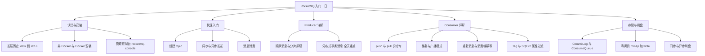

# RocketMQ 入门一日收束：从安装到存储刷盘的复习地图

day09 一整天都围着 RocketMQ 转：概念、安装、快速入门、生产者与消费者详解、存储、刷盘，信息量大，散着学容易学完就忘。把这一天摊开重走一遍，把每个环节的结论压缩成可以背诵的要点，再配一张全章知识地图，复习时照着走就行。这一篇就是为「学完之后怎么记住」准备的。

## 先给结论

- 全章主线五段：认识与安装、快速入门、Producer 详解、Consumer 详解、存储与刷盘，一张图就能串起来。
- Producer 侧两件大事：顺序消息靠分片键把同一业务的哈希到同一队列；分布式事务消息靠半消息加状态回查，是当天的重点内容。
- Consumer 侧三条线：push 与 pull 底层都是拉取加长轮询；消息模式分集群与广播；重复消息靠消费端幂等解决。
- SQL92 属性过滤要在 Broker 端开 `enablePropertyFilter=true`，不开则过滤语句无法生效。
- 存储与刷盘是性能与可靠性的底座：CommitLog 顺序写加 ConsumeQueue 索引，零拷贝 mmap 加 write，刷盘分 `SYNC_FLUSH` 与 `ASYNC_FLUSH`，按业务场景选。
- 课程介绍里预告的错误消息重试与集群搭建，安排在下一天展开。

## 一、全章知识地图

先上地图，后面每一节按图上的分支展开：



地图上每个叶子节点都对应一天里的一个环节，复习时从根往下走，哪一支讲不出内容就回去补哪一支。

## 二、认识与安装：把服务跑起来

历史脉络按时间轴记：2007 年的 Notify、2010 年的 Napoli、2011 年基于 ActiveMQ 内核重写、2012 年 MetaQ v1.0、2015 年 Aliware MQ v1.0、2016 年捐赠给 Apache 基金会并成长为顶级项目。内部 Java 开发、经受住了多次双十一压力，这两点解释了它为什么适合在大规模业务里用。

安装给了两条路：非 Docker 安装直接跑发行包脚本，Docker 安装拉镜像起容器，两者最终都得到一个 NameServer 加一个 Broker。安装完成后再部署 rocketmq-console 管理控制台，Topic、消息、消费进度都能在页面上看。发行包里最值得认识的文件是 `conf/broker.conf`，后面刷盘与主从角色都靠它配置。

## 三、快速入门：一条消息从发出到收到

入门三步走。先用管理 API 建 Topic，再发消息，最后消费：

```java
package com.example.rocketmq.quick;

import org.apache.rocketmq.client.producer.DefaultMQProducer;
import org.apache.rocketmq.client.exception.MQClientException;

public class TopicDemo {

    public static void main(String[] args) throws MQClientException {
        DefaultMQProducer producer = new DefaultMQProducer("haoke-im");
        producer.setNamesrvAddr("172.16.55.185:9876");
        producer.start();
        // 参数依次为 broker 名称、topic 名称、队列数
        producer.createTopic("broker_haoke_im", "haoke_im_topic", 8);
        System.out.println("创建topic成功");
    }
}
```

发送分同步与异步两种：同步发送拿到 `SendResult` 才算完，异步发送注册回调、发送线程不阻塞。消费端用 `DefaultMQPushConsumer` 订阅 Topic，注册 `MessageListenerConcurrently` 监听器，处理完返回 `ConsumeConcurrentlyStatus.CONSUME_SUCCESS`。这三段代码是后面所有例子的骨架。

## 四、Producer 详解：顺序消息与分布式事务消息

顺序消息解决的问题：同一订单的创建、支付、发货消息必须按业务顺序处理。原理两句话：生产端用分片键把同一业务的消息路由到同一个队列，队列内天然先进先出，消费端单线程消费该队列即可。课程代码模拟了按订单分片：

```java
package com.example.rocketmq.order;

import org.apache.rocketmq.client.producer.DefaultMQProducer;
import org.apache.rocketmq.client.producer.MessageQueueSelector;
import org.apache.rocketmq.client.producer.SendResult;
import org.apache.rocketmq.common.message.Message;
import org.apache.rocketmq.common.message.MessageQueue;
import org.apache.rocketmq.remoting.common.RemotingHelper;

import java.util.List;

public class OrderProducer {

    public static void main(String[] args) throws Exception {
        DefaultMQProducer producer =
                new DefaultMQProducer("haoke-order-producer");
        producer.setNamesrvAddr("172.16.55.185:9876");
        producer.start();
        for (int i = 0; i < 100; i++) {
            String msgStr = "order" + i;
            int orderId = i % 10;   // 模拟生成订单 id
            Message message = new Message("haoke_order_topic", "ORDER_MSG",
                    msgStr.getBytes(RemotingHelper.DEFAULT_CHARSET));
            // 同一订单的消息按 orderId 取模，路由到同一个队列
            SendResult result = producer.send(message,
                    (MessageQueueSelector) (mqs, msg, arg) -> {
                        int id = (Integer) arg;
                        return mqs.get(id % mqs.size());
                    }, orderId);
            System.out.println(result);
        }
        producer.shutdown();
    }
}
```

分布式事务消息是全天重点。它解决「本地事务和发消息要么都成要么都不成」的问题：先发半消息（对消费者不可见），执行本地事务，成功则提交半消息、失败则回滚；如果 Broker 长时间没等到二次确认，还会主动回查生产者的本地事务状态。整套机制把跨服务的两步操作绑成一个逻辑事务，面试频率极高，值得动手把演示代码再敲一遍。

## 五、Consumer 详解：模式、过滤与幂等

消费端知识密度最高，四件事：

**第一，push 与 pull 的真相。** push 是 Broker 推给消费者，pull 是消费者定时拉取，但 push 底层实现同样是拉取，靠长轮询（长连接加轮询）做到「有消息几乎即时送达，没消息不空转」，所以两种模式本质都是拉。

**第二，消息模式。** 同一消费组内集群模式分摊消息、广播模式人人全量，由 `consumer.setMessageModel(MessageModel.CLUSTERING)` 或 `BROADCASTING` 控制，默认集群。

**第三，重复消息与幂等。** 重复无法避免，解法两种：业务逻辑写成幂等（更新带状态前置条件），或者用业务唯一编号加去重记录（Redis、去重表）判重。RocketMQ 不保证不重复，去重是业务端的责任。

**第四，消息过滤。** 订阅时用 Tag 表达式筛一部分消息；更进一步是 SQL92 风格的自定义属性过滤，写法非常像 SQL。发送端往消息上挂属性，消费端用选择器筛选：

```java
// 发送端：给消息附加自定义属性
Message msg = new Message("haoke_im_topic", "SEND_MSG",
        msgStr.getBytes(RemotingHelper.DEFAULT_CHARSET));
msg.putUserProperty("age", "18");
msg.putUserProperty("sex", "女");

// 消费端：按 SQL92 语法筛选，只收 age=20 且性别为女的消息
consumer.subscribe("haoke_im_topic",
        MessageSelector.bySql("age=20 AND sex='女'"));
```

这个能力默认是关的，必须往 Broker 的配置文件里加一行并重启：

```properties
# 加入 broker 的配置文件，开启 SQL92 属性过滤
enablePropertyFilter=true
```

漏掉这行，消费端订阅时会收到服务端明确的功能未开启错误，这是本节最常见的翻车点。

## 六、存储与刷盘：性能与可靠性的底座

存储一节的结论：RocketMQ 快，靠零拷贝（mmap 加 write，省两次拷贝）与顺序写（所有 Topic 混写同一个 CommitLog，单文件 1 GB 滚动）；可靠，靠消息完整落盘。ConsumeQueue 按 Topic 分目录、按队列分文件，每条 20 字节索引（8 字节 CommitLog 偏移量、4 字节长度、8 字节 Tag 哈希）指向真实数据，消费端先查索引再回 CommitLog 读消息体，store 目录下另有 index 目录提供按 Key 的查询。

刷盘一节的结论：PAGECACHE 写入即返回是异步刷盘 `ASYNC_FLUSH`，吞吐大但断电窗口可能丢；刷完磁盘才返回是同步刷盘 `SYNC_FLUSH`，可靠但慢。选择标准回到业务：支付、账务这类丢了就是事故的消息用同步，日志、埋点这类可以容忍少量丢失的用异步。进阶取舍还要叠加主从复制的 `brokerRole` 配置，四种组合决定最终的风险水位，留到集群搭建时实操。

## 常见误区

- **把事务消息当普通消息发。** 不实现本地事务回查接口、直接发半消息，Broker 回查不到状态，消息最终会回滚，业务看起来就是「消息丢了」。
- **以为 push 是真正的推。** push 底层仍是消费者发起的拉取加长轮询，理解成真推会在排查消费延迟时走错方向。
- **SQL92 过滤配了代码不配 Broker。** `enablePropertyFilter=true` 不加到 broker.conf，订阅直接报功能未开启，代码再对也没用。
- **顺序消息只靠消费端排序。** 生产端不用分片键路由，同一业务的消息落在不同队列，消费端怎么排都排不回业务顺序。
- **把「不丢消息」寄托给异步刷盘。** 异步刷盘的返回点在内存，强可靠消息必须 `SYNC_FLUSH`，并按需叠加主从复制。

## 面试可能被问到的问题

1. 面试官追问：「一天学下来，RocketMQ 的核心概念哪几个最重要？」
   答：NameServer 做路由注册中心，Broker 存储转发消息，Producer 与 Consumer 通过 Topic 与队列交互；消费组决定消息分摊方式，消息模式决定组内分摊还是广播。这五个概念串起所有功能配置。

2. 面试官追问：「顺序消息怎么保证？」
   答：生产端用 MessageQueueSelector 按业务分片键（如订单 id 取模）把同一业务的消息固定路由到同一个队列，队列内先进先出，消费端对该队列顺序消费。两个环节缺一不可。

3. 面试官追问：「分布式事务消息的实现流程？」
   答：生产者先发半消息，Broker 持有但不投递；生产者执行本地事务，成功提交、失败回滚半消息；Broker 未等到确认时定时回查生产者本地事务状态再决定投递或丢弃。它保证本地事务与消息发送的最终一致性。

4. 面试官追问：「push 和 pull 模式怎么选？底层有什么共同点？」
   答：push 适合实时消费的常规业务，pull 适合消费端自主控制节奏的场景。两者底层都是拉取，push 通过长轮询让「拉」拥有接近推的实时性，同时避免无消息时的空轮询开销。

5. 面试官追问：「消费端怎么做到消息不重复处理？」
   答：业务逻辑幂等（更新语句带状态前置条件）或唯一编号去重（业务流水号写入消息 keys，消费端用 Redis setNX 或去重表判重）。关键消息的去重记录要和业务操作同事务，保证处理成功与去重日志同时生效。

6. 面试官追问：「存储结构和刷盘方式一句话概括？」
   答：所有 Topic 顺序追加写 CommitLog，ConsumeQueue 存 20 字节索引按 Topic 和队列切分消费视图，零拷贝加速读写；刷盘分同步与异步，同步保证 ACK 即落盘、异步换吞吐，按业务可靠性与性能要求选，进阶还要叠加主从复制组合。

## 配套资料

- RocketMQ 专题讲义：`materials/docs/10/RocketMQ研究v1.0.md`（覆盖 MQ 应用场景、RocketMQ 组成结构与安装、快速入门、消息发送过程、同步与异步发送、消费模式、消费重试等章节，与全章主线一一对应；错误消息重试与集群搭建按课程安排在下一天）
- RocketMQ 发行包：`materials/code/10/rocketmq-all-4.5.0-bin-release/rocketmq-all-4.5.0-bin-release/`（课程所用 4.5.0 服务端运行环境，安装、启动、`conf/broker.conf` 刷盘与主从配置都出自它）
- 管理控制台源码：`materials/code/10/rocketmq-console/rocketmq-console/`（部署 rocketmq-console 管理工具所用工程的源码，含按 Key 查询消息的 IndexFile 消费路径）
- 本课（day09）资料包未提供源码：`materials/code/03/day09-分布式消息系统RocketMQ的入门/` 下仅有解压清单 `_extracted.json`，记录解压文件数为 0；文中 `TopicDemo`、`OrderProducer`、过滤收发代码按课程视频屏幕代码整理，包名统一改为 `com.example`，顺序消息的 MessageQueueSelector 细节按主流写法补全
