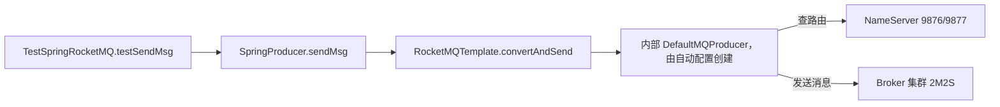
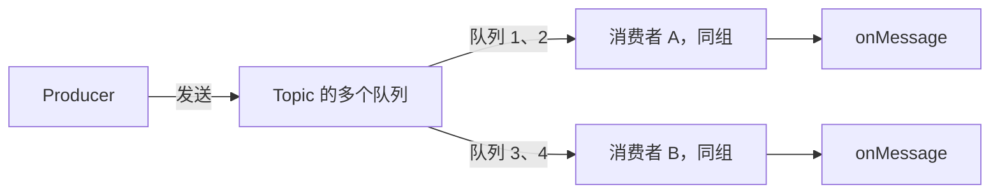
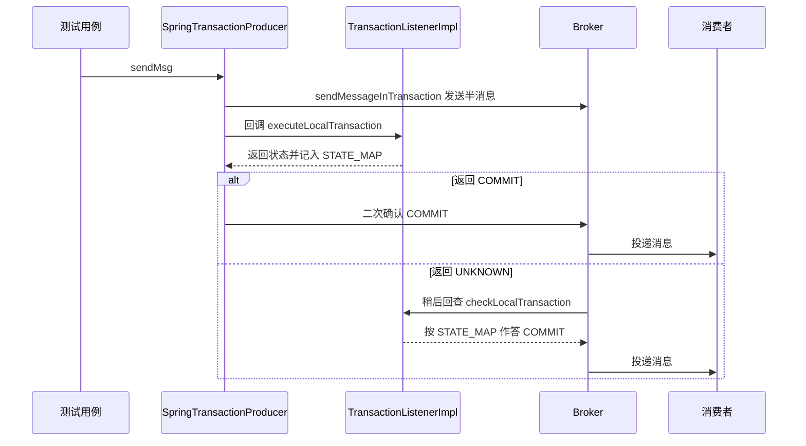

# SpringBoot 整合 RocketMQ 之完整实践：收发消息与事务消息

## 先给结论

- 三篇内容完成 Spring Boot 与 RocketMQ 的整合：环境搭建与 Producer 发送消息、Consumer 接收消息、事务消息。
- 发送端只需 `rocketmq-spring-boot-starter` 一个依赖加两行配置，`RocketMQTemplate` 注入即用，convertAndSend 最简，要结果用 syncSend 或 asyncSend。
- 消费端收敛为一个类加两个注解：`@Component` 加 `@RocketMQMessageListener` 声明 topic、consumerGroup、selectorExpression 三要素，泛型即消息类型。
- consumerGroup 决定消费语义：同组消费者分摊消费，一条消息组内只收一次；consumeMode 有并发与保序两种。
- 事务消息把原生 TransactionMQProducer 的样板收进注解：实现 `RocketMQLocalTransactionListener`，两个回调对应本地事务与 Broker 回查。
- 状态枚举 COMMIT、ROLLBACK、UNKNOWN 与原生一一对应；Message 用的是 Spring messaging 的，事务 ID 从 headers 里取。
- `sendMessageInTransaction` 的分组名必须与 `txProducerGroup` 完全一致，否则消息不在同一个事务上下文里；消费端零改动。
- 测试有个隐形前提：回查要求进程活着，JUnit 方法一结束 JVM 退出，Broker 想回查都找不到人。

## 第1部分：Spring Boot 整合 RocketMQ 发送端：一个 RocketMQTemplate 替掉整套样板代码

用原生客户端发一条消息，代码里要 `new DefaultMQProducer`、`setNamesrvAddr`、`start`、发送、`shutdown`，生命周期与异常处理全要自己盯着。Spring Boot 整合要做的就是把这套样板收敛掉：starter 自动装配一个 `RocketMQTemplate`，业务代码注入模板、一行发送。整合本身不难，卡点通常在两个地方：这个 starter 早期并不在 Maven 中央仓库里，得手动装进本地仓库；配置键名又随扩展包实现而变，照抄旧前缀会配出连不上集群的模板。

### 一、导入依赖：starter 的来历与坐标

pom 骨架分三块，父工程、依赖、编译插件：

```xml
<parent>
    <groupId>org.springframework.boot</groupId>
    <artifactId>spring-boot-starter-parent</artifactId>
    <version>2.1.0.RELEASE</version>
</parent>

<dependencies>
    <!-- RocketMQ 官方提供的 Spring Boot 扩展 -->
    <dependency>
        <groupId>org.apache.rocketmq</groupId>
        <artifactId>rocketmq-spring-boot-starter</artifactId>
        <version>2.0.2</version>
    </dependency>
    <!-- 测试用 -->
    <dependency>
        <groupId>org.springframework.boot</groupId>
        <artifactId>spring-boot-starter-test</artifactId>
    </dependency>
</dependencies>

<build>
    <plugins>
        <!-- java 编译插件 -->
        <plugin>
            <groupId>org.apache.maven.plugins</groupId>
            <artifactId>maven-compiler-plugin</artifactId>
            <configuration>
                <source>1.8</source>
                <target>1.8</target>
                <encoding>UTF-8</encoding>
            </configuration>
        </plugin>
    </plugins>
</build>
```

**这个 starter 的来历值得单独交代。** 它是 RocketMQ 官方为 Spring Boot 开发的扩展包，课程录制那会儿刚做出来，并没有上传到 Maven 中央仓库。当时课程的做法是：下载扩展的源码工程，在源码目录执行 `mvn clean install`（带 `clean` 先做清理），把它安装到本地仓库，然后以本地坐标引入。这套流程对任何「有源码但没进仓库」的组件都通用，本质是绕过远端仓库，直接把构件放进本机的 `~/.m2`。官方坐标发布到中央仓库之后，这一步就不需要了，直接按上面的写法引 `org.apache.rocketmq:rocketmq-spring-boot-starter`，文中的代码按官方扩展的 API 编写。

starter 内部已经传递引入了 RocketMQ 客户端，原生 API 的依赖不用再单独加。

### 二、配置文件：两行决定模板怎么造

在 `src/main/resources` 下新建 `application.properties`：

```properties
# 应用名
spring.application.name=rocketmq-demo
# NameServer 地址，集群有两个 NameServer 就都写上，分号分隔
rocketmq.name-server=172.16.55.185:9876;172.16.55.185:9877
# 生产者分组，可自定义
rocketmq.producer.group=my-group
```

课程画面里的键名是 `spring.rocketmq.nameServer`，那是当时本地安装的扩展包自己定义的前缀；换成官方 starter 之后，配置键是 `rocketmq.name-server` 与 `rocketmq.producer.group`，配套讲义里 yml 的写法与之对应。键名随扩展包的实现走，思路完全一致：一个指路 NameServer，一个声明生产组。前面搭好的 2M2S 集群在这里派上用场，两个 NameServer 地址都写上，任一存活即可完成路由查询。

**生产组是模板内部 Producer 的身份标识。** 讲义里说得很清楚：事务消息场景下 Broker 需要回查生产者，同一个生产组的 Producer 组成集群参与回查；普通发送场景它主要作为分组名存在，自定义即可。

自动配置的机制一句话就能说透：starter 里的 `RocketMQAutoConfiguration` 读到 name-server 就创建 `DefaultMQProducer`，读到 group 就设进去，再把它们包装成 `RocketMQTemplate` 注册为容器里的单例。配置文件写完，模板已经是可注入状态，这是后面业务类里一个 `@Autowired` 就能发送的根本原因。

### 三、生产者：注入模板，一行发送

```java
package com.example.rocketmq.spring;

import org.apache.rocketmq.spring.core.RocketMQTemplate;
import org.springframework.beans.factory.annotation.Autowired;
import org.springframework.stereotype.Component;

@Component
public class SpringProducer {

    // 注入 RocketMQ 的模板
    @Autowired
    private RocketMQTemplate rocketMQTemplate;

    /**
     * 发送消息
     * @param topic 目标主题
     * @param msg   消息内容
     */
    public void sendMsg(String topic, String msg) {
        this.rocketMQTemplate.convertAndSend(topic, msg);
    }
}
```

对照原生客户端那五步样板：`setNamesrvAddr` 与 `start`、`shutdown` 被自动配置和容器生命周期接管，业务类只剩「拿到模板、调方法」。`convertAndSend` 的第一个参数是目标地址，写 topic 即可（需要打标签时用 `topic:tag` 形式），第二个参数是消息负载，框架负责把它转成消息体。

启动类照常，放在与 `SpringProducer` 同级或更上层的包里：

```java
package com.example.rocketmq.spring;

import org.springframework.boot.SpringApplication;
import org.springframework.boot.autoconfigure.SpringBootApplication;

@SpringBootApplication
public class MyApplication {
    public static void main(String[] args) {
        SpringApplication.run(MyApplication.class, args);
    }
}
```

整合之后一条消息从测试方法到集群的完整链路：



最关键的一环是「内部 `DefaultMQProducer`」：它不是业务代码 new 出来的，而是配置文件触发自动配置创建的，连接、路由缓存、重试全部由模板托管。

### 四、测试与验证

```java
package com.example.rocketmq.spring;

import org.junit.Test;
import org.junit.runner.RunWith;
import org.springframework.beans.factory.annotation.Autowired;
import org.springframework.boot.test.context.SpringBootTest;
import org.springframework.test.context.junit4.SpringRunner;

@RunWith(SpringRunner.class)
@SpringBootTest
public class TestSpringRocketMQ {

    @Autowired
    private SpringProducer springProducer;

    @Test
    public void testSendMsg() {
        String msg = "我的第一个SpringRocketMQ消息！";
        this.springProducer.sendMsg("spring-my-topic", msg);
        System.out.println("发送成功");
    }
}
```

两个注解各管一件事：`@RunWith(SpringRunner.class)` 让 JUnit 运行在 Spring 的测试执行器上，`@SpringBootTest` 把整个应用上下文拉起来，`@Autowired` 才有对象可注。如果工程里还没有启动类，这个测试会在启动阶段就报错，容器里根本没有 `SpringProducer`，注入无从谈起。

跑完测试控制台打出「发送成功」，再到管理控制台按 `spring-my-topic` 查询消息，详情里能看到那条消息内容，发送链路才算真正闭环。

### 五、要拿发送结果：syncSend 与 asyncSend

`convertAndSend` 的返回值是 void，只管投递、不管结果。想要原生客户端那种 `SendResult` 返回，模板提供了对应的 API：

```java
// 同步发送，直接拿到发送结果
SendResult sendResult = this.rocketMQTemplate.syncSend(topic, msg);
System.out.println(sendResult.getSendStatus());
System.out.println(sendResult.getMsgId());

// 异步发送，回调里拿结果
this.rocketMQTemplate.asyncSend(topic, msg, new SendCallback() {
    @Override
    public void onSuccess(SendResult sendResult) {
        System.out.println("发送成功：" + sendResult.getSendStatus());
    }
    @Override
    public void onException(Throwable e) {
        System.out.println("发送失败：" + e.getMessage());
    }
});
```

`syncSend` 同步等待 Broker 应答，返回的 `SendResult` 里能看到发送状态与消息落点（落在哪个 broker、哪个队列）；`asyncSend` 把结果放进 `SendCallback` 的成功与异常回调，写法与原生 `producer.send(message, callback)` 一致，只是 Producer 的管理权交给了模板。对可靠性有要求的发送用 `syncSend` 检查状态；日志埋点这类不关心结果的消息，用 `convertAndSend` 或单向的 `sendOneWay` 就够了。

## 第2部分：Spring Boot 整合 RocketMQ 消费端：一个注解把监听做完整

原生消费者要写五步样板：`new DefaultMQPushConsumer`、`setNamesrvAddr`、`subscribe(topic, "*")`、`registerMessageListener`、`start`，一步都不能漏，漏了订阅收不到、漏了监听器白启动。整合 Spring Boot 之后，这些步骤全部消失，剩下的东西只有一个类：实现 `RocketMQListener` 接口写消费逻辑，再贴一个 `@RocketMQMessageListener` 注解声明订阅三要素。类短了，但注解里每个属性都值得拆开讲透，因为消费语义（谁收到、收什么、按什么顺序收）全由它们决定。

### 一、消费端长什么样

```java
package com.example.rocketmq.spring;

import org.apache.rocketmq.spring.annotation.RocketMQMessageListener;
import org.apache.rocketmq.spring.core.RocketMQListener;
import org.springframework.stereotype.Component;

@Component
@RocketMQMessageListener(topic = "spring-my-topic",
        consumerGroup = "spring-consumer-group",
        selectorExpression = "*")
public class SpringConsumer implements RocketMQListener<String> {

    @Override
    public void onMessage(String msg) {
        System.out.println("接收到消息 -> " + msg);
    }
}
```

原生五步样板在这个类里一行都看不到了。框架在启动时扫描到这个 Bean，按注解属性构造内部的 `DefaultMQPushConsumer`，完成订阅与注册监听并启动，`onMessage` 就是那条监听器的回调方法。名称服务器地址不需要在这个类里出现，沿用上一节 `application.properties` 里的配置。

注解的三个必懂属性：

**topic，订阅哪个主题。** 必须与生产端发送的主题一致，上一节的 `spring-my-topic`。

**consumerGroup，消费组。** 组是一个逻辑集群：同一组内的消费者共同消费该主题的消息。组名也是消费进度的存储键，同一组断线重连能接着上次的进度继续消费。

**selectorExpression，订阅规则。** 默认 `*` 表示接收该主题全部消息；生产端打了 TAG 时，这里可以写 `tagA || tagB` 做过滤。

泛型参数 `String` 直接决定 `onMessage` 的入参类型，消息体是普通文本时用 String 最顺手；消息体是 JSON 时，把泛型换成对应 POJO，框架会完成反序列化，消费方法里拿到的直接是对象。

### 二、注解的其余可调项

消费模式与并发线程数也能在注解上调整：

```java
@RocketMQMessageListener(topic = "spring-my-topic",
        consumerGroup = "spring-consumer-group",
        selectorExpression = "*",
        consumeMode = ConsumeMode.CONCURRENTLY,
        consumeThreadMax = 64,
        selectorType = SelectorType.TAG)
public class SpringConsumer implements RocketMQListener<String> {
    // onMessage 省略
}
```

**consumeMode，消费模式。** `CONCURRENTLY` 是默认值，多线程并发消费，吞吐高但不保证顺序；`ORDERLY` 是队列内顺序消费，同一个队列的消息串行处理，代价是吞吐下降。业务需要「同一订单的状态变更按序处理」这类语义时才切 `ORDERLY`。

**consumeThreadMax，消费线程数上限。** 课程画面里 IDE 展示的默认值就是 64，多数场景用不着动它。

**selectorType，过滤类型。** 默认 `TAG`，与 `selectorExpression` 配套使用。

集群模式下一条消息的投递路径：



图里的关键是队列与消费者的分配关系：讲义里的规则是，一个队列同一时刻只允许组内一个消费者占用，一个消费者可以同时消费多个队列。消费者数量多于队列数时，多出来的消费者分不到队列，处于空闲。

### 三、启动与验证

消费端的验证流程：先启动应用（运行 `MyApplication` 的 main 方法），监听容器随上下文启动，日志里能看到消费组订阅成功；再回到发送端跑一次上一节的测试方法，消费端控制台随即打印「接收到消息 -> 我的第一个SpringRocketMQ消息！」。

多跑几次发送测试，一条发一条收，链路即验证通过。测试时常见一个小现象：刚启动消费者就收到了「旧」消息，那不是灵异事件，是此前发送时还没有消费者在线，消息在队列里积压着，消费者一上线就被补消费了。这正是消息队列削峰填谷的价值所在。

### 四、消费语义与异常处理的联动

**一条消息谁收到？** 默认的集群模式下，同组消费者分摊消息，主题下的一条消息只被组内一个消费者消费；广播模式下组内每个消费者各消费全量。多数业务要的是前者：多个实例做负载均衡，消息不会被重复处理（组内）。换个组名重新上线，等于一个全新的消费组，进度从零开始，历史消息可能被重新消费，这也是灰度发布时经常踩到的行为差异。

**onMessage 抛不抛异常，决定消息的命运。** 方法正常返回，框架视为消费成功并提交；抛出异常则触发 Broker 端重试，按前文 Consumer 重试机制一课的规则，默认重试若干次后进入死信队列。讲义给出的生产处理策略是在 `onMessage` 里判断重试次数：

```java
public class ConsumerSimple implements RocketMQListener<MessageExt> {

    @Override
    public void onMessage(MessageExt messageExt) {
        // 取出当前重试次数
        int reconsumeTimes = messageExt.getReconsumeTimes();
        // 超过一定次数后落库，交由单独程序或人工处理
        if (reconsumeTimes >= 2) {
            // 保存消息，之后正常返回
            return;
        }
        throw new RuntimeException(String.format("第%s次处理失败..", reconsumeTimes));
    }
}
```

把泛型换成 `MessageExt` 才能拿到重试次数这类元信息，消息体再用 `new String(messageExt.getBody())` 取。这段代码可以作为消费端异常处理的通用骨架：能处理就处理，暂时处理不了就抛出去让 MQ 重试，重试到头之前落库兜底。

## 第3部分：Spring Boot 事务消息：一个注解替掉 TransactionMQProducer 的整套样板

原生 API 的事务消息在 day09 已经写过一遍：`TransactionMQProducer`、`setTransactionListener`、`sendMessageInTransaction`，监听器要自己 new 出来手动挂上去。这套代码能跑，但 Producer 的生命周期、监听器的装配全靠手工。换成 Spring Boot 整合之后，样板代码收敛成什么样，事务 ID 又该怎么取，是这一课要解决的问题。学完它你会发现：机制一个字没变，变的全是工程外壳。

### 一、从原生 API 到 Spring 风格：换了什么，没换什么

先摆一个对照表，原生与整合版的差异一眼见底：

| 环节 | 原生客户端 | Spring Boot 整合 |
|---|---|---|
| 生产者 | `new TransactionMQProducer`，手动 `start`/`shutdown` | 注入 `RocketMQTemplate`，生命周期托管 |
| 挂监听器 | `producer.setTransactionListener(new TransactionListenerImpl())` | 类上贴 `@RocketMQTransactionListener` |
| 监听器接口 | `TransactionListener` | `RocketMQLocalTransactionListener` |
| 本地事务状态 | `LocalTransactionState.COMMIT_MESSAGE` 等 | `RocketMQLocalTransactionState.COMMIT` 等 |
| 发送 | `producer.sendMessageInTransaction(msg, arg)` | `rocketMQTemplate.sendMessageInTransaction(group, topic, msg, arg)` |
| 消息对象 | `org.apache.rocketmq.common.message.Message` | `org.springframework.messaging.Message` |

没换的是机制：半消息、二次确认、状态回查这套协议原样运行，只是执行者从你手工装配的 Producer 换成了自动配置创建的内部组件。讲义在技术选型时列过 RocketMQ 的四条卖点，第一条就是支持事务消息，生产组那一节还专门点明「在事务消息中 Broker 需要回查 Producer，同一个生产组的 Producer 组成一个集群」，这条约束在整合版里依然成立，而且变得更加具体：回查找谁，就由 `txProducerGroup` 说了算。

### 二、事务监听器：一个注解完成注册

在工程里建一个 `transaction` 包，把事务相关的代码都放这里。监听器实现接口，两个方法各就各位：

```java
package com.example.rocketmq.spring.transaction;

import org.apache.rocketmq.common.message.MessageExt;
import org.apache.rocketmq.spring.annotation.RocketMQTransactionListener;
import org.apache.rocketmq.spring.core.RocketMQLocalTransactionListener;
import org.apache.rocketmq.spring.core.RocketMQLocalTransactionState;
import org.apache.rocketmq.spring.support.RocketMQHeaders;
import org.springframework.messaging.Message;

import java.util.HashMap;
import java.util.Map;

@RocketMQTransactionListener(txProducerGroup = "myTransactionGroup")
public class TransactionListenerImpl implements RocketMQLocalTransactionListener {

    // 事务ID -> 本地事务状态，演示用；生产环境要换成查业务库或事务日志
    private static Map<String, RocketMQLocalTransactionState> STATE_MAP = new HashMap<>();

    /**
     * 执行本地业务逻辑，半消息发送成功后被回调
     * @param message 发送的消息对象
     * @param o       sendMessageInTransaction 传入的附加参数
     */
    @Override
    public RocketMQLocalTransactionState executeLocalTransaction(Message message, Object o) {
        // Spring 的 Message 对象，事务 ID 要从 headers 里取
        String transId = (String) message.getHeaders().get(RocketMQHeaders.TRANSACTION_ID);
        try {
            System.out.println("执行操作1");
            Thread.sleep(500);
            System.out.println("执行操作2");
            Thread.sleep(800);
            STATE_MAP.put(transId, RocketMQLocalTransactionState.COMMIT);
            return RocketMQLocalTransactionState.COMMIT;
        } catch (Exception e) {
            e.printStackTrace();
            STATE_MAP.put(transId, RocketMQLocalTransactionState.ROLLBACK);
            return RocketMQLocalTransactionState.ROLLBACK;
        }
    }

    /**
     * Broker 回查时被回调，按记录的事务状态作答
     */
    @Override
    public RocketMQLocalTransactionState checkLocalTransaction(MessageExt msg) {
        String transId = msg.getTransactionId();
        System.out.println("状态回查 ---> " + transId + " " + STATE_MAP.get(transId));
        return STATE_MAP.get(transId);
    }
}
```

与原生版逐行对比，能发现三处升级和一处变复杂：

**注解替代了手动挂载。** 原生版要在生产者代码里写 `setTransactionListener`，整合版一个 `@RocketMQTransactionListener` 搞定。要不要额外加 `@Component` 把它交给容器？不需要。点进注解源码能看到它已经包含了 `@Component`，Spring 扫描到这个类时自然会把它注册成 Bean，写两遍无害但多余。

**取事务 ID 变绕了一点。** 原生版拿 `org.apache.rocketmq.common.message.Message`，直接 `msg.getTransactionId()`。整合版的参数换成了 Spring messaging 的 `Message` 接口，这个对象里没有 `getTransactionId` 方法，事务 ID 被放进了消息头，要通过 `getHeaders().get(RocketMQHeaders.TRANSACTION_ID)` 取出来。对象类型不同是整合版最容易看走眼的地方，两个 `Message` 长得像，出身完全不同。

**回查方法直接查表作答。** `checkLocalTransaction` 收到的是 RocketMQ 原生的 `MessageExt`，用 `getTransactionId()` 拿到事务 ID，再去 `STATE_MAP` 里查当初记录的状态返回即可。打印日志是教学演示，真实项目里应该换成日志框架输出。

### 三、生产者：模板的 sendMessageInTransaction

生产者收敛成一个普通组件，注入模板就能发：

```java
package com.example.rocketmq.spring.transaction;

import org.apache.rocketmq.spring.core.RocketMQTemplate;
import org.springframework.beans.factory.annotation.Autowired;
import org.springframework.messaging.Message;
import org.springframework.messaging.support.MessageBuilder;
import org.springframework.stereotype.Component;

@Component
public class SpringTransactionProducer {

    @Autowired
    private RocketMQTemplate rocketMQTemplate;

    /**
     * 发送事务消息
     * @param topic 目标主题
     * @param msg   消息内容
     */
    public void sendMsg(String topic, String msg) {
        // Spring 的消息对象需要用 MessageBuilder 构建
        Message message = MessageBuilder.withPayload(msg).build();
        // 分组名必须与 @RocketMQTransactionListener 的 txProducerGroup 一致
        this.rocketMQTemplate.sendMessageInTransaction("myTransactionGroup",
                topic, message, null);
    }
}
```

三个参数各司其职：第一参是事务生产组，值就是监听器注解里那个 `myTransactionGroup`，这个值不能随手写，两边对不上，消息就不在同一个事务上下文里，回查也会找错门；第二参是目标 topic；第三参是刚用 `MessageBuilder` 构建出来的 Spring 消息对象，注意它不是原生 API 那个 `Message`，直接 `new` 原生对象塞进来是编译不过的；第四参 `arg` 会原样透传给 `executeLocalTransaction` 的第二个参数，需要给本地事务带业务上下文时用它。

消费者则完全不用动，还是那套「实现 `RocketMQListener` 加 `@RocketMQMessageListener`」的写法，订阅 `spring-tx-my-topic` 即可。事务消息的复杂度全在生产者侧，消费者照常收消息。

### 四、三轮验证：COMMIT、ROLLBACK 与触发回查的 UNKNOWN

测试类沿用上一课的骨架，注入生产者，往事务专用主题 `spring-tx-my-topic` 发消息：

```java
@RunWith(SpringRunner.class)
@SpringBootTest
public class TestSpringRocketMQ {

    @Autowired
    private SpringTransactionProducer springTransactionProducer;

    @Test
    public void testSendTxMsg() {
        this.springTransactionProducer.sendMsg("spring-tx-my-topic",
                "我的第一个Spring事务消息");
        System.out.println("发送成功");
    }
}
```

跑起来之前先吃一个小亏：启动直接报错，提示消费组名重复。原因是工程里之前示例的消费者和事务消息的消费者用了同一个 `consumerGroup`，RocketMQ 客户端不允许同一个 JVM 里两个监听器共用一个消费组，给事务消费者单独起个组名如 `tx-consumer` 就好了。

正常路径一次通过：控制台先打出「执行操作1」「执行操作2」，再打出「发送成功」，消费端随即收到消息。第二轮把正常路径的返回值强行改成 `ROLLBACK`，生产者这边照样执行、照样「发送成功」，消费端却永远等不到那条消息，回滚生效。整条链路长这样：



第三轮才是回查的主场。把正常路径的返回值改成 `UNKNOWN`，`STATE_MAP` 里记的仍是 `COMMIT`，预期是 Broker 稍后回查、按表作答、消息最终投递。结果第一次跑完全静默：生产者发送成功，消费端没收到，回查日志一行都没有。原因不在代码，在进程：JUnit 测试方法一执行完，JVM 直接退出，生产者没了，Broker 拿着半消息想回查都不知道敲谁的门。

解决办法是让测试别急着结束，发送完睡一会儿：

```java
@Test
public void testSendTxMsgWithCheck() {
    this.springTransactionProducer.sendMsg("spring-tx-my-topic",
            "我的第五个Spring事务消息");
    try {
        // 拖住进程，给 Broker 留出回查的时间窗口
        Thread.sleep(600000);
    } catch (InterruptedException e) {
        e.printStackTrace();
    }
}
```

进程活着，回查如约而至：控制台打出「状态回查 ---> 事务ID COMMIT」，紧接着消费端收到了那条消息。这也解释了原生版里发送事务消息后 `Thread.sleep(999999)` 的用意，事务消息的发送方本来就要常驻，整合版把 Producer 的生命周期交给了 Spring 容器，但「回查需要活着的生产者」这个前提谁也替不了。

## 常见误区

- **没有启动类就写测试。** `@SpringBootTest` 找不到 `@SpringBootApplication` 会启动失败，注入随之全部失败，报错点看似在依赖注入，根源在工程结构。
- **配置键张冠李戴。** 官方 starter 的键是 `rocketmq.name-server`，照旧课件的 `spring.rocketmq.nameServer` 抄，模板会带着空地址被创建出来，发送时报连接异常。键名以所引 starter 的实现为准。
- **把发送结果寄望于 `convertAndSend`。** 它是 void，不返回状态不容错；重要消息要确认落盘，用 `syncSend` 检查 `SendResult`。
- **生产组与消费组混为一谈。** `rocketmq.producer.group` 与消费者的 `consumerGroup` 是两个独立概念，名字互不相干，作用也不同。
- **以为组内每个消费者都会收到同一条消息。** 默认集群模式是分摊，一条消息组内只投一个消费者；要人人一份得显式改广播模式。
- **随便改 consumerGroup。** 消费进度按组存储，换组等于新组从零开始，历史消息重收或从最新开始漏收，后果都是数据不对账。
- **泛型与消息体对不上。** 生产端发的是对象 JSON，消费端用 `String` 泛型收到的是原始字符串，需要对象就换对象泛型，别在 `onMessage` 里手工解析后再感叹框架不好用。
- **在 `onMessage` 里吞掉异常。** 不抛异常等于消费成功，失败消息永远不会重试；正确的姿势是让该重试的抛出去，配合重试次数落库兜底。
- **忘了 `@Component`。** 类不被容器管理，`@RocketMQMessageListener` 不会被扫描处理，监听器根本不注册。
- **两个 `Message` 张冠李戴。** 监听器回调和 `MessageBuilder` 用的都是 Spring messaging 的接口，事务 ID 在 headers 里；给 `sendMessageInTransaction` 传 RocketMQ 原生 `Message` 编译不过，在监听器里调 `getTransactionId()` 也找不到方法。分清出身，取 ID 走 `RocketMQHeaders.TRANSACTION_ID`。
- **发送分组与监听器分组不一致。** `sendMessageInTransaction` 第一参与 `@RocketMQTransactionListener` 的 `txProducerGroup` 必须是同一个字符串，对不上等于消息脱离了事务上下文，半消息没人确认，最后只能靠回查兜底甚至被丢弃。
- **同 JVM 内消费组重名。** 一个工程里多个 `@RocketMQMessageListener` 共用同一个 `consumerGroup`，启动时客户端直接抛消费组已创建的异常。每个监听器一个独立组名，这是硬约束不是好习惯。
- **用一次性测试验证回查。** 测试方法跑完进程就没了，回查永远等不到，还以为回查机制坏了。回查测试必须保活进程，或者干脆把发送逻辑放进常驻应用里跑。

## 面试可能被问到的问题

1. 面试官追问：「rocketmq-spring-boot-starter 帮你做了什么？」
   答：通过 `RocketMQAutoConfiguration` 自动配置，读取 name-server 与 producer.group 等配置创建 `DefaultMQProducer`，并包装成 `RocketMQTemplate` 注册到容器，同时接管 Producer 的启动与关闭生命周期，业务代码只需注入模板即可收发消息。

2. 面试官追问：「`convertAndSend` 和 `syncSend` 有什么区别？」
   答：`convertAndSend` 只负责投递，无返回值，内部不关心 Broker 应答；`syncSend` 同步等待应答并返回 `SendResult`，可检查发送状态与消息落点。对可靠性有要求的场景用 `syncSend`，不关心结果的场景用 `convertAndSend` 或 `sendOneWay`。

3. 面试官追问：「生产者分组有什么用？」
   答：普通发送时它只是 Producer 的分组名；在事务消息里作用关键，Broker 需要回查生产者确认事务状态时，按生产组回查，同一组内的 Producer 组成集群共同承担回查。

4. 面试官追问：「 starter 没发布到中央仓库时怎么引入？」
   答：下载其源码工程，在源码目录执行 `mvn clean install`，构件会安装到本地仓库，然后按正常坐标引入。也可以把它发布到私服供团队共用，思路都是绕过缺失的远端仓库。

5. 面试官追问：「整合后的发送链路与原生客户端有何不同？」
   答：创建、配置、启动、关闭 Producer 的动作都移到了自动配置与容器生命周期里，业务代码只剩模板调用；路由查询、消息重试等内部机制没有变，还是原生客户端那套。

6. 面试官追问：「`@RocketMQMessageListener` 的核心属性有哪些？」
   答：topic 指定订阅主题，consumerGroup 指定消费组，selectorExpression 指定过滤表达式（默认 `*` 收全部）；进阶属性包括 consumeMode（并发或顺序）、consumeThreadMax（消费线程上限）、selectorType（过滤类型，默认 TAG）。

7. 面试官追问：「consumerGroup 相同和不同分别意味着什么？」
   答：相同意味着同组，组内消费者集群模式分摊消费、进度共享，一条消息只被组内一个消费者处理；不同则是两个独立消费组，各自维护进度，同一条消息每个组都会收到一份。

8. 面试官追问：「CONCURRENTLY 和 ORDERLY 怎么选？」
   答：默认 CONCURRENTLY，吞吐高但不保序；对同一业务键的消息有先后要求时用 ORDERLY，它在队列内串行消费，配合生产端把同一键的消息发到同一队列才能实现完整顺序语义。

9. 面试官追问：「消费端怎么和消息重试机制联动？」
   答：`onMessage` 正常返回视为成功，抛异常触发 Broker 重试，默认重试若干次后进死信队列。生产上通常在方法里用 `MessageExt` 的重试次数判断，超过阈值就把消息落库转人工，避免无限重试。

10. 面试官追问：「消费者刚启动就收到一批旧消息，是什么原因？」
   答：这些消息是消费者离线期间发送的，一直在队列里积压；消费进度按组存储，组没变的话会从上次进度继续消费，正好把这些消息补上，属于消息队列可靠投递的正常表现。

11. 面试官追问：「想收到对象消息而不是字符串，怎么改？」
   答：把监听类实现的泛型从 `String` 换成对应 POJO，如 `RocketMQListener<OrderExt>`，框架自动反序列化；生产端用 `convertAndSend(topic, 对象)` 发送，消息体以 JSON 传输，两端泛型与类型对齐即可。

12. 面试官追问：「Spring Boot 整合后，事务消息的机制和原生 API 有区别吗？」
   答：机制完全一致，还是半消息、二次确认、状态回查三件套。变化全在工程层面：Producer 的创建与生命周期交给自动配置，监听器由 `@RocketMQTransactionListener` 注册，发送收敛为模板方法，消息对象从原生 `Message` 换成 Spring messaging 的接口。

13. 面试官追问：「`@RocketMQTransactionListener` 为什么不用再加 `@Component`？」
   答：这个注解的元注解里已经带了 `@Component`，类被扫描到时自然注册为 Bean。再写一遍不影响功能，但属于冗余，容易让后来者误以为注解本身不产生 Bean。

14. 面试官追问：「整合版里怎么拿事务 ID，和原生版有什么不同？」
   答：原生版参数是 RocketMQ 的 `Message`，直接调 `getTransactionId()`；整合版参数是 Spring messaging 的 `Message` 接口，事务 ID 放在消息头里，用 `message.getHeaders().get(RocketMQHeaders.TRANSACTION_ID)` 取。回查方法收到的仍是原生 `MessageExt`，照旧用 `getTransactionId()`。

15. 面试官追问：「`sendMessageInTransaction` 的分组参数写错了会怎样？」
   答：消息会脱离对应的事务监听器上下文，本地事务回调没有着落，二次确认与回查都可能无人应答，半消息最终被 Broker 清理。这个分组必须与 `@RocketMQTransactionListener` 的 `txProducerGroup` 严格一致，它同时也是 Broker 回查时定位生产者的依据。

16. 面试官追问：「为什么测试事务消息的回查要 Thread.sleep？」
   答：回查是 Broker 主动找生产者，JUnit 测试方法结束后 JVM 退出，生产者实例消失，Broker 无处回查，半消息就一直悬着。sleep 是为了让进程存活足够久，等回查到来并给出状态。

17. 面试官追问：「`STATE_MAP` 这种内存表在生产环境能用吗？」
   答：不能。应用重启后 Map 清空，回查来了答不出状态。生产实现要把「本地事务是否完成」持久化到业务库或事务日志，回查时按事务 ID 查库作答，同时保证查询逻辑幂等，因为回查可能到来多次。

## 配套资料

- 讲义：`materials/docs/10/RocketMQ研究v1.0.md`（Spring 整合章节给出 `rocketmq-spring-boot-starter` 依赖、配置文件、`RocketMQTemplate` 各发送 API 与测试类写法，第五节的 `syncSend`/`asyncSend` 用法与讲义一致；生产组作用出自讲义对事务回查的说明）
- day10 自身资料包为空（`materials/code/03/day10-RocketMQ集群、分布式WebSocket实现以及地图找房功能实现/` 下仅有 `textIconOverlay.js` 一个文件，与本课无关），`SpringProducer`、`TestSpringRocketMQ` 等代码按课程画面整理并将包名改写为 `com.example`，pom 坐标按官方已发布版本写法补全，属可运行示例
- 讲义：`materials/docs/10/RocketMQ研究v1.0.md`（消费消息章节的监听类样例与「监听消息队列需要指定 topic、consumerGroup」的说明对应第一节；消费组两种消费模式、队列占用规则对应第二节与第四节；重试次数落库的处理策略示例为第四节代码原型）
- day10 自身资料包为空（`materials/code/03/day10-RocketMQ集群、分布式WebSocket实现以及地图找房功能实现/` 下仅有 `textIconOverlay.js` 一个文件，与本课无关），`SpringConsumer` 等代码按课程画面整理并将包名改写为 `com.example`，`ConsumeMode`/`SelectorType` 的枚举写法按官方 starter 主流写法补全，属可运行示例
- 讲义：`materials/docs/10/RocketMQ研究v1.0.md`（技术选型一节把「支持事务消息」列为选用 RocketMQ 的首要原因，「生产组有什么用」小节写明事务消息中 Broker 需要回查 Producer、同一生产组的 Producer 组成集群，是 `txProducerGroup` 设计的依据）
- day10 自身资料包为空（`materials/code/03/day10-RocketMQ集群、分布式WebSocket实现以及地图找房功能实现/` 下仅有 `textIconOverlay.js`，与本课无关），`TransactionListenerImpl`、`SpringTransactionProducer`、测试类按课程视频屏幕代码整理，包名统一改写为 `com.example`，属可运行示例
