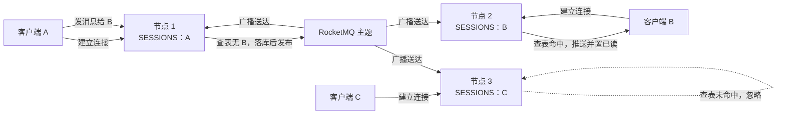

# 分布式 WebSocket 动手前夜：把方案再过一遍，把消费模式定下来

day08 的微聊系统单机跑通，最后一篇分析把遗留问题摆上了台面：服务部署成多个实例后，A 与 B 的连接几乎必然落在不同节点，进程内的 `SESSIONS` 表互相看不见，实时推送就断了。当时只给方案不动手，因为缺一件武器：消息中间件。现在 RocketMQ 已经学完，集群也搭好了，这一课开始把方案变成代码。动手之前值得花几分钟做两件事：把方案的每一步在脑子里再走一遍，把一个关键选型，消费模式，提前敲定，它能省掉实现完才发现推不出去的返工。

## 先给结论

- 方案一句话：每个 WebSocket 节点订阅同一个主题；发送方查本地登记表找不到目标用户，就把消息发布到主题；所有节点收到后各查各的 `SESSIONS`，命中就推，未命中就忽略。
- 通道选 RocketMQ 而不是 Redis 发布订阅：课程技术选型时本就因事务消息、延迟消息、失败重发选定了它，IM 转正的路由广播复用同一套基础设施，持久化与重试能力也强于即发即失的 Pub/Sub。
- 消费模式必须显式设为广播（BROADCASTING）：默认的集群模式把同组消费者当负载均衡单元，一条消息只给组内一个消费者，恰好可能让持有目标会话的节点收不到。
- 落库铁律跨节点依然成立：只有接收客户端消息的节点落库并发布，订阅方只推不存，否则一条消息在 MongoDB 里出现 N 份。
- 动手前的准备只有两处：IM 工程导入 `rocketmq-spring-boot-starter` 依赖，配置 NameServer 地址与生产者分组。

## 一、方案重演：三个节点，一张广播网

把 day08 构思的架构图原样再画一遍，这次上面要跑真代码了：



A 给 B 发一条消息，路径被拆成五步。**第一，A 的连接在节点 1，消息照旧先落 MongoDB**，未读状态、上线补拉这些单机版逻辑原样保留，分布式改造不动「存」的部分。**第二，节点 1 查本地 `SESSIONS` 表**，没有 B 的会话，此刻无法区分 B 是下线了还是连在别的节点上，也不用区分。**第三，节点 1 把消息发布到约定主题**，相当于朝消息系统喊了一嗓子。**第四，主题上的消息送达每个订阅节点**，三个节点各查各的表。**第五，节点 2 命中 B 的会话**，推送并把消息状态改为已读；节点 3 查无此人，静默丢弃。

这套设计的聪明处在于无状态：任何节点都不需要知道 B 到底连在哪，路由问题被转化成了「人人都收到，收到的人自己查」的广播过滤问题。代价同样明确，消息会被投递到所有节点，绝大多数节点的处理结果是空转，集群越大浪费越多。规模小的时候这点浪费可以接受，等量级上来了再演进成「登记路由表、定向投递」，那是后话。

## 二、关键选型：集群模式还是广播模式

RocketMQ 的消费组有两种工作模式，讲义的定义值得原文过一遍：集群模式下「一个消费组内的消费者组成一个集群，主题下的一条消息只能被一个消费者消费」；广播模式下「主题下的一条消息能被消费组下的所有消费者消费」。两种模式摆进 IM 场景，行为差异立刻分出高下：

| 对比项 | 集群模式 CLUSTERING | 广播模式 BROADCASTING |
|---|---|---|
| 一条消息谁收到 | 组内分摊，只有一个消费者 | 组内每个消费者都收到 |
| 本场景的行为 | 三个节点抢单，目标会话可能不在中标节点 | 三个节点都收到，各自查表 |
| 能否完成跨节点推送 | 碰运气，多数情况推不出去 | 稳定成立 |
| 典型用途 | 削峰、异步解耦的负载均衡 | 配置刷新、缓存失效通知、本场景 |

集群模式不是不好，它的分摊语义正是 MQ 削峰填谷的本职；坏就坏在语义与本场景相反。假设消息被分配到节点 3，而 B 恰好连在节点 2，节点 3 查表未命中把消息扔掉，节点 2 根本没收到，推送链路在这里断得无声无息。要的是「每个节点都过目一遍」，那只能是广播。day09 学消费模式时它是知识考点，day10 落到工程里它成了必选项，同一个知识点在两个位置的价值完全不同。

## 三、动手前的准备：依赖与配置

IM 工程引入 RocketMQ 的 Spring Boot 扩展，一次依赖配置管住发送与接收两端：

```xml
<dependency>
    <groupId>org.apache.rocketmq</groupId>
    <artifactId>rocketmq-spring-boot-starter</artifactId>
    <version>2.0.0</version>
</dependency>
<dependency>
    <groupId>org.apache.rocketmq</groupId>
    <artifactId>rocketmq-client</artifactId>
    <version>4.3.2</version>
</dependency>
```

starter 里已经传递了客户端依赖，这里显式再引一份是课程工程的做法，锁住与 Broker 匹配的 4.3.2 版本。配置文件补两行：

```properties
# NameServer 地址，集群有两个就都写上
rocketmq.name-server=172.16.55.185:9876
# 生产者分组，自定义即可
rocketmq.producer.group=haoke-im-websocket-group
```

自动配置读到这两项就会创建 `RocketMQTemplate` 并放进容器，IM 工程的处理器类随后只需注入就能发消息。课程画面里的配置键是 `spring.rocketmq.nameServer` 前缀，那是当时还未进中央仓库的扩展包自定义的键名，官方 starter 发布后键名固定为 `rocketmq.name-server`，按官方写法给出，思路一致。

## 四、接下来改哪里

方案与选型齐备，落地动作收敛成三处：发送侧在 `MessageHandler` 的处理逻辑里加一个 else 分支，本地查表未命中就把消息发到主题，目标地址用 `topic:tag` 形式带上标签便于消费端筛选；接收侧让同一个 `MessageHandler` 实现 `RocketMQListener` 接口，注解里把 `messageModel` 显式指为广播；最后起两个端口各跑一个实例，三五个用户分连两台机器互发消息，验证跨 JVM 的链路。这三处的完整代码与联调过程，放在下一篇展开。

## 常见误区

- **不设消费模式直接上线。** `@RocketMQMessageListener` 的 `messageModel` 默认是集群模式，不显式改广播，多节点部署后消息被分摊，跨节点推送时灵时不灵，这种「偶现」缺陷比必然失败难查得多。
- **把落库逻辑也搬进订阅回调。** 广播让每个节点都收到消息，如果订阅方收到后也写库，一条消息落 N 份，未读已读状态全乱。谁收客户端的钱谁记账，订阅方只推不存。
- **以为要先把「用户在哪」查清楚再发。** 方案不需要全局路由表，本地查不到就直接广播，查表过滤是订阅端的事。过早引入路由登记反而是过度设计。
- **用 Redis 发布订阅替代消息队列却不掂量可靠性。** Pub/Sub 即发即失，订阅端断线期间的消息拿不回来；本项目对「推不达」有落库兜底，但既然 RocketMQ 已就位，没有理由选可靠性更弱的通道。

## 面试可能被问到的问题

1. 面试官追问：「分布式 WebSocket 的推送方案是什么？」
   答：每个节点订阅同一个 RocketMQ 主题，发送方发现目标用户不在本节点的会话登记表里，就把消息发布到主题；所有节点收到后各查各的登记表，持有目标会话的节点推送并更新已读状态，其余节点忽略。路由问题被转化为广播加本地过滤。

2. 面试官追问：「为什么选广播模式而不是集群模式？」
   答：集群模式一条消息只给组内一个消费者，语义是负载均衡；本场景要求每个节点都过目消息，持有目标会话的节点必须收到，否则推不出去。广播模式让组内每个消费者各收全量，配合本地查表过滤，才符合需求。

3. 面试官追问：「广播的浪费怎么优化？」
   答：把无差别广播改成定向投递。各节点在用户连接或上线时把「用户挂在哪个节点」登记到共享路由表，发布前先查目标节点，只投给那一个节点；或按节点维度拆分主题。规模小的时候广播加查表够用，量级上来再做这层演进。

4. 面试官追问：「为什么用 RocketMQ 而不用 Redis 的发布订阅？」
   答：Redis Pub/Sub 不持久化，订阅端断线期间的消息直接丢失；RocketMQ 可持久化、可重试、可回溯。本场景推送失败还有落库兜底，但工程里 RocketMQ 已是既定基础设施，复用一套中间件比多引入一种组件更划算，可靠性上限也更高。

5. 面试官追问：「这套方案里消息会丢吗，会重复吗？」
   答：不丢，先落库再推送的顺序保证离线用户上线后能拉到历史；会重复触达，每个节点都收到广播，但只有持有目标会话的节点真正推送，业务上表现为单次投递。落库必须只做一次，由接收客户端消息的节点负责。

## 配套资料

- 讲义：`materials/docs/10/RocketMQ研究v1.0.md`（消费组两种消费模式的定义出自其中：集群模式主题下的一条消息只能被一个消费者消费，广播模式一条消息能被消费组下所有消费者消费；技术选型一节列明的四条选用理由支撑通道选择）
- 依赖与配置整理自课程视频画面，day10 资料包为空（`materials/code/03/day10-RocketMQ集群、分布式WebSocket实现以及地图找房功能实现/` 下仅有 `textIconOverlay.js`），配置键按官方 starter 已发布版本写法补全，属可运行示例
