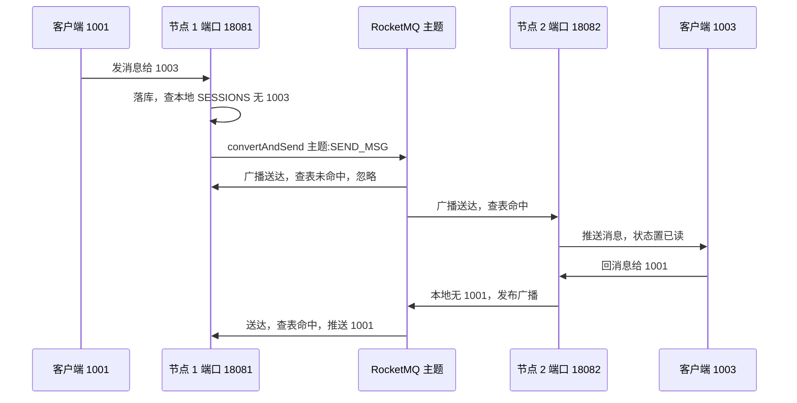

# 分布式 WebSocket 落地：发送侧一个 else 走 MQ，接收侧广播送达各节点

方案在上一节已经敲定：节点订阅同一主题，本地查不到目标会话就发布消息，各节点收到后自查推送。这一篇进 IM 工程把它写出来。改动量小得超出直觉：发送侧只是在原有处理逻辑上加一个 `else` 分支，接收侧让现有的 `MessageHandler` 类顺手实现一个监听接口。真正值得花心思的是三个细节，目标地址里的冒号语法、`ObjectId` 的序列化陷阱、消费模式必须显式指为广播，每一个都可能让联调卡住半小时。

## 先给结论

- 发送侧：本地 `SESSIONS` 查不到目标用户就 `convertAndSend`，目标地址写成 `haoke-im-send-message-topic:SEND_MSG`，冒号前是主题，冒号后是标签，标签供消费端筛选。
- 消息体只序列化一次：`MAPPER.writeValueAsString` 的结果本地推送与发 MQ 共用；`Message` 的 `id` 字段是 `ObjectId`，要加 `@JsonSerialize(using = ToStringSerializer.class)` 让它序列化成字符串，否则 MQ 里的消息体带着一坨嵌套对象。
- 接收侧：`MessageHandler` 实现 `RocketMQListener<String>`，注解里 `topic`、`selectorExpression = "SEND_MSG"`、`messageModel = MessageModel.BROADCASTING` 三项都要对；默认的集群模式会把消息分摊掉，广播语义不成立。
- `onMessage` 的逻辑：解析出目标 id，查本地 `SESSIONS`，命中就推送并把消息状态改为已读，未命中直接忽略，落库永远只发生在接收客户端消息的节点。
- 联调用两个端口各起一个实例，用户分连两台机器互发，跨 JVM 的消息全部可达，MQ 广播就是中间的路由层。

## 一、配置进工程，模板就位

IM 工程的依赖按上一节给的两个坐标导入，`application.properties` 补上 RocketMQ 配置后完整长这样：

```properties
# Spring boot application
spring.application.name = haoke-im
server.port = 18081
spring.data.mongodb.uri=mongodb://172.16.55.185:27017/testdb
# RocketMQ NameServer 地址
rocketmq.name-server=172.16.55.185:9876
# 生产者分组
rocketmq.producer.group=haoke-im-websocket-group
```

自动配置读到 `rocketmq.name-server` 就会创建 `RocketMQTemplate` 并注册进容器，处理器类里一个 `@Autowired` 即可注入。课程画面里配置键还是旧前缀 `spring.rocketmq.nameServer`，那是当时未进中央仓库的扩展包自定义的，官方 starter 发布后按上面这份写。

## 二、发送侧：查不到就发 MQ

改造点在 `MessageHandler` 原有的处理方法里，把单机版「不在线则到此为止」的注释，升级成真正有意义的分支：

```java
@Autowired
private RocketMQTemplate rocketMQTemplate;

@Override
protected void handleTextMessage(WebSocketSession session, TextMessage textMessage) throws Exception {
    Long uid = (Long) session.getAttributes().get("uid");
    // 解析消息：目标用户与内容
    JsonNode jsonNode = MAPPER.readTree(textMessage.getPayload());
    Long toId = jsonNode.get("toId").asLong();
    String msg = jsonNode.get("msg").asText();

    // 组装消息对象，from 与 to 来自静态用户表
    Message message = Message.builder()
            .from(UserData.USER_MAP.get(uid))
            .to(UserData.USER_MAP.get(toId))
            .msg(msg)
            .build();

    // 消息保存到 MongoDB，状态为未读
    message = this.messageDAO.saveMessage(message);
    // 统一序列化一次，本地推送与发 MQ 共用同一份消息体
    String msgJson = MAPPER.writeValueAsString(message);

    // 判断用户是否在本节点在线
    WebSocketSession toSession = SESSIONS.get(toId);
    if (toSession != null && toSession.isOpen()) {
        // TODO 具体推送格式需要和前端对接
        toSession.sendMessage(new TextMessage(msgJson));
        // 在线推送成功，更新消息状态为已读
        this.messageDAO.updateMessageState(message.getId(), 2);
    } else {
        // 该用户可能下线，也可能连在其他的节点中，发送消息到 MQ 系统
        // topic:tags 设置主题和标签，便于消费者对消息的筛选
        this.rocketMQTemplate.convertAndSend("haoke-im-send-message-topic:SEND_MSG", msgJson);
    }
}
```

这段代码有三个动作值得单独说。

**落库的位置一步没挪。** 消息仍由接收客户端报文的节点写入 MongoDB，未读状态、上线补拉的既有语义原封不动，分布式改造只接管「实时推送」这一段。

**序列化提前到分支之前。** 原来的写法是在推送分支里现序列化，现在无论走哪个分支都需要同一份 JSON 字符串，就统一提到前面做一次，两个分支共用 `msgJson`，省掉重复劳动也避免两边格式漂移。

**目标地址的冒号语法。** `convertAndSend` 的第一个参数不只是主题名，`主题:标签` 格式会把 `SEND_MSG` 作为消息的 TAG 一并发出去。加这个标签不是为了好看：IM 主题上以后可能跑多种消息，消费者用 `selectorExpression` 按标签筛选，只接自己关心的那类。发送时不打标，消费端想过滤也没得滤。

验证方式是打断点单节点跑一遍：用 WebSocket 测试工具连接 `ws://127.0.0.1:18081/1001`，发送一段 `{"toId":1003, "msg":"你好，在吗"}` 的 JSON。1003 没连在这台服务上，断点稳稳落在 `else` 分支。打开 RocketMQ 管理控制台按主题 `haoke-im-send-message-topic` 查询，能看到这条消息，详情里 TAG 一栏是 `SEND_MSG`，消息体就是那段 JSON。

## 三、消息体里的 ObjectId 陷阱

控制台里看消息详情，会发现消息体的 `id` 不太对劲：

```json
{
  "id": {
    "timestamp": 1545468964,
    "machineIdentifier": 4608541,
    "processIdentifier": 12103,
    "counter": 1508588
  },
  "msg": "你好，在吗",
  "status": 1,
  "to": { "id": 1003, "username": "王五" },
  "from": { "id": 1001, "username": "张三" }
}
```

`id` 被展开成了四个字段的嵌套对象。原因在 `Message` 类的定义上：MongoDB 主键用的是 `ObjectId` 类型，Jackson 默认按 POJO 反射序列化，把它的内部结构原样吐了出来。消费端要的只是一个能还原主键的字符串，这坨嵌套纯属噪音。修法是在字段上指定序列化器：

```java
import com.fasterxml.jackson.databind.annotation.JsonSerialize;
import com.fasterxml.jackson.databind.ser.std.ToStringSerializer;
import org.bson.types.ObjectId;

public class Message {

    // ObjectId 序列化为 24 位十六进制字符串，而不是展开成嵌套对象
    @JsonSerialize(using = ToStringSerializer.class)
    private ObjectId id;

    // 其余字段省略
}
```

重启再发一条，消息体里的 `id` 变成 `5c1df024757f73648a5c4b0c` 这样的 24 位十六进制字符串，干净利落。这个小修正看似不起眼，却直接决定消费端能否顺手还原主键去更新消息状态。

## 四、接收侧：同一个类变成消费者

让 `MessageHandler` 在继承 `TextWebSocketHandler` 之外再实现 `RocketMQListener<String>`，类上补一个监听注解：

```java
@Component
@RocketMQMessageListener(
        topic = "haoke-im-send-message-topic",
        selectorExpression = "SEND_MSG",
        messageModel = MessageModel.BROADCASTING,
        consumerGroup = "im-group"
)
public class MessageHandler extends TextWebSocketHandler implements RocketMQListener<String> {

    @Override
    public void onMessage(String msg) {
        try {
            JsonNode jsonNode = MAPPER.readTree(msg);
            // 消息体里 to 是完整的用户对象，从中取目标 id
            long toId = jsonNode.get("to").get("id").longValue();
            // 判断目标用户是否在本节点
            WebSocketSession toSession = SESSIONS.get(toId);
            if (toSession != null && toSession.isOpen()) {
                // 推送给目标用户
                toSession.sendMessage(new TextMessage(msg));
                // 更新消息状态为已读，id 需从字符串还原成 ObjectId
                this.messageDAO.updateMessageState(
                        new ObjectId(jsonNode.get("id").asText()), 2);
            } else {
                // 不在本节点：该用户可能下线，也可能连在别的节点上，忽略即可
            }
        } catch (Exception e) {
            e.printStackTrace();
        }
    }
}
```

注解的四个属性各有讲究。**topic 与发送端一致**，收的就是自己人发出去的广播。**selectorExpression 写 `SEND_MSG`**，与发送端的标签对应，只接这一类消息，主题上将来出现的其他标签不会被误收。**messageModel 显式设为 `BROADCASTING`**，这一项是全篇的命门：注解默认值是集群模式，集群模式把同组消费者当负载均衡单元，一条消息只投给组内一个消费者，持有目标会话的节点很可能根本收不到，跨节点推送就退化成碰运气。设成广播，每个节点都收到每条消息，各自的 `onMessage` 再查表过滤。**consumerGroup 单独起名**，广播模式下组名主要用于区分订阅主体，仍不要与工程里其他监听器重名。

`onMessage` 里的解析路径与发送侧不同：发送前消息体是 `Message` 对象，`to` 字段是完整的用户对象，所以目标 id 要从 `jsonNode.get("to").get("id")` 两级取出来。命中会话后推送的字符串就是收到的原文，无需再序列化；更新已读状态时，`updateMessageState` 的参数类型是 `ObjectId`，从 JSON 里拿到的是字符串，用 `new ObjectId(hex)` 还原即可，这正是上一节坚持把 `id` 序列化成字符串的回报。未命中的分支什么都不做，这里特意保留了空的 `else` 注释说明语义：不在本节点，可能是下线，也可能在别的节点，推送的事交给持有会话的那个节点，落库的事发送节点已经做完了。

## 五、多实例联调：跨 JVM 的消息全通

单节点验证完，把服务起两个实例。复制一份运行配置，把端口改成 18082；IDEA 运行配置里默认勾着「单实例」限制，要去掉才能并行启动第二个。用户 1001 与 1002 连 18081，用户 1003 连 18082，然后按三条线路互发：



1001 在 18081 给 1003 发消息，节点 1 查表未命中，消息进了 MQ；节点 2 的 `onMessage` 断点被触发，解析出目标 1003，查表命中，推送成功，1003 的测试工具里立即出现消息。1003 回消息给 1001，路径完全对称，这次是节点 2 发布、节点 1 推送。1003 给同在 18081 上的 1002 发消息同样可达。三个用户两两互通，中间件默默做了所有跨 JVM 的路由。

方案跑通了，还有两个已知的不完善点留给后续打磨。**其一，用户下线后登记表不清理**：连接关闭时 `SESSIONS` 里的旧会话还挂着，查表会命中一个已死连接，应在连接关闭回调里把对应条目移除。**其二，发送节点也会收到自己发布的消息**：这条消息查表必然未命中（命中就不会发了），白空转一次，优化办法是发送时在消息里带上本节点标识，消费时发现是自己发的就直接跳过。两处都是小逻辑，不影响方案成立，量级上来之前补上即可。

## 常见误区

- **`messageModel` 不设，以为默认就能广播。** 默认是集群模式，消息在组内分摊，跨节点推送时灵时不灵，而且单实例测试完全正常，一上多实例就出问题，属于典型的「测不出来」缺陷。
- **标签两头对不上。** 发送端把标签写进主题名里忘了用冒号语法，或消费端 `selectorExpression` 与发送端标签不一致，消息发出去了、订阅也在跑，就是互相收不到。排查时先去控制台看消息详情里 TAG 到底是什么。
- **`ObjectId` 裸奔上线。** 不加序列化器，MQ 消息体带着嵌套对象，消费端还原主键要一层层剥字段，还容易在类型上栽跟头。字段上加 `@JsonSerialize(using = ToStringSerializer.class)` 一步到位。
- **订阅回调里再落库。** 广播让每个节点都收到消息，订阅方写库会让一条消息落 N 份，未读已读全乱。落库只属于接收客户端报文的节点，订阅方只推不存。
- **在 `onMessage` 里吞掉所有异常。** catch 住了却不区分业务异常与推送异常，推送失败被静默吃掉，用户侧表现为「时收时不收」。至少把异常打出来，必要时报监控。

## 面试可能被问到的问题

1. 面试官追问：「分布式 WebSocket 的推送链路完整讲一遍？」
   答：客户端消息到达后，所在节点先落 MongoDB，再查本地会话登记表；命中则直接推送并置已读；未命中则把序列化后的消息发布到 RocketMQ 主题并带 TAG。所有节点以广播模式订阅该主题，各自解析出目标用户查本地表，命中的节点推送并置已读，未命中的忽略。落库只做一次，推送交给持有会话的节点。

2. 面试官追问：「为什么消费模式必须是广播，集群模式会怎样？」
   答：集群模式下同组消费者分摊消息，一条消息只投给组内一个消费者，持有目标会话的节点大概率收不到，跨节点推送失败；广播模式保证每个节点都收到全量消息，再由本地查表过滤，才能覆盖「目标可能在任何节点」的场景。

3. 面试官追问：「`convertAndSend` 的目标地址里冒号是什么意思？」
   答：`主题:标签` 是 RocketMQ 的 destination 写法，冒号前是主题，冒号后是消息的 TAG。发送端打标，消费端在 `selectorExpression` 里写对应标签做过滤，同一主题就能承载多类消息而互不干扰。

4. 面试官追问：「发送节点也会收到自己发布的广播，怎么优化？」
   答：这条消息查表必然未命中，属于可预见的空转。可以在消息体里携带发送节点标识，消费时发现是自己发的直接跳过；进一步可以引入节点路由表，发布前查目标用户挂在哪个节点，做定向投递，把广播的浪费降到最低。

5. 面试官追问：「用户断开连接后，登记表里的旧会话会有什么影响？」
   答：查表会命中一个已经关闭的连接，推送调用要么抛异常要么无效，所以连接关闭回调里要把该用户的条目从 `SESSIONS` 移除；代码里保留的 `isOpen` 判断是最后兜底，防止清理时机上竞态漏网的死会话。

6. 面试官追问：「已读状态为什么由推送节点更新，而不是发送节点？」
   答：已读的含义是消息确实到达了接收方的屏幕，只有推送成功的节点掌握这个事实。发送节点置已读等于假设送达，与真实状态可能不符；推送节点在 `sendMessage` 成功后再更新，语义才站得住。

## 配套资料

- 讲义：`materials/docs/10/RocketMQ研究v1.0.md`（消费模式定义与 Spring 整合章节的 `RocketMQTemplate` 用法）
- day10 自身资料包为空（`materials/code/03/day10-RocketMQ集群、分布式WebSocket实现以及地图找房功能实现/` 下仅有 `textIconOverlay.js`，与本课无关），文中 `MessageHandler` 改造、`Message` 序列化注解、联调步骤按课程视频屏幕代码与操作整理，包名沿用前几篇的 `com.study.haoke.im`，配置键按官方 starter 已发布版本写法补全，属可运行示例
