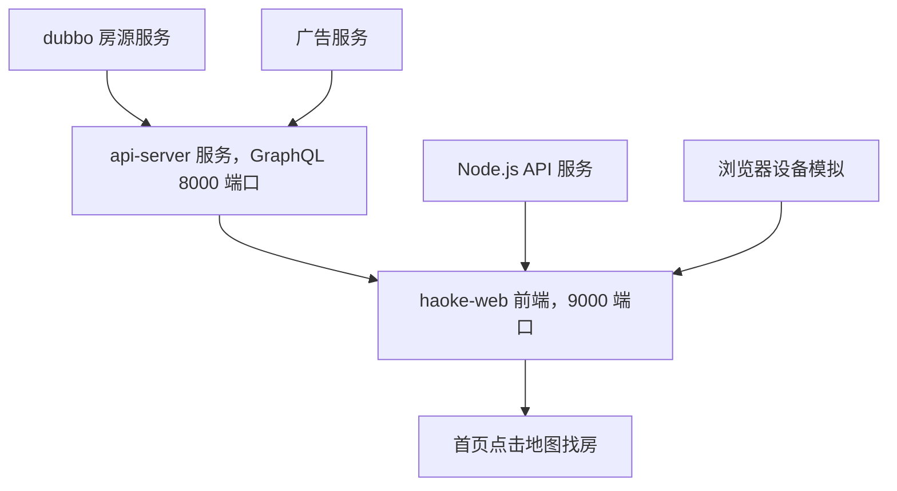

# 跑通地图找房前端：BMap 初始化、静态点位与自定义覆盖物脚本

上一课把地图找房拆到了组件级：聚合圈怎么画、缩放怎么下钻、`TextIconOverlay` 承担什么，思路都齐了。真正到工程里点开这个页面，第一道坎反而不在前端代码本身，而在服务依赖：页面打开了地图不出来，或者地图出来了数据不齐，排查半天，原因常常只是后端某个服务没有起。这一课把整套服务按依赖顺序跑起来，然后进代码看前端团队留下的实现：地图在哪里初始化、点位数据放在哪、覆盖物脚本为什么要单独引。

## 先给结论

- 地图找房页面由前端团队预先实现，代码位于前台工程 `haoke-web` 的 `home/maphouse.js`，后端要做的是跑通它、看懂它、然后改造它的数据来源。
- 页面完整呈现依赖五个服务：管理侧的 dubbo 房源服务、广告服务、GraphQL api-server，前台侧的 React 工程（9000 端口）与 Node.js API 服务，少起一个就有模块不显示。
- 百度地图脚本在 `public/index.html` 里全局引入，React 组件在 `componentDidMount` 里取 `window.BMap` 完成初始化。
- 点位目前是写死的坐标数组，聚合圈效果由资料包中的 `textIconOverlay.js`（`BMapLib.TextIconOverlay`）这类覆盖物脚本绘制。
- 静态数据只是权宜之计，后面两课先把它换成 GraphQL 查询，再换上 MongoDB 的地理位置索引。

## 一、先把五个服务按依赖跑起来

进入页面之前清点一遍启动清单。管理后台一侧，api-server 依赖两个 dubbo 服务：一个是房源数据服务，一个是广告服务；api-server 自己就是 GraphQL 服务的宿主，房源列表、轮播广告、地图点位都从它的 8000 端口出。前台一侧，React 工程 `haoke-web` 用 `npm start` 起在 9000 端口，登录校验和首页数据由配套的 Node.js API 服务提供，进入工程目录执行 `npm run dev` 启动。启动顺序可以参照这张图：



图里的汇聚点是 9000 端口的前端：它既向 Node 服务要登录态和首页数据，又向 api-server 要 GraphQL 业务数据，两边任何一边缺席，页面都会缺一块。

启动完成后的验证路径很固定：浏览器开开发者工具，切到设备模拟的 iPhone 6/7/8 视图，访问 9000 端口，用账号 `tom`、密码 `123` 登录，进首页后点击「地图找房」。演示时出现过一次典型现象：登录成功、页面框架出来了，但部分模块一直空着。这不是前端 bug，回过头检查发现广告服务没有启动，把它拉起来再等一会儿，数据就齐了。这个排查动作值得记住：**页面哪个模块空了，先对图找它依赖的那个服务。**

## 二、maphouse.js：地图初始化与静态点位

功能入口在 `home` 目录下，与首页、房源列表、搜索栏平级的是 `maphouse.js`：

```text
home
├── calc.js
├── home.css
├── home.js
├── list.js
├── maphouse.js
└── searchbar.js
```

组件挂载完成后的初始化代码是百度地图 JS API 的标准三步：

```javascript
componentDidMount() {
  // 百度地图API函数
  var BMap = window.BMap;
  var BMapLib = window.BMapLib;
  // 创建地图实例
  var map = new BMap.Map("allmap");
  // 初始化地图，设置中心点坐标和级别
  map.centerAndZoom(new BMap.Point(116.43244, 39.929986), 12);
  // 添加地图类型控件与缩放控件
  map.addControl(new BMap.MapTypeControl());
  map.addControl(new BMap.ScaleControl({
    anchor: window.BMAP_NAVIGATION_CONTROL_ZOOM
  }));
}
```

三步分别是：`new BMap.Map` 绑定页面里 id 为 `allmap` 的容器；`centerAndZoom` 定中心点与缩放级别，这里给的是北京坐标、12 级；`addControl` 挂控件。因为脚本在 `index.html` 里全局引入，组件内通过 `window.BMap` 拿到对象，这也是 React 集成第三方全局脚本的固定套路。

点位数据此刻还是写死的测试数组，六组经纬度：

```javascript
// 测试数据
var xy = [
  { 'x': 116.350444, 'y': 39.931645 },
  { 'x': 116.351684, 'y': 39.9167 },
  { 'x': 116.357253, 'y': 39.923152 },
  { 'x': 116.354954, 'y': 39.935767 },
  { 'x': 116.36233,  'y': 39.93839 },
  { 'x': 116.374249, 'y': 39.93839 }
];
```

数组里每个元素就是一个房源点的 `x` 经度与 `y` 纬度。页面效果先靠这批假数据撑起来，把交互链路验证通，是后端改造前的过渡态。

## 三、index.html：地图脚本与自定义覆盖物脚本

地图能力的来源在 `public/index.html`。除了项目自身的 meta 与标题，这里多出两个脚本引用：

```html
<!-- 百度地图 JS API 本体 -->
<script type="text/javascript" src="http://api.map.baidu.com/api?v=2.0"></script>
<!-- 聚合覆盖物脚本：工程内放置的是资料包中的 textIconOverlay.js -->
<script type="text/javascript" src="%PUBLIC_URL%/js/textIconOverlay.js"></script>
```

第一个是百度地图开放平台的 JS API，`BMap` 对象全部来自它。第二个要单独说明：画「至少多少套」那种带数字的聚合圈，百度 API 本体没有这个组件，官方库虽然有对应组件可按 CDN 地址引用，工程里选择把覆盖物脚本放进本地工程自行维护。资料包里交出的就是这份脚本源码 `textIconOverlay.js`，文件头注释把职责写得清楚：表示地图上一个由文字和图标组成的覆盖物，文字与图标按映射关系自动匹配大小和颜色。聚合器负责算出「视野内有几个点、合并到哪」，它负责把那个圆圈画出来，上一课拆解过的分工在工程里就是这么落的。

两种引法等价，本地化的好处是不依赖第三方 CDN 的可用性，样式想改就改。引法上要注意顺序：覆盖物脚本依赖 `BMap` 全局对象，必须排在 API 本体之后。

## 四、覆盖物与缩放联动：圆圈什么时候出现

演示时还有一个值得注意的现象：刚进地图时部分聚合圈没有画出来，把地图放大一档，圆圈又出现了。原因在聚合机制本身：聚合器按当前缩放级别把视野划成网格，网格内的点合并成一个覆盖物，级别一变，网格重划、聚合重算，圆圈的数量与大小随之变化。所以「圆圈消失」多数时候不是 bug，是当前级别下这些点被划进了别的格子，或者格子内的点数还没到渲染阈值。

这套联动发生在库内部，如果业务要在缩放结束时做自己的事（比如按新视野重新拉数据，正是后面动态加载要做的），挂的是地图的缩放事件。当前课程里还没有展开写，按主流写法补一个示例，供下一课改造时对照：

```javascript
// 示例：缩放结束后拿到当前级别与中心点，为按视野查询数据做准备
map.addEventListener('zoomend', function () {
  var zoom = map.getZoom();          // 当前缩放级别
  var center = map.getCenter();      // 当前视野中心点
  console.log('zoom=' + zoom + ', lng=' + center.lng + ', lat=' + center.lat);
});
```

现在这段代码只打印参数；等后端能按「中心点加缩放级别」返回附近点位，把打印换成一次 GraphQL 查询，地图找房就从静态走向动态，这条线在下一课接上。

## 常见误区

- **把页面缺数据当前端 bug。** 模块空着先对照服务依赖图清点：房源服务、广告服务、api-server、Node 服务，任何一个没起都会让对应区域空白，广告服务是最常被漏掉的一个。
- **在 `render` 或构造函数里初始化地图。** 那两个时机容器 DOM 还没挂载好，`new BMap.Map("allmap")` 找不到容器直接报错。初始化必须放在 `componentDidMount`。
- **覆盖物脚本引用顺序颠倒。** 自定义覆盖物脚本依赖 `BMap` 全局对象，放在百度 API 之前引入，加载时就会抛出对象未定义。
- **把测试坐标当真实坐标入库。** `xy` 数组是演示用的北京坐标，后续接入真实房源时，坐标来源与坐标系必须统一核对，不能沿用演示值。

## 面试可能被问到的问题

1. 面试官追问：「React 项目里怎么集成百度地图这类第三方 DOM 库？」
   答：脚本在 `public/index.html` 全局引入，挂到 `window` 上；组件内通过 `window.BMap` 取对象，在 `componentDidMount` 里初始化，因为那时容器 DOM 已经挂载。组件卸载时要注意清理地图实例与事件监听，避免内存泄漏。

2. 面试官追问：「为什么地图初始化必须放在 componentDidMount 里？」
   答：React 组件的生命周期里，`render` 只产出虚拟 DOM，`componentDidMount` 才代表真实 DOM 已经插入页面。百度地图实例需要拿到容器元素来计算尺寸、绑定事件，容器不存在时初始化必然失败。

3. 面试官追问：「`window.BMap` 这个对象是怎么来的？」
   答：来自 `index.html` 里引入的百度地图 JS API，脚本加载后在全局挂载 `BMap` 命名空间，包含 Map、Point、Marker 等类。React 与它没有依赖关系，纯粹是全局对象共享，所以用前最好判断一下是否存在，防止脚本加载失败时页面直接崩掉。

4. 面试官追问：「聚合圈不显示，你会怎么排查？」
   答：按层查。先看覆盖物脚本是否加载成功，控制台有没有对象未定义的报错；再看点位数据是否真的到了前端，Network 面板确认请求与响应；然后看缩放级别，聚合按级别划格子，部分点在小级别下可能被合并到视野外的圈里；最后看网格尺寸参数，格子越大越容易合并成一个大圈，调小后圆圈会更早散开。

5. 面试官追问：「地图缩放或拖动结束后，前端通常还要做什么？」
   答：监听 `zoomend` 与 `moveend` 事件，拿到新的缩放级别与视野中心点，作为参数向后端发起该范围的点位查询，再重建覆盖物。数据量控制、请求节流也在这一层做，避免每次缩放都打出密集请求。

## 配套资料

- 聚合覆盖物脚本（真实文件）：`materials/code/03/day10-RocketMQ集群、分布式WebSocket实现以及地图找房功能实现/day10-RocketMQ集群、分布式WebSocket实现以及地图找房功能实现/资料/textIconOverlay.js`（百度地图开放平台开源库 `BMapLib.TextIconOverlay`，基于百度地图 JS API 1.2，正文第三节的引入方式与该文件对应）
- day10 资料包其余内容为空：`maphouse.js` 的初始化与点位代码为按本课画面抄录整理，`index.html` 中本地脚本的存放路径、缩放事件示例为按本课写法补全
- 前端工程与 Node 服务的启动方式，见同系列成稿 `0096-前台系统之工程搭建以及启动服务.md` 与 `0097-前台系统之搭建node.js服务进行测试.md`
