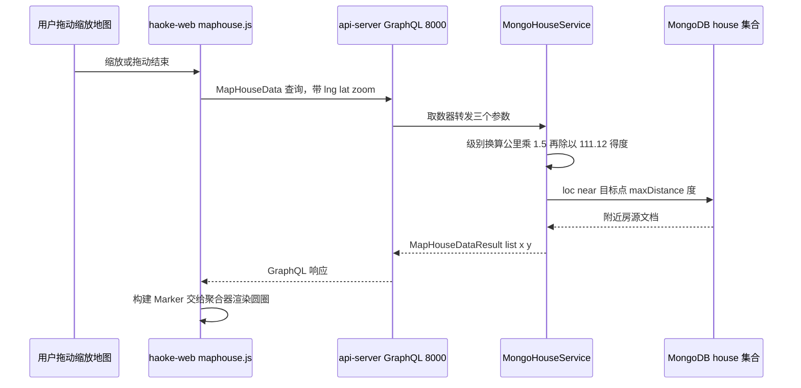

# 整合 MongoDB 收尾地图找房：缩放级别换算查询半径，前后端全链路跑通

到这里，地图找房的三块零件各就各位：前端会画点位与聚合圈，GraphQL 取数器能把数据送出去，MongoDB 的 `2d` 索引加 `$near` 能按坐标查附近。缺的是最后一根线：取数器里的假数据换成真正的 MongoDB 查询，并且查询范围跟着地图的缩放级别走，地图放得越大，查的半径越小，点位越细。这一课把这根线接上：导入依赖、写实体、写查询服务、取数器接线，最后前台联调，十天里地图找房这条功能线就此收束。

## 先给结论

- api-server 引入 `spring-boot-starter-data-mongodb`，配置一行连接串指向 `testdb`，其余交给自动装配。
- 实体 `MongoHouse` 用 `@Document(collection = "house")` 对齐集合，`ObjectId` 主键用 `ToStringSerializer` 序列化成字符串，避免前端处理对象结构。
- 核心换算在服务层：百度地图每个缩放级别对应一个视野宽度公里数，查询半径取它的 1.5 倍，再除以 111.12 换算成度，交给 `$near` 的 `$maxDistance`。
- 取数器从硬编码数据改为调用服务，参数 `lng`、`lat`、`zoom` 从 GraphQL 查询变量里取；前端把默认中心点从北京改到上海人民广场、级别 12。
- 联调通过后十条测试数据在地图上全部对上，剩余的点击圆圈看详情、更高缩放级别明细等留作后续迭代，day10 到此收束。

## 一、依赖与配置：一次引入，一行配置

api-server 目前连的是 MySQL、Redis 与注册中心，MongoDB 还没进来。pom 里加一个起步依赖：

```xml
<dependency>
    <groupId>org.springframework.boot</groupId>
    <artifactId>spring-boot-starter-data-mongodb</artifactId>
</dependency>
```

配置追加到 api-server 的 `application.properties` 末尾：

```properties
# MongoDB 连接配置
spring.data.mongodb.uri = mongodb://172.16.55.185:27017/testdb
```

连接串的末尾是库名，用的就是上一课建索引、插数据的 `testdb`。演示时这里翻过一次车：端口敲成了 `271017`，多打了一个 1，服务能启动但一执行查询就连不上库。连接串这种手抄字符是错误高发区，抄完对一遍主机、端口、库名三要素，比事后看半天堆栈省时间。

## 二、实体 MongoHouse：贴着集合结构映射

查询要有对象接，在 api-server 的 pojo 包下建 `MongoHouse`，字段与上一课插入的文档一一对应：

```java
@Data
@AllArgsConstructor
@NoArgsConstructor
@Document(collection = "house") // 指定集合名称
public class MongoHouse {

    @Id
    @JsonSerialize(using = ToStringSerializer.class)
    private ObjectId id;

    private Long hid;      // 房源 id，对应唯一索引
    private String title;  // 房源标题

    private double[] loc;  // 经纬度数组，下标 0 是经度 x，下标 1 是纬度 y
}
```

三个映射点值得展开。`@Document(collection = "house")` 声明这个类对应 `testdb` 里的 `house` 集合，不加注解时 Spring Data 按类名首字母小写去找集合，集合名不规整时就会查空。`id` 的类型是 MongoDB 驱动的 `ObjectId`，它默认会被序列化成一个嵌套对象结构，前端拿到不好用，加 `@JsonSerialize(using = ToStringSerializer.class)` 让它输出成 24 位的十六进制字符串。`loc` 用 `double[]` 接，因为文档里存的就是两个元素的数组，取的时候按下标 0、1 分别拿经度和纬度。

## 三、MongoHouseService：把缩放级别翻译成查询半径

真正的业务逻辑在服务层。新建 `MongoHouseService`，注入 `MongoTemplate`，先在类里放一张缩放级别与视野宽度的对照表：

```java
@Service
public class MongoHouseService {

    /** 百度地图缩放级别与视野宽度（公里）的映射 */
    private static final Map<Integer, Double> BAI_DU_ZOOM = new HashMap<>();

    static {
        BAI_DU_ZOOM.put(19, 20d / 1000);      // 0.02 公里
        BAI_DU_ZOOM.put(18, 50d / 1000);
        BAI_DU_ZOOM.put(17, 100d / 1000);
        BAI_DU_ZOOM.put(16, 200d / 1000);
        BAI_DU_ZOOM.put(15, 400d / 1000);
        BAI_DU_ZOOM.put(14, 800d / 1000);
        BAI_DU_ZOOM.put(13, 1600d / 1000);
        BAI_DU_ZOOM.put(12, 3200d / 1000);    // 3.2 公里
        BAI_DU_ZOOM.put(11, 6400d / 1000);
        BAI_DU_ZOOM.put(10, 12800d / 1000);
    }

    @Autowired
    private MongoTemplate mongoTemplate;

    public MapHouseDataResult queryHouseData(Double lng, Double lat, Integer zoom) {
        // 查询半径：视野宽度的 1.5 倍，保证视野边缘的点位也能命中，单位公里
        Double km = BAI_DU_ZOOM.get(zoom) * 1.5;
        // $near 在 2d 索引下以度为单位，公里数除以 111.12 换算
        Query query = Query.query(Criteria.where("loc")
                .near(new Point(lng, lat))
                .maxDistance(km / 111.12));
        List<MongoHouse> houses = this.mongoTemplate.find(query, MongoHouse.class);

        List<MapHouseXY> list = new ArrayList<>();
        for (MongoHouse house : houses) {
            list.add(new MapHouseXY(house.getLoc()[0], house.getLoc()[1]));
        }
        return new MapHouseDataResult(list);
    }
}
```

这张对照表的本质是比例尺：百度地图每一级缩放对应固定的视野宽度，19 级视野只有 20 米，10 级视野宽达 12.8 公里，数值来自地图产品对各级别比例尺的定义，单位统一成公里。查询半径取视野宽度的 1.5 倍，留出余量，让视野边缘的房源点不至于贴边就被漏掉。以默认的 12 级为例，视野 3.2 公里，查询半径就是 4.8 公里，与上一课手工测试用的「5 公里」基本重合，两条线在这里对上了。`Criteria.where("loc").near(点).maxDistance(度)` 生成 `$near` 条件，与上一课 shell 里那条 `find` 是同一个东西的 Java 表达。

## 四、取数器接线：假数据退场

上一课的 `MapHouseDataFetcher` 里还硬编码着六个演示坐标，现在把服务注入进来，一行调用替换掉整段构造代码：

```java
@Component
public class MapHouseDataFetcher implements MyDataFetcher {

    @Autowired
    private MongoHouseService mongoHouseService;

    @Override
    public String fieldName() {
        return "MapHouseData";
    }

    @Override
    public Object dataFetcher(DataFetchingEnvironment environment) {
        // 从查询变量里取视野中心点与缩放级别
        Double lng = environment.getArgument("lng");
        Double lat = environment.getArgument("lat");
        Integer zoom = environment.getArgument("zoom");
        // 联调期临时打印，验证通过后删除
        System.out.println("查询附近房源 lng=" + lng + " lat=" + lat + " zoom=" + zoom);
        return this.mongoHouseService.queryHouseData(lng, lat, zoom);
    }
}
```

取数器多了三个入参，SDL 里的字段定义要同步补上参数声明（示例按本课写法补全）：

```graphql
type HaokeQuery {
  MapHouseData(lng: Float, lat: Float, zoom: Int): MapHouseDataResult
}
```

前端查询语句带上变量，值来自地图当前状态；这部分画面没有完整展示，按本课写法补一个示例：

```javascript
// 示例：视野变化后带参数重新查询
function reloadPoints() {
  const center = map.getCenter();
  client.query({
    query: GET_MAP_HOUSE,
    variables: {
      lng: center.lng,
      lat: center.lat,
      zoom: map.getZoom()
    },
  }).then(result => {
    // 用返回的 list 重建覆盖物与聚合圈
  });
}
map.addEventListener('zoomend', reloadPoints);
map.addEventListener('moveend', reloadPoints);
```

整条链路至此闭环：



图里最关键的一环是缩放级别到查询半径的换算：前端每次缩放，传给后端的不只是中心点，还有级别，级别决定了这圈画多大，地图的交互语义由此完整地传导到了查询条件。

## 五、联调验证与收束

重启 api-server，前端还有一处小改动：默认中心点原来是北京的坐标，数据都在上海，把它改成上海人民广场的坐标、级别保持 12（坐标沿用上一课查询用的演示值）：

```javascript
// 默认定位改为上海人民广场，级别 12
map.centerAndZoom(new BMap.Point(121.483102, 31.235156), 12);
```

进页面点击「地图找房」，地图直接落在上海，人民广场与中山公园周边出现聚合圈；点加号放大地图，圆圈变多变细，拖动地图时按新视野重新拉取点位，半透明加载效果也正常。把十条测试数据逐一核对：人民广场附近三套、中山公园附近若干套，地图上的圈与库里的数据完全对得上。控制台里取数器留的调试打印持续输出 `lng`、`lat`、`zoom` 三个参数，确认前端参数传导无误后即可删掉。

至此，地图找房这条线跑完了从静态到动态的全过程：前端画点、GraphQL 供数、MongoDB 按地理范围查询，三层各司其职。还留有余地的部分也很明确：点击聚合圈进入下一级明细、更高缩放级别的逐套展示、造数之外接入真实房源数据，这些留作后续迭代。day10 的功能实现部分到此收束，下一课做整章总结。

## 常见误区

- **连接串端口或库名敲错还以为代码有 bug。** 手抄的 `host:port/db` 三要素要逐一核对，端口多一个 1、库名拼错，启动都不报错，直到第一次查询才暴露。
- **查询半径只按视野宽度算，不乘放大系数。** 视野边缘的点会被圆形边界裁掉，用户看到的是地图上某个方向的点凭空缺失。乘 1.5 倍留余量是这类「视野查询」的常规做法。
- **忘记 2d 索引下距离单位是度。** 服务层把公里数直接塞给 `maxDistance`，查询范围扩大一百多倍，一次就把全库点都拉回来了，数据一多页面直接卡死。
- **ObjectId 原样序列化给前端。** 默认的嵌套对象结构前端解析别扭，统一用 `ToStringSerializer` 输出十六进制字符串，前后端约定一次到位。

## 面试可能被问到的问题

1. 面试官追问：「地图缩放级别是怎么变成查询半径的？」
   答：前端把级别连同中心点一起传给后端，后端维护一张级别与视野宽度的对照表，查到当前级别的视野公里数，乘 1.5 留出边缘余量，再除以 111.12 换算成 2d 索引下的度数，作为 $near 的 maxDistance。级别越大视野越小，查询半径随之收紧。

2. 面试官追问：「为什么要乘 1.5 倍？」
   答：查询以中心点画圆，而用户看的是矩形视野，圆的半径如果恰好等于视野宽度的三分之一不到，边缘方向的点位会被裁掉。按视野宽度乘 1.5 给出余量，保证视野边缘的房源也能命中，多返回的几个点对体验无损。

3. 面试官追问：「ObjectId 为什么要用 ToStringSerializer 序列化？」
   答：ObjectId 是 12 字节的二进制结构，Jackson 默认把它序列化成一个包含时间戳、机器标识等字段的嵌套对象，前端拿到要多做一层处理。ToStringSerializer 让它输出 24 位十六进制字符串，语义清晰也方便直接回传给后端做按 id 查询。

4. 面试官追问：「MongoTemplate 里怎么表达 $near 查询？」
   答：用 `Criteria.where("loc").near(new Point(lng, lat)).maxDistance(距离)` 构造条件，装进 `Query` 后调 `mongoTemplate.find(query, 实体类)`。它与 shell 里 `{loc: {$near: [...], $maxDistance: n}}` 一一对应，注意 2d 索引下距离单位是度。

5. 面试官追问：「每次缩放都打一次库，怎么扛住流量？」
   答：几层手段叠加：查询本身有地理索引，命中的是半径内的小结果集；前端对 moveend、zoomend 做节流，避免连缩几档打出密集请求；中心点与级别变化不大的请求可以加缓存；数据量再大就上分片或把聚合层前置。索引加节流解决绝大多数问题，缓存与分片是后续规模化的事。

6. 面试官追问：「这个地图找房方案如果要继续演进，你会先做什么？」
   答：先补交互闭环：点击聚合圈下钻展示区内房源明细，点击单点弹出房源卡片，接上详情页。再把数据换成真实房源并统一坐标系与入库流程，索引从 2d 升级到 2dsphere 配 GeoJSON，查询改 $geoNear 以便带上距离排序与分页。

## 配套资料

- 本课无配套源码包：pom 依赖、`MongoHouse`、`MongoHouseService`、取数器接线与前端参数查询为按本课视频画面与讲解整理，包名统一改为中性的 `com.haoke.manage`，前端带变量查询与缩放事件部分为按本课写法补全的示例
- 聚合覆盖物脚本（真实文件，前端渲染侧对应资料）：`materials/code/03/day10-RocketMQ集群、分布式WebSocket实现以及地图找房功能实现/day10-RocketMQ集群、分布式WebSocket实现以及地图找房功能实现/资料/textIconOverlay.js`
- `MongoTemplate` 的 Query 与 Criteria 体系见同系列成稿 `0141-spring-data-mongodb的使用之查询、更新、删除操作.md`，取数器扩展模式见 `0094-优化改进GraphQLProvider实现逻辑.md`
