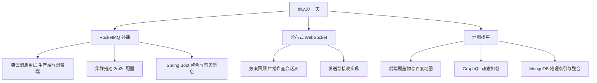
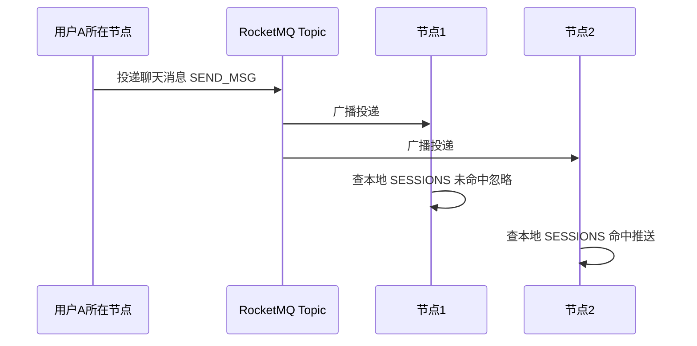

# day10 收束：RocketMQ 补课、分布式 WebSocket 与地图找房的复习地图

day10 的内容跨了三个领域：上午还在给 RocketMQ 补可靠性的课，下午就写完了分布式 WebSocket，最后又把地图找房整条链路打通。一天下来笔记散落在五个话题里，回头想串成一条线并不容易。这一篇把全天内容摊开重走一遍：每一块只留最关键的结论和最容易翻车的点，再配一张全章知识地图，复习时照图走。

## 先给结论

- 全章三块内容各有主心骨：RocketMQ 补课解决「失败了怎么办、机器挂了怎么办」，分布式 WebSocket 是前面所有铺垫的业务出口，地图找房的核心资产是 MongoDB 的 2d 地理索引。
- 重试机制的重点落在消费端：生产端只有重试次数与超时时间两个参数；消费端异常或超时会进重试队列，次数耗尽进入死信队列。
- 集群四种模式按可用性递进：单 Master 只配开发环境，生产环境在「多 Master 多 Slave 异步复制」与「同步双写」之间按业务选，差别是用 10% 左右的性能换一个丢消息窗口。
- 分布式 WebSocket 的全部秘密是一句话：消息投进 Topic 广播，各节点收到后自查本地会话表；测试必须启动多个 JVM 才能看到效果。
- 地图找房里 `$near` 的 `$maxDistance` 单位是度不是公里，5 公里要写成 `5/111.12`；缩放级别换算视野宽度再乘 1.5，是查询半径的来源。

## 一、全章知识地图

先上地图，后面每一节按图上的分支展开：



地图上每个叶子节点对应一个视频环节，哪一支讲不出内容就回去补哪一支。三块内容不是并列关系：A3 学完的注解写法直接用在了 B 上，C 又复用了 A2 保证的消息系统可用性，这条依赖链是全天内容真正的组织方式。

## 二、RocketMQ 补课：重试与集群的分工

重试讲了两端。生产端很薄，两个参数就说完：

```java
package com.example.rocketmq;

public class SyncProducer {

    public static void main(String[] args) throws Exception {
        DefaultMQProducer producer = new DefaultMQProducer("haoke-im");
        producer.setNamesrvAddr("172.16.55.185:9876");
        // 发送失败自动重试的次数
        producer.setRetryTimesWhenSendFailed(3);
        producer.start();
        String msgStr = "用户发送消息给用户";
        Message msg = new Message("haoke_im_topic", "SEND_MSG",
                msgStr.getBytes(RemotingHelper.DEFAULT_CHARSET));
        // 发送并指定超时时间，超时也算失败、触发重试
        SendResult sendResult = producer.send(msg, 1000);
        System.out.println("消息状态：" + sendResult.getSendStatus());
    }
}
```

消费端才是重试的主战场。监听方法抛异常返回 `RECONSUME_LATER`，消息进入重试队列按延迟级别反复投递，默认最多 16 次，仍失败就转入死信队列 `%DLQ%+消费组名`；超时的情况同理，方法迟迟不返回应答，Broker 视同消费失败。理解这条路径，后面排查「消息怎么被消费了这么多次」才有方向。

集群解决机器层面的问题。四种模式一句话各自概括：单 Master 宕机即服务中断；多 Master 横向扩展了容量但宕机节点上的消息暂时不可订阅且无副本；多 Master 多 Slave 用主从复制补上容错，又按「先返回后同步」与「主备都写成功才返回」分成异步复制和同步双写两种。发行包 `conf` 目录下 `2m-2s-async`、`2m-2s-sync` 两套样例对应这两种形态，配置差别集中在 `brokerRole` 一个键：`ASYNC_MASTER` 或 `SYNC_MASTER`。异步复制性能几乎无损、主盘损坏可能丢一个复制窗口内的消息；同步双写几乎不丢、性能低约 10%。转账账务选同步，日志埋点选异步，本地开发单 Master 就够。

Spring Boot 整合把前两站的能力变成顺手的写法。收发靠 `RocketMQTemplate` 与 `@RocketMQMessageListener`，事务消息靠一个注解完成监听器注册：

```java
@RocketMQTransactionListener(txProducerGroup = "myTransactionGroup")
public class TransactionListenerImpl implements RocketMQTransactionListener {

    private static Map<String, RocketMQLocalTransactionState> STATE_MAP = new HashMap<>();

    @Override
    public RocketMQLocalTransactionState executeLocalTransaction(
            org.springframework.messaging.Message message, Object o) {
        // 执行本地事务，返回 COMMIT、ROLLBACK 或 UNKNOWN
        return RocketMQLocalTransactionState.COMMIT;
    }
}
```

两个回调与原生 API 一一对应：`executeLocalTransaction` 执行本地事务，`checkLocalTransaction` 响应 Broker 回查。与原生写法的差别只在简化，生命周期交给容器，注解替代手工装配。

## 三、分布式 WebSocket：让会话表出 JVM 的那一步

单机 WebSocket 的会话登记表是进程内的静态 Map，多实例部署后 A 与 B 连在不同节点上，A 所在节点查不到 B，消息就推不出去。day10 的方案把这一步打通：发送侧不再关心目标用户连在哪个实例，只管把消息投进 Topic；接收侧让 `MessageHandler` 顺手实现消息监听接口，收到消息后查本地会话表，命中就推送。

三个配置项决定方案成立与否，缺一不可：

```java
@Component
@RocketMQMessageListener(topic = "haoke-im-send-message-topic",
        consumerGroup = "haoke-in-consumer",
        messageModel = MessageModel.BROADCASTING,
        selectorExpression = "SEND_MSG")
public class MessageHandler extends TextWebSocketHandler
        implements RocketMQMessageListener {
    // 收到广播后解析目标 id，查本地 SESSIONS，有就推送，没有就忽略
}
```

主题与标签决定消息走哪条路，广播模式决定每个实例都收到全量消息。默认的集群模式会把消息在消费组内分摊，广播语义直接不成立，这是联调时最容易漏的一项。整条链路如下：



验证这个方案必须起多个 JVM，每个实例各连一个 WebSocket 客户端，从 A 发一条消息，观察 B 所在节点也能弹出。单实例测试永远「看起来没问题」，这是本课明确提醒的测试纪律。

## 四、地图找房：地理索引是真正的核心

前端、GraphQL、MongoDB 三块在上一课拼合完成。前端用百度地图 API 渲染点位与聚合圈，资料包里唯一的文件 `textIconOverlay.js` 就是负责画「文字加图标」覆盖物的库；GraphQL 取数器把地图当前的经纬度与缩放级别传给后端；后端查询落在 MongoDB 上：

```java
public MapHouseDataResult queryHouseData(Double lng, Double lat, Integer zoom) {
    // 视野宽度（公里）的 1.5 倍作为查询半径，除以 111.12 换算成度
    double distance = BAI_DU_ZOOM.get(zoom) * 1.5 / 111.12;
    Query query = Query.query(Criteria.where("loc")
            .near(new Point(lng, lat)).maxDistance(distance));
    List<MongoHouse> mongoHouses = this.mongoTemplate.find(query, MongoHouse.class);
    return new MapHouseDataResult(mongoHouses);
}
```

支撑这条查询的前提是两步索引：`loc` 字段建 `2d` 地理索引，`hid` 字段建唯一索引防重复灌数据。`$near` 查的是平面距离，单位与坐标一致是度，纬度上 1 度约合 111.12 公里，所以公里数必须除以 111.12 再进 `$maxDistance`。缩放级别乘以 1.5 是为了让视野边缘的点位也能命中，地图放得越大半径越小，点位越细。

整套架构至此已经搭好：数据结构、索引、查询、渲染全部就位，后续只需把真实房源数据灌进去，地图找房就是一个完整功能。教师原话的落点也在这里，全章内容都希望大家动手敲一遍，测试时多起几个 JVM，地理索引的能力还能顺手做出附近的人、附近的餐馆这类功能。

## 常见误区

- **广播模式忘了显式声明。** `@RocketMQMessageListener` 默认集群模式，消息在消费组内分摊，每个实例只收到一部分，表现为「有时收得到有时收不到」。必须显式写 `messageModel = MessageModel.BROADCASTING`。
- **单 JVM 测试分布式 WebSocket。** 一个实例上收发都正常，误以为方案没问题；多实例部署后立刻出现消息丢失。测试时至少起两个 JVM、各连一个客户端。
- **`$maxDistance` 直接写公里数。** 2d 索引的距离单位是度，写 5 查的是 5 度（约 555 公里），结果大到离谱。公里数除以 111.12 再传。
- **事务消息只实现执行回调不实现回查。** 本地事务结果返回 `UNKNOWN` 后，全靠 Broker 回查 `checkLocalTransaction` 收敛状态，这个方法不写，半消息永远悬着。
- **集群选型一刀切。** 同步双写不是越稳越好，吞吐优先的场景用它白白损失 10% 性能；反之强可靠场景用异步复制，主盘损坏就是事故。

## 面试可能被问到的问题

1. 面试官追问：「Producer 和 Consumer 的重试机制有什么区别？」
   答：Producer 侧只有两个参数，重试次数与超时时间，失败由客户端换 Broker 重发；Consumer 侧复杂得多，异常或超时会触发重试队列按延迟级别重新投递，默认 16 次后进死信队列。重点在消费端，因为消费失败的原因通常是业务代码，需要更长的时间窗口和人工介入。

2. 面试官追问：「多 Master 多 Slave 的异步复制与同步双写怎么选？」
   答：异步复制消息写 Master 即返回，复制在后台进行，性能与多 Master 几乎一致，代价是主盘损坏时丢一个复制窗口内的少量消息；同步双写要等主备都写成功才返回，几乎不丢但性能低约 10%。强可靠场景如账务支付选同步，日志埋点等吞吐优先场景选异步。

3. 面试官追问：「Spring Boot 整合后事务消息怎么写？」
   答：类上贴 `@RocketMQTransactionListener` 指定生产组即完成注册，实现 `executeLocalTransaction` 执行本地事务并返回 `COMMIT`、`ROLLBACK` 或 `UNKNOWN`，实现 `checkLocalTransaction` 响应 Broker 回查。发消息用 `rocketMQTemplate.sendMessageInTransaction`，与原生 API 流程一致，只是装配交给容器。

4. 面试官追问：「多实例部署下 WebSocket 怎么做跨节点推送？」
   答：会话表是进程内的静态 Map 出不了 JVM，所以发送方不查目标实例，把消息投到 Topic 并打上目标用户标识与标签，各实例以广播模式订阅，收到后自查本地会话表，命中就推送，未命中忽略。广播保证每个实例都看到消息，本地查表保证只有持有连接的实例真正推送。

5. 面试官追问：「附近的人这类功能用什么实现？」
   答：MongoDB 的地理位置索引。坐标以经纬度数组存储并对 `loc` 字段建 2d 索引，查询用 `$near` 加 `$maxDistance` 指定半径，注意距离单位是度，公里数要除以 111.12。给定一个位置查周边目标，就是一次走索引的近邻查询，地图找房按缩放级别动态换算半径，同一个原理。

6. 面试官追问：「day10 的三块内容是怎么串起来的？」
   答：重试与集群解决消息系统的可靠性，Spring Boot 整合解决写法成本，这三件事凑齐后分布式 WebSocket 才能用几十行代码落地，广播语义、可靠投递、注解订阅各取所需；地图找房则是把 MongoDB 地理索引接到前端地图上，属于当天独立的业务特性，核心资产是 2d 索引。

## 配套资料

- RocketMQ 专题讲义：`materials/docs/10/RocketMQ研究v1.0.md`（消息发送方式、消费重试等成文结论与全章重试部分对应）
- RocketMQ 官方发行包：`materials/code/10/rocketmq-all-4.5.0-bin-release/rocketmq-all-4.5.0-bin-release/`（`conf/2m-2s-async`、`conf/2m-2s-sync` 集群样例即集群搭建两讲的素材）
- day10 资料包：`materials/code/03/day10-RocketMQ集群、分布式WebSocket实现以及地图找房功能实现/`（仅含 `资料/textIconOverlay.js`，为地图找房前端覆盖物所用；重试、集群、WebSocket 与 MongoDB 部分资料包无源码，文中代码按课程视频屏幕代码整理，包名统一改为 `com.example`）
