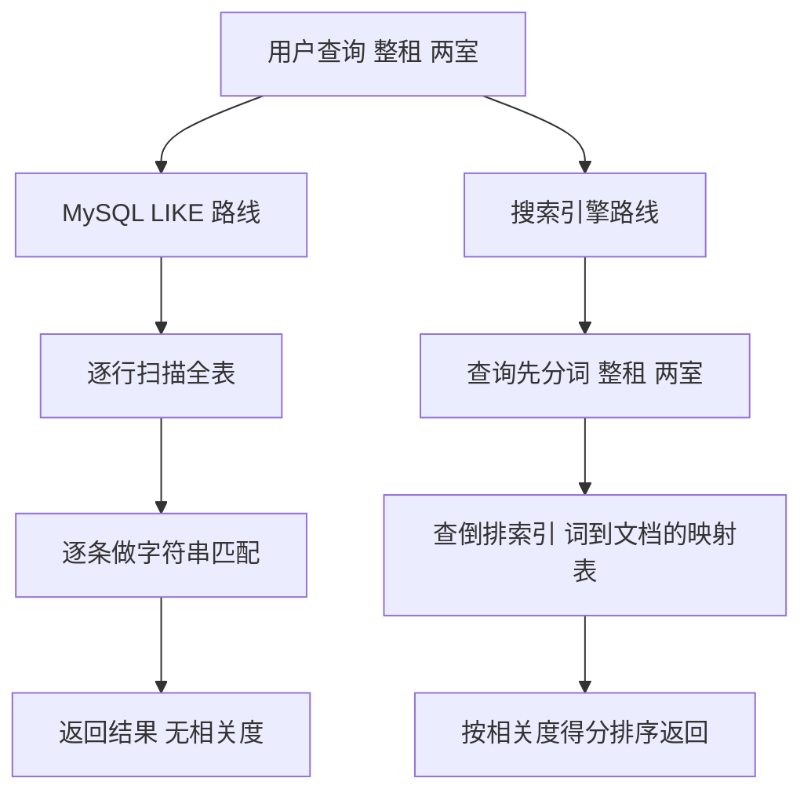

# 搜索框逼出来的新引擎：day13 开启 Elastic Stack 学习之路

房源列表页迟早要长出一个搜索框，用户在里面敲「整租 两室 近地铁」，期望返回的是相关房源，而不是报错或者一堆不相关的结果。用现有的 MySQL 去接这个需求，写两条 SQL 就会发现力不从心；而只要搜过「ELK 是什么」，又会被一堆新名词浇一头雾水。day13 从这一天开始把这两件事一次讲清：为什么搜索需要专门的引擎，以及传说中的 ELK 到底是几个软件。

## 先给结论

- `LIKE '%关键词%'` 的三个硬伤：全表扫描慢、中文没有分词、结果没有相关度排序，这三条决定了搜索要换引擎。
- 搜索引擎的底牌是倒排索引：把「文档里有哪些词」倒过来存成「词出现在哪些文档」，查询先分词再查表，速度与文档总量解耦。
- ELK 是 Elasticsearch、Logstash、Kibana 三个软件首字母的组合，Beats 加入后改叫 Elastic Stack，名称来龙去脉在简介一讲展开。
- day13 五段路线：Elastic Stack 简介、Elasticsearch 介绍与安装、快速入门、核心讲解、中文分词，先把环境装起来，后面全在这套环境上练。

## 一、LIKE 查询到底差在哪

拿房源表直接写搜索，第一直觉是这样：

```sql
-- 用户搜「整租 两室」，直觉写法
SELECT * FROM tb_house
WHERE title LIKE '%整租%' AND title LIKE '%两室%';
```

这条 SQL 能跑，但放在搜索场景里有三个绕不过去的坎。

**第一，性能与数据量正相关。** `%` 开头的条件让索引彻底失效，数据库只能从第一行扫到最后一行，数据到百万级、每次请求都这么扫，接口耗时直接起飞。搜索恰恰是并发最高的入口之一，最慢的方案顶在最前面，方向就错了。

**第二，中文按字匹配，语义全无。** `LIKE '%两室%'` 匹配的是连续的四个字符，用户输入「两居室」就匹配不上；反过来用户搜「卧室」，所有含「两室」的标题也搭不上边。数据库眼里这只是一串字符，它不知道「两室」和「两居室」是一个意思，更不知道该把「室」单独切开。

**第三，结果没有相关度。** 标题以「整租」开头的结果和标题末尾才出现「整租」的结果，在这条 SQL 眼里完全等价，返回顺序全凭主键运气。搜索体验的核心恰恰是「最相关的排最前」，这一层能力 `LIKE` 根本没有。

三条坎指向同一个结论：搜索是一个独立的问题域，需要为它专门设计的引擎。用一张图看清两边思路的差异：



左边的工作量随数据量线性增长，右边的工作量只与「词」有关，这就是专门的引擎敢接搜索需求的底气。

## 二、倒排索引：搜索引擎的反向思路

正排与倒排的差别，用一个类比就能说透。正排像一本书的正文，想知道某个词在哪一页，只能一页页翻；倒排像书末尾的索引页，列着「这个词出现在第几页」，翻索引一步到位。

落到存储上，写文档入库时引擎先把文本切成一个个词（这个过程就是分词，day13 压轴的中文分词讲的正是它），然后记录每个词出现在哪些文档里：

```text
文档1: 整租 两室 近地铁
文档2: 合租 主卧 近地铁
文档3: 整租 一室

倒排表:
整租   -> 文档1, 文档3
两室   -> 文档1
近地铁 -> 文档1, 文档2
```

用户查询时同样先分词，再在倒排表里取交集并集，命中的文档按得分排序返回。查的是「词到文档」的映射，扫的行数从「全部文档」缩小到「包含这些词的文档」，这就是第二张图里右路的原理。倒排索引、分词、相关度得分这三样，构成了 day13 后半程「核心讲解」的主要内容，此处先立起骨架。

## 三、ELK 与 Elastic Stack：先把名字捋清

课程在这一天正式进入「传说中的 ELK」。这个名字很容易被当成某个软件，实际上它是三个软件名称首字母的缩写组合：Elasticsearch 的 E，Logstash 的 L，Kibana 的 K，三者分别承担搜索与存储、数据处理、可视化展示的职责。

现在更通行的叫法是 Elastic Stack，因为 ELK 组合之后又加入了新成员 Beats，专门负责数据采集。再往缩写里插字母显然不是办法，官方索性给整个技术体系起了新名字。ELK 与 Elastic Stack 的关系、四个成员各自怎么配合，是下一天「Elastic Stack 技术栈介绍」的主题，也是读懂后续一切架构图的前提。

## 四、day13 的五段路线怎么走

导览页列出的五个模块是一条由浅入深的链：Elastic Stack 简介先解决「这一套东西是什么」；Elasticsearch 的介绍与安装把环境部署起来，单机版安装与 Docker 安装两种方式都会走一遍；快速入门讲怎么用，索引、文档、RESTful 接口的增删改查都在这一段；核心讲解把文档、映射、结构化查询这些内部概念拆开；中文分词收尾，解决中文场景最实际的切词问题。

学习方式上有一点值得先说：Elasticsearch 的操作全部通过 RESTful 接口完成，环境一旦装好，一个 HTTP 客户端就能玩遍所有功能。比如后面快速入门里会反复出现这样的请求（示例为按本课写法补全）：

```bash
# 向 ES 发一个最简单的请求，看它是否已经就绪
curl http://localhost:9200
```

环境就绪后返回一段 JSON，里面有集群名、版本号和那句著名的 tagline。之后建索引、写文档、搜文档，全是同样的套路：

```http
POST /haoke/house/_search
{
  "query": {
    "match": {
      "title": "整租 两室"
    }
  }
}
```

`match` 查询会把「整租 两室」先分词再检索，这正是前面 LIKE 做不到的事。快速入门阶段不求全懂，先把「请求进来、结果返回」的手感练出来，核心讲解再看内部结构，顺序不要倒。

## 常见误区

- **以为加个 `FULLTEXT` 索引就能解决搜索。** MySQL 的全文索引对中文支持薄弱，天然按词库切词的引擎与按前缀匹配的索引是两回事，真正做搜索还是要上专业引擎。
- **把 ELK 当成一个软件。** 它是三个软件首字母的组合，装的时候要分别装、分别启动，出了问题也要分组件排查。
- **先学概念再装环境。** Elasticsearch 一切操作都走接口，环境不起来越学越虚；正确顺序是先把单机环境跑起来，边发请求边理解概念。
- **把搜索框当成简单的模糊查询。** 用户输入的是自然语言片段，需要分词、纠错、相关度排序这一整套机制，这是独立的问题域，不是 SQL 里加几个条件的事。

## 面试可能被问到的问题

1. 面试官追问：「为什么有了 MySQL 还需要 Elasticsearch？」
   答：MySQL 擅长精确匹配与事务，但 `LIKE '%x%'` 全表扫描、中文不分词、没有相关度排序。Elasticsearch 基于倒排索引，查询先分词再查词到文档的映射表，按得分排序返回，性能与文档总量解耦，是为搜索这个场景专门设计的。

2. 面试官追问：「倒排索引和正排索引的区别？」
   答：正排是文档到词，知道文档 id 找它的内容；倒排是词到文档，记录每个词出现在哪些文档。查询关键词时走倒排表直接定位命中文档集合，不必扫描全部数据，这是搜索引擎速度的来源。

3. 面试官追问：「ELK 和 Elastic Stack 是什么关系？」
   答：ELK 是 Elasticsearch、Logstash、Kibana 三个组件首字母的组合；后来加入负责采集的 Beats，官方将整个体系改称 Elastic Stack，包含的技术内容比原来的 ELK 更宽，两者是新旧名称的演进关系。

4. 面试官追问：「用户搜『两居室』能搜到标题为『两室』的房源吗？」
   答：取决于分词与检索策略。数据库 `LIKE` 匹配连续字符串，搜不到；搜索引擎把标题与查询都切词后基于倒排表匹配，配合同义词词库或按分词器粒度切分，可以建立「两室」与「两居室」的关联，这正是中文分词一讲要解决的问题。

5. 面试官追问：「Elasticsearch 的操作通过什么方式完成？」
   答：RESTful 风格的 HTTP 接口，请求与响应都是 JSON，任何语言都能直接调用，官方同时提供各语言的客户端库。学习阶段用一个 HTTP 工具就能完成索引与文档的全部增删改查。

## 配套资料

- day13 资料包未提供源码：`materials/code/03/day13-ElasticStack学习之Elasticsearch入门/` 下仅有解压清单 `_extracted.json`，记录解压文件数为 0，文中的 SQL、倒排表演示与 REST 请求均为按本课写法补全的示例。
- 同一条 ES 主线的后续实战数据：`materials/code/03/day15-房源数据抓取以及实现房源搜索/day15-房源数据抓取以及实现房源搜索/资料/抓取的房源数据/data.json`（抓取好的房源数据，day15 会把它灌进 Elasticsearch 做真实搜索，提前认识它有助于理解这条线要解决什么）。
