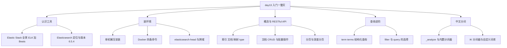

# day13 收束：Elasticsearch 入门一整天的复习地图

day13 一口气走了十个环节：从 Elastic Stack 是什么，一路讲到 IK 分词器扩词。视频看完当时都懂，合上笔记再回忆，顺序乱了、坑的位置也忘了。收尾这一讲把全天内容重新点名了一遍，正好按这个顺序把整章压成一张图加几段结论：每个环节只留最要紧的一条线和最容易翻车的一个点，复习时照图走，哪一支讲不出来就回去补哪一支。

## 先给结论

- 全章主线是四步：认识工具（Elastic Stack 与 Elasticsearch 的定位）、装起来（单机、Docker、head 管理界面）、用起来（基本概念与 RESTful API）、搜得准（结构化查询与中文分词）。
- 版本是所有安装问题的第一变量，课程全程用 6.5.4；集群安装被刻意挪到进阶篇，day13 始终单节点。
- 查询有两条路可走：精确值（年龄、邮箱、状态）走 `filter`，不算分、可吃缓存；分词文本（标题、爱好）走 `query`，靠相关性算分排序。
- 分页要带着集群意识用：`from+size` 翻得越深，各分片要返回的数据越多，深度分页的代价在分布式下被放大。
- 中文搜索必须装 IK 分词器，惯例是 `ik_max_word` 建索引、`ik_smart` 做搜索词，业务专有名词靠扩展词库补。

## 一、全章知识地图

先上图，后面每一节按图上的分支展开：



图上五个分支是有依赖顺序的：B 支撑一切操作，C 是日常八成动作的来源，D 与 E 决定搜索质量。E 是全章的收口，也是搜索从「能搜」到「搜得准」的分水岭。

## 二、把环境立起来：版本、安装与 head

**版本先行。** 下载页分 GA 与 PREVIEW 两条线，选 GA 稳定版；课程用的 6.5.4 基于 Lucene 7.5.0。后面的插件、客户端都要跟着这个版本对齐，IK 分词器尤其如此，插件 release 与 ES 版本一一对应。

**两条安装路径。** 单机解压安装要走全流程：建专用用户、解压、调系统参数、启动看日志，一步不能省；已有 Docker 的机器可以压成四条命令，拉镜像、建容器、启动、验证。集群安装这一讲刻意没讲，留到进阶篇配合分片副本机制一起展开，单节点先把 API 玩熟。

**head 是纯前端工具。** ES 官方不做管理界面，elasticsearch-head 补了这个空缺：它自己监听 9100 端口，通过浏览器向 9200 发请求。四种安装方式里推荐 Docker 与 Chrome 插件两种，最顺手的是 Chrome 插件，点开即用还不受同源策略约束。用 Docker 或源码方式装完，第一次点「连接」大概率连不上，那是跨域被拦，ES 侧加两行配置解决：

```yaml
http.cors.enabled: true
http.cors.allow-origin: "*"
```

改完重启，head 上能看到索引与分片分布，环境才算立完。

## 三、概念与 API：拿 MySQL 思维当翻译器

ES 的概念第一次接触容易发懵，但几乎每个都能在 MySQL 世界找到对应物：

| Elasticsearch | MySQL 世界 | 一句话 |
|---|---|---|
| 索引 index | 表 | 文档的容器，建索引就是建表 |
| 文档 document | 行 | 一条 JSON 数据，有唯一 `_id` |
| 映射 mapping | 表结构 | 定义字段与类型 |
| type | 已废弃的分层 | 6.x 逐步淡化，一个索引一种 type |

API 的套路是「HTTP 方法表达动作，URL 表达资源」。建索引时顺手把分片与副本定下来，这两个数后续不好改：

```bash
PUT http://172.16.55.185:9200/haoke
{
  "settings": {
    "index": {
      "number_of_shards": "2",
      "number_of_replicas": "0"
    }
  }
}
```

文档层的高频动作按 ID 走：`GET /haoke/user/1005?pretty` 取单条，`pretty` 只是把 JSON 拉开好看；判断文档存在不用取回全文，不存在时直接返回 `404 Not Found`。大批量灌数据走 `_bulk`，一行动作描述跟一行文档，插入、删除、查询都能混在一起批量做，唯一记得是最后一行必须留一个换行，否则整批报错。

分页是搜索的前置能力，`from` 加 `size` 两个参数：

```bash
GET http://172.16.55.185:9200/haoke/user/_search?size=1&from=2
```

写分页功能时就要有集群意识：翻到深页码，每个分片都要按「from+size」把前面所有条数据取回来再归并排序，页越深代价越大，这是进阶篇还要回头看的问题。

## 四、查询进阶：term、terms 与 filter 的选择

结构化查询的核心是 `term`：不分析、不拆词，拿整个值去精确匹配，`terms` 则是一次给一组值命中任意一个即可。配合 `bool` 结构组装多条件，最常见的形态是过滤：

```bash
POST http://172.16.55.185:9200/haoke/user/_search
{
  "query": {
    "bool": {
      "filter": {
        "term": { "age": 20 }
      }
    }
  }
}
```

这一讲留下的最重要结论是选型判断：过滤查询与条件查询常常能得到相同的结果，差别在机制。**精确搜索用过滤**，`filter` 不计算相关性得分，结果还能被缓存，年龄、邮箱这类字段都该走这条路；**需要分词、按相关性排序的搜索用查询**，比如搜一段文本、按得分排座次。拿不准就问自己一句：这个字段要不要分词、要不要算分。

## 五、中文分词：全章的收口

分词是把文本切成词条的过程，ES 靠 `_analyze` 接口把这件事变成可观测的：

```bash
POST http://172.16.55.185:9200/_analyze
{
  "analyzer": "ik_max_word",
  "text": "我爱炒肉丝"
}
```

返回的词条带着 `start_offset` 与 `position`，切分位置一目了然：

```json
{
  "tokens": [
    { "token": "我",     "start_offset": 0, "end_offset": 1, "type": "CN_CHAR", "position": 0 },
    { "token": "爱",     "start_offset": 1, "end_offset": 2, "type": "CN_CHAR", "position": 1 },
    { "token": "炒肉丝", "start_offset": 2, "end_offset": 5, "type": "CN_WORD", "position": 2 }
  ]
}
```

内置分词器对中文只会逐字切，「我是中国人」被拆成一串单字，中文搜索的精度问题必须靠 IK 解决。装好 IK 之后两种模式的分工要记牢：`ik_max_word` 输出最细粒度词条组合，适合建索引保召回；`ik_smart` 粗粒度切分，适合处理搜索词。IK 的主词典是通用词典，业务专有名词（比如平台名）它不认识，要用扩展词典补上，本地文件冷更新够开发用，线上环境走远程词典热更新。

到这里，ES 基本上就能玩起来了。还欠一块是 Java 端 API 的使用，全部留到进阶篇：先把倒排索引与集群机制讲清，再用 Java 客户端与 Spring Data Elasticsearch 落地。

## 常见误区

- **head 连不上就怀疑端口装错。** 页面在 9100、接口在 9200，连接失败十有八九是跨域被浏览器拦下，补 CORS 两行配置再重启，而不是反复重装工具。
- **把精确值字段设成 `text` 还想精确查。** 邮箱、手机号、状态码要走 `keyword`，`text` 会被分词，`term` 查询对不上整值。
- **`_bulk` 最后一行没换行。** 批量格式要求每条动作后都有换行，最后一条少了它，整批请求直接报解析错误，且报错位置容易看岔。
- **IK 插件版本与 ES 版本不对应。** 一一对应是硬要求，6.3.0 的插件装在 6.5.4 上轻则加载失败重则节点起不来。

## 面试可能被问到的问题

1. 面试官追问：「Elastic Stack 和 ELK 是什么关系？」
   答：ELK 是 Elasticsearch、Logstash、Kibana 三个词的首字母组合，后来 Beats 数据采集器加入，整套体系改称 Elastic Stack。Elasticsearch 是其中的存储与搜索核心，Logstash 做加工，Beats 做轻量采集，Kibana 做展示。

2. 面试官追问：「ES 的索引、文档、映射怎么和 MySQL 对应？」
   答：索引对应表，文档对应行，映射对应表结构，`_id` 对应主键。对照着理解上手最快，但有两点不同：ES 的文档是无模式 JSON 但同名字段类型必须一致，且写入文档即建倒排索引，不需要手动建二级索引。

3. 面试官追问：「filter 和 query 都能查到结果，选哪个？」
   答：看字段性质与排序需求。精确值用 `filter`，不算相关性分、结果可缓存，性能更好；分词文本或需要按相关性排序的场景用 `query`，走算分流程。两者可以在 `bool` 里组合使用。

4. 面试官追问：「分页翻深了会发生什么？」
   答：`from+size` 模式下协调节点要求每个分片取回「from+size」条数据再全局排序截取，翻到第 1000 页、每页 10 条时每片要回 10010 条，内存与网络开销随页深线性放大。深翻页要换 `search_after` 或游标思路，浅分页没问题。

5. 面试官追问：「中文搜索为什么必须装 IK？两种模式怎么用？」
   答：内置分词器对中文逐字切分，倒排索引里全是单字词条，搜不出完整词语。IK 基于词典加规则按词切分。惯例是索引阶段用 `ik_max_word` 拿最细粒度词条保召回，搜索阶段用 `ik_smart` 拿干净词条减干扰，业务专有名词走扩展词库。

## 配套资料

- 本课无配套源码包：`materials/code/03/day13-ElasticStack学习之Elasticsearch入门/` 下仅有解压清单 `_extracted.json`（记录解压文件数为 0），文中安装步骤、请求示例与分词结果均按课程视频的屏幕演示与讲解整理。
- 全章每个环节的完整展开见同阶段 0189 至 0198 各篇：技术栈介绍、简介与安装、head 安装、基本概念、RESTful API、核心详解、分词 API、IK 分词器与自定义词库。
