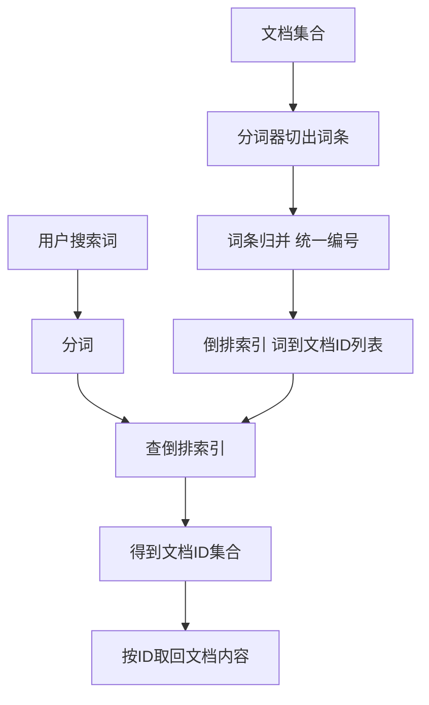
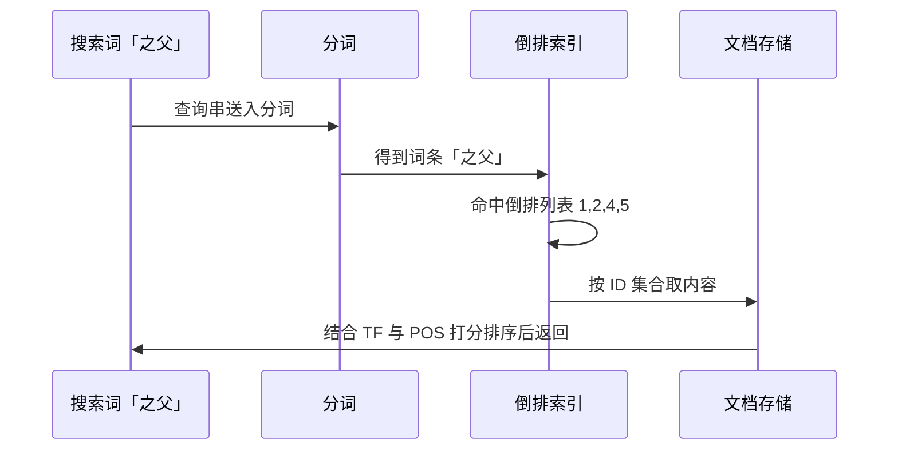

# 正排找内容，倒排找文档：搜索引擎的基石是这样炼成的

day13 里搜「张三 李四」，两条文档都能命中，当时只当是 ES 的本事。凭什么搜词就能秒回结果？数据库表里用 `LIKE '%谷歌%'` 扫几百行就慢得难受，ES 面对几十亿文档反而毫秒级返回，差距的根源就在这一讲的主角：倒排索引。它是 Lucene 与 Elasticsearch 共同的地基，理不清它，后面 match 查询的每个参数都只能死记硬背。

## 先给结论

- 正排是「文档 ID 到内容」，数据库表格就是典型的正排结构；倒排是「词到文档 ID 列表」，方向整个反过来。
- 建倒排先分词：文本切成词条，每个词条记一份出现它的文档列表，搜索词分词后直接查表命中。
- 倒排列表不止存文档 ID，还记录词频（TF）与位置（POS），这两样是相关性算分的原始材料。
- 名字里的「倒排」来自方向：不是由记录确定属性值，而是由属性值确定记录位置。
- 搜索引擎必须走「词到文档」这条路，所以倒排索引是 Lucene 与 Elasticsearch 的基石。

## 一、正排索引：熟悉的存法，别扭的查法

假设要把一批新闻标题存进数据库，最自然的做法就是一张表（示例数据，按课件场景整理）：

| 文档编号 | 文档内容 |
|---|---|
| 1 | 谷歌地图之父跳槽Facebook |
| 2 | 谷歌地图之父加盟Facebook |
| 3 | 谷歌地图创始人跳槽Facebook |
| 4 | 谷歌地图之父将离职Facebook |
| 5 | 谷歌地图之父跳槽Facebook内幕 |

一行一个文档，靠文档编号区分，编号 1 和编号 2 说的是同一件事，但因为 ID 不同就算两条。这种「按文档组织、由 ID 找内容」的结构就是正排索引，日常用的 MySQL 表全是这个形态。

存起来顺手，查起来别扭。**拿文档编号查内容，一步到位**；可搜索的输入往往是词，想知道「谷歌」出现在哪些文档里，只能从头到尾把每条内容比对一遍，数据量一大就是全表扫描。搜索引擎要的恰恰是反方向的高效。

## 二、倒排索引：把方向反过来

思路转变只有一步：不再围着文档转，而是围着词转。把上面五条内容全部分词，给每个词条编号，再记录这个词出现在哪些文档里：

| 单词 ID | 单词 | 倒排列表（DocID） |
|---|---|---|
| 1 | 谷歌 | 1,2,3,4,5 |
| 2 | 地图 | 1,2,3,4,5 |
| 3 | 之父 | 1,2,4,5 |
| 4 | Facebook | 1,2,3,4,5 |
| 5 | 创始人 | 3 |

课件里的完整表格有 16 个词条，这里取关键的几行看结构。「之父」出现在文档 1、2、4、5，第三条用的是「创始人」，自然不在列。查「谷歌」不用再碰任何一条原文，直接读到 1,2,3,4,5，五条全命中。

为什么叫「倒排」，课件的定义讲得很准：倒排索引源于实际应用中需要根据属性值来查找记录的需求，索引表中的每一项包含一个属性值和具有该属性值的各记录的地址；由于不是由记录来确定属性值，而是由属性值来确定记录的位置，所以称为倒排索引。说白了就是过程反过来了：正排拿着钥匙（ID）找内容，倒排拿着内容（词）找钥匙。

整条链路一张图看全：

图的关键在中间那张表：写入时它是分词的产物，查询时它是命中的入口，两侧都经过它，这就是「基石」的含义。

## 三、倒排列表里还藏着 TF 和 POS

只存文档 ID 还不够撑起「搜得准」。倒排索引会往倒排列表里继续塞信息，第一样是 **TF（词频）**：这个词在该文档里出现了几次。出现的次数越多，文档与这个词的相似度越高。课件示例里每条标题词都不重复，TF 全是 1，换成正文长文，同一词出现十次和出现一次，相关性的差距就显出来了。

第二样是 **POS（位置）**：词在文档中出现的偏移位置。一般认为出现得越靠前，相关性越高，标题开头的词比结尾的词分量重。再往外扩一层还有文档频率：一个词总共出现在多少个文档里，出现得越普遍，区分度越低。完整的倒排索引长这样：

| 单词 ID | 单词 | 文档频率 | 倒排列表（DocID:TF〈POS〉） |
|---|---|---|---|
| 3 | 之父 | 4 | 1:1〈3〉, 2:1〈3〉, 4:1〈3〉, 5:1〈3〉 |

搜索「谷歌」命中一百条时怎么排座次？答案就藏在这些字段里：把词频、位置、文档频率等因子代入算分公式，给每条命中结果打出一个得分，按得分从高到低展示。用户感觉「第一条最相关」，背后就是倒排列表里这几个不起眼的数字在起作用。

## 四、拿一次查询把流程走通

搜「之父」，从输入到结果分四步：

四步里没有一步是「遍历所有文档比对内容」，全是查表与取数，词到文档的路径稳定且可预估，这正是倒排索引把搜索复杂度从「与文档总量相关」降到「与词条相关」的意义。Lucene 与 Elasticsearch 无论版本怎么演进，底层都是这条路径。

## 常见误区

- **以为倒排列表只存文档 ID。** TF、POS、文档频率都在里面，它们是相关性算分的原材料；只存 ID 的倒排索引只能「查得到」，做不到「排得对」。
- **以为搜索是逐条比对。** 倒排索引下搜索是先分词再查表，命中集合来自词条的倒排列表，跟文档总量关系不大；把它当全表扫描去优化就走错了方向。
- **拿 keyword 字段做全文搜索。** keyword 不分词，整个值作为一个词条进倒排，搜「苹果 手机」无法命中「苹果手机 Pro」；全文检索要用 text 类型。
- **索引与搜索两侧分词器不一致。** 索引用 `ik_max_word`、搜索侧却用内置 standard，词条对不上，写入的数据搜不出来。

## 面试可能被问到的问题

1. 面试官追问：「什么是倒排索引？和正排的区别一句话说清。」
   答：正排由文档 ID 找内容，倒排由词找文档 ID 列表。把所有文档分词，为每个词条维护一份出现它的文档列表，搜索词分词后查表命中，不需要遍历文档。

2. 面试官追问：「为什么搜索引擎都用倒排索引，数据库 B+ 树不行吗？」
   答：B+ 树按键有序组织，擅长前缀与范围匹配，搜「含某词的文档」只能退化为全表扫描或 `LIKE`。倒排索引按词条组织，词到文档是直接寻址，天然适合多关键词、相关性排序这类全文检索场景。

3. 面试官追问：「倒排列表里除了文档 ID 还存什么？有什么用？」
   答：还存词频 TF、位置 POS，可扩展文档频率。TF 与位置参与相关性得分计算，决定命中结果的排序；文档频率反映词条区分度，也是算分因子。没有这些信息，结果只能命中不能排序。

4. 面试官追问：「为什么说倒排索引是 Lucene 与 ES 的基石？」
   答：Lucene 是全文检索库，ES 是分布式搜索引擎，它们的核心能力都建立在「词到文档」的查询路径上：写入时切词建倒排，查询时切词查倒排，打分排序的因子也来自倒排列表。上层 API 怎么包装，这条底层路径不变。

5. 面试官追问：「搜出来的结果是怎么排序的？」
   答：以倒排列表中记录的词频、位置、文档频率等为计算因子，按相关性算法给每条命中文档打分，得分越高越靠前。同一个词在文档中出现次数多、出现位置靠前，得分就高，最终呈现为「最相关的排最前」。

## 配套资料

- 本课无配套源码包：`materials/code/03/day14-ElasticStack学习之Elasticsearch进阶/` 下仅有解压清单 `_extracted.json`（记录解压文件数为 0），示例数据表格为按本课课件场景与讲解整理的示例，正排五条新闻、倒排词条行（谷歌、地图、之父、Facebook、创始人）与课件一致，TF 与 POS 的完整四列表为按课件结构补全。
