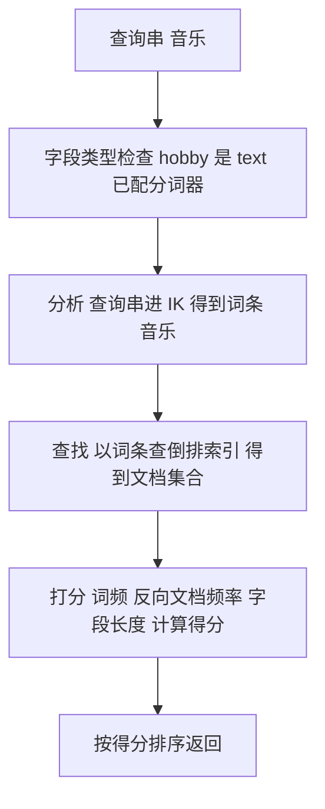

# match 查询实战：单词搜索、多词搜索与那个松紧可调的匹配度

倒排索引的道理讲完了，落到 API 上就是今天的主角 `match`。第一次用它的人几乎都会在同一个地方愣住：搜「音乐」结果正常，改成搜「音乐 篮球」，结果反而变多了；电商里搜「苹果手机」，出来的却是一堆「苹果」加一堆「手机」。这不是 bug，是 match 的默认逻辑在起作用。这一讲把单词搜索、多词搜索连起来走一遍，看清默认行为，再学会用 `operator` 与 `minimum_should_match` 把结果收紧或放松。

## 先给结论

- 全文搜索就两个关键：相关性决定结果怎么排序，分析（分词）决定文本怎么进倒排索引，match 查询把两者都封装好了。
- 单词搜索背后是一条四步流水线：字段类型检查、查询串分词、查倒排索引、打分排序。
- match 多个词默认 `or`：命中任意一个词就返回，加词只会让结果更宽，常与用户预期相反。
- `operator: and` 把条件收紧到全部命中，`minimum_should_match` 在两个极端之间连续调节，实际项目里更常用的是后者。
- 匹配度阈值没有标准答案，调到多少合适要靠真实数据反复测试，再拿用户反馈校准。

## 一、先把索引和数据备好

建一个演示索引（索引名与类型名为演示自定，换成自己的名字即可），分片 1、副本 0，够测试用：

```bash
PUT http://172.16.55.185:9200/demo
{
  "settings": {
    "number_of_shards": "1",
    "number_of_replicas": "0"
  },
  "mappings": {
    "person": {
      "properties": {
        "name":  { "type": "text" },
        "age":   { "type": "integer" },
        "mail":  { "type": "keyword" },
        "hobby": {
          "type": "text",
          "analyzer": "ik_max_word"
        }
      }
    }
  }
}
```

四个字段的类型各有用意：`name`、`hobby` 是要被搜索的文本，走 `text`；`hobby` 是中文，挂上 `ik_max_word`；`mail` 是邮箱，整值存取即可，用 `keyword` 不分词；`age` 是数值。类型在这里定错，后面所有查询都会跟着歪。

批量灌五条用户数据，走 `_bulk`：

```bash
POST http://172.16.55.185:9200/demo/_bulk
{"index": {"_index": "demo", "_type": "person"}}
{"name": "张三", "age": 20, "mail": "111@qq.com", "hobby": "羽毛球,乒乓球,足球"}
{"index": {"_index": "demo", "_type": "person"}}
{"name": "李四", "age": 21, "mail": "222@qq.com", "hobby": "羽毛球,乒乓球,篮球,游泳"}
{"index": {"_index": "demo", "_type": "person"}}
{"name": "王五", "age": 22, "mail": "333@qq.com", "hobby": "篮球,足球,游泳,听音乐"}
{"index": {"_index": "demo", "_type": "person"}}
{"name": "赵六", "age": 23, "mail": "444@qq.com", "hobby": "跑步、游泳、听音乐"}
{"index": {"_index": "demo", "_type": "person"}}
{"name": "孙七", "age": 24, "mail": "555@qq.com", "hobby": "听音乐、看电影、羽毛球"}
```

批量格式的老规矩：每条动作描述一行、文档一行，最后一行必须留一个换行，少一个换行整批报错。

## 二、单词搜索：match 加高亮

最简的搜索形态是在 URL 上拼条件，`GET /demo/person/_search?q=hobby:音乐`，临时验证很顺手，条件一复杂就不好维护。正经写法用 DSL 的 match 查询，顺手把高亮加上：

```bash
POST http://172.16.55.185:9200/demo/person/_search
{
  "query": {
    "match": { "hobby": "音乐" }
  },
  "highlight": {
    "fields": { "hobby": {} }
  }
}
```

`_search` 接口 GET 与 POST 都接受，课程演示统一用 POST。返回结果里，命中用户的 `hobby` 都带着「听音乐」，王五与孙七两条的得分完全相同（0.81652206），谁先谁后无所谓。

加 highlight 的用意是让分词结果可视化：高亮片段里被标记的正是分词后命中的词条，「音乐」是从「听音乐」里切出来的词，说明字段上配的 IK 分词器已经生效，写入与查询两侧用的同一套切词规则。

## 三、match 背后的四步

这一次看似简单的搜索，内部走了四步，每一步都有值得停下来看的点：



**第一步，字段类型检查。** 目标字段 `hobby` 是 `text` 且指定了分词器，这意味着查询串本身也要走一遍分词，而不是拿整串去比对。

**第二步，分析。** 「音乐」送进 IK，输出就是一个词条「音乐」，它本身已经是一个完整的词。

**第三步，查找。** match 检测到查询串只切出了一个词条，底层执行的就是单个 `term` 查询：去倒排索引里查「音乐」，拿到一组包含该词条的文档，示例数据里对应王五与孙七。上一步讲的倒排索引在这里兑现价值。

**第四步，打分。** 同一批命中谁来排前面？把词频、反向文档频率、字段长度等因子代入算分公式，每条文档得到一个 `_score`，按得分从高到低输出。两条得分相同就说明它们与查询串的相关性在算法眼里完全一样。

## 四、多词搜索：默认 or 与它的两个极端

把搜索词换成「音乐 篮球」再发一次，结果一下变成四条，王五排到最前面（得分 1.3192271）。原因是 match 对多个词默认按 `or` 处理：命中任意一个词条就返回。王五两个词都占，得分最高排第一；只占一个词的也一并进来了。

这个默认行为符合「多给点结果」的直觉，却常常违背真实预期。拿电商场景想一下：用户搜「苹果手机」，意图明确是要苹果手机，按 `or` 处理返回的是「苹果或手机」，结果比单独搜「苹果」还多。用户加了一个词，期望范围收窄，实际范围反而扩大，这就是默认逻辑与预期的错位。

ES 允许在 match 里指定词与词的逻辑关系。注意写法会跟着变：加了参数后，字段值不能再是字符串，要包成对象：

```bash
POST http://172.16.55.185:9200/demo/person/_search
{
  "query": {
    "match": {
      "hobby": {
        "query": "音乐 篮球",
        "operator": "and"
      }
    }
  },
  "highlight": {
    "fields": { "hobby": {} }
  }
}
```

这里有个现场踩坑值得记录：第一次改的时候直接在字符串值旁边加了 `"operator"`，请求直接报不支持，必须改成上面的对象写法，用 `query` 放搜索词；第二次报错更朴素，JSON 里少了一个逗号，400 Bad Request。改对之后，结果只剩一条：王五，`hobby` 里既有「篮球」又有「听音乐」，两词都命中的文档才返回。

`or` 是「有一个就行」，`and` 是「全都要」，两者都是极端。真实场景常常站在中间：差不多匹配就可以，至于差多少，要能调。

## 五、minimum_should_match：把松紧做成旋钮

`minimum_should_match` 就是那个旋钮，指定文档至少要命中查询词条的多大比例。拿「游泳 羽毛球」做演示：

```bash
POST http://172.16.55.185:9200/demo/person/_search
{
  "query": {
    "match": {
      "hobby": {
        "query": "游泳 羽毛球",
        "minimum_should_match": "80%"
      }
    }
  },
  "highlight": {
    "fields": { "hobby": {} }
  }
}
```

先把它拉满到 100%，语义上等价于 `and`：两个词都必须命中，结果里只剩李四，`hobby` 是唯一同时带游泳与羽毛球的。往下调，命中的条数一路变多：80% 时四条，40% 时五条，全部数据都进了结果。阈值越低召回越多，符合预期的程度越差，松弛与精度就是这样一个反向的跷跷板。

比 or 与 and 强的地方在于可调性：数据敏感就调高，宁可少而准；召回优先就调低，宁可多而全。它比两个极端更折中，做项目时用得也更多。阈值到底定多少，没有现成答案：查询词条会被 IK 切成几个、数据分布如何都影响结果，只能拿真实数据反复测试。更务实的做法是把功能放出去，收集用户对结果的满意度反馈，再回头修这个值，让它跟着产品一起校准。

## 常见误区

- **以为加词会收窄结果。** match 默认 `or`，「苹果 手机」比只搜「苹果」返回得更多；要收窄必须显式指定 `operator: and` 或用 `minimum_should_match`。
- **operator 直接写在字符串旁边。** `"hobby": "音乐 篮球", "operator": "and"` 这种写法解析不过，字段值必须包成对象，搜索词放进 `"query"` 里。
- **拿 `keyword` 字段做 match 全文搜索。** `mail` 这类字段不分词，整个值是一个词条，match「音乐」永远匹配不上 `333@qq.com`；全文搜索只对 `text` 字段有意义。
- **`_bulk` 最后一行没换行。** 批量接口按行解析，最后少一个换行整批失败，报错信息还容易把人引到别处。
- **匹配度阈值拍脑袋定。** 阈值受分词结果与数据分布影响，换一批数据最优值就变了，必须实测加反馈校准，没有通用值。

## 面试可能被问到的问题

1. 面试官追问：「match 和 term 的区别是什么？」
   答：term 不分词，拿整个值精确匹配，适合 keyword 与数值字段；match 会对查询串分词，再按切出的词条查倒排索引，是全文检索的入口。对 text 字段用 term 往往查不到预期结果，因为索引里的词条是切分后的。

2. 面试官追问：「搜一个词的整个执行过程是怎样的？」
   答：先做字段类型检查确认目标字段需要分词；查询串送入分词器得到词条；按词条查倒排索引拿到命中文档集合；最后用词频、反向文档频率、字段长度等因子计算相关性得分，按得分排序返回。单词条的 match 底层执行的就是一次 term 查询。

3. 面试官追问：「match 多个词的默认行为是什么？怎么收紧？」
   答：默认 or，命中任意词条即返回，加词结果更宽。收紧有两种方式：`operator: and` 要求全部词条命中，是硬条件；`minimum_should_match` 按比例要求最低命中数，介于两个极端之间可调，实际项目里更常用。

4. 面试官追问：「`_score` 是怎么算出来的？」
   答：由相关性算法综合多个因子计算：词条在文档中出现的词频越高得分越高；该词条在全部文档中出现越普遍区分度越低，即反向文档频率的加权；字段长度也有影响，短字段命中权重更高。两个文档得分相同，说明在算法眼里相关性一致。

5. 面试官追问：「高亮功能除了好看还有什么用？」
   答：它是分词结果的直观验证，页面上被标记的正是切词后命中的词条，能立刻确认分词器是否生效、切分是否符合预期。排查「为什么这条文档被命中」时，先看高亮片段往往比看 JSON 更快。

6. 面试官追问：「`minimum_should_match` 设多少合适？」
   答：没有通用值。查询词被分词器切出的词条数、语料的分布都会影响同一阈值下的结果，定值要靠真实数据测试，并依据用户对搜索结果的满意度反馈持续调整，80% 只是一个常见的起点。

## 配套资料

- 本课无配套源码包：`materials/code/03/day14-ElasticStack学习之Elasticsearch进阶/` 下仅有解压清单 `_extracted.json`（记录解压文件数为 0），文中索引与映射结构、批量数据、查询单词与多词的请求体均按本课课件写法补全，索引名按演示环境自定为 `demo`，五条用户数据与课件示例一致。
