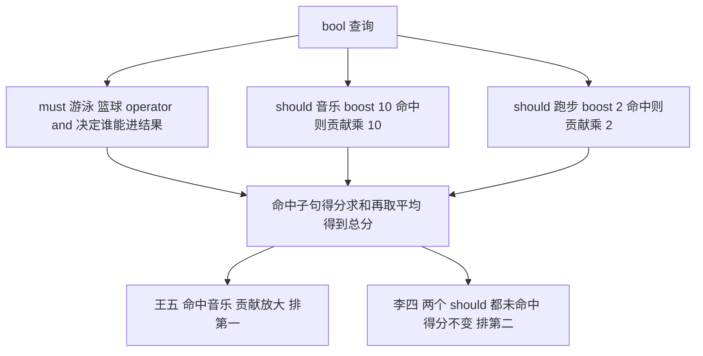

# 搜索权重：一个 boost 参数怎么把想要的结果顶到第一

搜索结果默认按相关性得分排序，得分是算出来的，理论上谁也改不了。但业务偏偏经常要改：付费房源要置顶，
会员信息要靠前，竞价排名更是把「花钱多排得靠前」写成了商业模式。搜索引擎给广告主插队的做法，落到
Elasticsearch 里就是一个参数：`boost`，也叫激励因子。它在子句层面给得分乘一个倍率，倍率大的子句命中时，
文档的排名就被顶上去。

## 先给结论

- `boost` 是子句级的得分倍率，命中的子句贡献被放大后参与 bool 查询的求和取平均，最终改变排序。
- 写法上字段值要从字符串换成对象：搜索词放 `query`，倍率放 `boost`，如 `{ "query": "音乐", "boost": 10 }`。
- `boost` 只影响得分，不影响召回：不含目标词的文档权重设得再高也进不了结果集。
- 实操上 `boost` 几乎总是与 `should` 搭配，表达「包含某词的排前面」这类柔性置顶。
- 倍率小于 1 也合法，效果是压低该子句的话语权，权重是双向的。

## 一、需求长什么样

课件给的需求很具体：搜索关键字是「游泳篮球」，用 `operator: and` 收紧成必须同时包含游泳与篮球；
在此基础上，如果文档还包含音乐，给它权重 10；包含跑步，给它权重 2。预期效果是含音乐的文档排到含跑步的前面，
尽管两者都满足硬条件。

放到项目语境里就是房源搜索：中介交了会员费、房源买了推广，这些数据就该比普通房源靠前。分类信息网站上
付费置顶的信息同理。相关性算法不知道谁交了钱，`boost` 就是把这种业务意图翻译给打分器的通道。

## 二、先看没有权重时的默认排序

索引与数据沿用上一节的 `demo` 演示索引。按硬条件查一遍：

```bash
POST http://172.16.55.185:9200/demo/person/_search
{
  "query": {
    "bool": {
      "must": {
        "match": {
          "hobby": { "query": "游泳 篮球", "operator": "and" }
        }
      }
    }
  }
}
```

同时含游泳与篮球的只有李四与王五，两条都会返回，谁前谁后由分词结果、字段长度这些相关性因子决定。
业务对这两个因子插不上手，想干预排序，就得在子句上动手。

## 三、用 boost 把含音乐的顶上去

把两个柔性条件装进 `should`，各自带上倍率：

```bash
POST http://172.16.55.185:9200/demo/person/_search
{
  "query": {
    "bool": {
      "must": {
        "match": {
          "hobby": { "query": "游泳 篮球", "operator": "and" }
        }
      },
      "should": [
        {
          "match": {
            "hobby": { "query": "音乐", "boost": 10 }
          }
        },
        {
          "match": {
            "hobby": { "query": "跑步", "boost": 2 }
          }
        }
      ]
    }
  }
}
```

王五的爱好里带着听音乐，`boost: 10` 的子句命中，得分贡献被放大十倍参与汇总，直接跳到第一；李四两样都不占，
得分原地不动，退居第二。课件里的实测对照更直观：加权前两条文档得分 3.6 与 2.1，音乐给 10、跑步给 2 之后，
得分变成 9.48 与 5.4，原本排第二的文档反超到第一。倍率不是加法而是乘法，子句命中时它的得分先乘上倍率，
再进 bool 的求和取平均，10 倍的杠杆足以碾压常规的相关性差距。



图的左边是召回线（`must` 决定谁有资格参赛），右边是评分线（`should` 加 `boost` 决定名次），两条线分工清晰，
互不越界。

## 四、boost 管排序，不管召回

赵六的爱好里有跑步，`boost: 2` 看着像为他准备的，但他不含游泳与篮球，被 `operator: and` 挡在结果集外，
权重再大也捞不回来。把这条边界记住：`boost` 作用在评分层，参与排序的文档集合永远由召回条件决定。
想让更多文档进来，只能放宽召回条件（去掉 `and`、调低 `minimum_should_match`），而不是加权重。

另一个细节是倍率的取值不限于大于 1 的整数。给不希望出现的干扰词设 0.5，它的得分贡献减半，效果是压制
而不是提升。权重是双向旋钮，往右拧是置顶，往左拧是降权。

## 五、落到业务：柔性置顶的实现套路

把套路总结成三步：硬条件放 `must` 或 `filter`，圈出所有合格的文档；业务想扶持的特征放进 `should` 并配
`boost`，特征越值钱倍率越高；上线后观察实际得分差距，倍率太小顶不动就加码，太大把普通结果全压到后面
就回调。置顶的本质不是另开一条队列，而是让某个子句在算分时拥有更大的话语权，这套机制与上一节的
求和取平均衔接起来，就是搜索排序干预的全部骨架。

## 常见误区

- **以为 `boost` 能把不匹配的文档捞进结果。** 它只放大已命中子句的得分贡献，召回集合完全由 `must`、
  `filter` 与阈值决定。赵六含跑步，但过不了 `operator: and`，`boost` 设 100 也没用。
- **把 `boost` 直接写在字符串旁边。** `"hobby": "音乐", "boost": 10` 这种写法解析不过，字段值必须包成对象，
  搜索词放进 `query`，倍率放进 `boost`。
- **把 `boost` 加在所有文档必然命中的 `must` 子句上。** 硬条件人人命中，整体得分同比放大，排序纹丝不动，
  白白浪费计算。倍率要放在能区分文档的子句上，通常就是 `should`。
- **以为倍率越大最终得分就越大。** bool 求和后还要除以子句总数取平均，`should` 子句堆得越多，
  单个子句的倍率被稀释得越厉害，调参时要连子句总数一起看。

## 面试可能被问到的问题

1. 面试官追问：「boost 参数的作用原理是什么？」
   答：它是子句级的得分倍率，该子句命中时，其相关性得分先乘以倍率，再参与 bool 查询的求和与取平均，
   从而抬高或压低文档的总分与排名。倍率大于 1 是提权，小于 1 是降权。

2. 面试官追问：「boost 会影响召回率吗？」
   答：不会。它只作用在评分层，能改变的是已召回文档的排序；文档能否进入结果集由召回条件决定，
   与权重无关。想扩大召回只能放宽查询条件。

3. 面试官追问：「付费置顶这类需求在 Elasticsearch 里怎么实现？」
   答：硬条件放 `must` 或 `filter` 保证正常召回，付费特征放进 `should` 并配一个较大的 `boost`，
   命中该特征的文档得分被放大自然排前。也可以按付费等级设多档倍率，实现阶梯置顶。

4. 面试官追问：「为什么 boost 通常加在 should 而不是 must 里？」
   答：`must` 是硬条件，参与排序的文档全部命中它，倍率对所有文档同比例放大，排序不变，等于没加。
   `should` 才能区分文档：命中者提分、未命中者不动，排序才会真的变化。

5. 面试官追问：「不加 boost，还有别的干预排序的手段吗？」
   答：有。function score 查询可以按字段值自定义打分函数，适合按时间、热度等数值加权；排序字段
   （如置顶标志）配合普通排序也能实现硬置顶。`boost` 适合按「是否包含某特征」做柔性加权，各有分工。

## 配套资料

- 本课无配套源码包：`materials/code/03/day14-ElasticStack学习之Elasticsearch进阶/` 下仅有解压清单
  `_extracted.json`（记录解压文件数为 0）。索引、映射与五条用户数据沿用本阶段的 `demo` 演示索引，
  带权重的查询请求体按本课课件写法补全，得分对照数值引自课件实测，可在自建环境上复测。
