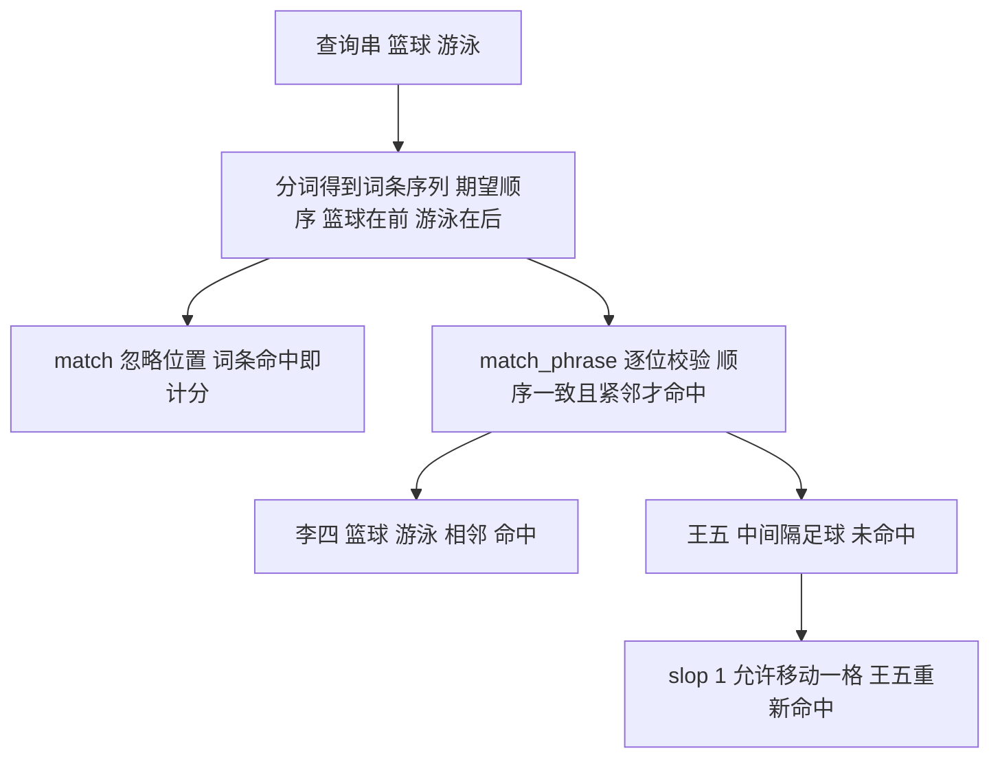

# match_phrase 短语匹配：词要命中，顺序也不能乱

用 match 搜「篮球 游泳」，篮球在前、游泳在后的文档，游泳在前、篮球在后的文档，全都会回来。
分词之后的词条集合里没有顺序这个维度，match 自然也管不了顺序。可有些需求恰恰卡在顺序上：
术语要按固定说法出现，歌词要按原句接续，用户输入「羽毛球 篮球」就是想找两个词挨着且按这个次序的文档。
这种苛刻要求由 `match_phrase` 短语匹配来满足：词要命中，先后次序还得与查询串一致。

## 先给结论

- `match_phrase` 在 match 的分词流程之上增加位置校验：词条不仅都要命中，还必须按查询串的顺序依次排列。
- 默认要求词条紧邻，中间隔一个词都不行；`slop` 参数放宽这一限制，允许词条总共移动 N 个位置。
- `slop` 数的是词条位置步数，不是字符数，「乒乓球」三个字在位置账本上只占 1 步。
- 与 match 的差异一句话：match 做词条集合的与或运算，match_phrase 做词条序列的逐位校验。
- 底层依赖倒排索引里记录的词条位置信息，这是分词器在建索引时顺手写进去的。

## 一、match 的盲区：只认词条集合

沿用本阶段的 `demo` 索引与五条用户数据。先用 match 搜「篮球 游泳」：

```bash
POST http://172.16.55.185:9200/demo/person/_search
{
  "query": {
    "match": { "hobby": "篮球 游泳" }
  },
  "highlight": {
    "fields": { "hobby": {} }
  }
}
```

李四（羽毛球、乒乓球、篮球、游泳）与王五（篮球、足球、游泳、听音乐）都被命中。两人词条都齐，
match 满意了；但李四的篮球与游泳是挨着的，王五中间却隔着足球。换成 `match_phrase`：

```bash
POST http://172.16.55.185:9200/demo/person/_search
{
  "query": {
    "match_phrase": { "hobby": "篮球 游泳" }
  }
}
```

结果只剩李四。同样的两个词，王五因为顺序链上多了一个足球被排除。这就是短语匹配的严格之处：
分词照做，词条照查，但倒排索引里每个词条还带着位置信息，match_phrase 逐一核对位置，
要求「篮球」之后紧跟着就是「游泳」。

## 二、顺序反了同样不行

把查询串两个词对调再试一次：

```bash
POST http://172.16.55.185:9200/demo/person/_search
{
  "query": {
    "match_phrase": { "hobby": "游泳 篮球" }
  }
}
```

这次一条都查不到。五条数据里没有任何文档是游泳在前、篮球在后，尽管李四与王五两个词都有。
match 对两个词等价，match_phrase 却分得出两种结果，差距全在顺序上。排查这类「明明有词却查不到」的问题时，
先拿 match 跑一遍做对照：match 有结果而 phrase 没有，基本就是顺序或间隔不满足。

## 三、slop：把紧邻要求放宽 N 步

苛刻有苛刻的用处，但更多时候需求是「顺序对就行，中间可以隔一两个词」。`slop` 参数就是为此准备的，
它允许词条总共移动 N 个位置：

```bash
POST http://172.16.55.185:9200/demo/person/_search
{
  "query": {
    "match_phrase": {
      "hobby": {
        "query": "篮球 游泳",
        "slop": 1
      }
    }
  }
}
```

slop 设 1 之后王五重新命中：足球占了一个位置，把游泳往回挪一步就能接上。再看张三（羽毛球、乒乓球、足球），
短语「羽毛球 足球」同样靠 slop 拿下：中间的乒乓球占一个位置，slop 1 即可。课件演示时把 slop 设成 3，
理由是乒乓球三个字，结果确实命中，但解释并不准确：slop 数的是位置步数，「乒乓球」无论几个字都只占 1 步，
设 3 能命中只是因为 3 大于所需的 1，slop 是上限而非精确步数。

整个校验过程画出来是这样的：



图中从上到下是三档松紧：match 最松，match_phrase 默认最严，slop 在两者之间拧出中间态。
产品上拿不准用户输入的词序时，可以先用宽松档保召回，再把 phrase 档的结果加权置前。

## 四、原理：位置信息是哪来的

分词器把文本切成词条写进倒排索引时，除词条本身外还记录每个词条在字段内的位置编号，
「羽毛球、乒乓球、篮球、游泳」切出的四个词条依次占 0 到 3 号位置。match 只用词条这一层做集合运算，
match_phrase 则把位置编号一并取出：先确认所有词条都命中，再核对编号是否按查询顺序递增且间隔不超过
slop 允许的步数。分词器不同、切出的词条与位置就不同，`ik_max_word` 与 `ik_smart` 在同一段文本上
可能给出不一样的短语匹配结果，这也是短语查询对分词器选择更敏感的原因。

## 常见误区

- **把 slop 当字符数。** 「羽毛球 足球」中间隔了乒乓球三个字，就设 slop 3；实际隔的是 1 个词条，
  slop 1 就够。设大了不报错，但语义上放宽了不该放宽的间隔，容易放过干扰结果。
- **以为 match_phrase 不分词。** 它照常走分词器，只是多了位置校验；换分词器会改变短语匹配的行为，
  与「原样字符串匹配」是两回事，后者应该用 `keyword` 字段或 wildcard 类查询。
- **单词条也用 match_phrase。** 只有一个词条时不存在顺序与间隔，match_phrase 退化为与 match 等价，
  白付一次校验成本，语义表达上也有误导性。
- **查不到就断定数据没有。** 多数是顺序或间隔不满足，先用 match 对照、再逐档试 slop，
  把「有没有词」与「词序对不对」两个问题分开排查。

## 面试可能被问到的问题

1. 面试官追问：「match 和 match_phrase 的区别是什么？」
   答：match 对查询串分词后按词条做集合运算，默认 or，不管词条在文档里的先后与间隔；
   match_phrase 同样分词，但额外校验词条位置，要求按查询顺序排列且间隔不超过 slop。
   一个是相关性强弱，一个是顺序约束。

2. 面试官追问：「slop 参数的确切含义是什么？」
   答：允许词条移动的总位置步数上限。同序中间插词时，可以近似理解为允许跳过的词条个数，
   但它数的是位置不是字符；设 3 并不要求恰好 3 步，1 步也能命中。

3. 面试官追问：「match_phrase 为什么能校验顺序，靠的是什么数据结构？」
   答：靠倒排索引中的位置信息。分词器建索引时为每个词条记录它在字段内的位置编号，
   match_phrase 取出各词条的 posting 列表后按位置求交集，核对编号递增且间隔合规。

4. 面试官追问：「哪些业务场景必须用短语匹配？」
   答：词序本身有语义的场景，比如专有名词、歌词诗句、地址与账单摘要的精确片段检索，
   以及把用户输入当整句理解的日志检索。这类需求用 match 会混入大量乱序结果。

5. 面试官追问：「match_phrase 查不到结果，怎么排查？」
   答：先确认分词器切出了哪些词条，用 analyze API 看查询串与文档的切分结果是否一致；
   再用 match 对照确认词条本身能否命中；最后逐档调大 slop 排除间隔问题。
   三步分别对应词条、集合、位置三层。

## 配套资料

- 本课无配套源码包：`materials/code/03/day14-ElasticStack学习之Elasticsearch进阶/` 下仅有解压清单
  `_extracted.json`（记录解压文件数为 0）。索引、映射与五条用户数据沿用本阶段的 `demo` 演示索引，
  match_phrase 与 slop 的请求体按本课课件写法补全，可在自建环境上原样执行。
