# Elasticsearch 进阶全景：集群节点、分片副本、故障转移与 Java 客户端实战

## 先给结论

本系列 11 篇把 Elasticsearch 从「会起单节点」推进到「懂集群原理、能做故障演练、会用 Java 客户端写增删改查」：前半段（集群六篇加路由一篇）拆集群本身的组成、存储与容错，后半段（客户端四篇）拆 Java 客户端的选型与落地，两段合起来是一条从运维视角到开发视角的完整主线。
集群组成只认两个配置：`cluster.name` 相同的节点自动组网，`node.name` 是节点唯一名号；角色分工明确，master 管集群、data 存数据、客户端节点只转发请求、部落节点跨集群联合查询，实际生产最常用 master 与 data 两种。
存储模型的关键是分片：索引是逻辑空间，每个分片都是完整的 Lucene 实例与最小工作单元；每个文档属于唯一一个主分片，写请求只走主分片，主分片数参与路由公式、建完索引就不能改，副本数随时可调。
集群实验的路径是「先搭后练」：Docker 单机起两节点（host 网络加 9200、9201 端口区分，配置与数据全部挂载在容器外），再复制目录扩成三节点，人人 `node.master: true` 才演得动故障转移。
故障转移两组实验结论：data 节点宕机，副本在存活节点间补齐，集群转 yellow 再回 green，数据不丢；master 宕机，幸存候选节点重新选举，master 缺位不影响文档读写；副本数设 2 而节点只剩 2 台时副本补不齐，状态会停在 yellow。
脑裂的成因与防线：旧 master 带着 `minimum_master_nodes: 1` 的旧配置重启可能自立门户，防线是多数派公式「候选节点总数除以 2 加 1」，三节点取 2；验证方式是停掉现任 master 再拉起，它只能以 data 身份回群；ES 7.x 已把多数派选主内置进协议。
一条文档的旅程靠计算不靠记录：`shard = hash(routing) % number_of_primary_shards`，写先主分片再同步副本，单文档读主副本轮询分摊，全文搜索拆 query 与 fetch 两段式，第一阶段只传 ID 与得分做全局排序。
Java 客户端选型主线：TransportClient 走 9300 端口、与服务端实现强耦合，已废弃；低级 REST 客户端手动拼请求手动解析，换来兼容所有版本；高级 REST 客户端对象化封装换开发效率，代价是版本必须与服务端对齐。
低级客户端的固定套路：`RestClient.builder` 注册三个节点并挂失败监听，`new Request` 加参数后 `performRequest`，响应体用 `EntityUtils` 手动转字符串；新增文档 POST 返回 201、`result` 为 `created`，`_id` 不带就自动生成。
高级客户端把操作收进对象：`IndexRequest`、`GetRequest`、`DeleteRequest`、`UpdateRequest` 配 `SearchSourceBuilder` 装配 `SearchRequest`；`FetchSourceContext` 控制返回字段，`exists` 只拿 boolean，删除不存在的文档返回 `NOT_FOUND` 不抛异常，更新是只动传入字段的局部更新。
测试数据与观察手段：bulk 一次灌入六条房源文档，NDJSON 每行结尾的换行符不能省；head 里粗框是主分片、细框是副本，green、yellow、red 描述的是主副本齐全度而不是节点在线与否。
环境上最容易翻车的三处：data 目录 root 属主导致容器起不来，`discovery.zen.ping.unicast.hosts` 单播名单指向宿主机 IP，`http.port` 不写默认 9200，多节点必须显式区分。

## 第1部分：Elasticsearch 集群节点类型：谁当指挥，谁存数据，谁跑腿

单机 Elasticsearch 撑不起生产环境：数据涨上去一台机器的磁盘装不下，查询写入挤在一起响应越来越慢，
机器一挂整个搜索就没了。解决办法是把多台 ES 组成集群，但「组成集群」只是第一步，每个节点进集群后
干什么活，由它的类型决定。搭集群之前把 master、data、客户端、部落这四种角色的分工弄清楚，
后面配分片、副本、扩容才不至于一头雾水。

### 一、集群怎么认亲：两个配置项

节点之间不看 IP 也不看机器名，只看配置文件里的集群名。`elasticsearch.yml` 里的两行决定了归属与名号：

```yaml
# node01 的 elasticsearch.yml
cluster.name: es-haoke-cluster   # 相同集群名的节点组成一个集群
node.name: node01                # 节点名，集群内唯一，日志排查全靠它
node.master: true                # 有资格参与 master 选举，默认 true
node.data: true                  # 承载数据，执行文档读写
```

多台机器的 `cluster.name` 改成同一个值，启动后它们就自动发现彼此、组成集群；不同的集群靠不同的集群名
区分，同一机房里跑多套集群时，这个名字就是隔离边界。`node.name` 不影响角色分配，但它出现在每一条集群
日志里，起个能对上机器的名字，排查问题时能省一半力气。

### 二、master：集群的大脑

配置 `node.master: true` 的节点是 master 候选节点。注意措辞：有资格被选为 master，不代表就是 master。
集群启动时候选节点之间选举出一个活跃 master，也就是说它先被提名，再靠选举上岗。

master 的职责全部在集群层面：创建与删除索引、决定分片怎么分配到哪些节点、感知节点加入与离开、
管理其他非 master 节点。数据怎么读写它一概不管。用大白话说，master 是集群里的老大，而老大只能有一个：
一旦网络抖动导致集群里出现两个都认为自己是 master 的节点，索引分配就会打架，这就是脑裂，
生产环境的对策是让候选节点保持奇数个（三个起步），选举时按多数派决出唯一的主。

### 三、data：数据的仓库与搬运工

配置 `node.data: true` 的节点承载分片，执行一切数据相关操作：文档的增删改查、写入、聚合，
压力最大的就是它。上一节讲的分片与副本，物理上就躺在 data 节点里，节点类型与分片副本的组合
有一条硬规则：副本分片必须与它的主分片落在不同节点上，否则主节点一挂副本跟着陪葬，副本就失去了容灾意义。

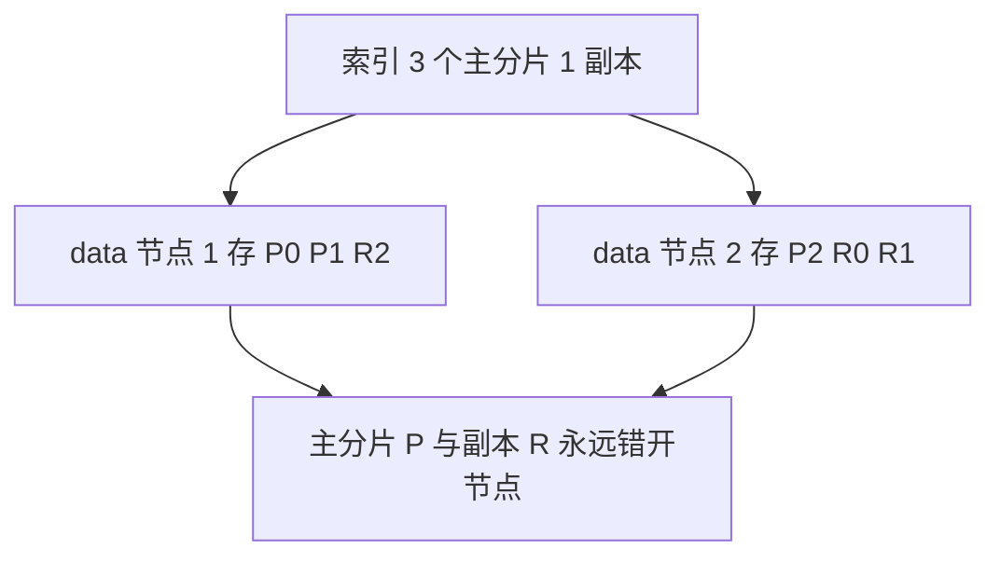

这张图讲的是分片在 data 节点上的摆放：P0 的副本 R0 必须去另一个节点。由此推出一个容量约束：
副本数的上限受 data 节点数限制，集群只有 1 个 data 节点时，副本无处可放，索引健康度长期停在 yellow
（主分片齐、副本缺）；想配 1 个副本，至少要 2 个 data 节点，想扛住一台机器宕机且副本还在，就要 3 个起步。

### 四、客户端节点：只跑腿不干活的中介

把 `node.master` 与 `node.data` 都设为 false，这个节点既不当指挥也不存数据，成为客户端节点：
专职接收用户请求，把请求转发给合适的节点，再把结果汇总返回。课堂白板画的正是这条链路：

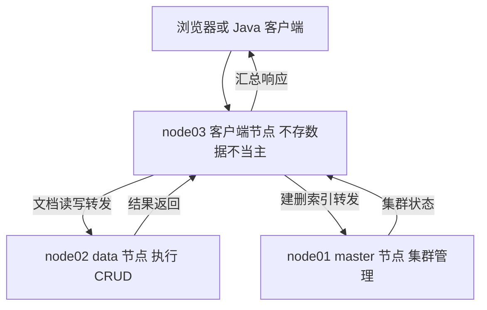

用户要写一条文档，node03 自己不写，转发给 data 节点的 node02 处理，结果原路返回；用户要建一个索引，
这类集群级操作则转发给 master。它像房产中介：手里没有房子，但知道谁在卖房、谁要买房，撮合就是它的价值。
分摊请求转发与结果汇总的负载，让 data 节点专心干活，这是它的存在理由。

新版本里这套概念演化成了更清晰的表述：集群中任何节点默认都会承担协调工作，把请求路由到对应分片、
合并各分片的返回，这个角色叫协调节点；把 master 与 data 都关掉、专职做协调的就是曾经的客户端节点。
此外还有一类 ingest 节点，在文档写入前跑预处理管道（字段清洗、富化、转换），相当于写入侧的流水线。
角色名称在变，「转发、预处理、存储、管理」四类职责的划分一直没变。

### 五、部落节点：能连多个集群的特殊客户端

部落节点（tribe）是更特殊的一种：配置 `node.tribe.*` 后，它可以同时连接多个集群，把搜索等操作
联合起来执行，相当于站在多个集群之上的超级客户端。普通的客户端节点只在同一集群内部转发，
部落节点打破了这层边界。这个角色实际用得很少，新版本里它的能力由跨集群搜索（cross-cluster search）
接管，联合查询多个集群不再需要专门的部落节点。实际项目里最常打交道的还是 master 与 data 两种，
搭建中小集群时，让每个节点兼任 master 候选加 data 是常见起点，规模上来后再按职责拆分。

## 第2部分：用 Docker 把两个 Elasticsearch 节点拉成一个集群

单机 Elasticsearch 的天花板很好摸：数据一涨磁盘先满，进程一崩搜索整体下线。解法是把多个 ES 组成集群，
但第一次动手的人几乎都卡在同样几个地方：两个节点挤在同一台机器上端口怎么分、容器到底要挂载哪些文件、
容器起了又马上退出，日志里一片 AccessDeniedException。接下来在一台宿主机上用 Docker 搭起两节点集群，
把这几道坎挨个踩过去。

### 一、目录与配置文件：先定下两个节点的身份

在宿主机上建一个集群根目录，两个节点各开一个子目录，把单机版 Elasticsearch 安装目录里 `config`
下的两个配置文件拷进来：

```bash
# 建集群根目录，两个节点各一个子目录
mkdir -p /haoke/es-cluster/node01 /haoke/es-cluster/node02
# 拷贝单机版 Elasticsearch 的两个配置文件到节点目录
cp <单机版ES安装目录>/config/elasticsearch.yml /haoke/es-cluster/node01/
cp <单机版ES安装目录>/config/jvm.options /haoke/es-cluster/node01/
```

node01 的 `elasticsearch.yml` 关键配置如下：

```yaml
# 集群名：集群名相同的节点才会组到一起
cluster.name: es-haoke-cluster
# 节点名：集群内唯一，日志排查全靠它
node.name: node01
# 角色：有资格竞选 master，同时承载数据
node.master: true
node.data: true
# 绑定本机 IP
network.host: 172.16.55.185
# 对外 HTTP 端口，node01 用 9200
http.port: 9200
# 单播发现名单：节点启动时按这个地址去找同伴
discovery.zen.ping.unicast.hosts: ["172.16.55.185"]
# 选主需要的最少票数，两节点集群先设为 1
discovery.zen.minimum_master_nodes: 1
# 打开跨域，head 插件才能连上集群
http.cors.enabled: true
http.cors.allow-origin: "*"
```

node02 只改四处：`node.name` 改成 `node02`，`http.port` 改成 `9201`（同一台机器上两个节点的 HTTP
端口绝不能相同），`node.master` 设为 `false`，其余保持与 node01 一致：

```yaml
# node02 与 node01 的差异项
node.name: node02
node.master: false   # 只当 data 节点，不参与 master 竞选
node.data: true
http.port: 9201
```

`node.master: false` 的含义是没有被选举权：node02 照常存数据、响应读写，但 master 挂了它接不了班。
这个配置在故障转移实验里还会重点用到。

JVM 堆要顺手调小。单机默认堆是 1G，两个节点一起起就是 2G，学习机吃不消，编辑各节点目录下的
`jvm.options`，把堆参数改小：

```text
-Xms512m
-Xmx512m
```

改完想快速核对生效配置，可以用 `grep` 反选把注释行全部滤掉：

```bash
grep -v "#" elasticsearch.yml
```

输出的就是真正生效的几行配置，和上面这份清单对照，漏配一眼就能看出来。

### 二、创建并启动容器：配置在外面，进程在里面

容器用 `docker create` 先创建再启动，两个节点的命令只差名字和路径：

```bash
docker create --name es-node01 --net host \
  -v /haoke/es-cluster/node01/elasticsearch.yml:/usr/share/elasticsearch/config/elasticsearch.yml \
  -v /haoke/es-cluster/node01/jvm.options:/usr/share/elasticsearch/config/jvm.options \
  -v /haoke/es-cluster/node01/data:/usr/share/elasticsearch/data \
  elasticsearch:6.5.4

docker create --name es-node02 --net host \
  -v /haoke/es-cluster/node02/elasticsearch.yml:/usr/share/elasticsearch/config/elasticsearch.yml \
  -v /haoke/es-cluster/node02/jvm.options:/usr/share/elasticsearch/config/jvm.options \
  -v /haoke/es-cluster/node02/data:/usr/share/elasticsearch/data \
  elasticsearch:6.5.4
```

三处挂载各司其职：配置文件挂进容器内的 `config` 目录，JVM 参数挂进容器，`data` 目录负责数据落盘。
`data` 目录现在还不存在，Docker 会自动创建，这个「自动」马上会带来一个权限坑。

`--net host` 是 host 网络模式：容器不再有独立网络栈，直接共用宿主机的网卡和端口。由此带来两个结果：
一是配置里绑定的 `http.port` 就是宿主机端口，不需要也不应该再写 `-p 9200:9200` 之类的映射；
二是节点间通信的 transport 端口默认从 9300 起自动顺延，两个进程互不相撞。

启动前还有一件容易漏掉的事：把之前单机实验装的那个 Elasticsearch 容器停掉，它的 9200 端口会和
node01 冲突。然后启动第一个节点并跟日志：

```bash
docker start es-node01
docker logs -f es-node01
```

### 三、两个启动失败的现场：横杠丢了，权限不够

**第一坑：命令从课件复制时丢了横杠。** 第一次启动容器直接退出，回看命令发现挂载路径里的
`elasticsearch.yml` 少了一个 `-`。Docker 找不到源文件时，会按目录规则创建一个同名空目录挂进去，
容器里的配置等于被架空，ES 读完空配置立刻退出。删掉两个容器，改好路径重新创建：

```bash
docker rm es-node01 es-node02
```

**第二坑：data 目录属主是 root。** 修好路径后再启动，日志里出现：

```text
java.nio.file.AccessDeniedException: /usr/share/elasticsearch/data/nodes
```

对照挂载关系就明白了：容器内 ES 以非 root 用户运行，它要写的 `data` 目录实际落在宿主机的
`/haoke/es-cluster/node01/data`。这个目录是 Docker 自动创建的，属主是 root，容器里的普通用户自然
写不进去。学习环境简单粗暴，递归放开权限：

```bash
chmod 777 -R /haoke/es-cluster/node01/data
chmod 777 -R /haoke/es-cluster/node02/data
```

再启动，日志刷出集群名、节点名、绑定地址与端口，node01 就绪；node02 照此办理，改权限后启动，
日志里能看到它绑在 9201。两个进程都在，集群就算组起来了。生产环境更规范的做法是把目录属主改成
容器内 ES 用户的 uid（官方镜像为 1000），`chmod 777` 只适合本机实验。

### 四、head 里看集群：粗框主分片，细框副本

打开 head 插件刷新，节点列表里出现 node01 与 node02，node01 名字旁带一颗星，说明它被推举为 master。
新建索引 `haoke`，分片数填 6，副本数填 1，索引框里的方格立刻铺开：粗框是主分片，细框是副本，
同一个编号的主分片与副本一定落在不同节点，交叉摆放：

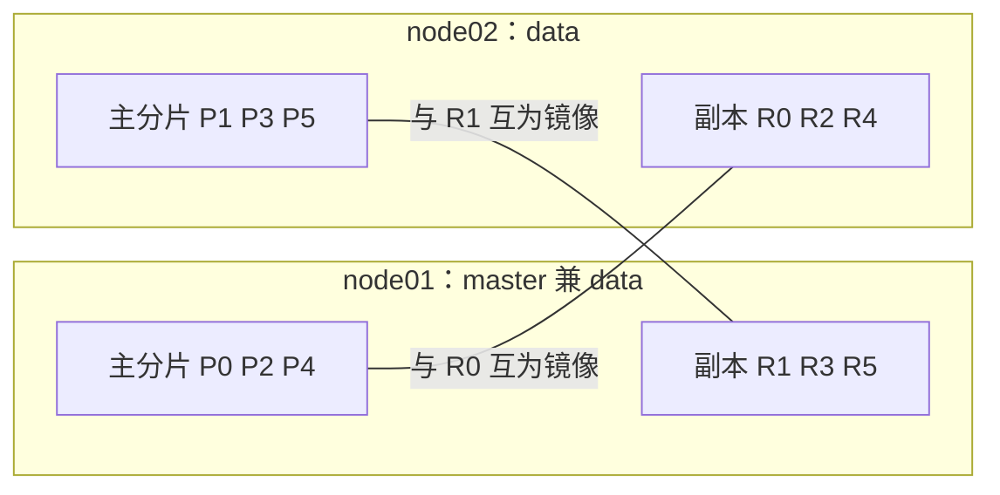

这张图讲的是 6 主分片 1 副本在两节点上的分布：主分片对半劈开，副本整体错开到对面节点。接着再建一个
`test` 索引，把副本数加到 2，状态马上变 yellow：每个主分片要配两份副本，而副本不能与主分片同节点，
两个节点最多只放得下一份，多出来的副本无处安放。删掉 `test`，状态回到 green。

命令行同样能拿到结论，向任一节点发一个集群健康查询：

```json
GET /_cluster/health
{
  "cluster_name": "es-haoke-cluster",
  "status": "green",
  "timed_out": false
}
```

head 的界面正是拿这份数据渲染出来的。三种健康值从搭建阶段就该记牢：

- **green**：所有主分片和副本分片都可用，集群最佳状态。
- **yellow**：主分片全部可用，但有副本没分配出去，查询与写入不受影响。
- **red**：有主分片不可用，部分数据已经无法服务，属于要立刻处理的故障。

## 第3部分：分片与副本：索引背后的仓库，以及为什么主分片数建完就不能改

在 head 里新建索引时有两个必填项：分片数与副本数。很多人第一次都是照着教程填 6 和 1，点完 OK 看到
一堆粗框细框也不明所以。这两个数字决定了索引能存多少数据、挂一台机器丢不丢数据，而且其中一个建完
就再也不能改。把它们彻底讲清楚，后面看集群健康值、做故障转移才有判断依据。

### 一、索引是逻辑空间，分片才是仓库

把 head 里的 `haoke` 索引放大看：索引名下面挂着编号 0 到 5 的方格，这些方格才是真正存数据的地方。
索引本身不存数据，它是一个逻辑命名空间，指向一个或多个分片，把一组分片包装成一个可以整体读写的
「位置」。类比分库分表：库名是给应用看的逻辑概念，真正落数据的是散在各机器上的物理表。

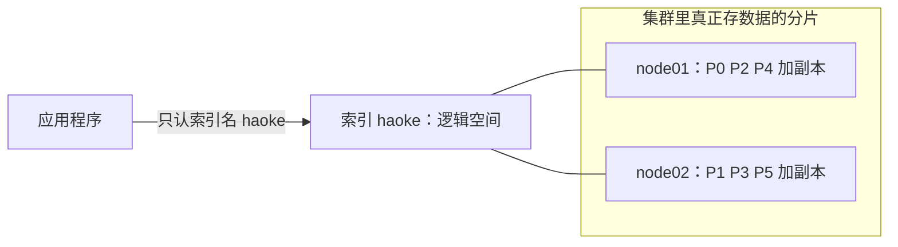

这张图讲的是逻辑与物理的两层关系：应用面只看到一个索引名，存储面是一组分片散在不同节点。
建索引时填的分片数 6，指的是 6 个主分片；填的副本数 1，指每个主分片再备 1 份拷贝，也就是
head 里看到的粗框与细框。

### 二、分片：一个完整的 Lucene 实例

**每个分片都是一个 Lucene 实例。** Elasticsearch 底层是 Lucene，一个分片就是一个独立且完整的
搜索引擎，有自己的倒排索引、自己的存储文件，编号 0、1、2 各管各的。分片是 ES 里最小级别的工作单元，
保存着索引全部数据的一部分；扩容、迁移、负载均衡，操作的对象都是分片。

**应用不需要知道分片的存在。** 程序与 `haoke` 交互时，请求先到协调节点，由它按文档归属把活分给
具体的分片，再把各分片的结果汇起来返回。正因为中间有这一层封装，向集群加节点、挪分片，应用代码
一行都不用改。

**分片可为主也可为副本。** 粗框是主分片（primary shard），细框是副本分片（replica shard）。
主分片承担写入，副本是主分片的拷贝，两者内容一致、角色可换：主分片所在节点宕机时，副本会被
提升为新的主分片顶班。

### 三、主分片数为什么建完就不能改

每个文档都属于一个唯一的主分片，归属不是随机的，靠路由公式算出来：

```text
shard = hash(routing) % number_of_primary_shards
```

`routing` 默认是文档 id，取模的主分片数正是建索引时填的那个数字。文档 id 不变、主分片数不变，
文档就永远落在同一个分片上，检索时才能一步定位。反过来想，如果建完索引把主分片数从 6 改成 12，
取模结果全变，存量文档的归属全乱，等于整个索引的存储秩序要推倒重来。ES 干脆禁止改，真需要调整
只能新建索引再迁移数据。这也解释了主分片数量决定容量上限这件事：数据量预估要在大规模写入之前做，
分片数给少了，后面没有后悔药。

### 四、副本：容灾的第一道防线，顺带分担读压力

**副本的第一职责是防丢数据。** 机器会坏、磁盘会烧，副本把每个主分片在另一个节点上再存一份完整拷贝，
硬件故障最多让集群降级，不会让数据消失。这和 Redis 的主从复制、MySQL 的从库是同一种思路。

**副本可以承接读请求。** 搜索类请求可以在主分片与副本分片上任选一个执行，读多的场景加副本就能
横向摊薄压力。写则不行：写请求永远先写主分片，再由主分片同步到它的所有副本，直接往副本上写会
破坏数据一致性。

**副本数随时可调。** head 界面上改，或者发一条设置更新：

```json
PUT /haoke
{
  "settings": {
    "number_of_shards": 6,
    "number_of_replicas": 1
  }
}
```

主分片数写死在这个创建语句里；副本数则可以在索引建好之后随时调整：

```json
PUT /haoke/_settings
{
  "index": {
    "number_of_replicas": 2
  }
}
```

调大副本数，master 会把新增的副本分配到合适的节点；调小则多出来的副本直接回收。给读流量大的索引
临时加副本，是线上最常用的应急扩容手段之一。

## 第4部分：为故障转移做准备：把两节点集群扩成三节点，人人都有被选举权

集群一上生产，绕不开一个问题：节点宕机会怎样。要亲眼看到答案，得先把实验环境备好。手上这个集群
只有两个节点，node02 连 master 被选举权都没有，真把 node01 停了，集群连新主都选不出来，故障转移
根本无从演示。这一步把集群扩到三个节点，并让每个节点都有资格当 master，后面的宕机实验才有意义。

### 一、为什么两个节点演示不了故障转移

故障转移的核心是 master 挂掉之后，幸存节点里要有人能接棒。现在的 node02 配的是
`node.master: false`，master 候选只有 node01 一个，它一挂，选举连候选人都不剩，集群瘫痪。
讲义里对这一步的要求写得很直白：为了测试故障转移，需要再向集群中添加一个节点，并且将所有节点的
`node.master` 设置为 true。

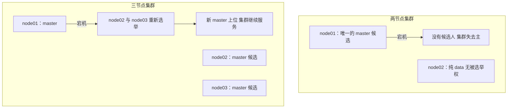

这张图对比的是两种集群在 master 宕机时的命运：候选人数决定有没有「转移」可讲。三节点还有一个
隐含的好处，副本数为 1 时任何一台宕机，剩余两台正好放得下全部主分片与副本，健康值能回到 green。

### 二、改造与复制：node03 的诞生

把两个节点先停掉，留出干净的环境：

```bash
docker stop es-node01 es-node02
```

node02 的配置要改一处：`node.master` 从 `false` 改成 `true`，让它获得被选举权。node01 本来就是
`true`，不用动。

node03 不必从头配，直接复制 node01 的目录再改差异项：

```bash
cp -r /haoke/es-cluster/node01 /haoke/es-cluster/node03
# 清空数据目录：新节点不能带着别人的数据入群
rm -rf /haoke/es-cluster/node03/data/nodes
```

清 data 这一步不能省：复制来的目录里带着 node01 的集群状态与分片数据，node03 带着这些入群会与
真实数据冲突，只有把 `data` 里的内容清干净，它才是一张白纸。接着改 node03 的差异配置：

```yaml
# node03 与 node01 的差异项
node.name: node03
http.port: 9202
node.master: true
node.data: true
```

`cluster.name`、`network.host`、单播名单保持原样，这正是它能自动加入集群的原因。此时三个节点的
`node.master` 全部为 true，任何一台都有资格当老大。

### 三、启动第三个容器

容器创建命令与 node01、node02 同构，换名字换路径即可：

```bash
docker create --name es-node03 --net host \
  -v /haoke/es-cluster/node03/elasticsearch.yml:/usr/share/elasticsearch/config/elasticsearch.yml \
  -v /haoke/es-cluster/node03/jvm.options:/usr/share/elasticsearch/config/jvm.options \
  -v /haoke/es-cluster/node03/data:/usr/share/elasticsearch/data \
  elasticsearch:6.5.4
```

启动 node03，老规矩先跟日志，权限报错照旧处理，然后把另外两个节点拉起来：

```bash
docker start es-node03
docker logs -f es-node03
chmod 777 -R /haoke/es-cluster/node03/data
docker start es-node01 es-node02
```

三个日志都刷出集群名与绑定端口（9200、9201、9202），三节点集群就组好了。

### 四、三节点上的分片分布

head 刷新后节点列表变成三个，星标出现在 node03 旁边：它最早启动，被推举成了 master。master 归谁
由启动与选举过程决定，星标在谁身上就以谁为准，后面做宕机实验前要先确认这一点。

在 head 里删掉旧的 `haoke` 索引重建一次，分片数 6、副本数 2，看分片怎么铺：6 个主分片劈给
node01 与 node02，每个主分片的两份副本分别落在另外两台机器上，18 个分片铺满三个节点。任一节点
宕机，它的主分片都有两份副本在别处候着，这正是后面故障转移实验的底气。

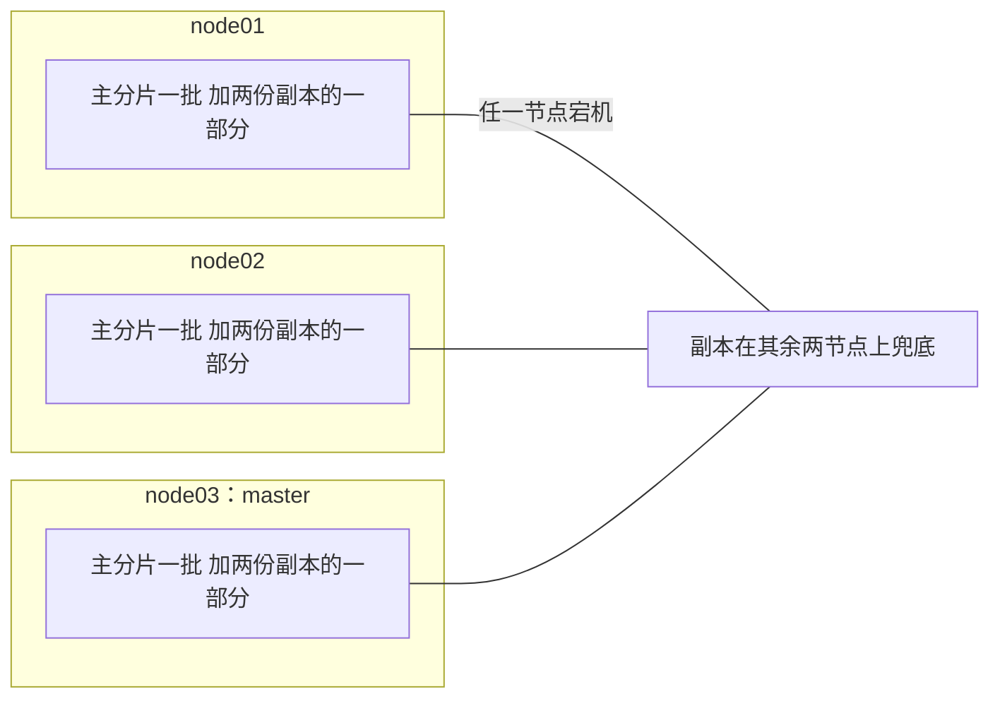

还有一处伏笔值得记下：配置里的 `discovery.zen.minimum_master_nodes` 沿用了 1。它的注释写着防脑裂
公式「master 候选节点数 / 2 + 1」，三节点集群应设为 2，这处没改的配置在主节点宕机实验里会现出原形。

## 第5部分：故障转移实验：data 节点宕机与 master 宕机，集群自己能救回多少

三节点集群搭好，所有节点都有被选举权，万事俱备。接下来做破坏性实验：把节点一台一台停掉，盯着 head
看集群怎么自愈。两次实验分别回答两个问题：存数据的节点挂了，数据丢不丢；当指挥的节点挂了，谁来接手。
把现象和背后的机制对上，故障转移才算真正看懂。

### 一、实验约定：先认清谁是 master

动手前先确认星标在谁头上。实验环境里 node03 最早启动，星标在它身上；讲义案例里 master 是 node02，
连操作对象都不一样。宕机实验不能照抄讲义的角色，**以自己集群的实际角色为准**：master 在谁身上，
第二次实验就停谁；第一次实验专门挑一个 data 节点停。环境不同现象相同，这才是实验的意义。

两次实验共用的基础命令只有两条，停与看：

```bash
docker stop es-node01
docker logs -f es-node02
```

### 二、实验一：data 节点宕机，副本顶上

把一个 data 节点（node01）停掉。它身上的连接立刻断开，换到另一个节点的端口（9201 或 9202）继续看，
集群状态变成 yellow：主分片全部可用，但原本在 node01 上的副本缺位。同时 master 立刻开始补位，
把 node01 上承担的主分片复制到存活节点上，保证每个主分片始终有一个在岗。

**副本数为 2 时，实验停在中途。** 当前索引是 6 主分片 2 副本，node01 下线后只剩两个节点：主分片的
两份副本要求错开主分片所在节点，两个存活节点最多只放得下一份，另一份永远分配不出去，yellow 一直
挂着。把 node01 重新拉起，状态立刻回 green，而且它会以副本的角色回归，主分片仍留在另外两个节点上。

**副本数为 1 时，才能看到完整自愈。** 为了观察到讲义里的现象，删掉索引重建一次，分片数 6、副本数 1，
然后再次停掉 node01：

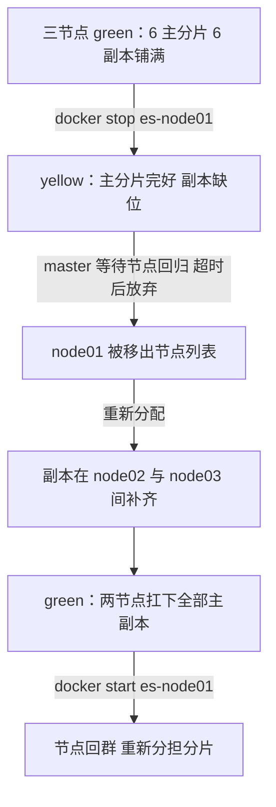

等上几十秒再刷新：节点列表里已经看不到 node01，它被集群从分配计划中移除；原本在它身上的副本
在 node02 与 node03 之间重新补齐，状态回到 green。集群永远向着「主副本都齐全」的最佳状态收敛，
这就是副本机制的价值：只要还有节点活着，停一台机器只是一次状态波动，不是事故。

整个实验的状态流转可以记成一张表：

| 操作 | 状态变化 | 现象与原因 |
|---|---|---|
| 副本 2 时停 node01 | green 转 yellow | 主分片完好，副本缺位且补不齐 |
| 重新启动 node01 | yellow 转 green | 节点回群，重新承担副本 |
| 副本 1 时停 node01 | green 转 yellow 再转 green | 几十秒后节点被移出，副本补齐 |

### 三、实验二：master 宕机，重新选举

这次停的是 master（当前是 node03）。它一停，9202 的连接断开，换到 9200 观察。node01 与 node02
都在线，两个候选节点立刻触发重新选举，node02 当选新 master，head 里的星标移到了它身上。此刻集群
是 yellow：原 master 身上的分片缺了副本，等 master 完成分配，状态回到 green。讲义案例里停的是
node02、选出 node01，现象完全一致，只是角色对调。

值得记下一个细节：master 缺位的这段时间，文档的读写不受影响。写入路由到主分片、搜索在各分片上
执行，都不经过 master；只有建删索引这类集群级操作需要主在岗。master 的重要性在「管理」而不在
「数据通道」。

**旧 master 回来了，意外出现了。** 把 node03 重新启动，等它起来刷新 head，原集群毫无变化，
node01 与 node02 照常维持 green。但连上 9202 一看：node03 名字旁多了一颗星，它自己成了 master，
手里的部分分片显示不可用，状态 red，仿佛一个只有它一个人的集群。9200 与 9201 看到的是一个集群，
9202 看到的是另一个集群，一个集群裂成了两半。

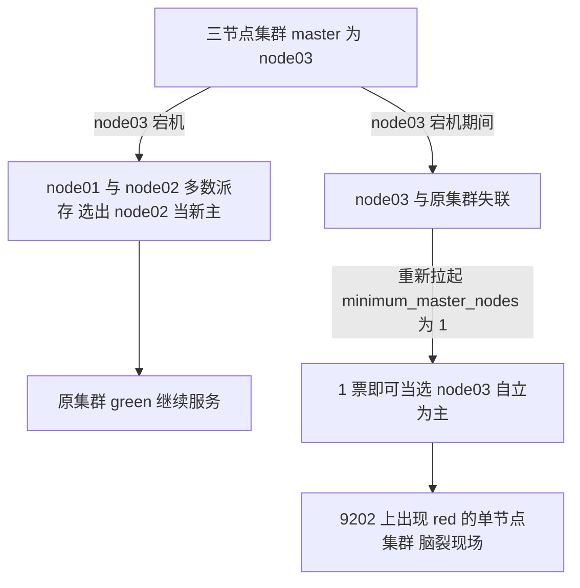

这张图讲的是分裂是怎么发生的：`minimum_master_nodes` 还是 1，意味着一票就能当选。node03 失联期间
原集群选了新主，node03 回来后不知道这件事，自己手里正好有一票，于是也选出了主，两边各说各话。
把 `minimum_master_nodes` 设为候选节点数的一半加一（三节点即 2），node03 一票凑不够多数，
只能加入别人的集群，分裂就不会发生。防脑裂的原理到此就落在了具体的配置项上。

### 四、把两次实验连成一张地图

| 实验 | 停掉的节点 | 幸存者做了什么 | 状态轨迹 |
|---|---|---|---|
| data 节点宕机 | data 节点 | 副本升级补位，超时后移除宕机节点并重分配 | green，yellow，green |
| master 宕机 | master（兼 data） | 幸存候选重新选举，master 重分配缺位副本 | green，yellow，green |
| 旧 master 回归 | 无（启动） | 原 cluster 不变，旧主自立（配置为 1 时） | 原 green 不变，9202 侧 red |

两次宕机集群都自动恢复，差别在恢复的手段：data 节点宕机靠副本升级与重分配，master 宕机靠重新选举。
而当网络分区叠加错误的 `minimum_master_nodes`，自动恢复会变成自动分裂，所以三节点加多数派配置
才是生产环境的标配。

## 第6部分：一个集群为什么会裂成两个：脑裂的成因、多数派防线与回归验证

上一课的破坏性实验做到最后出现了诡异一幕：停掉的旧 master 重新拉起后，自己头上多了一颗星，9202 端口看到一个
red 状态的单节点集群，9200 与 9201 看到的却还是那个正常的 green 集群。一个集群裂成两半，这就是 Elasticsearch
集群最经典的问题，脑裂。这一课把它的成因拆开，再动手把它堵死。

### 一、脑裂：一个大脑裂成两个

「脑裂」这个词在官方文档里没有严格定义，按字面拆最好懂。三节点的集群里 node01 是 master，其余两个是 data 节点，
画一条线把 node01 与另外两个分开，集群就被一分为二。原来只有一个「老大」指挥全局，分裂之后变成两个老大各指挥一摊，
大脑做了分裂，这就是脑裂。节点的名字不重要，重要的是角色，下面按课件里的角色把过程铺开。

**第一幕，主节点宕机，集群自愈。** 正常状态下三个节点都在线，node01 当 master。node01 宕机后，集群必须保证可用，
幸存节点里会选出一个新 master，比如 node02 当选，node03 仍是数据节点，两者继续维持原来的集群，读写照常。

**第二幕，旧主回归，一票当选。** 过了一会儿 node01 修好重启，它的配置里 `node.master: true`，有候选资格；
而此前配置的 `minimum_master_nodes` 是 1，意思是只要有一个节点认可就能当 master。它自己恰好就是这一票，
于是它也成了 master。

**第三幕，双主并存，集群分裂。** 此刻集群里有两个 master。node02 一侧继续维护着原来的数据；node01 一侧延续
它宕机前保存的集群状态，想把主分片与副本分片分配给其他节点，可它的「集群」里只有自己，分片永远分配不出去，
于是它那一侧出现红色未分配分片。两边各说各话，一个集群就此裂成两个。

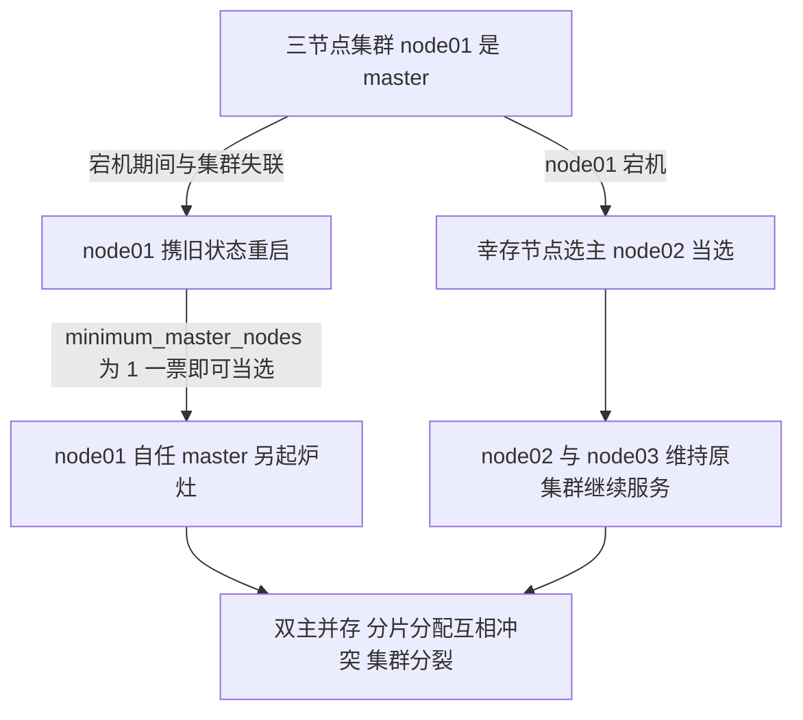

这张图讲的就是分裂的全过程：原集群照常选主，失联的旧 master 按自己手里的旧配置也选出了主，两条路径同时成立。
要杜绝它，就得让第二条路走不通，办法落在下一节的一个配置项上。

### 二、防线：minimum_master_nodes 的过半原则

解决的思路很朴素：不能让节点自己说了算。想当 master，必须拿到多数节点的认可，只靠自己这一票不行。
这个认可票数就是配置项 `discovery.zen.minimum_master_nodes`，它在 `elasticsearch.yml` 里的位置和写法如下，
官方注释直接把防脑裂写在了它旁边：

```yaml
discovery.zen.ping.unicast.hosts: ["172.16.55.185"]
# Prevent the "split brain" by configuring the majority of nodes
# (total number of master-eligible nodes / 2 + 1):
discovery.zen.minimum_master_nodes: 2
gateway.recover_after_nodes: 3
action.destructive_requires_name: true
http.cors.enabled: true
http.cors.allow-origin: "*"
node.master: true
node.data: true
```

数值怎么算？官方给的公式是候选 master 节点总数除以 2 再加 1，向下取整。当前集群三个节点都配了
`node.master: true`，也就是三个候选，3 除以 2 加 1，取整后就是 2。它的含义是：至少要有 2 个节点认可，
你才能成为 master。回到上一幕的现场，node01 重启时手里只有自己一票，凑不够 2 票，当不上 master，
唯一的选择就是加入 node02 领导的原集群，分裂被从机制上堵死。

**为什么是过半而不是全票？** 过半的意义在于任何两个多数派必有交集。允许半数当选的话，一次网络分区就能让
两边各凑出足够的票数；要求全票又太脆弱，一台机器宕机集群就选不出主。过半原则在可用性与一致性之间取了平衡，
这也是分布式系统选主的通用思路。

**ES 7.x 的改进顺带交代一句。** 从 7.0 起官方移除了 `discovery.zen.minimum_master_nodes`，选主协议改为内置的
基于多数派的投票机制，集群自动维护投票配置，多数派原则由协议本身保证，不再需要人工算票数。老版本的配置思路
依然值得掌握，一来线上仍有 6.x 集群在跑，二来面试考的就是这个原理。

### 三、动手验证：改完配置旧 master 只能乖乖回群

思路落在操作上分三步：停集群、逐台改配置、重启验证。

```bash
# 停掉全部节点
docker stop es-node01 es-node02 es-node03

# 分别进入三个节点的配置目录，把 minimum_master_nodes 由 1 改为 2
cd es-cluster/node01 && vim elasticsearch.yml
cd es-cluster/node02 && vim elasticsearch.yml
cd es-cluster/node03 && vim elasticsearch.yml

# 全部改完后再启动
docker start es-node01 es-node02 es-node03
```

三个节点的值必须一致，漏改任何一台，那台重启后仍按旧票数参与选举，防线就漏了风。启动完成后重建测试索引
（6 个主分片 1 个副本），head 插件里显示 green，星标在 node03 头上，环境就绪。

开始复现之前的破坏动作。停掉现任 master node03，node02 立刻当选新主，node01 与 node02 承担下全部主分片与
副本分片，等分片补齐，集群回到 green。现在把 node03 拉起来，关键一刻到了：node03 起来后头上没有星，角色是
data 节点，node02 的 master 地位没有任何动摇，node03 还分担了一部分分片。进它的 9202 端口确认，看到的数据
与另外两个节点完全一致，它认了 node02 这个主，重新融入了集群。

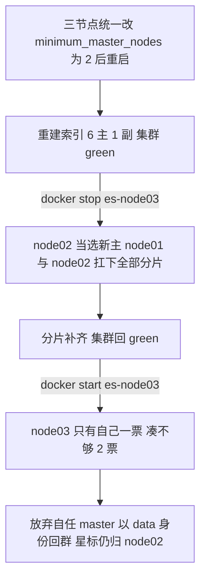

这张图是验证实验的状态流转，最后一跳是全课的点睛之处：node03 回群时手里仍是一票，票数不够多数派，
当不上主，只能当成员。对比改配置前的同一套操作，之前是自立门户、9202 上出现 red 单节点集群，现在回来的是
一名普通成员。两个现象的差值，就是这条多数派配置的防护力。

## 第7部分：一条文档在集群里的旅程：路由公式、写流程与两段式搜索

单机玩 Elasticsearch 时，文档写到哪、从哪读，从来不构成问题。集群一上，索引拆成主分片与副本散在三个节点上，
同样的一次写入，服务器多了，问题反而来了：这条文档究竟落在哪个节点？读的时候去哪里找？全文搜索时数据散落
各处，结果又怎么合并？这一课把分布式文档的四件事一次讲透：路由怎么算、写怎么走、单条怎么读、全文怎么搜。

### 一、路由：文档到底该存进哪个分片

**把备选方案摆出来对比，才知道计算式路由的分量。** 三个节点摆在面前，一条文档要保存，只能存进其中一个节点，
全都存一遍就变成三份完整副本，失去了分布式的意义。最容易想到的选法是随机和轮询：随机就是每次挑一个节点写；
轮询是第一次写节点一、第二次写节点二、第三次写节点三，循环往复。写入这一端两种方案都没问题，读这一端麻烦
立刻出现：你不知道这条文档当时被随机或轮询到了哪里，去哪读？

**除非在集群外面维护一张映射表。** 记下文档一存在哪台机器、文档二存在哪台机器，写的时候记、读的时候查。
而 Elasticsearch 的目标是海量数据存储，文档本身是海量，这张映射表随之也是海量，维护一张不断膨胀的全局表，
成本吞掉分布式带来的全部好处，随机与轮询方案就此作废。

**计算式路由把映射表换成了一个公式：**

`shard = hash(routing) % number_of_primary_shards`

两个参数各自的角色：routing 是任意字符串，默认就是文档的 `_id`，也可以自定义；routing 字符串经哈希函数生成
一个数字，除以主分片数量取余数，余数范围永远是 0 到主分片数减 1，这个数字就是文档所在的分片。主分片 6 个时，
余数只会在 0 到 5 之间，每个文档一定落在某个具体分片上。写入时按公式算，读取时还按公式算，两边结果必然一致，
不需要任何额外的维护，比随机加映射表轻量得多。

自定义 routing 的典型玩法是把相关数据定向到同一分片，检索时带上同样的 routing 就只需要查一个分片
（示例，按本课写法补全）：

```bash
# 写入时指定自定义 routing
curl -X PUT "172.16.55.185:9200/haoke/house/1001?routing=agent_88" \
  -H "Content-Type: application/json" \
  -d '{"id":"1001","title":"精装修 1居室 7500","price":"7500"}'

# 检索时带上同样的 routing，查询范围缩到一个分片
curl -X GET "172.16.55.185:9200/haoke/house/_search?routing=agent_88"
```

**这个公式还顺手解释了一个老问题。** 之前讲集群时留过一句话：主分片数在创建索引时确定之后不能修改。原因就在
公式里，`number_of_primary_shards` 是计算的除数，分片数一变，所有文档的余数全部重排，原来存在 0 号分片的文档，
按新公式算出来可能落在 3 号分片，那条数据就找不到了。对比 Redis 集群更容易看清这件事：Redis 增加节点时可以把
槽里的数据搬到新节点，数据跟着槽走；Elasticsearch 没有这种数据转移机制，主分片数一动就是全局重算，这条路
直接封死，所以主分片数在建索引时就要规划好。

### 二、写操作：先主分片，再同步副本

写操作指文档的新建、索引与删除，这类操作必须先在主分片上完成，然后复制到对应的副本分片。看一个具体布局：
集群三个节点，两个主分片 P0、P1，每个主分片两个副本。NODE1 是 master，身上放着 R0 与 P1；NODE2 放着 R0 与
R1；NODE3 放着 P0 与 R1。

一张时序图把写流程走完，它回答「数据怎么从客户端落到每一个分片」：

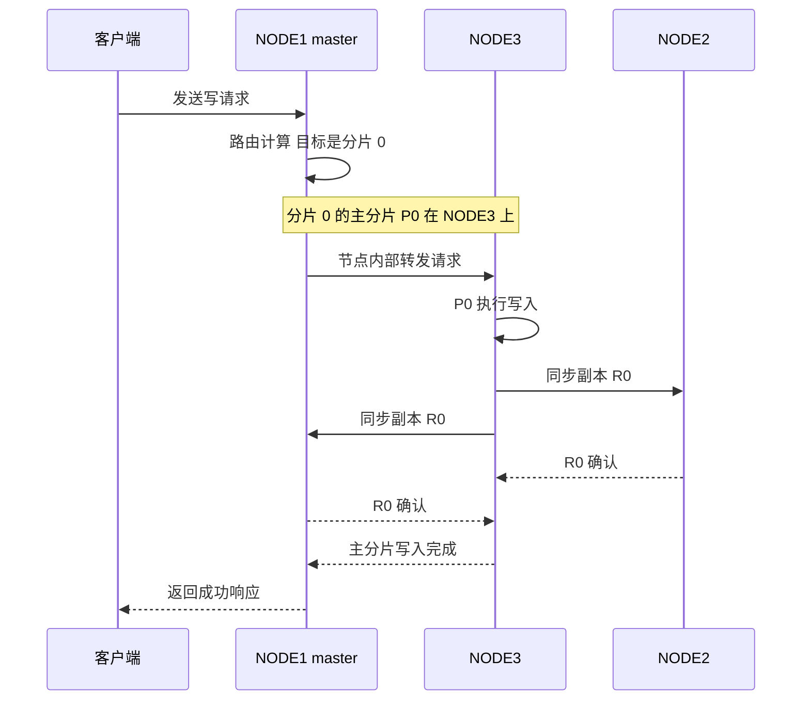

图里最该记住的是转发方向：请求永远先到接收节点，再由接收节点算路由、做内部转发，副本确认沿原路逐级返回。
三个细节值得圈出来。**转发发生在节点内部，不是客户端再发一次请求。** 客户端只管把请求发给任意一个节点，
图里是 master 所在的 NODE1，它按路由公式算出目标分片，发现 P0 不在自己身上，就在集群内部把请求转给 NODE3，
客户端对这一切无感知。**副本同步是推给所有副本的**，P0 写完后把操作同时推给 NODE1 与 NODE2 上的两份 R0，
两份都确认才算完。**成功响应的语义是全量生效**：客户端收到成功响应时，这次修改已经作用于主分片与所有副本
分片，这是一个同步过程，不是主分片写完就算写成功。

### 三、单文档读取：主副本都能应答，轮询分摊

读比写宽松：文档能从主分片或任意一个副本分片被检索。还用上面那个布局，客户端按 `_id` 发 GET 请求，落在
NODE1，路由算出文档属于分片 0。分片 0 的三份拷贝分布在三个节点上，NODE1 的 R0、NODE2 的 R0、NODE3 的 P0，
取哪一份都行。协调节点在这些拷贝之间轮询选择，比如这次轮到 NODE2 的 R0，就把请求转发过去；NODE2 取出文档
发回 NODE1，NODE1 再响应客户端。

单文档 GET 的完整时序如下：

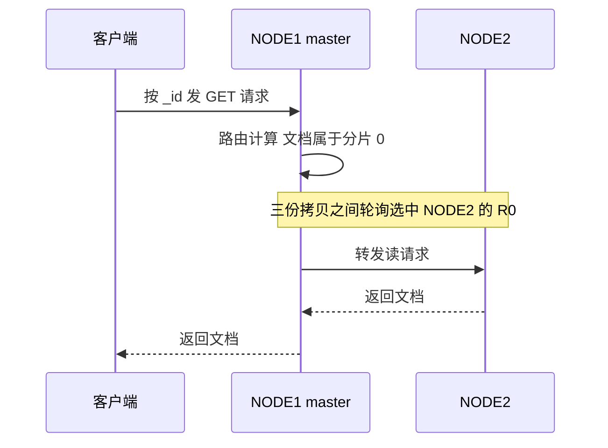

轮询换来的是读负载均衡：为了平衡负载，请求节点会为每个请求选择不同的拷贝，循环使用所有分片副本，读压力被
摊到每一份拷贝上，不会全部压向主分片。

**有一个边界情况必须知道。** 文档刚写进主分片、还没来得及同步到副本时，如果读请求恰好被轮询到那份落后的
副本，副本会报告「文档未找到」，而主分片那一份是完整的，能正常返回。一旦索引请求成功返回给用户，文档在
主分片与所有副本上都可用了，这个窗口就关闭。落到应用开发的建议很直接：先确认写操作成功，再发起后续的读操作，
才能保证一定拿得到文档。

### 四、全文搜索：query 与 fetch 的两段式

按 `_id` 取单条文档有公式帮着定位，全文搜索复杂一档：关键词命中的文档可能散落在各个节点的各个分片上，
没有任何公式能告诉你第几页的结果在哪台机器里。做法是把一次搜索拆成两个阶段，查询 query 与取回 fetch。

**query 阶段解决「哪些文档命中、排什么顺序」。** 客户端把搜索请求发给 NODE3，它成为协调节点，先创建一个
长度为 `from + size` 的空优先级队列。`from` 与 `size` 是分页参数，`from=10`、`size=5` 表示跳过 10 条取 5 条，
队列就要建 15 的长度。协调节点把请求转发给索引的每个分片，由于副本也能服务搜索，具体发给主分片还是某个
副本是轮询决定的，比如搜「手机」这个关键词，P1 与某份 R0 各收到一份转发。每个分片在本地执行查询，同样建一个
`from + size` 的优先队列，排好序后把最前面的结果返回给协调节点，注意返回的只有文档 ID 与得分这些轻量信息。
协调节点把所有分片的结果收进自己的队列，做一次全局排序，因为最终结果要按得分排出统一的先后。

**fetch 阶段解决「把选中文档的完整内容取回来」。** 全局排序完成后，协调节点已经知道最终要返回的
`from` 到 `from + size` 条文档，可能五条结果里两条来自这个分片、三条来自那个分片。它向相关分片发出 GET 请求，
分片把完整文档内容取回发来，协调节点汇总后响应客户端。两段式的经济性就在这里：网络里大量传输的只有 ID 与
得分，完整的文档内容只为最终命中的那几条跑一趟。

query 与 fetch 连起来的一张总图：

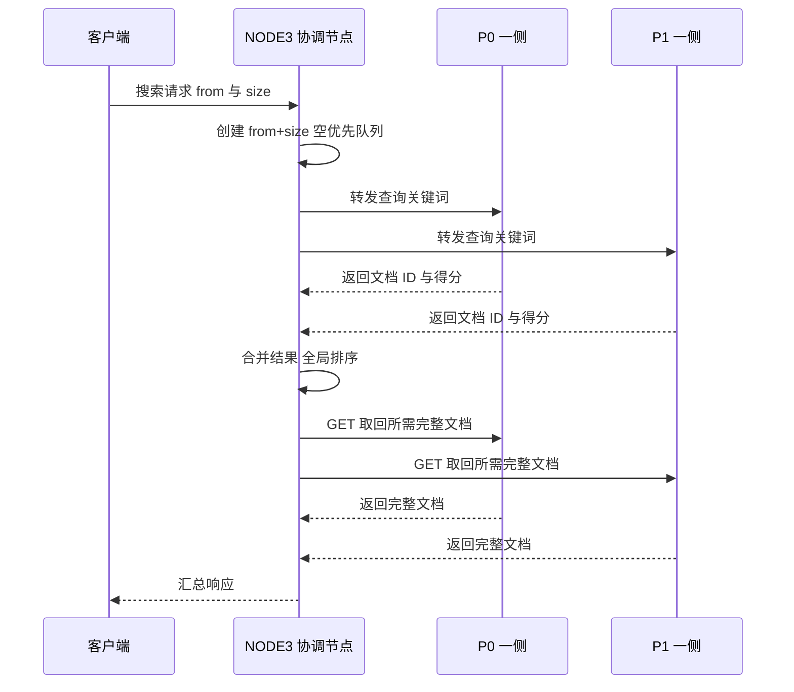

关键路径读法：前半段（到全局排序为止）是 query 阶段，全程只动 ID 与得分；后半段是 fetch 阶段，只为入选的
少数文档取全文。一次请求两趟分片交互，职责切分清楚。

配合分页参数的一个请求长这样（示例，按本课写法补全）：

```json
{
  "from": 10,
  "size": 5,
  "query": {
    "match": {
      "title": "拎包入住"
    }
  }
}
```

`from` 加 `size` 既是客户端要的结果页，也决定了协调节点与每个分片本地优先队列的长度，两处长度必须一致，
全局排序截取的位置才有依据。

## 第8部分：Java 客户端怎么选：从 TransportClient 到低级与高级 REST 客户端

API 工具里玩得再熟，业务里终究要用 Java 代码连集群。官方为各种语言都提供了客户端，Java 这一支在文档里分成
两大家族，家族下面还有分支，动手写代码之前得先看清地图，否则第一行依赖就可能走错门。这一课过一遍客户端谱系，
顺手把后续查询测试要用的房源数据灌进集群。

### 一、官方客户端地图

官方客户端文档里，Java 这一栏摆出两条路线，一张图看清全貌：

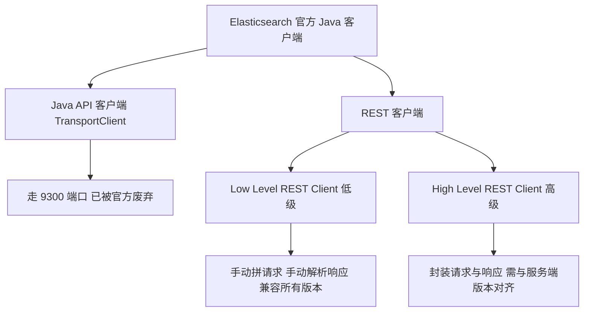

图上的分叉就是选型的全部岔路口：先在 Java API 与 REST 之间二选一，走 REST 的再在低级与高级之间二选一。
两个问题依次回答：为什么 REST 成了主流，低级与高级差在哪。

### 二、低级与高级 REST 客户端，差别在封装多少

**低级客户端贴近原生 HTTP。** 它通过 HTTP 连接到 Elasticsearch 集群，用的时候要手动拼接请求的 endpoint 与
参数，拿到响应后还要手动把 JSON 数据封装成对象。类比一下，就相当于拿浏览器直接访问 API 地址，看到什么
JSON 就自己解析什么。麻烦是麻烦，但它有一个硬优点：兼容所有 Elasticsearch 版本，因为 HTTP 接口的兼容承诺
比服务端内部协议稳得多，后期服务端升级，这类客户端代码基本不用动。

**高级客户端在低级之上做了封装。** 数据封装、响应格式转换这些问题它都替你处理了，请求变成对象与方法调用，
开发体验接近调用本地接口。代价是版本耦合，服务端升级时高级客户端往往要跟着升。

**项目里选哪个，没有硬性规定，看场景。** 项目里只是简单用一下 Elasticsearch，选低级客户端，按 REST API 的方式
调用，后期做版本升级时代码不需要跟着更新，这正是它的价值所在；正式业务开发追求效率，选高级客户端，
把版本钉住即可。两者的差异汇总成一张表：

| 维度 | 低级 REST 客户端 | 高级 REST 客户端 |
|---|---|---|
| 通信方式 | HTTP | HTTP（构建在低级客户端之上） |
| 请求构建 | 手动拼 endpoint 与参数 | 对象化 API |
| 响应处理 | 手动解析 JSON | 自动映射成对象 |
| 版本兼容 | 兼容所有 ES 版本 | 与服务端版本强相关 |
| 适用场景 | 轻度使用、在意升级成本 | 正式业务开发 |

顺带把左上角那条废弃的路线交代清楚。TransportClient 走 9300 端口，连的是节点间通信协议，服务端内部实现一变
客户端就得跟着改，官方从 7.0 起把它标记为废弃并在 8.x 移除。看到老项目里还在用它，迁移到 REST 客户端是迟早的事。

### 三、构造测试数据：bulk 一次灌入六条房源

客户端选型定了，动手之前先把测试数据备好，后面所有查询都拿这批数据验证。往 `haoke` 索引灌六条房源文档，
ID 从 1001 到 1006，走 bulk 批量接口。bulk 的请求体是 NDJSON 格式：一行动作元数据，一行文档内容，交替出现
（数据来自本课示例，按本课写法补全）：

```json
{"index": {"_index": "haoke", "_type": "house", "_id": "1001"}}
{"id": "1001", "title": "精装修 1居室 7500", "price": "7500"}
{"index": {"_index": "haoke", "_type": "house", "_id": "1002"}}
{"id": "1002", "title": "法家瑞枫快 精装设计一室一厅，可拎包入住诚意租。", "price": "8500"}
{"index": {"_index": "haoke", "_type": "house", "_id": "1003"}}
{"id": "1003", "title": "整租 1居室 4050", "price": "7500"}
{"index": {"_index": "haoke", "_type": "house", "_id": "1004"}}
{"id": "1004", "title": "整租 中心城之光·视野开阔·景色秀丽·拎包入住", "price": "6500"}
{"index": {"_index": "haoke", "_type": "house", "_id": "1005"}}
{"id": "1005", "title": "整租 南京西精品小区 21213二轨交汇 配套齐 拎包入住", "price": "6000"}
{"index": {"_index": "haoke", "_type": "house", "_id": "1006"}}
{"id": "1006", "title": "祥里里 网约风格 两户型 拎包入住 看房随时", "price": "7000"}
```

把这段内容存成文件或直接粘进 Postman 的请求体，以 POST 方式发给 bulk 接口：

```bash
# 批量导入，请求体就是上面的 NDJSON
curl -X POST "172.16.55.185:9200/_bulk" \
  -H "Content-Type: application/x-ndjson" \
  --data-binary @houses.ndjson
```

发送成功后每条记录返回 created，head 插件的数据浏览页刷新，`haoke` 索引下出现六条房源记录，字段有 `_id`、
`title`、`price` 等，后续 Java 客户端的查询测试就以这批数据为底料。

**一个动手时差点翻车的细节：末行换行符。** bulk 对 NDJSON 的解析要求每个动作行都以换行结尾，最后一行漏掉
回车，整个请求解析报错。课件里特意标注了「最后一行还有一个回车别忘记」，粘贴完数据记得补上结尾换行，
这是 bulk 新手最常见的第一次报错。

## 第9部分：低级 REST 客户端起步：搭工程、建连接、查一次集群状态

客户端谱系理清了，从最底层的低级 REST 客户端开始动手。它的体验最接近直接拿浏览器访问 ES 的接口，把工程搭起来、
把连接建起来、把第一个请求发出去，低级客户端的玩法就通了，后面所有进阶客户端都建立在这套动作之上。

### 一、搭工程：依赖与版本匹配

Maven 工程起手，编译插件钉住 JDK 1.8，pom 的关键部分如下（工程坐标已改为中性示例，依赖与版本按本课演示）：

```xml
<dependencies>
    <!-- 低级 REST 客户端，版本与集群 6.5.4 对齐 -->
    <dependency>
        <groupId>org.elasticsearch.client</groupId>
        <artifactId>elasticsearch-rest-client</artifactId>
        <version>6.5.4</version>
    </dependency>
    <dependency>
        <groupId>junit</groupId>
        <artifactId>junit</artifactId>
        <version>4.12</version>
    </dependency>
    <!-- 低级客户端要手动解析响应，Jackson 反序列化用 -->
    <dependency>
        <groupId>com.fasterxml.jackson.core</groupId>
        <artifactId>jackson-databind</artifactId>
        <version>2.9.4</version>
    </dependency>
</dependencies>

<build>
    <plugins>
        <plugin>
            <groupId>org.apache.maven.plugins</groupId>
            <artifactId>maven-compiler-plugin</artifactId>
            <version>3.2</version>
            <configuration>
                <source>1.8</source>
                <target>1.8</target>
            </configuration>
        </plugin>
    </plugins>
</build>
```

版本匹配多说一句：低级客户端只封装 HTTP 传输，兼容面宽，但客户端版本与服务端大版本保持一致最稳，本课集群
是 6.5.4，客户端就用 6.5.4。Jackson 不是客户端的硬性依赖，它是给手动解析响应准备的工具，低级客户端不管解析，
总得有人管。

### 二、初始化：builder 注册三个节点加失败监听

测试类里核心对象只有 `RestClient`。它不能直接 new，要通过 builder 构建，构建时把集群节点逐个注册进去
（原课程包名已改写为中性的 `com.example.es`）：

```java
package com.example.es;

import org.apache.http.HttpHost;
import org.apache.http.util.EntityUtils;
import org.elasticsearch.client.Node;
import org.elasticsearch.client.Request;
import org.elasticsearch.client.Response;
import org.elasticsearch.client.RestClient;
import org.elasticsearch.client.RestClientBuilder;
import org.junit.After;
import org.junit.Before;
import org.junit.Test;

import java.io.IOException;

public class TestRestApi {

    private RestClient restClient;

    @Before
    public void init() {
        // 三个节点都注册进去，客户端自动在节点间轮询分发
        RestClientBuilder restClientBuilder = RestClient.builder(
                new HttpHost("172.16.55.185", 9200, "http"),
                new HttpHost("172.16.55.185", 9201, "http"),
                new HttpHost("172.16.55.185", 9202, "http"));
        // 失败监听：请求在某个节点上失败时回调
        restClientBuilder.setFailureListener(new RestClient.FailureListener() {
            @Override
            public void onFailure(Node node) {
                System.out.println("出错 -> " + node);
            }
        });
        this.restClient = restClientBuilder.build();
    }

    @After
    public void close() throws IOException {
        // 客户端应跟随应用的关闭而关闭，例如随 Spring 容器销毁时关闭
        this.restClient.close();
    }
}
```

三段各有讲究。**多节点注册是自带的高可用。** 三个 `HttpHost` 全传给 builder，客户端在节点间轮询分发请求，
一台挂了后续请求自动落到其他节点，不需要自己写重试逻辑。**失败监听器负责报信。** `onFailure` 拿到出问题的
`Node` 对象，学习阶段打印一行日志，生产里这里可以做节点摘除标记与告警。**`@After` 关闭不是可有可无。**
`RestClient` 底层持有连接池，用完不关，连接一直占着；它的生命周期应该与应用对齐，接 Spring 时随容器启动创建、
随容器销毁关闭，JUnit 环境里就用 `@Before` 与 `@After` 模拟这一对时机。

### 三、发第一个请求：查询集群状态

低级客户端发请求的固定三步：构造 `Request` 指定方法与 endpoint，按需附加参数，`performRequest` 拿回
`Response`：

```java
@Test
public void testInfo() throws IOException {
    Request request = new Request("GET", "/_cluster/state");
    // pretty 参数让响应 JSON 带缩进，便于阅读
    request.addParameter("pretty", "true");
    Response response = this.restClient.performRequest(request);
    System.out.println("请求完成 -> " + response.getStatusLine());
    // 响应体是 HttpEntity，手动转成字符串
    System.out.println(EntityUtils.toString(response.getEntity()));
}
```

跑起来控制台先打出 `请求完成 -> HTTP/1.1 200 OK`，跟着一大段 JSON：集群名、三个 node 的信息、元数据全在里面，
把内容贴进格式化工具看，集群全貌一目了然。`pretty` 参数只影响阅读体验，程序解析时用不上，去掉它响应就是
一行紧凑的 JSON。

这个体验和用浏览器插件直接访问集群接口完全一致：低级客户端没有隐藏任何东西，你写 endpoint、发 HTTP、收响应，
它只是替你管好了连接池与节点轮询。补一个对照：集群健康检查的 endpoint 是 `/_cluster/health`，集群全局状态是
`/_cluster/state`，本课示例用的是后者，想快速确认集群好不好就查 health。

整个请求的生命周期串成一张图：

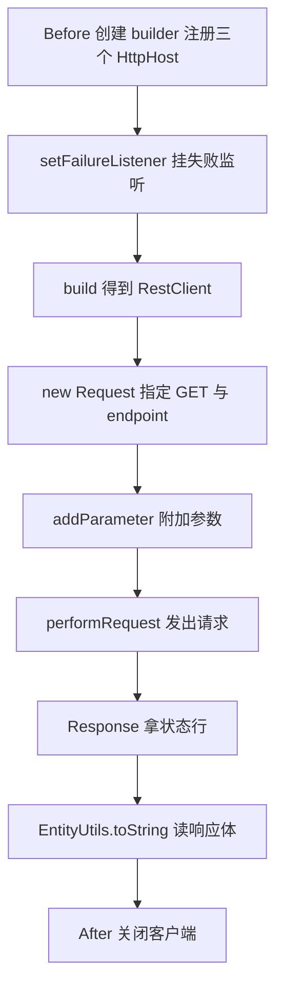

图上的关键路径是 C 到 F：build 出客户端之后，剩下的就是 Request 与 performRequest 两个动作，低级客户端的全部
日常就是这两个动作的反复组合，换 endpoint 就是换功能。

### 四、它「低级」在哪，为什么还要先学它

低级客户端的「低级」指封装少，不是功能弱：请求要手动拼、响应要手动解析，正因如此它与任何版本的 ES 都合得来，
版本升级时这段代码原地不动。它同时是高级客户端的地基，高级客户端内部包着的就是这个 `RestClient`，把初始化、
发请求、关资源这一套吃透，切到高级客户端只是换了个外壳发请求，底层逻辑一模一样。

## 第10部分：低级客户端发出第一个写请求：POST 新增、按 ID 查、match 搜索，再换高级客户端对比一遍

上一篇把 RestClient 建了起来，也查回了集群状态，但那只读不写。真实业务最先遇到的问题是：怎么把一条房源数据存进
Elasticsearch？存进去之后怎么按 ID 找回、怎么按关键词搜出来？这一篇用低级客户端把「增、查、搜」三个动作各走一遍，
再引入高级客户端做同一件事，两边的代码摆在一起，封装的价值立刻就看出来了。

### 一、新增文档：POST 与 JSON 请求体

低级客户端的思路延续上一篇：一切皆 HTTP 请求。新增数据对应的接口是 `POST /haoke/house`，`haoke` 是索引名，
`house` 是类型名，往这个 endpoint 提交 JSON 就是要入库的文档。测试方法接着写在 `TestRestApi` 里：

```java
private static final ObjectMapper MAPPER = new ObjectMapper();

@Test
public void testSave() throws IOException {
    // 新增文档走 POST，目标地址是索引名/类型名
    Request request = new Request("POST", "/haoke/house");
    request.addParameter("pretty", "true");

    // 用 Map 构造文档数据，Jackson 负责转成 JSON 字符串
    Map<String, Object> data = new HashMap<>();
    data.put("id", "2001");
    data.put("title", "南京西路 一室一厅");
    data.put("price", "3500");
    request.setJsonEntity(MAPPER.writeValueAsString(data));

    Response response = this.restClient.performRequest(request);
    System.out.println(response.getStatusLine());
    System.out.println(EntityUtils.toString(response.getEntity()));
}
```

三个细节值得停下来看。**请求体必须自己变字符串。** `setJsonEntity()` 接收的是字符串形式的 JSON，客户端不做任何
对象映射，所以 pom 里那一份 Jackson 依赖在这里派上用场：先建 `Map` 装数据，再 `MAPPER.writeValueAsString(data)`
序列化，链路清楚。**字段名就是文档结构。** 这条数据有 `id`、`title`、`price` 三个字段，对应先前在 head 里看到的
房源索引结构，`id` 写 2001 只是我们业务上的编号，它与文档的 `_id` 是两回事。**异常直接上抛。** 测试代码抛给 JUnit
即可，省掉层层 try-catch。

运行后控制台第一行是 `HTTP/1.1 201 Created`。201 就是 HTTP 协议里的「已创建」，它一出现数据就已经写进去了。响应体
是一段 JSON：自动生成的 `_id`、`_version` 为 1、`result` 为 `created`，还有分片信息 `_shards`，total 为 2、
successful 为 2，主分片与副本分片都写入成功。回到 head 插件刷新，`haoke` 索引下多出一条南京西路的房源，和刚填的
三个字段一字不差。

### 二、按 ID 查询与关键词搜索

查询有两种姿势，都是同一个套路的变体。按 ID 查最简单，把刚才响应里的 `_id` 拷过来拼进 endpoint：

```java
@Test
public void testQueryData() throws IOException {
    // 按 _id 查询，GET 索引/类型/文档ID
    Request request = new Request("GET", "/haoke/house/j5vaGgBqiMwr19H-k63");
    request.addParameter("pretty", "true");
    Response response = this.restClient.performRequest(request);
    System.out.println(response.getStatusLine());
    System.out.println(EntityUtils.toString(response.getEntity()));
}
```

状态码 200，响应体里的 `found` 为 `true`，`_source` 就是当初存进去的三个字段。这个 `_id` 是新增时 ES 随机生成的，
不是数据里的 2001，两套 ID 别混。

搜索也只差在请求体上。match 查询拼成 JSON，endpoint 换成 `_search`：

```java
@Test
public void testSearchData() throws IOException {
    // 搜索走 _search endpoint，查询条件放在请求体里
    Request request = new Request("POST", "/haoke/house/_search");
    String searchJson = "{\"query\": {\"match\": {\"title\": \"拎包入住\"}}}";
    request.setJsonEntity(searchJson);
    request.addParameter("pretty", "true");
    Response response = this.restClient.performRequest(request);
    System.out.println(response.getStatusLine());
    System.out.println(EntityUtils.toString(response.getEntity()));
}
```

响应里 `total` 为 4，`max_score` 是 1.1507203，`hits` 数组装着四条命中的文档，标题里都含「拎包入住」。整个过程
和用浏览器插件、Postman 直接调 RESTful API 没有本质区别：低级客户端只是替你管好了连接池和节点轮询，HTTP 的每个
部分都原样暴露在你面前。这也是它名字里「低级」的含义，封装少，离 HTTP 近。

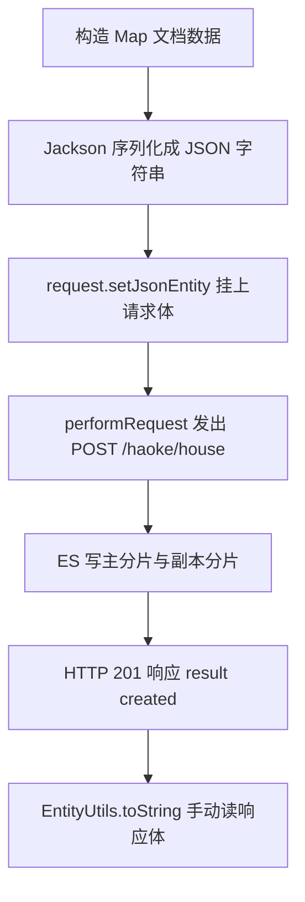

图里最费手工的环节是 B 和 G 两头：写入前手动序列化，读响应时手动转字符串。这两头正是高级客户端要替你省掉的。

### 三、高级客户端登场：同一个新增换种写法

低级客户端能用，但每个请求都要自己拼 endpoint、自己序列化、自己解析。高级客户端在它之上做了一层对象化封装，
依赖换成一个新坐标（版本依旧与集群的 6.5.4 对齐）：

```xml
<dependency>
    <groupId>org.elasticsearch.client</groupId>
    <artifactId>elasticsearch-rest-high-level-client</artifactId>
    <version>6.5.4</version>
</dependency>
```

初始化时可以复用上一篇那套 builder，三个节点照旧注册进去，区别只在最后一步：先 build 出低级客户端，再把它包装成
高级客户端（新测试类名 `TestRestHighLevel`，包名沿用 `com.example.es`）：

```java
public class TestRestHighLevel {

    private RestHighLevelClient restHighLevelClient;

    @Before
    public void init() {
        RestClientBuilder restClientBuilder = RestClient.builder(
                new HttpHost("172.16.55.185", 9200, "http"),
                new HttpHost("172.16.55.185", 9201, "http"),
                new HttpHost("172.16.55.185", 9202, "http"));
        // 低级客户端 build 出来后，被高级客户端包在内部
        RestClient restClient = restClientBuilder.build();
        this.restHighLevelClient = new RestHighLevelClient(restClient);
    }

    @After
    public void close() throws IOException {
        this.restHighLevelClient.close();
    }
}
```

这段初始化透露了高级客户端的本质：它没有另起炉灶，内部包着的就是 `RestClient`，请求照样走 9200 的 HTTP 接口，
只是外面套了一层面向对象的皮。同步新增的完整写法：

```java
@Test
public void testSave() throws Exception {
    Map<String, Object> data = new HashMap<>();
    data.put("id", 2002);
    data.put("title", "南京东路 二室一厅");
    data.put("price", 4000);

    // IndexRequest 指定索引、类型，source 直接收 Map
    IndexRequest indexRequest = new IndexRequest("haoke", "house").source(data);
    IndexResponse response = this.restHighLevelClient.index(indexRequest, RequestOptions.DEFAULT);
    System.out.println("id -> " + response.getId());
    System.out.println("version -> " + response.getVersion());
    System.out.println("result -> " + response.getResult());
}
```

对照低级版本的五处变化一目了然：不用拼 endpoint 字符串了，`IndexRequest` 构造参数里直接传索引名与类型名；不用
Jackson 序列化了，`source()` 直接收 Map；不用解析响应了，拿回来的就是 `IndexResponse` 对象，`getId()` 给出自动
生成的文档 ID，`getVersion()` 给出版本号 1，`getResult()` 打出 `CREATED`，语义直白。`RequestOptions.DEFAULT`
是请求选项的默认实现，管的是请求头这类传输层细节，学习阶段默认值就够。head 里刷新，2002 这条南京东路的房源已经
躺在索引里，和低级客户端写进去的并存。

### 四、同步与异步：index 与 indexAsync

高级客户端的每个操作基本都有同步、异步两个版本，新增也不例外。异步版本多收一个 `ActionListener` 回调：

```java
@Test
public void testSaveAsync() throws Exception {
    Map<String, Object> data = new HashMap<>();
    data.put("id", 2003);
    data.put("title", "南京东路 最新房源 二室一厅");
    data.put("price", 3500);

    IndexRequest indexRequest = new IndexRequest("haoke", "house").source(data);
    this.restHighLevelClient.indexAsync(indexRequest, RequestOptions.DEFAULT,
            new ActionListener<IndexResponse>() {
                @Override
                public void onResponse(IndexResponse indexResponse) {
                    System.out.println("id -> " + indexResponse.getId());
                    System.out.println("result -> " + indexResponse.getResult());
                    System.out.println("shardInfo -> " + indexResponse.getShardInfo());
                }

                @Override
                public void onFailure(Exception e) {
                    System.out.println(e);
                }
            });
    System.out.println("OK");
    Thread.sleep(20000); // 测试环境等待异步回调跑完
}
```

请求一发出，方法立刻往下走，控制台先打出 `OK`，过一会儿才出现 `onResponse` 里那几行响应内容，这个打印顺序就是
异步最直接的证据。`onResponse` 收成功结果，连分片信息 `getShardInfo()` 都能拿到；`onFailure` 收失败原因。
结尾的 `Thread.sleep` 只在测试里有意义：主线程不等回调就退出，JVM 一关回调就丢了，生产代码里会有别的机制兜住
线程生命周期。换一条数据（编号 2004、租金 5600）再跑一次，依然是先 `OK` 后响应，行为完全可复现。

### 五、选型的现实答案

低级客户端讲到这里可以收了。它的定位很清楚：贴近 HTTP，适合理解协议、排查问题，或者做一层自己的封装；真拿到
项目里写业务，每条数据都要手拼请求手动解析，开发效率偏低。高级客户端把这层手工活包掉了，要在 REST 客户端里选，
选高级的。而项目里最终的路子是下一节的 Spring Data Elasticsearch，它连 `IndexRequest` 这种对象都帮你收进注解
和模板里，本课先把这个印象立住即可。

## 第11部分：高级客户端把删改查收进对象里：GetRequest、DeleteRequest、UpdateRequest 与 SearchRequest

高级客户端的新增在上一篇走通了，剩下的日常操作就四样：查单条、判存在、删、改、搜。这一篇把删除、更新、搜索一次
补齐，你会发现它有一套稳定的「三件套」规律：每个操作对应一个 Request 对象、一个 client 方法、一个 Response 对象，
认准这个规律，官方文档上再多的 API 也只是同一模式的排列组合。

### 一、按 ID 查询：顺带控制返回哪些字段

还是 `TestRestHighLevel` 这个测试类，客户端已在 `@Before` 里建好。第一个操作是按 ID 查询，它比上一篇的按 ID 查
多了一步：指定返回字段。

```java
@Test
public void testQuery() throws Exception {
    GetRequest getRequest = new GetRequest("haoke", "house", "j5vaGgBqiMwr19H-k63");

    // 结果只要 id 与 title 两个字段，排除项留空
    String[] includes = new String[]{"id", "title"};
    String[] excludes = new String[]{};
    getRequest.fetchSourceContext(new FetchSourceContext(true, includes, excludes));

    GetResponse getResponse = this.restHighLevelClient.get(getRequest, RequestOptions.DEFAULT);
    System.out.println(getResponse.getSourceAsString());
}
```

正常情况下这条文档会返回 `id`、`title`、`price` 三个字段，设置了 `includes` 之后响应里只剩 `id` 与 `title`。
这个能力对应 REST API 里的 `_source` 过滤：文档可能很大，业务只需要其中两三个字段时，传输与解析的量都降下来。
对比低级客户端拿到一大坨 JSON 字符串再反序列化的做法，这里直接拿 `GetResponse` 对象，要字段取字段，方便不止一点。

### 二、判断存在：exists 只回答有还是没有

判断一个文档存不存在，没必要把字段搬回来，`exists()` 就是为这个场景准备的：

```java
@Test
public void testExists() throws Exception {
    GetRequest getRequest = new GetRequest("haoke", "house", "jpuGgBqIMwr19HZE4A");
    // 不取回字段，只要存在性结论
    getRequest.fetchSourceContext(new FetchSourceContext(false));
    boolean exists = this.restHighLevelClient.exists(getRequest, RequestOptions.DEFAULT);
    System.out.println("exists -> " + exists);
}
```

请求对象还是 `GetRequest`，只是 `FetchSourceContext` 的第一个参数传了 `false`，意思是连 source 都不要。真实存在的
文档打印 `exists -> true`；随手把 ID 改一位再跑，打印 `exists -> false`。一个 boolean 换一次网络往返，比查回整个
文档再自己判空干净得多。

### 三、删除：状态码告诉你删没删掉

删除的 Request 对象是 `DeleteRequest`，构造参数与查询一样是索引、类型、文档 ID 三件：

```java
@Test
public void testDelete() throws Exception {
    DeleteRequest deleteRequest = new DeleteRequest("haoke", "house", "jpuGgBqIMwr19HZE4A");
    DeleteResponse response = this.restHighLevelClient.delete(deleteRequest, RequestOptions.DEFAULT);
    System.out.println("status -> " + response.status());
}
```

先拿一个不存在的 ID 试：响应状态打出 `NOT_FOUND`，程序没有抛异常，删除动作本身是成功的，只是目标文档找不到。
换成真实存在的文档 ID 再执行，状态打出 `OK`，回到 head 里刷新，那条数据已经消失。这个状态值很有用：删除完成后
可以根据它是 `OK` 还是 `NOT_FOUND` 决定下一步动作，比如记录删除日志、判断是否需要重试，不需要再发一次 exists
查询去确认。

### 四、更新：局部更新只动传了的字段

更新用 `UpdateRequest`，把要改的字段装进 Map 交给 `doc()`：

```java
@Test
public void testUpdate() throws Exception {
    UpdateRequest updateRequest = new UpdateRequest("haoke", "house", "j5vaGgBqiMwr19H-k63");

    // 只传要修改的字段，就是局部更新
    Map<String, Object> data = new HashMap<>();
    data.put("title", "南京西路2 一室一厅2");
    data.put("price", "4000");
    updateRequest.doc(data);

    UpdateResponse response = this.restHighLevelClient.update(updateRequest, RequestOptions.DEFAULT);
    System.out.println("version -> " + response.getVersion());
}
```

执行完 `version` 打出 2，说明文档被改写了一版。head 里看这条数据：标题变成「南京西路2 一室一厅2」，价格变成
4000。有个细节要盯住：这次请求里没有传 `id` 字段，可文档里原来的 2001 还好好地待着。这就是局部更新，对照前面
讲 REST API 时的结论完全一致，底层 Lucene 的文档一旦写入不可修改，所谓更新是拿旧文档合并新字段后整篇覆盖写回，
版本号加一。所以只传变化的部分即可，其余字段不会丢；反过来，如果你走的是 `index()` 全量写入却只传了两个字段，
没传的字段就真丢了，两条路径的语义差别要分清。

### 五、搜索：SearchSourceBuilder 把查询条件对象化

搜索是这一篇里最「重」的一个操作，条件不再手拼 JSON 字符串，而是用 builder 逐步装配：

```java
@Test
public void testSearch() throws Exception {
    SearchRequest searchRequest = new SearchRequest("haoke");
    searchRequest.types("house");

    // 查询条件在 SearchSourceBuilder 上装配
    SearchSourceBuilder sourceBuilder = new SearchSourceBuilder();
    sourceBuilder.query(QueryBuilders.matchQuery("title", "拎包入住"));
    sourceBuilder.from(0);
    sourceBuilder.size(5);
    sourceBuilder.timeout(new TimeValue(60, TimeUnit.SECONDS));
    searchRequest.source(sourceBuilder);

    SearchResponse searchResponse = this.restHighLevelClient.search(searchRequest, RequestOptions.DEFAULT);
    System.out.println("total -> " + searchResponse.getHits().getTotalHits());
    for (SearchHit hit : searchResponse.getHits().getHits()) {
        System.out.println(hit.getSourceAsString());
    }
}
```

逐段对应之前的 REST API 写法：`QueryBuilders.matchQuery("title", "拎包入住")` 等价于请求体里的
`{"match": {"title": "拎包入住"}}`，当时是 JSON 表达，现在是 Java API 表达，语义一个字没变；`from(0)` 加
`size(5)` 是分页，跳过 0 条取 5 条；`timeout` 给这次搜索限定 60 秒，防止慢查询拖住调用方。响应里 `total` 打出 4，
循环打印出四条命中文档的 source 字符串，标题都含「拎包入住」，与低级客户端搜出的结果完全一致。

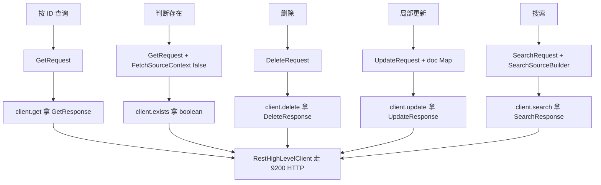

这张图把五个操作压成一张规律表：左边是业务动作，中间是请求对象，右边是 client 方法与响应对象，所有请求最终汇入
同一个 `RestHighLevelClient`。记住「动作、Request、方法、Response」四列对齐，高级客户端就算入门了。

## 常见误区

- **以为 `node.master: true` 的节点就是 master。** 它只是候选人，真正的主由选举产生且全集群只有一个；
  候选节点挂掉不等于集群没了主，只要多数派还在就能选出新主。
- **副本数随便配。** 副本必须与主分片错开节点，data 节点不够时副本分不下去，索引卡在 yellow；
  单节点集群配副本只会在监控里报警，没有任何容灾收益。
- **所有环境的集群名都用默认值。** 默认 `cluster.name` 是 elasticsearch，开发与生产节点接到同一网段时
  会意外抱成一个集群，数据互相乱窜。每套环境起独立集群名，是上线前的必查项。
- **以为客户端节点是必需品。** 小集群里每个节点都能兼任协调，专用客户端节点是负载大了之后的拆分手段；
  一上来就配一堆「纯转发」节点，反而浪费机器。
- **以为少了 `-p` 映射是漏配。** host 网络模式下端口在 `elasticsearch.yml` 的 `http.port` 里区分，
  再写 `-p` 多余且与 host 模式语义冲突。多节点单机部署，先想清楚网络模式再动手。
- **data 目录交给 Docker 自动创建。** 自动创建的目录属主是 root，容器内 ES 是普通用户，必报
  `AccessDeniedException`。先建目录授好权限，或者启动失败后按日志补救。
- **忘停旧的单机 ES。** 之前实验装的单节点占着 9200，新集群的 node01 起不来，报错又指向端口，
  顺着端口排查能省很多时间。
- **JVM 堆保持默认 1G。** 一台机器两个节点就是 2G 堆外加堆外内存，小机器直接卡死。实验环境 512m
  甚至 256m 都够用。
- **分片越多越好。** 每个分片都是一个 Lucene 实例，吃内存吃文件句柄，分片过多会让集群被元数据与
  段合并拖垮。按单分片数据量适中（经验值几十 GB 内）倒推分片数，而不是拍脑袋填大数。
- **副本可以写。** 写只走主分片，副本只读。试图写副本的请求要么被路由回主分片，要么报错，
  取决于客户端行为。
- **主分片数不够用，改个配置就行。** 主分片数建完不可改，只能重建索引或用别名切换迁移；
  容量规划要放在建索引之前。
- **副本数不受限制。** 副本必须与主分片错开节点，data 节点数不够时副本永远分配不出去，
  索引健康值会一直卡在 yellow。
- **复制目录带着旧 data 扩容。** 复制来的 data 里存着原节点的集群状态，新节点带着它入群会与真实
  数据冲突，表现为分片错乱或节点无法加入。复制目录后必须清空 data。
- **三节点了，`minimum_master_nodes` 还是 1。** 1 票即可当选，网络分区时两派人马各自选主，
  脑裂由此而来。按「候选节点数 / 2 + 1」设置，三节点应为 2。
- **以为 master 一定是 node01。** master 由选举产生，与编号无关，先启动且有资格者先上位。
  做宕机实验前先到 head 里认星标，别照抄别人的操作对象。
- **新节点起不来就反复重启。** 三节点环境下新节点的 data 目录同样会因 root 属主报
  `AccessDeniedException`，先看日志改权限，盲目重启解决不了权限问题。
- **一见 yellow 就慌。** yellow 只是有副本没分配出去，主分片完好，读写照常。多数情况等几秒到几十秒
  集群自己就补齐了，先看缺的是主分片还是副本再行动。
- **副本数越大越安全。** 副本必须错开主分片所在节点，节点数不够时副本永远分配不出去，实验里
  2 副本卡在 yellow 就是例证。副本数受 data 节点数约束，宁少勿空。
- **以为 master 挂了就写不进数据。** 文档读写不依赖 master，只有集群级操作需要主。master 宕机期间
  业务写入照常，前提是目标主分片还活着。
- **以为重启旧 master 一定自动回群。** 多数派配置缺失时，失联过的节点可能自立为另一个集群；
  生产环境把 `minimum_master_nodes` 配成多数派（新版本已内置多数派选主）才能杜绝。
- **把 `minimum_master_nodes` 设为 1 图省事。** 这正是脑裂的成因配置，任何一台失联过的旧 master 回归都可能
  自立门户。候选节点有几个，就按公式算出多数派值，三节点集群就是 2。
- **拿 data 节点数量当计算基数。** 公式的分子是 master 候选节点总数，即配置了 `node.master: true` 的节点数，
  与承担数据的节点数是两个概念。
- **只改了一台节点的配置。** 三台里漏改一台，那台重启后按旧值参与选举，脑裂防线出现缺口，必须全部一致。
- **以为 master 挂了数据就没了。** master 只负责集群管理，分片数据在各节点都有副本，master 宕机期间读写基本
  不受影响，受影响的只是建删索引这类集群级操作。
- **建完索引想加主分片。** 主分片数在路由公式里当除数，创建后不可修改，想扩只能新建索引重新灌数据；
  副本数倒是随时可调，扩读能力加副本，扩容量要提前规划主分片。
- **以为写成功只是主分片成功。** 客户端收到成功响应时，修改已同步到全部副本；反过来说，任何一个副本没确认，
  客户端都拿不到成功响应，写是同步复制。
- **写入成功后立刻读却偶发查不到。** 读请求轮询到了尚未同步完的那份副本，属于边界窗口；保证写成功后再读，
  或在业务上接受短暂不一致。
- **以为全文搜索每台机器都返回完整文档。** query 阶段各分片只回文档 ID 与得分，完整内容在 fetch 阶段按需取回，
  第一阶段就搬全量文档纯属浪费网络。
- **新项目继续用 TransportClient。** 它依赖 9300 端口与服务端内部协议，版本耦合深，官方已废弃；新项目一律走
  REST 客户端。
- **以为低级客户端会自动解析响应。** 它只负责传输，响应体是原始 JSON，要自己借助 Jackson 之类的工具反序列化
  成对象。
- **把 bulk 请求体当普通 JSON 数组发。** 它是 NDJSON，动作行与文档行交替出现，不是 `[{...}, {...}]` 的数组，
  末行还要以换行收尾。
- **高级客户端版本随手乱选。** 版本与服务端差得远，接口签名或序列化对不上，往往编译能过、运行期才炸；
  客户端版本与服务端大版本保持一致最稳。
- **只注册一个节点地址。** 单节点地址一挂整个客户端不可用；把集群节点都传给 builder，故障转移才是默认行为。
- **用完不关闭客户端。** 底层连接池不释放，测试代码连跑几次就开始堆积连接；按应用生命周期管理创建与关闭。
- **以为响应会自动变成对象。** 低级客户端拿到的是 `HttpEntity`，必须 `EntityUtils.toString` 转字符串再交给
  Jackson 反序列化，它不做任何自动映射。
- **客户端版本与服务端乱配。** 低级客户端兼容面虽宽，仍应与服务端大版本对齐，避免参数与行为上的差异。
- **把 Map 直接塞给 `setJsonEntity()`。** 低级客户端只认字符串形式的 JSON，Map 必须先经 Jackson 序列化；忘了这一步
  编译期不报错，运行时类型不符。
- **把业务字段 `id` 当成文档 `_id`。** 不带文档 ID 的 POST 请求，`_id` 由 ES 自动生成，数据里的 `id` 只是普通字段。
  想自己定 `_id`，按 REST 语义把 ID 拼进 endpoint 再用 PUT 提交。
- **看到 200 就以为新增成功。** 新增成功的标志是 201 与 `result: created`；对已存在的 `_id` 重复写入会变成覆盖，
  `result` 变成 `updated`，版本号递增。
- **异步调用后主线程直接退出。** 回调还没执行 JVM 就关闭了，表现为「程序跑完了但没有任何输出」，测试里要给回调
  留时间，工程里靠线程池或容器生命周期兜底。
- **把 `exists()` 当普通查询用。** 存在性判断只该要 boolean，忘了 `FetchSourceContext(false)` 会把字段也搬回来，
  白费带宽；真要字段就老老实实用 `get()`。
- **删除不存在的文档当异常处理。** `delete()` 不抛异常，返回状态 `NOT_FOUND`，按状态分支处理才是正确姿势。
- **以为 `update()` 是整篇替换。** `doc()` 是局部更新，未传字段保留；`index()` 全量覆盖才是「传什么存什么」。
  该用哪个取决于业务语义，别混。
- **构造好 `SearchSourceBuilder` 忘了 `searchRequest.source(sourceBuilder)`。** 条件装配完必须挂回请求对象，
  否则发出去的是没有查询体的空搜索。

## 面试可能被问到的问题

1. 面试官追问：「Elasticsearch 集群有哪几种节点类型，各自负责什么？」
   答：master 节点负责集群级操作（建删索引、分片分配、拓扑管理）；data 节点存分片并执行文档读写；
   客户端节点（新版本的专用协调节点）不存数据不参与选举，专职转发请求与汇总结果；部落节点可连接
   多个集群联合查询，新版本由跨集群搜索取代，另有 ingest 节点负责写入前的预处理管道。
2. 面试官追问：「master 是怎么产生的，脑裂是怎么回事？」
   答：配置 `node.master: true` 的节点都是候选节点，集群通过选举产生唯一活跃 master。
   网络分区时旧主与新选主并存就是脑裂，会导致索引状态冲突。老版本靠 `minimum_master_nodes` 多数派
   配置预防，要求候选节点数为奇数；新版本用基于多数派的选主机制从协议层面规避。
3. 面试官追问：「副本数和 data 节点数是什么关系？」
   答：副本分片必须分配在与主分片不同的 data 节点上，所以副本数上限受 data 节点数约束；
   节点数不足时副本无法分配，索引健康度为 yellow。容量规划时按「单节点宕机后副本仍在」倒推节点数。
4. 面试官追问：「协调节点是什么，每个节点都能做协调吗？」
   答：协调是接收请求、路由到分片、合并结果的职责，新版本默认所有节点都承担；把 master 与 data
   都关闭的节点是专职协调节点，用来在大集群里隔离请求层压力，对应老版本的客户端节点。
5. 面试官追问：「ingest 节点是干什么的？」
   答：它在文档写入索引前执行 ingest pipeline，做字段清洗、格式转换、富化等预处理，
   相当于写入侧的数据加工流水线，适合把原来放在应用层的清洗逻辑下沉到 ES。
6. 面试官追问：「部落节点听说过吗？现在还用吗？」
   答：它是一种可同时连接多个集群、联合执行搜索的特殊客户端节点，实际使用很少；
   新版本提供了跨集群搜索（CCS）来承担多集群联合查询，配置与稳定性都更好。
7. 面试官追问：「一台机器上跑两个 ES 节点，端口怎么规划？」
   答：host 网络模式下靠配置区分：HTTP 端口分别绑 9200 与 9201，节点间通信的 transport 端口默认
   从 9300 起自动顺延。若用 bridge 模式则用 `-p` 把两个容器的 9200 分别映射到宿主机不同端口，
   但多一层 NAT，集群场景更常用 host 模式。
8. 面试官追问：「`discovery.zen.ping.unicast.hosts` 是干什么的？」
   答：单播发现名单。节点启动后按这份名单逐个发探测请求，应答里带着集群名与集群状态，
   集群名一致就加入。多机部署时把名单填成几个稳定节点的地址即可，不必列全所有节点。
9. 面试官追问：「容器里的 ES 一启动就报 AccessDeniedException，怎么排查？」
   答：先看报错路径对应哪个挂载，通常是 data 目录。Docker 自动创建的宿主机目录属主是 root，
   而容器内 ES 以非 root 用户运行，没有写权限。把目录属主改成 ES 用户的 uid，或实验环境
   `chmod -R 777` 放开后重启容器。
10. 面试官追问：「集群健康值的三个颜色分别代表什么？」
   答：green 表示主分片与副本分片全部可用；yellow 表示主分片完整但有副本未分配，读写不受影响；
   red 表示存在不可用的主分片，对应数据无法读写，需要立即处理。
11. 面试官追问：「head 里粗框细框分别是什么？」
   答：粗框是主分片，细框是它的副本。ES 保证主副本不会落在同一节点上，看框的分布就能判断容灾是否
   成立：任一节点上的主分片，在其他节点都能找到对应副本。
12. 面试官追问：「索引和分片是什么关系？」
   答：索引是逻辑命名空间，指向一个或多个分片；分片是物理存储与计算的最小单元，每个分片是一个
   完整的 Lucene 实例。应用只与索引交互，分片的分配与路由由集群内部完成。
13. 面试官追问：「为什么主分片数建索引之后不能改？」
   答：文档归属由 `hash(routing) % 主分片数` 决定，改主分片数会改变所有文档的归属，存量数据无法
   继续定位。要调整只能重建索引、迁移数据，所以主分片数在建索引前就要按数据量规划好。
14. 面试官追问：「副本分片有什么用？」
   答：一是容灾，主分片所在节点故障时副本在别的节点上兜底，并可被提升为主分片；二是分担读压力，
   搜索请求可以在主副本上任选执行。写请求只走主分片，由主分片同步给副本。
15. 面试官追问：「一条文档是怎么落到具体分片上的？」
   答：写请求先到协调节点，协调节点按 `hash(routing) % 主分片数` 算出目标主分片，转发到该分片
   所在节点写入，再同步到它的全部副本，最后返回结果。
16. 面试官追问：「副本数怎么动态调整，什么时候用？」
   答：通过更新索引 settings 里的 `number_of_replicas` 即时生效，不用重启不用重建。读流量突增时
   临时加副本摊薄查询压力，节点缩容时减副本避免分配不出去。
17. 面试官追问：「为什么 ES 集群推荐三个节点起步？」
   答：master 选举依赖多数派。三节点集群挂掉一台，剩余两台仍占多数，既能选出新主又能放得下副本；
   两节点集群候选不足、无法形成多数派，故障转移无从谈起。
18. 面试官追问：「`node.master: true` 和 `minimum_master_nodes` 分别管什么？」
   答：前者决定节点有没有被选举权，是候选资格；后者决定一次选举需要多少候选节点投票才算数，
   取「候选节点数 / 2 + 1」可以保证只有多数派能选出主，防止网络分区时出现两个 master。
19. 面试官追问：「复制已有节点的目录快速扩容，要注意什么？」
   答：改掉 `node.name` 与端口，让节点有独立身份；清空 data 目录，避免携带原节点的集群状态与
   分片数据入群；确认新目录权限对容器内 ES 用户可写。
20. 面试官追问：「新节点加入集群后，分片会自动重新分布吗？」
   答：会。master 负责分片分配，节点加入后集群自动做均衡，把部分分片迁到新节点，无需手工干预；
   数据量大时迁移过程会持续一段时间，期间不影响读写。
21. 面试官追问：「怎么确认当前集群里谁是 master？」
   答：head 界面上 master 节点名旁有星标；命令行可以查 `GET /_cat/master` 或任一节点的
   `GET /_nodes`，从返回里直接读出 master 的节点名。做节点宕机实验前必须先确认这一点。
22. 面试官追问：「data 节点宕机后集群会发生什么？」
   答：该节点上的分片暂时失联，集群转 yellow（若主分片在该节点上则相关分片由副本顶上）；
   master 等待节点回归，超时后把它移出分配计划，把缺失的副本在存活节点间补齐，回到 green，
   全程数据不丢，前提是每个主分片都有健康的副本。
23. 面试官追问：「master 宕机会影响业务读写吗？」
   答：文档读写不经过 master，只要目标主分片在岗就照常进行；受影响的是建删索引等集群级操作。
   幸存的候选节点会重新选出新 master，期间集群状态短暂波动后恢复。
24. 面试官追问：「什么是脑裂，怎么预防？」
   答：网络分区时集群裂成两半，各自选出 master，索引分配互相冲突。老版本通过
   `minimum_master_nodes` 设为候选节点数的一半加一预防，保证只有多数派能选出主；
   新版本把基于多数派的选主做进了协议，从机制上消除脑裂。
25. 面试官追问：「副本数设 2 的集群，两节点宕机一台后为什么一直是 yellow？」
   答：副本必须与主分片错开节点，剩两个节点时每个主分片最多放得下一份副本，第二份无处分配。
   要么等节点回归，要么临时把副本数调成 1，状态即可回 green。
26. 面试官追问：「宕机节点恢复后会怎样？」
   答：若它离开时间短、集群状态没走远，会带着本地数据回群，master 只补增量，恢复很快；
   若它已被移出分配计划，回群后按空节点重新分配分片。极端情况（如 `minimum_master_nodes` 为 1
   时失联的旧 master）可能自立集群，需要人工介入。
27. 面试官追问：「故障转移期间数据会丢吗？」
   答：已成功写入的文档不丢，每个主分片都有副本在别的节点上；宕机瞬间正在写入、尚未同步到副本的
   请求会失败，由客户端重试补偿。只有主分片与其全部副本同时损坏，对应数据才真正丢失。
28. 面试官追问：「什么是脑裂，它是怎么发生的？」
   答：集群分裂成两个、各自选出 master 的现象。典型过程是 master 宕机后幸存节点选出新主，旧 master 恢复时
   因选举门槛过低（如 `minimum_master_nodes` 为 1），凭自己一票也当选，于是双主并存，分片分配与集群状态
   互相冲突。
29. 面试官追问：「`minimum_master_nodes` 怎么设置？」
   答：官方公式是 master 候选节点总数除以 2 加 1，向下取整。三节点集群设为 2，含义是至少过半节点认可才能当选，
   保证任何两个多数派必有交集，失联的旧节点凑不出多数票，只能加入现有集群。
30. 面试官追问：「为什么是过半，要求全票不是更安全吗？」
   答：全票要求所有候选节点在线，一台宕机集群就选不出主，可用性太差。过半既保证不可能选出两个主，
   又容忍少数节点故障，是一致性与可用性的折中，也是分布式系统选主的通用原则。
31. 面试官追问：「双主并存的直接危害是什么？」
   答：两个 master 各自维护集群状态并分配分片，同一索引的分片分配互相冲突，数据写入与元数据变更各自为政，
   事后合并会出现数据覆盖或丢失，恢复成本很高，所以防脑裂是集群规划的第一课。
32. 面试官追问：「新版 Elasticsearch 还需要配这个参数吗？」
   答：7.0 起该参数被移除，选主改为内置的基于多数派的投票协议，集群自动维护投票配置，多数派由协议保证，
   不再人工设置。理解老参数的原理依然必要，它是理解新版选主机制的基础。
33. 面试官追问：「Elasticsearch 如何决定文档存在哪个分片上？」
   答：按公式 `shard = hash(routing) % number_of_primary_shards` 计算，routing 默认是文档 `_id`，也可以自定义。
   写入与读取使用同一公式，结果一致，因此不需要维护文档与节点的映射表。
34. 面试官追问：「为什么主分片数创建之后不能修改？」
   答：主分片数是路由公式的除数，修改后所有文档计算出的分片号全部改变，已存数据将无法定位。Redis 集群可以
   通过槽迁移挪数据，Elasticsearch 没有等价的数据转移机制，所以主分片数固定，扩容要靠提前规划。
35. 面试官追问：「描述一次文档写入的完整流程。」
   答：客户端把写请求发给任意节点（图例中为 master），该节点按路由公式算出目标主分片；若主分片不在本机，
   在节点内部转发过去；主分片写入后把变更同步给所有副本，副本全部确认后逐级返回，接收节点再响应客户端。
   收到成功响应时，主分片与所有副本均已生效。
36. 面试官追问：「读请求怎么做到负载均衡？」
   答：单文档检索可由主分片或任意副本应答，协调节点在这些拷贝间轮询转发，把读压力摊到所有分片副本上；
   每次请求可能选到不同的拷贝，实现循环均摊。
37. 面试官追问：「写入成功后立刻读，一定能读到吗？」
   答：大概率能，但存在边界窗口：文档已落主分片、尚未同步到某副本时，读请求恰好轮询到该副本，会报告文档
   未找到。一旦索引请求成功返回，文档在主副本上都可用；应用层先确认写成功再读即可规避。
38. 面试官追问：「全文搜索为什么分 query 和 fetch 两个阶段？」
   答：命中文档分散在各节点，query 阶段让每个分片本地查询、只返回文档 ID 与得分，协调节点汇总后全局排序；
   fetch 阶段只对最终入选的 from 到 from+size 条文档发 GET 取回完整内容。这样网络传输量与结果集规模成正比，
   而不是与索引规模成正比。
39. 面试官追问：「Elasticsearch 的 Java 客户端有哪些，各自现状如何？」
   答：两大类。Java API 客户端即 TransportClient，走 9300 端口，官方已标记废弃；REST 客户端走 9200 的 HTTP
   接口，分低级与高级两种，是现在的主流，高级客户端构建在低级客户端之上。
40. 面试官追问：「低级 REST 客户端这么原始，为什么还保留？」
   答：它只封装 HTTP 传输，不绑服务端内部实现，因此能兼容所有 Elasticsearch 版本，服务端升级时客户端代码
   基本不用动。轻度使用或对升级成本敏感的场景，低级客户端反而更省心。
41. 面试官追问：「低级和高级 REST 客户端怎么选？」
   答：看场景。轻度使用、在意升级无痛选低级；正式业务开发追求开发效率选高级，它把请求构建与响应解析都
   对象化了，代价是版本必须与服务端对齐，升级时可能要跟着调整。
42. 面试官追问：「bulk 批量导入的请求体格式有什么讲究？」
   答：NDJSON 格式，一行动作元数据（index、delete 等）紧跟一行文档内容，循环交替；每个动作行必须以换行结尾，
   包括最后一行。用成 JSON 数组或漏掉末行换行都会解析失败。
43. 面试官追问：「TransportClient 为什么被废弃？」
   答：它连接 9300 端口，依赖节点间通信协议，服务端内部实现一变客户端就得跟着升，版本耦合深；REST 客户端
   基于公开稳定的 HTTP 接口，解耦干净，官方因此把方向整体转向了 REST 客户端。
44. 面试官追问：「RestClient 和 TransportClient 的本质区别？」
   答：RestClient 走 9200 的 HTTP 接口，不依赖服务端内部实现，跨版本兼容；TransportClient 走 9300 的内部
   协议，与服务端版本强耦合，已被官方废弃。新项目一律选 REST 客户端。
45. 面试官追问：「低级 REST 客户端怎么实现多节点容错？」
   答：builder 构建时传入多个 HttpHost，客户端内部对节点做轮询分发；请求失败时 FailureListener 的 onFailure
   回调能感知故障节点，后续请求自动落到其他节点，容错是客户端层完成的。
46. 面试官追问：「performRequest 的返回值是什么，怎么取响应体？」
   答：返回 Response 对象，`getStatusLine` 拿 HTTP 状态行，`getEntity` 拿响应实体；实体是 HttpEntity，
   用 `EntityUtils.toString` 转成字符串，再按需用 Jackson 反序列化成对象。
47. 面试官追问：「RestClient 的生命周期应该怎么管理？」
   答：与应用保持一致：应用启动时创建，关闭时调用 close 释放连接池。Spring 环境把它注册成单例 Bean，随容器
   创建销毁；测试环境用 `@Before` 与 `@After` 模拟同一对时机。
48. 面试官追问：「为什么要先学低级客户端，直接用高级的不行吗？」
   答：低级客户端把 HTTP 细节全部暴露，能看清一次 ES 请求的完整构成：方法、endpoint、参数、响应体；它又是
   高级客户端的底层组件，理解它之后再看高级客户端的封装，边界与成本都清清楚楚。
49. 面试官追问：「低级 REST 客户端和高级 REST 客户端是什么关系？」
   答：高级客户端内部包着低级客户端的 RestClient，请求同样走 9200 的 HTTP 接口。低级版只封装连接池、节点轮询、
   失败转移这些传输层能力，请求与响应都是原始 HTTP；高级版在其上做对象化封装，Request 与 Response 都有对应类，
   序列化与解析都不用自己写。
50. 面试官追问：「低级客户端新增一条文档要哪几步？」
   答：构造 `Request("POST", "/索引/类型")`，把文档对象用 Jackson 序列化成 JSON 字符串后 `setJsonEntity` 挂上
   请求体，`performRequest` 发出请求，再用 `EntityUtils.toString` 读响应体。新增成功返回 201，响应里带自动生成的
   `_id` 与分片写入情况。
51. 面试官追问：「`index()` 的同步和异步用法差在哪？」
   答：参数上前两者相同，都是 IndexRequest 与 RequestOptions，异步版多一个 ActionListener。同步版线程阻塞到拿到
   IndexResponse；异步版立刻返回，成功走 `onResponse`，失败走 `onFailure`，适合高并发下不占业务线程的场景。
52. 面试官追问：「`RequestOptions.DEFAULT` 是干什么的？」
   答：RequestOptions 承载与具体操作无关的传输层选项，比如自定义请求头、身份认证信息。DEFAULT 是它的默认单例，
   学习与常规场景直接用；接入安全认证时才需要构建自己的实例并在整个应用内复用。
53. 面试官追问：「为什么项目里不建议直接用低级客户端写业务？」
   答：它偏向底层，每个请求都要手拼 endpoint、手动序列化请求体、手动解析响应字符串，开发效率低、样板代码多。
   它的价值在理解协议与做底层封装，业务层应选高级客户端或 Spring Data Elasticsearch 这类更高层的整合。
54. 面试官追问：「高级客户端怎么做到按需返回文档字段？」
   答：给 GetRequest 设置 `FetchSourceContext`，构造参数第一个是是否取 source，后两个是包含与排除的字段数组。
   它最终对应 REST API 的 `_source` 过滤，传输与解析量都能省下来。
55. 面试官追问：「删除一个不存在的文档会发生什么？」
   答：不会抛异常，DeleteResponse 的状态是 `NOT_FOUND`；删除成功则是 `OK`。业务上应该按状态做分支判断，
   而不是用 try-catch。
56. 面试官追问：「UpdateRequest 的 doc 和用 index 全量写入有什么区别？」
   答：doc 是局部更新，只修改传入字段，其余字段保留，ES 在内部做旧文档与新字段的合并后再覆盖写回，版本号加一。
   index 是全量写入，source 里没传的字段会丢。底层 Lucene 文档不可原处修改，两者本质都是覆盖写，差别只在合并的
   由谁来做。
57. 面试官追问：「SearchSourceBuilder 能设置哪些常用条件？」
   答：query 里通过 QueryBuilders 构建 match、term、bool 等查询；from 与 size 做分页；timeout 限制本次搜索耗时；
   排序、高亮、聚合也都在这个 builder 上设置，它是高级客户端搜索的装配中心。
58. 面试官追问：「搜出来的结果怎么解析？」
   答：从 SearchResponse 的 `getHits()` 入手，`getTotalHits()` 拿命中总数，`getHits()` 数组里每个 SearchHit 用
   `getSourceAsString()` 取原始 JSON，或直接映射成实体对象；分页、聚合信息也都挂在 SearchResponse 上。

## 配套资料

- 本课无配套源码包：`materials/code/03/day14-ElasticStack学习之Elasticsearch进阶/` 下仅有解压清单
  `_extracted.json`（记录解压文件数为 0）。文中的 `elasticsearch.yml` 配置片段按本课课件写法补全
  （集群名按本阶段项目语义改写），节点角色与 Docker 搭建集群的完整步骤在下一节继续。
- 本课无配套源码包：`materials/code/03/day14-ElasticStack学习之Elasticsearch进阶/` 下仅有解压清单
  `_extracted.json`（记录解压文件数为 0）。文中配置与 Docker 命令按本课画面与课件写法整理，集群名
  沿用上一节的 `es-haoke-cluster`；目录路径、`chmod 777`、堆参数取值等为按本课写法补全的可运行示例。
- 本课无配套源码包：`materials/code/03/day14-ElasticStack学习之Elasticsearch进阶/` 下仅有解压清单
  `_extracted.json`（记录解压文件数为 0）。分片与副本的概念、主分片数不可改的原因按本课讲解整理；
  两段 REST 示例为按本课写法补全的可运行请求（与 head 界面新建索引、修改副本数的操作等价）。
- 本课无配套源码包：`materials/code/03/day14-ElasticStack学习之Elasticsearch进阶/` 下仅有解压清单
  `_extracted.json`（记录解压文件数为 0）。文中命令与配置按本课画面与课件写法整理（三节点目录、
  `node.master` 全开、复制清 data 的步骤）；具体路径与 `chmod` 取值为按本课写法补全的可运行示例。
- 本课无配套源码包：`materials/code/03/day14-ElasticStack学习之Elasticsearch进阶/` 下仅有解压清单
  `_extracted.json`（记录解压文件数为 0）。两次宕机实验的步骤、状态流转与脑裂现象按本课演示与
  课件记录整理；文中的命令、表格与 mermaid 图为按本课写法补全的示例，便于对照复现。
- 本课无配套源码包：`materials/code/03/day14-ElasticStack学习之Elasticsearch进阶/` 下仅有解压清单
  `_extracted.json`（记录解压文件数为 0）。脑裂成因、多数派公式与验证实验的步骤均按本课演示与课件记录整理；
  文中的配置片段、命令与 mermaid 图为按本课写法补全的示例，便于对照复现。
- 本课无配套源码包：`materials/code/03/day14-ElasticStack学习之Elasticsearch进阶/` 下仅有解压清单
  `_extracted.json`（解压文件数为 0）。路由、写操作、单文档检索与全文搜索的讲解顺序与图示对应课件
  2.5.1 路由、2.5.2 文档的写操作、2.5.3 搜索文档（单个文档）、2.5.4 全文搜索四个小节；文中的 curl 与
  搜索请求示例、时序图为按本课写法补全，便于对照理解。
- 本课无配套源码包：`materials/code/03/day14-ElasticStack学习之Elasticsearch进阶/` 下仅有解压清单
  `_extracted.json`（解压文件数为 0）。客户端分类与 bulk 导入流程按本课演示与课件 3.2 构造数据小节整理；
  NDJSON 测试数据与 curl 命令为按本课写法补全的示例，可直接执行。
- 本课无配套源码包：`materials/code/03/day14-ElasticStack学习之Elasticsearch进阶/` 下仅有解压清单
  `_extracted.json`（解压文件数为 0）。工程搭建、依赖清单与查询集群状态的流程按本课演示写法整理，
  文中 pom 与测试类为按本课写法补全的可运行示例，原课程包名已改写为中性的 `com.example.es`。
- 本课无配套源码包：`materials/code/03/day14-ElasticStack学习之Elasticsearch进阶/` 下仅有解压清单
  `_extracted.json`（解压文件数为 0）。新增、查询、搜索与高级客户端的示例均按本课演示写法补全为可运行代码，
  原课程包名已改写为中性的 `com.example.es`；集群节点、索引名 `haoke` 与数据字段沿用本课演示环境。
- 本课无配套源码包：`materials/code/03/day14-ElasticStack学习之Elasticsearch进阶/` 下仅有解压清单
  `_extracted.json`（解压文件数为 0）。查询、存在判断、删除、更新、搜索五个示例均按本课演示写法补全为可运行代码，
  原课程包名已改写为中性的 `com.example.es`；文档 `_id` 取自本课示例环境的新增结果。
