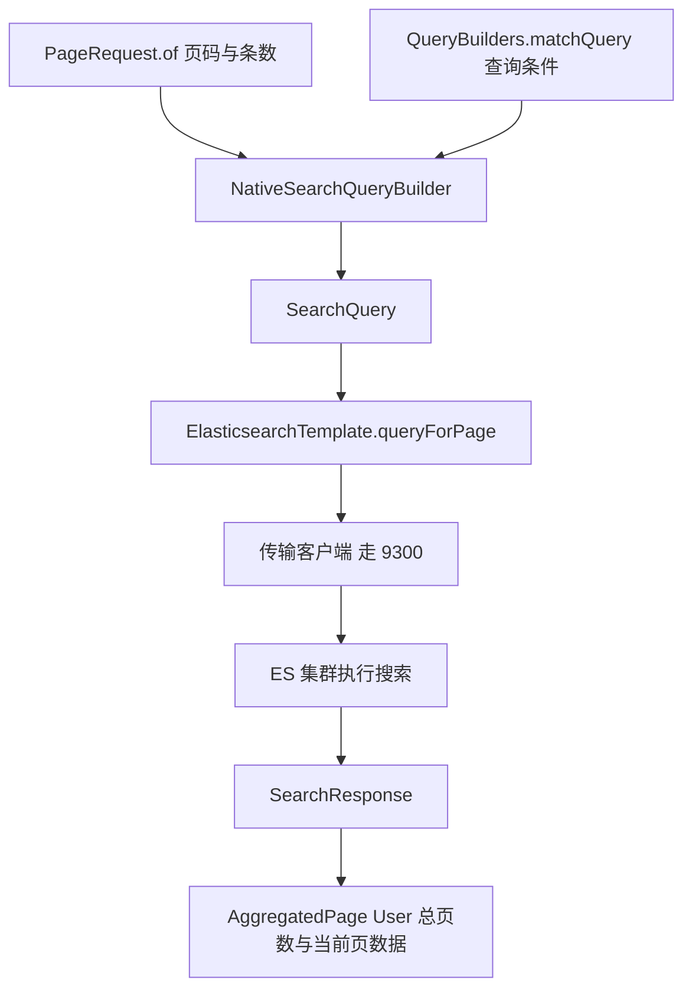

# Spring Data Elasticsearch 的日常四件套：批量写入、局部更新、按 ID 删除与分页搜索

工程搭好、新增跑通之后，剩下的是日常维护动作：数据量大时怎么批量灌、字段变了怎么改、脏数据怎么删、怎么按条件
分页搜。这一篇把模板的四个操作一次走完，也是 Elasticsearch 进阶这条线的收尾：走完之后你会看到，模板把原生 API
的对象模型又包了一层，而它之上还有 Repository 这条更省代码的路线，项目里最终落在哪，看完就有答案。

## 先给结论

- 批量写入用 `bulkIndex(list)`：5000 条实体各自包成 `IndexQuery` 丢进 List，一次调用全部写入，实测 8 秒左右。
- 局部更新用 `update(UpdateQuery)`：`IndexRequest.source("age", "30")` 只带要改的字段，其余字段原样保留。
- 删除用 `delete(User.class, "1001")`，按 ID 直接删，删完再查 `found` 为 `false`。
- 分页搜索用 `queryForPage(SearchQuery, User.class)`：`NativeSearchQueryBuilder` 装配 match 查询与分页参数，
  返回 `AggregatedPage`，总页数、当前页数据直接取。
- 页码从 0 起算，`PageRequest.of(1, 10)` 是第二页；模板与 Repository 两条路线按灵活度取舍，项目选型更偏 Repository。

## 一、批量插入：bulkIndex 一次灌 5000 条

单条写入在上一节跑通了，但真实场景一次来一批，循环调单条 `index()` 的网络往返成本受不了，模板给了批量入口。
测试方法先构造数据，再一次性提交：

```java
@Test
public void testBulk() {
    List<IndexQuery> list = new ArrayList<>();
    for (int i = 0; i < 5000; i++) {
        User user = new User();
        user.setId(1001L + i);
        user.setAge((i % 50) + 10);
        user.setName("张三" + i);
        user.setHobby("足球、篮球、听音乐");
        IndexQuery indexQuery = new IndexQueryBuilder().withObject(user).build();
        list.add(indexQuery);
    }
    Long start = System.currentTimeMillis();
    this.elasticsearchTemplate.bulkIndex(list);
    System.out.println("用时：" + (System.currentTimeMillis() - start));
}
```

循环 5000 次，ID 从 1001 递增，年龄在 10 到 59 之间循环取值，名字带序号，构造好的 `IndexQuery` 全部装进同一个
List，最后 `bulkIndex(list)` 一次提交。计时输出大约 8802 毫秒，早前整理讲义时的记录是 7836 毫秒，量级一致，
5000 条 8 秒上下。head 里点开索引浏览数据，5000 个文档都在。这批数据有个副作用要留意：ID 1001 的文档被覆盖了，
单条新增时它年龄是 20，批量写入后变成了 10，同一个 `_id` 写入即覆盖，save-or-update 语义在批量下同样成立。

## 二、局部更新：UpdateQuery 只带变化字段

改数据是模板里的 `update(UpdateQuery)`，装配比写入多绕一层，因为它要同时说清「改哪条」和「改成什么」：

```java
@Test
public void testUpdate() {
    // 改动内容：只带要修改的字段
    IndexRequest indexRequest = new IndexRequest();
    indexRequest.source("age", "30");

    UpdateQuery updateQuery = new UpdateQueryBuilder()
            .withId("1001")
            .withClass(User.class)
            .withIndexRequest(indexRequest)
            .build();
    this.elasticsearchTemplate.update(updateQuery);
}
```

三个 `with` 各管一件事：`withId("1001")` 锁定目标文档，`withClass(User.class)` 告诉模板去哪个索引哪个类型找，
`withIndexRequest` 装载改动内容，`source` 里只放了一个 `age`。执行完成后用 head 的查询工具发一个 GET 请求，路径
是 `demo/user/1001`，返回的数据里年龄已经从 10 变成 30。整个过程和高级客户端的局部更新是同一个语义：没传的字段
一概不动，底层依然是合并后整篇覆盖写回。模板的好处在于改哪条、去哪找这两件事由实体注解推导，不用再手拼索引名
和类型名。

## 三、删除：一行调用按 ID 删

删除是四个操作里最简单的，指定 ID 即可：

```java
@Test
public void testDelete() {
    String id = this.elasticsearchTemplate.delete(User.class, "1001");
    System.out.println(id);
}
```

`delete(User.class, "1001")` 返回被删文档的 ID，打印出来是 `1001`。再到客户端里查 `demo/user/1001`，响应里的
`found` 已经是 `false`，文档不存在，删除生效。局部更新、按 ID 删除都建立在 `@Id` 注解之上：实体与文档的锚点
在搭建阶段就定好了，后面所有按 ID 的操作都是顺着这个锚点找过去。

## 四、分页搜索：NativeSearchQueryBuilder 装配查询

搜索是模板的重头戏，查询条件与分页参数在 `NativeSearchQueryBuilder` 上装配，`queryForPage` 一次拿到分页结果：

```java
@Test
public void testSearch() {
    PageRequest pageRequest = PageRequest.of(1, 10); // 设置分页参数

    SearchQuery searchQuery = new NativeSearchQueryBuilder()
            .withQuery(QueryBuilders.matchQuery("name", "张三")) // match 查询
            .withPageable(pageRequest)
            .build();

    AggregatedPage<User> users =
            this.elasticsearchTemplate.queryForPage(searchQuery, User.class);
    System.out.println("总页数：" + users.getTotalPages()); // 获取总页数
    for (User user : users.getContent()) { // 获取搜索到的数据
        System.out.println(user);
    }
}
```

几个点拆开看。`PageRequest.of(1, 10)` 是 Spring Data 通用的分页参数，1 是页码、10 是每页条数，注意页码从 0
起算，这里的 1 实际是第二页，这个细节错一位，翻页数据就会重复或漏掉。`QueryBuilders.matchQuery("name", "张三")`
还是熟悉的 match 查询，和高级客户端里用的是同一个类，只是这里的查询对象被包进了 Spring Data 自己的 `SearchQuery`。
返回的 `AggregatedPage<User>` 已经是实体分页：`getTotalPages()` 打出总页数 500，每页 10 条乘 500 页正好 5000 条，
`getContent()` 里的对象直接就是 `User`，序列化反序列化全部由模板完成。这批数据名字都带张三，所以全部命中，
属于预期结果。



关键路径在 E 与 I：模板收下 Spring Data 风格的 SearchQuery，翻译成原生搜索请求发往集群，再把响应反序列化成
实体分页对象。上层代码从「拼请求、解 JSON」变成「装配条件、遍历结果」，这正是封装带来的效率差。

## 五、模板之外：Repository 路线与项目选型

模板之外，Spring Data Elasticsearch 还有第二条路线：继承 Repository 接口，连查询方法都不用写。给个方法名，
框架按命名规则自动推导语义，下面是按 Spring Data 通用写法补全的示例，项目整合阶段（房源搜索模块）会落到这条
路线：

```java
public interface UserRepository extends ElasticsearchRepository<User, Long> {

    // 方法名派生查询：按 name 查询，方法名即语义
    List<User> findByName(String name);

    // @Query 注解直接写原生 JSON 查询，?0 是参数占位符
    @Query("{\"match\": {\"name\": \"?0\"}}")
    Page<User> findByCustomName(String name, Pageable pageable);
}
```

`findByName` 靠方法名派生，框架解析出「按 name 字段等值查」的语义自动实现；复杂一点的条件用 `@Query` 注解直接
写原生 JSON，兼顾了省事与灵活。`save`、`findAll`、按 ID 删除这些基础方法继承即得，不用写一行实现。两条路线的
取舍也就清楚了：**模板贴着原生 API，聚合、高亮、批量这类复杂操作表达力强；Repository 胜在声明式，常规 CRUD 几乎
零实现代码。** 本课演示用模板是为了看清每一步，项目里常规操作走 Repository，复杂的搜索细节（比如后文会用到的
高亮）再退回模板，两条线在工程里并存。

到这里，Elasticsearch 进阶这条线收束：RESTful API 打底，低级客户端看协议，高级客户端看对象模型，Spring Data
负责工程落地。后面房源搜索功能开发时，这套东西会在真实业务里再走一遍。

## 常见误区

- **把 `PageRequest.of(1, 10)` 当成第一页。** Spring Data 页码从 0 起算，1 是第二页；从别的分页习惯迁过来时
  最容易整体错一位。
- **批量写入前没意识到同 ID 覆盖。** `bulkIndex` 一样是 save-or-update，构造的数据里 ID 与现有文档撞车，旧数据
  就被无声覆盖了，批量前先确认 ID 规则。
- **更新时把全部字段塞进 `source`。** 局部更新只传变化字段；全量塞回去等于自己手写覆盖，一旦漏字段就是数据丢失。
- **搜完只看当前页不管总数。** 分页场景下 `getTotalPages()` 与 `getTotalElements()` 决定前端翻页控件，只拿
  `getContent()` 的列表做不了完整分页。

## 面试可能被问到的问题

1. 面试官追问：「bulkIndex 比循环单条 index 快在哪？」
   答：单条写入每个文档一次网络往返，批量把一批 IndexQuery 打包成一次请求提交，网络开销与集群端的索引开销都摊薄
   了。5000 条实测 8 秒左右，量级对比明显；批量规模过大时要分段提交，避免单次请求占用过多内存。

2. 面试官追问：「模板的 update 怎么实现局部更新？」
   答：UpdateQuery 用 withId 与 withClass 定位文档，withIndexRequest 装载改动，source 里只放要改的字段。ES 按
   局部更新语义合并旧文档后覆盖写回，未传字段保留，版本号递增，与原生 UpdateRequest 的 doc 是同一套逻辑。

3. 面试官追问：「queryForPage 的分页参数怎么理解？」
   答：PageRequest.of(页码, 每页条数)，页码从 0 起算。底层翻译成 ES 的 from 与 size，模板再把 SearchResponse
   映射成 AggregatedPage，总页数、总数、当前页数据都能直接取。数据量大时 from 加 size 的深分页有性能上限，
   需要换 scroll 或 search_after。

4. 面试官追问：「ElasticsearchTemplate 和 ElasticsearchRepository 怎么选？」
   答：Repository 是声明式路线，方法名派生查询加 @Query 注解覆盖常规 CRUD，代码量最少；Template 贴近原生 API，
   聚合、高亮、批量、自定义结果映射这类复杂操作用它表达。工程里通常两者并存，常规操作走 Repository，复杂搜索
   退回 Template。

5. 面试官追问：「方法名派生查询的原理是什么，有什么限制？」
   答：框架解析方法名里的关键字与字段名，按规则生成对应的查询对象，findByName 就是按 name 等值查询。限制是
   只覆盖常见语义，组合复杂或字段名拼错时推导不出来，此时用 @Query 注解写原生 JSON 更直接。

6. 面试官追问：「删除后再查返回 found 为 false，说明什么？」
   答：文档已不可见，删除生效。ES 的删除是标记删除加段合并时物理清除，所以删除后立即按 ID 查询就是 found 为
   false；依赖这个返回值判断文档是否存在即可，不需要额外的确认请求。

## 配套资料

- 本课无配套源码包：`materials/code/03/day14-ElasticStack学习之Elasticsearch进阶/` 下仅有解压清单
  `_extracted.json`（解压文件数为 0）。批量、更新、删除、搜索示例均按本课演示写法补全为可运行代码，Repository
  一节为按 Spring Data 通用写法补全的示例，原课程包名已改写为中性的 `com.example.es`，索引名沿用 `demo` 系列。
