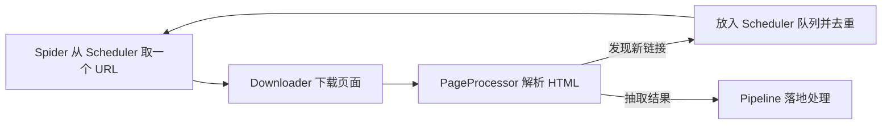
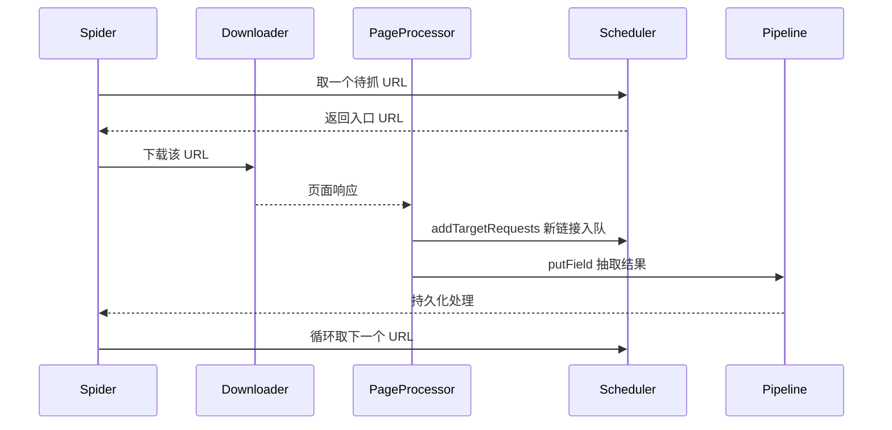
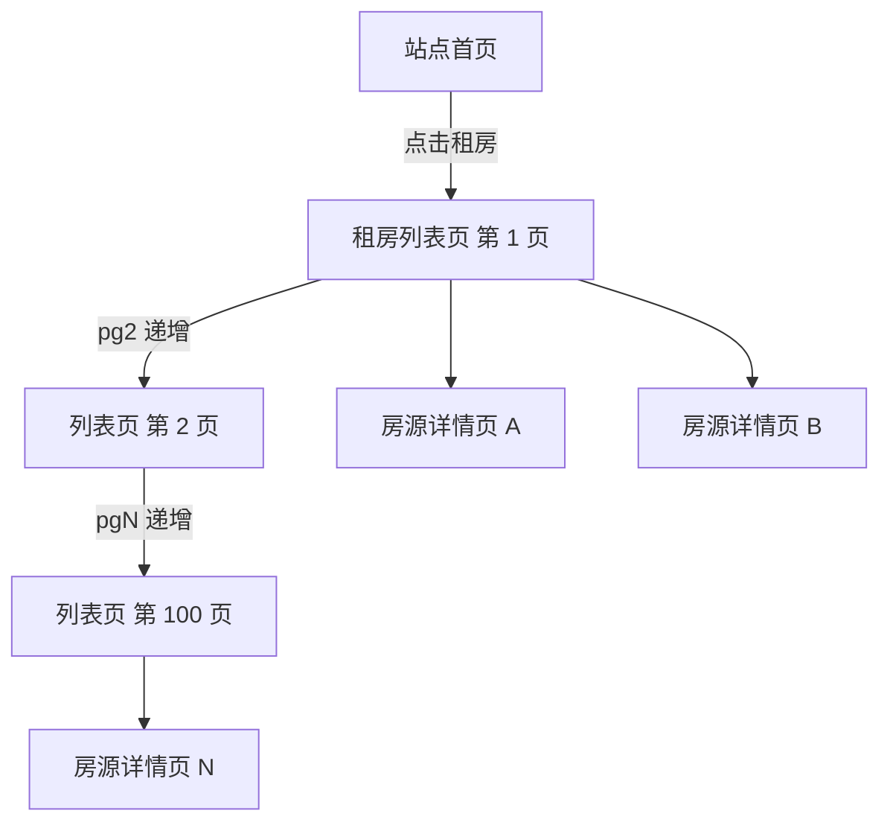
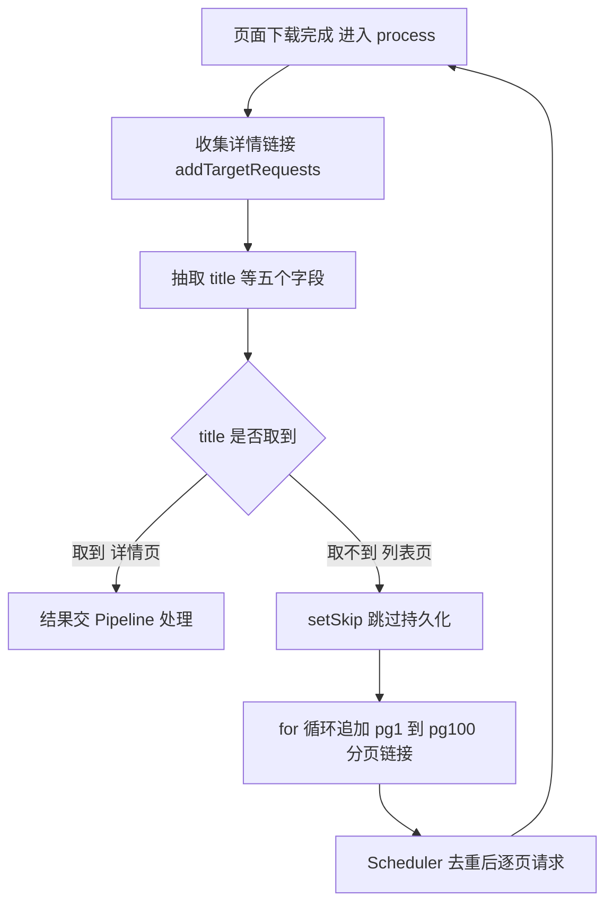
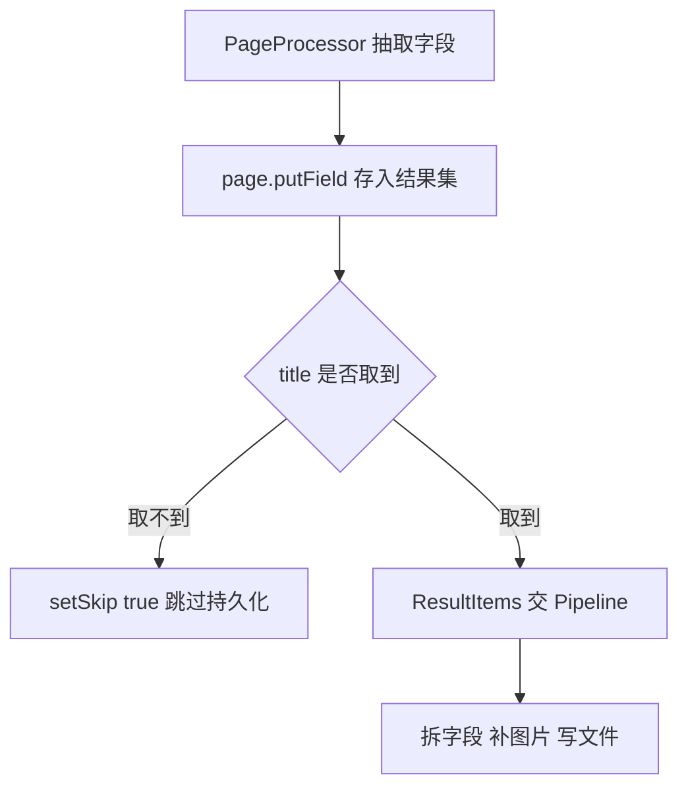
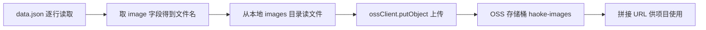
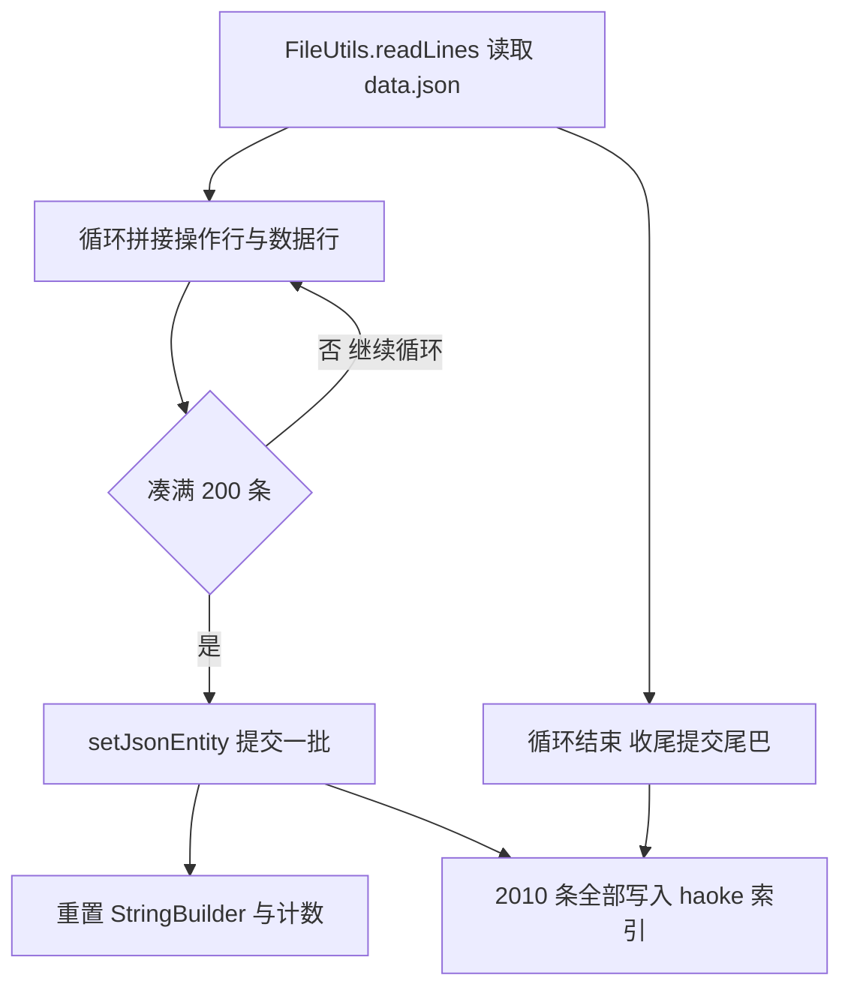

# WebMagic 抓取数据全流程：框架搭建、抓取解析、Pipeline 落盘到数据入库

## 先给结论

- 六篇内容串起一个完整的爬虫项目：框架认知与工程搭建、官方示例与目标站分析、抓取逻辑编写、Pipeline 处理数据、图片转存 OSS、批量导入 Elasticsearch。
- WebMagic 是简单灵活的 Java 爬虫框架，四大组件分工明确：PageProcessor 解析、Downloader 下载、Scheduler 调度去重、Pipeline 处理结果，Spider 串成门面。
- 抓取逻辑一个 process 伺候两种页面：列表页收链接进队列，详情页 XPath 抽五个字段，`setSkip` 让列表页不进 Pipeline。
- Pipeline 把散装字段整理成 JSON Lines 追加落盘，type 与 info 的拆解、图片按房源 ID 命名下载都在这一层完成。
- 原站图片有防盗链、本地路径线上不可访问，必须经 OSS 转存换一份可公网访问的 URL，putObject 的对象路径要用文件名防覆盖。
- haoke 索引按搜索场景做减法：只有 title 走 `ik_max_word` 分词，其余字段 keyword 且不建索引，`dynamic` 设为 false。
- bulk 是行协议：一行操作说明紧跟一行数据，200 条一批，循环结束后要补交尾巴，否则最后几十条静默丢失。
- 主线是「抓得到、理得清、存得下、搜得到」四关，分别对应 PageProcessor、Pipeline、OSS 转存与 ES 导入四段代码。

## 第1部分：WebMagic 速览：一个 Java 爬虫框架的四大组件与工程骨架

要给项目造一批真实房源数据，裸写 HttpClient 也能干：发请求、拿 HTML、正则抠字段。但接着就要自己管待抓队列、自己做 URL 去重、自己写重试和限速，这些都是爬虫的通用工程件，每换一个目标站就要重造一遍。WebMagic 把这套东西全部备好，开发者只写「怎么解析页面」这一段业务。这一篇把框架的定位、架构和工程骨架一次交代清楚，为动手写抓取逻辑铺路。

### 一、抓数据这件事的定位

写爬虫之前先把目的说透：抓数据只为丰富开发阶段的数据，帮我们把搜索这类功能做出来、调起来。平台并不需要「抓别人的房源再出租」这种业务，所以抓取功能不算项目的一部分，只算开发过程的一部分。

但它确确实实是开发人员该会的技能。做功能演示、做数据初始化、做压测数据集，都需要一批像样的数据，抓回来的数据比手工构造的真实得多：标题措辞、价格梯度、字段分布都是自然产生的。目标站点的挑选也没有技术含量，任何有房源数据的平台都行，挑一个页面结构规整的即可，课程选的是某租房平台的上海租房频道。

### 二、四大组件与一条请求的生命周期

WebMagic 的「模块化」体现在它把爬虫拆成四个各司其职的组件，理解了组件就理解了框架：

| 组件 | 职责 | 开发者要不要写 |
|---|---|---|
| PageProcessor | 解析页面、抽取数据、发现新链接 | 必写，核心业务都在这 |
| Downloader | 下载页面，处理 HTTP 细节 | 默认实现够用，可替换 |
| Scheduler | 管理待抓 URL 队列，负责去重 | 默认实现够用，可换分布式版 |
| Pipeline | 处理抽取结果，打印、存文件或入库 | 按存储方式选择或自定义 |

Spider 是封装器，把四个组件组装成一台能跑的爬虫。一条请求的生命周期长这样：



关键路径在 PageProcessor 分出的两条支线：发现的新链接回到 Scheduler 形成循环，爬虫因此能自己「走」完整站；抽取的结果流向 Pipeline，决定数据最终变成控制台日志、文件还是数据库记录。四大组件都是接口，默认实现覆盖大多数场景，要换存储就写 Pipeline，要分布式就换 Scheduler，这正是「模块化、易扩展」的落点。

### 三、工程搭建：两个坐标加一个 IO 工具

代码依然写在前面练习 Elasticsearch 的那个工程里，单独开一个 `wm` 包存放爬虫代码（包名统一为 `com.example.es.wm`）。pom 里导入框架的两个坐标，再加 commons-io：

```xml
<!-- WebMagic 爬虫框架：核心与扩展 -->
<dependency>
    <groupId>us.codecraft</groupId>
    <artifactId>webmagic-core</artifactId>
    <version>0.7.3</version>
</dependency>
<dependency>
    <groupId>us.codecraft</groupId>
    <artifactId>webmagic-extension</artifactId>
    <version>0.7.3</version>
</dependency>
<!-- 简化文件 IO：抓取结果要先写进文件 -->
<dependency>
    <groupId>commons-io</groupId>
    <artifactId>commons-io</artifactId>
    <version>2.6</version>
</dependency>
```

版本号两处保持一致，`webmagic-core` 提供四大组件与调度内核，`webmagic-extension` 提供多线程等扩展能力与更多工具。依赖导入完刷新 Maven，工程骨架就算搭完了，下一步就可以动手写爬虫。

官方还提供直接下载 jar 的引入方式，为什么仍然建议走 Maven？版本由依赖管理统一仲裁，不会出现两个 jar 版本打架；传递依赖自动带进来，不用手工补缺；团队协作时 pom 就是环境说明书，谁拉下代码谁就能构建。学习阶段体会不明显，工程化后全是收益。

### 四、接下来要写什么

框架层面只剩一个认知缺口：PageProcessor 的接口长什么样、Spider 怎么启动。下一篇直接把官方示例跑起来逐段拆解，再对目标站点做页面结构分析，确定入口 URL 和翻页规律，然后就能写出抓房源的完整逻辑。数据流向是既定的：抓取结果写文件，再导入 Elasticsearch，接上搜索功能。

## 第2部分：跑通官方示例，再看懂目标站：爬虫启动流程与入口页选择

框架装好了，直接对着目标站写抓取逻辑容易两眼一抹黑：PageProcessor 里到底能拿到什么、Spider 怎么启动、页面之间怎么接力，全靠先看一个能跑的样例。WebMagic 官方自带一个抓 GitHub 仓库信息的示例，把它拷进工程跑一遍、逐段拆开，爬虫的心智模型就立起来了；之后再对房源目标站做页面结构分析，确定入口 URL 与翻页规律，写自己的爬虫就只剩「照葫芦画瓢」。

### 一、把官方示例跑起来

在练习工程里新建 `wm` 包，把官方的 `GithubRepoPageProcessor` 拷进去，导入包后代码没有任何报错，类里已经写好了 main 方法，直接运行。完整代码如下：

```java
public class GithubRepoPageProcessor implements PageProcessor {

    // 站点配置：重试 3 次、请求间隔 1 秒、超时 10 秒
    private Site site = Site.me().setRetryTimes(3).setSleepTime(1000).setTimeOut(10000);

    @Override
    public void process(Page page) {
        // 把页面中匹配正则的仓库链接全部加入待抓队列
        page.addTargetRequests(page.getHtml().links()
                .regex("(https://github\\.com/[\\w\\-]+/[\\w\\-]+)").all());
        // 从 URL 里抽作者名
        page.putField("author", page.getUrl()
                .regex("https://github\\.com/(\\w+)/.*").toString());
        // 从页面结构里抽仓库名
        page.putField("name", page.getHtml()
                .xpath("//h1[@class='entry-title public']/strong/a/text()").toString());
        // 仓库名取不到说明不是仓库主页，跳过该页的持久化
        if (page.getResultItems().get("name") == null) {
            page.setSkip(true);
        }
        page.putField("readme", page.getHtml()
                .xpath("//div[@id='readme']/tidyText()"));
    }

    @Override
    public Site getSite() {
        return site;
    }

    public static void main(String[] args) {
        Spider.create(new GithubRepoPageProcessor())
                .addUrl("https://github.com/code4craft/webmagic")
                .thread(5).run();
    }
}
```

运行后控制台打出下载进度，一页数据下载完成就算跑通。有的环境会在启动时报安全认证相关的错（HTTPS 证书校验一类的问题），课程里没有去修它：这个示例的价值是当模板，不是当生产代码，报错原因清楚即可，换目标站写自己的爬虫时问题自然不存在。

### 二、逐段拆解这个模板

**第一段，Site 配置。** `Site.me()` 记录目标站点的抓取策略：`setRetryTimes(3)` 是失败重试次数，`setSleepTime(1000)` 是两次请求之间的停顿毫秒数，`setTimeOut(10000)` 是单次请求的超时。这三个参数决定爬虫对目标站的「礼貌程度」，任何爬虫都该设。

**第二段，process 方法。** 它是唯一要写业务的地方，入参 `Page` 代表一次下载结果，能从上面拿到 URL 和 HTML。抽取手段有三种：正则、XPath、CSS 选择器，示例里 URL 用正则、页面元素用 XPath。两个关键动作值得记牢：

- `addTargetRequests`：把要继续抓的链接塞进队列。没有这一行，爬虫处理完入口页就停了，只会执行一次请求。
- `putField`：以 key-value 形式把抽取结果放进 `ResultItems`，后续由 Pipeline 统一处理。取不到值的页面（比如不是仓库主页的散页）用 `setSkip(true)` 跳过，避免垃圾数据流进持久层。

**第三段，启动。** `Spider.create` 创建爬虫并传入处理器，`addUrl` 给出入口 URL，`thread(5)` 开五个线程，`run()` 让它动起来。整条链路的完整流转：



时序图里 `SC` 到 `SP` 的循环箭头就是爬虫能「自己走下去」的原因：只要 process 不断往 Scheduler 喂新链接，抓取就一轮接一轮；喂完了，爬虫自然停止。

### 三、给目标站选入口

模板吃透了，回到抓房源的正题。写爬虫第一个决策是入口 URL 给谁。直觉容易选站点首页，但首页目标并不明确：导航、资讯、广告一大堆，真正要的房源列表埋在层层链接之后。目标数据落在「租房」频道里，点进去之后满屏都是房源条目，每个条目带着详情链接，这一页才是理想入口。

站点结构可以画成三层：



入口定在列表页，爬虫在列表页收集详情链接，请求详情页抽数据；分页链接负责把 100 页列表页串起来。观察翻页时的 URL 变化能发现规律：点第 2 页变成 `pg2`，手动改成 `pg20` 就直接返回第 20 页数据，分页 URL 因此可以程序化构造，不必逐页点出来。

### 四、100 页上限背后的事

翻到站点分页条的尽头会发现，列表最多只给 100 页。构造一个 `pg101` 请求，返回的仍是同样的数据，超出范围的内容不再提供。这是站点保护自己数据不被整体抓走的手段：公开范围之外的页面要么不给、要么给重复内容，让「抓全站」无利可图。

对开发者来说这反而是好事：抓取范围天然有界，100 页列表页乘以每页约 30 条，几千条数据足够撑起搜索功能的开发测试，不必也不该尝试绕开限制。

## 第3部分：手写房源爬虫：一个 process 方法同时伺候列表页与详情页

模板看完了、站点分析完了，剩下的就是把它们揉进一个类。难点不在语法而在结构：WebMagic 对每个下载到的页面都调用同一个 `process` 方法，列表页和详情页的 HTML 长得完全不同，一份代码却要同时伺候两种页面。怎么区分、怎么各取所需、怎么把 100 页翻完，这一篇逐段写清楚，并附上一次真实的选择器翻车记录。

### 一、类骨架：配置、接口与启动

仿照官方示例建 `HousePageProcessor`（页面结构对应某租房平台的房源页，包名 `com.example.es.wm`），实现 `PageProcessor` 接口，Site 配置照搬模板，入口 URL 换成租房列表页，线程先设为 1 单线程调试：

```java
package com.example.es.wm;

import us.codecraft.webmagic.Page;
import us.codecraft.webmagic.Site;
import us.codecraft.webmagic.Spider;
import us.codecraft.webmagic.processor.PageProcessor;

public class HousePageProcessor implements PageProcessor {

    // 入口：某租房平台的上海租房列表页
    private static final String ENTRY_URL = "https://sh.example.com/zufang/";

    // 重试 3 次、间隔 1 秒、超时 10 秒
    private Site site = Site.me().setRetryTimes(3).setSleepTime(1000).setTimeOut(10000);

    @Override
    public void process(Page page) {
        // 业务逻辑见下文
    }

    @Override
    public Site getSite() {
        return site;
    }

    public static void main(String[] args) {
        Spider.create(new HousePageProcessor())
                .addUrl(ENTRY_URL)
                .thread(1)
                .run();
    }
}
```

`Site` 的三个参数与官方示例一致：请求失败重试 3 次，两次请求停顿 1 秒，单次超时 10 秒。单线程起步是为了调试时断点看得清楚，跑通后再提速。

### 二、列表页：把详情链接全部收进队列

打开浏览器开发者工具检查列表页结构，房源标题包在列表项的 `a` 标签里。`a` 标签本身没有任何 class，直接选它无从下手，但它的父节点带特定 class，于是用 CSS 组合选择器先选中父级、再下探到 `a`：

```java
@Override
public void process(Page page) {
    Html html = page.getHtml();

    // 列表页：收集当前页全部房源详情链接
    List<String> detailUrls = html.css(".content_list-item-title a").links().all();
    page.addTargetRequests(detailUrls);
}
```

`.css()` 按 CSS 选择器取节点，`.links()` 从节点里提取链接，`.all()` 返回全部结果。直接链式写进 `addTargetRequests` 也可以，提成 `detailUrls` 变量是为了断点调试：debug 启动后在这一行挂住，能看到 list 的长度是 30，正好一页 30 条房源，链接收集这步就算验证过了。

### 三、详情页：XPath 抽五个字段

详情页要的是标题、租金、户型等信息。用浏览器「查看元素」逐个定位：标题在特定 class 的 `p` 标签里，于是有了第一版 XPath 表达式。`//` 表示从根开始查找，`[@class='xxx']` 按属性过滤节点，`/text()` 取节点文本，`toString()` 把 `Selectable` 结果转成字符串：

```java
    // 详情页：抽取标题、租金、类型、信息与图片
    String title = html.xpath("//p[@class='content_title']/text()").toString();
    page.putField("title", title);
    page.putField("rent", html.xpath("//p[@class='content_aside-title']//span/text()").toString());
    page.putField("type", html.xpath("//p[@class='content_article_table']//allText()").toString());
    page.putField("info", html.xpath("//div[@class='content_article_info']//allText()").toString());
    page.putField("img", html.xpath("//div[@class='content_article_slide_item']//img").toString());
```

`/text()` 只取直接文本，`//allText()` 取子树里的全部文本，适合户型表格、信息条目这类内容打散在多个子节点里的场景。图片字段直接取 `img` 节点，把图片地址留给后续上传处理。

### 四、判定页面类型与翻页

字段齐了，回过头处理开头留的问题：怎么区分列表页和详情页。判定条件现成的：详情页一定抽得到标题，列表页抽不到。标题为空就说明当前是列表页，`setSkip(true)` 跳过持久化，同时把分页链接压进队列：

```java
    // title 取不到，说明当前是列表页：跳过该页数据，并追加分页链接
    if (page.getResultItems().get("title") == null) {
        page.setSkip(true);
        for (int i = 1; i <= 100; i++) {
            page.addTargetRequest(ENTRY_URL + "pg" + i);
        }
        return;
    }
```

分页 URL 前面分析过规律：`pg` 后拼页码即可。100 页没必要手写 100 行，for 循环构造。整条业务流程合起来是这样：



这里有个自然的疑问：每处理一个列表页就追加 100 个分页链接，请求岂不是永远停不下来？不会。Scheduler 对 URL 做去重，抓过的链接再进队列会被丢弃，同一批分页链接只有第一次生效，循环在链接耗尽时自然停止。

### 五、一次真实的选择器翻车

第一版标题选择器在 debug 时露了馅：断点走进去，列表页上居然也抽到了标题，内容还是「上海租房」这类站点的公共文案。原因是 `//p[@class='content_title']` 太宽，全文档范围内别的区域也存在同 class 的 `p` 标签，列表页被误判成详情页，垃圾数据眼看就要入库。

修正思路是把选择器收窄：标题所在的 `p` 标签外层有一个特定 class 的 `div` 容器，加上这层父级限定，表达式的命中率就唯一了：

```java
    // 修正后：加父级容器限定，列表页不再误命中
    String title = html.xpath("//div[@class='content clear w1150']/p/text()").toString();
    page.putField("title", title);
```

修正后重新 debug：列表页上 title 为空，走 skip 分支并追加分页；放行后请求进入详情页，`detailUrls` 为空、不再新增链接，标题顺利抽出，控制台把 `title`、`rent`、`type`、`info`、`img` 全部打印出来。默认的 Pipeline 是 `ConsolePipeline`，只负责打印；下一步换成自定义 Pipeline 把数据写进 JSON 文件，再导入 Elasticsearch，那是下一篇的内容。

## 第4部分：实现 Pipeline：把 Page 里的散装字段整理成房源 JSON，顺手把图片拉回本地

上一步的抓取逻辑跑通后，数据都堆在 `Page` 里，默认的 `ConsolePipeline` 只会往控制台打印，关掉程序就什么都没了。要喂给后面的搜索服务，真正的产物是两样：一份结构化的房源 JSON 文件，和一组下载到本地的房源图片。这一篇就写这个收尾的 `Pipeline`：实现接口、拆字段、抠出看房时间与楼层、按房源 ID 给图片命名下载，最后以 JSON Lines 的格式逐条追加落盘。

### 一、Pipeline 接口与 ResultItems：数据从哪来

Pipeline 是 WebMagic 抽取流程的最后一站。PageProcessor 负责解析页面，解析结果通过 `page.putField(key, value)` 存进结果集；页面处理完毕，框架把结果集包成 `ResultItems` 交给注册的每个 Pipeline。自定义一个 Pipeline 分两步：写类实现接口，再把实例挂到 Spider 上。

```java
package com.example.es.wm;

import us.codecraft.webmagic.ResultItems;
import us.codecraft.webmagic.Task;
import us.codecraft.webmagic.pipeline.Pipeline;

import java.util.Map;

public class MyPipeline implements Pipeline {

    @Override
    public void process(ResultItems resultItems, Task task) {
        // 先把拿到的所有字段打印出来，确认数据形状
        Map<String, Object> all = resultItems.getAll();
        System.out.println(all);
    }
}
```

挂载的位置在启动代码里，`Spider.create(...)` 之后追加一个 `.addPipeline(new MyPipeline())`：

```java
Spider.create(new HousePageProcessor())
        .addUrl(ENTRY_URL)
        .addPipeline(new MyPipeline()) // 数据交给自定义 Pipeline 处理
        .thread(1)
        .run();
```

debug 启动，在 `process` 里挂断点放行，控制台能把 `title`、`rent`、`type`、`info`、`img` 五个字段全部打出来。到这里数据就握在手里了，存文件、存数据库都是在这段代码里继续往下写。

有一个行为要先确认：上一节在抓取逻辑里写过 `page.setSkip(true)`，标题取不到就跳过。这个「跳过」的准确含义是**跳过持久化**，被 skip 的页面不会再流进任何 Pipeline。列表页正是在这里被挡住的，所以 Pipeline 里不用担心混进导航文案，拿到的每条记录都是详情页。



图里的分叉点就是列表页与详情页的分水岭：skip 的页面直接出局，只有详情页数据能走到 Pipeline 这一站。

### 二、拆字段：type 一拆三，info 里抠时间与楼层

详情页抽出来的 `type` 是一整段文本，租赁方式、户型、朝向用空格连在一起；`info` 更杂，面积、看房时间、楼层、朝向混在一行里。整理逻辑不复杂，全是字符串切分：

```java
Map<String, Object> data = new HashMap<>();
data.put("title", resultItems.get("title")); // 标题
data.put("rent", resultItems.get("rent")); // 租金
String[] types = StringUtils.split(resultItems.get("type"), ' '); // 户型
data.put("rentMethod", types[0]); // 租赁方式
data.put("houseType", types[1]); // 户型，如：2室1厅1卫
data.put("orientation", types[2]); // 朝向
String[] infos = StringUtils.split(resultItems.get("info"), ' ');
for (String info : infos) {
    if (StringUtils.startsWith(info, "看房：")) {
        data.put("time", StringUtils.split(info, ':')[1]);
    } else if (StringUtils.startsWith(info, "楼层：")) {
        data.put("floor", StringUtils.split(info, ':')[1]);
    }
}
```

这段代码有两个讲究。**第一，用 `StringUtils.split` 而不是 `String.split`。** commons-lang3 的这个工具对连续分隔符、null 输入更宽容，页面文本里多一个空格、少一个空格不至于下标错位。**第二，info 用前缀扫描而不是固定下标。** 信息条目的顺序在页面上不保证稳定，按「看房：」「楼层：」前缀逐段比对，出现顺序变了也能拿对值；中文冒号是页面原文的一部分，切分值时再用英文冒号拆一次。

拆完的 `data` 就是一条房源的最终形状：`rentMethod`、`houseType`、`orientation`、`time`、`floor` 加上标题租金，之后直接序列化入库。

### 三、图片落地：从标签原文里取地址，按房源 ID 命名

图片字段 `img` 当初抽的是整个 `img` 节点的标签原文，不是纯 URL。取地址用了一个朴素但有效的办法：按引号切开后取对应下标。文件名则不沿用原站的名字，而是从详情页 URL 里截：URL 最后一段是 `SH210919638597144832.html` 这样的形式，去掉 `/` 之前的部分再截掉 `.html` 后缀，剩下的房源 ID 就当图片名。

```java
String image = StringUtils.split(resultItems.get("img"), '"')[3]; // 从标签原文中取图片地址
// URL 最后一段去掉扩展名，得到房源 ID 作为新文件名
String newName = StringUtils.substringBefore(
        StringUtils.substringAfterLast(resultItems.getRequest().getUrl(), "/"), ".");
```

为什么要下载而不是直接引用原站链接？测试结论很直接：原站对图片请求做了限制，同一个链接浏览器打开正常，放进自己项目里请求就失败。这就是典型的图片防盗链，服务端校验请求来源，本站页面带着合法的引用头自然放行，第三方程序直连就被拒。所以图片必须走一遍下载，落到自己手里才有长期使用的可能。

下载方法自己写一个，用 HttpClient 发 GET 请求，把响应体写成文件：

```java
// 下载图片到自己指定的目录（示例为按本课写法补全）
private void downloadFile(String url, File targetFile) throws IOException {
    try (CloseableHttpClient client = HttpClients.createDefault()) {
        HttpGet get = new HttpGet(url);
        // 补上浏览器常用的 User-Agent，降低被拦截的概率
        get.setHeader(HttpHeaders.USER_AGENT,
                "Mozilla/5.0 (Windows NT 10.0; Win64; x64)");
        try (CloseableHttpResponse response = client.execute(get);
             InputStream in = response.getEntity().getContent()) {
            FileUtils.copyInputStreamToFile(in, targetFile);
        }
    }
}
```

请求头里的 `User-Agent` 值得带上：目标站除了校验引用页，也常按 UA 过滤明显的程序请求，装成浏览器形态能少踩很多坑。

### 四、落盘：JSON Lines 追加写入

数据、图片名、图片文件都齐了，收尾就是序列化与写文件。每处理完一条记录，图片存进 `data` 的 `image` 字段（只存文件名），整条记录转成一行 JSON，以追加模式写进 `data.json`：

```java
try {
    this.downloadFile(image, new File("F:\\code\\images\\" + newName + ".jpg"));
    data.put("image", newName + ".jpg"); // 图片名随 JSON 一起落盘
    String json = MAPPER.writeValueAsString(data);
    // 追加模式：每条一行，跑多久写多久
    FileUtils.write(new File("F:\\code\\data.json"), json + "\n", "UTF-8", true);
} catch (Exception e) {
    e.printStackTrace();
}
```

`FileUtils.write` 的最后一个参数 `append` 必须是 `true`：爬虫是流式工作的，每条记录写一次，追加模式让文件越写越长；一旦漏了这个参数，每写一条都会把之前的清空，跑完只剩最后一条。每行一条 JSON、行与行换行分隔，这就是 JSON Lines 格式，后面批量导入 Elasticsearch 时一行就是一条文档，正好接得上。

删掉旧产物重新启动，图片一张张落进 `images` 目录，`data.json` 一行行变长。随便挑一行丢进 JSON 查看工具里，能看到完整的房源记录：

```json
{
    "image": "SH210919638597144832.jpg",
    "orientation": "52㎡",
    "houseType": "1室2厅1卫",
    "rentMethod": "整租",
    "time": "需提前预约",
    "title": "整租 · 凯欣*园诚意出租的房品质小区采光好 楼层佳 交通便利",
    "rent": "11000",
    "floor": "高楼层/36层",
    "url": "https://sh.example.com/zufang/SH210919638597144832.html"
}
```

`images` 目录里能找到与 `image` 字段同名的图片文件，两份产物对得上号。爬虫持续运行，JSON 与图片持续增加，跑得越久攒得越多，抓取这一环到此闭合，剩下的就是把数据搬进 Elasticsearch 的事了。

## 第5部分：抓到的房源图片别留在本地：批量转存 OSS 换一份能长期用的 URL

上一篇收尾时，图片已经按房源 ID 命名落在了本地目录，`data.json` 里存着每条记录对应的图片文件名。但本地磁盘解决不了访问问题：前端页面要展示图片，靠的是 URL，而原站的图片链接又有防盗链，拿来就用注定裂图。这一篇把整个 `images` 目录批量搬上 OSS 对象存储，换回一份属于自己的、项目里可以放心引用的图片 URL。

### 一、为什么中间必须加一道转存

把三个位置摆在一起看，逻辑就顺了：

| 位置 | 能否直接用 | 原因 |
|---|---|---|
| 原站图片 URL | 不能 | 防盗链校验请求来源，第三方项目请求被拒，图片裂图 |
| 本地磁盘路径 | 不能 | `F:\code\images\...` 只在开发机上有意义，线上页面引用不到 |
| OSS 对象存储 | 能 | 拿到公网可访问的 URL，项目里、前端页面里随意引用 |

**第一，原站 URL 的问题出在请求身份上。** 浏览器里点开能看到图，是因为请求带着正常的来源信息；换成程序或第三方页面发起，服务端校验不过直接拒绝。这个限制绕不过去，也不该去绕，图片握在自己手里才踏实。**第二，本地文件的问题出在可达性上。** 爬虫跑在开发机上，生产环境的页面无法引用一台开发机的盘符路径，图片必须挪到一个有公网入口的地方，对象存储就是干这个的。

整条链路串起来是这样：



关键的一环是 B 到 C 的对应关系：`data.json` 的 `image` 字段存的就是文件名，数据与图片靠它对上号，上传时不需要再去页面找。

### 二、初始化 OSSClient：四个参数定一个客户端

先建测试类，把客户端构造出来。四个参数各管一件事：`endpoint` 是服务区域的接入地址，`accessKeyId` 与 `accessKeySecret` 是身份凭证，`bucketName` 是要写入的存储桶，再留一个 URL 前缀方便后面拼访问地址：

```java
public class TestOSSTest {

    @Test
    public void testOss() throws Exception {
        ObjectMapper mapper = new ObjectMapper();
        String endpoint = "http://oss-cn-qingdao.aliyuncs.com";
        String accessKeyId = "LTAI****************"; // 密钥已打码，使用自己的凭证
        String accessKeySecret = "****************************************";
        String bucketName = "haoke-images";
        String urlPrefix = "http://haoke-images.oss-cn-qingdao.aliyuncs.com/";

        OSSClient ossClient = new OSSClient(endpoint, accessKeyId, accessKeySecret);
    }
}
```

有两点要交代。**第一，密钥属于敏感信息。** 课堂演示里用的是教师自己的 AccessKey，真实项目中这对凭证泄露等于把整个存储桶拱手让人，代码里绝不能明文提交，交给配置中心或环境变量管理，并按最小权限原则给这个 Key 只分配目标桶的读写授权。**第二，构造方式分版本。** 老版本 SDK 提供 `new OSSClient(endpoint, ...)` 这种直接构造，新版本 SDK 推荐走 `OSSClientBuilder` 的 build 方式创建，两者最终都产出 `OSS` 接口实例，课程环境用前者，工程上按所用 SDK 版本对齐即可。

### 三、批量上传：逐行读 JSON，逐张 putObject

上传循环的输入是上一节抓取产物 `data.json`。每一行是一条 JSON 记录，`image` 字段是图片文件名，用它拼出本地文件路径，交给 `putObject`：

```java
// 读取抓取产物，逐行解析出图片名，再从本地目录上传
List<String> lines = FileUtils.readLines(new File("F:\\code\\data.json"), "UTF-8");
for (String line : lines) {
    JsonNode jsonNode = mapper.readTree(line);
    String image = jsonNode.get("image").asText(); // 图片文件名，如 SH2109...4832.jpg
    // 对象 key 用图片文件名，保证每张图一个独立对象
    ossClient.putObject(bucketName, image, new File("F:\\code\\images\\" + image));
    System.out.println(image);
}
```

循环里就三个动作：`readTree` 把一行字符串解析成 JSON 树，`get("image")` 取出文件名，`putObject` 三个参数分别是桶名、对象 key、本地文件。对象 key 决定了图片在桶里的路径与名字，用原始文件名上传，访问 URL 与本地文件名就能一一对上，`data.json` 里存的 `image` 字段从此有了双重含义：既是本地文件名，也是 OSS 上的对象名。

跑完到控制台刷新存储桶，图片一张不缺地列在对象列表里。挑一张点开预览，拿到访问 URL，形如：

```text
http://haoke-images.oss-cn-qingdao.aliyuncs.com/SH210919638597144832.jpg
```

浏览器打开能看到图，把这份 URL 配到项目里，图片展示这一环正式闭环。至此房源数据的三样东西全齐了：结构化 JSON、本地图片、公网可访问的图片 URL，下一步该让它们进搜索索引了。

## 第6部分：给 2010 条房源安家：设计 haoke 索引的 mapping，再用 bulk 批量导入 Elasticsearch

抓取产物已经在手里：`data.json` 一行一条房源，图片也转存妥当。要让前端能按标题搜房源，这些数据得进 Elasticsearch。这中间隔着三件事：索引与 mapping 怎么设计（哪些字段可搜、哪些只存不搜）、mapping 设计错了会怎样（用一个不可检索字段实测报错）、2010 条数据怎么高效写进去（bulk 的行协议与分批提交）。三件事连在一起讲完，数据就能直接供搜索接口使用了。

### 一、建索引：settings 与 mapping 里的每个决定

上一节已给集群装好 IK 分词器（安装文档见配套资料），现在建索引。整体请求是向 `192.168.1.7:9200/haoke` 发 PUT，请求体分 `settings` 与 `mappings` 两段：

```json
PUT http://192.168.1.7:9200/haoke
{
  "settings": {
    "index": {
      "number_of_shards": 6,
      "number_of_replicas": 1
    }
  },
  "mappings": {
    "house": {
      "dynamic": false,
      "properties": {
        "title": {
          "type": "text",
          "analyzer": "ik_max_word"
        },
        "image": {
          "type": "keyword",
          "index": false
        },
        "orientation": {
          "type": "keyword",
          "index": false
        },
        "housetype": {
          "type": "keyword",
          "index": false
        },
        "rentMethod": {
          "type": "keyword",
          "index": false
        },
        "time": {
          "type": "keyword",
          "index": false
        },
        "rent": {
          "type": "keyword"
        }
      }
    }
  }
}
```

**第一，settings 只有两条：6 个分片、1 个副本。** 建完后在 head 插件里能看到编号 0 到 5 的六个分片，每个都拖着一个副本，这是集群层面给数据分布做的规划。

**第二，`dynamic` 决定「文档里冒出未声明字段」时怎么办。** 它有三个值：默认 `true`，自动为新字段建索引，数据自由但脏字段会悄悄混进索引；`false`，字段照常随文档写入、能随 `_source` 返回，只是不建索引、不可查询；`strict`，直接报错拒绝写入。房源数据里的 `floor`、`url` 就没在 mapping 里声明，选 `false` 意味着它们照常随文档存进来、展示时原样返回，但不参与搜索，正好符合「url 只是展示字段」的定位。

**第三，字段类型与可检索性是按搜索场景倒推的。** 业务只要求按标题搜房源，所以 `title` 用 `text` 类型加 `ik_max_word` 分词器，索引建立时就把标题切成词放进倒排索引；其余字段全是 `keyword`（整串精确值，不分词），并且除了 `rent` 全部 `index: false`，不进倒排索引。这样省掉了大量无用的索引构建开销，代价是这些字段不能当查询条件，而这个代价业务完全承受得起。mapping 里已有字段的类型建好后改不了，这些取舍必须在建索引时想清楚，这也是它值得单独一节的原因。

### 二、插一条、搜一条：验证 mapping 与 IK 分词器

索引建好先别急着灌数据，手动验证一轮。向 `192.168.1.7:9200/haoke/house` 发 POST 插入一条抓取产物：

```json
POST http://192.168.1.7:9200/haoke/house
{
  "image": "SH21769516242678448.jpg",
  "orientation": "53㎡",
  "housetype": "2室1厅1卫",
  "rentMethod": "整租",
  "title": "房屋装修，品牌家具，临近四号线地铁口精装两房",
  "time": "需提前预约",
  "rent": "6200",
  "floor": "高楼层/6层",
  "url": "https://sh.example.com/zufang/SH21769516242678448.html"
}
```

写入成功后立刻按标题搜「地铁」，走 `_search` 接口并带上高亮配置：

```json
POST http://192.168.1.7:9200/haoke/house/_search
{
  "query": {
    "match": {
      "title": "地铁"
    }
  },
  "highlight": {
    "fields": {
      "title": {}
    }
  }
}
```

返回结果命中这条文档，`title` 里「地铁」二字被 `<em>` 标签包住做了高亮。高亮能生效说明标题确实经过了分词，「地铁」作为一个词进了倒排索引，IK 分词器安装无误、`text` 类型与 analyzer 配置无误，整条写入与检索链路都是通的。

### 三、拿非索引字段试一次：报错才是预期行为

正向验证过了，再反向试一次：把查询字段从 `title` 换成 `houseType`，其余不动。

```json
{
  "query": {
    "match": {
      "houseType": "地铁"
    }
  }
}
```

请求直接失败，错误信息里明确指出该字段不可被搜索、不是被索引的字段，所有分片查询失败。这不是配置出了错，而是 mapping 里 `"index": false` 的准确兑现：字段不进倒排索引，自然没有东西可查。

这一步的价值在于把设计原则钉死：**mapping 的每个字段都要过一遍「要不要被搜」的问题。** 图片地址、户型、看房时间这类字段在本项目里永远只做展示，`index: false` 省掉无谓的索引开销；真有按租金筛选的需求，再把 `rent` 留成可检索（示例里正是这么做的）。哪些字段可索引没有标准答案，跟着业务走，项目开工前和产品把搜索需求对齐，比事后重建索引便宜得多。

### 四、批量导入：bulk 的行协议与 200 条一批

验证完毕，先删掉手动插入的测试文档（按它的 `_id` 发 DELETE 请求，删除操作在前面的低级客户端一节练过），保证库里只有抓取数据。随后写批量导入。逐条 POST 插入 2010 条要发 2010 个请求，Elasticsearch 为这种场景准备了 `_bulk` 批量接口：一次请求携带多组「操作行 + 数据行」，两组之间的行协议长这样：

```text
{"index":{"_index":"haoke","_type":"house"}}
{"image":"SH2136842962700091392.jpg","orientation":"52㎡","houseType":"1室2厅1卫","rentMethod":"整租","time":"需提前预约","title":"整租 · 凯欣*园诚意出租的房品质小区采光好 楼层佳 交通便利","rent":"11000","floor":"高楼层/36层","url":"https://sh.example.com/zufang/SH2136842962700091392.html"}
{"index":{"_index":"haoke","_type":"house"}}
{"image":"SH2118607017555279872.jpg", ...}
```

操作行声明这条数据写往哪里（`index` 动作、`haoke` 索引、`house` 类型），紧跟的数据行就是文档本体，每一行都必须以换行符结尾，这是协议的一部分而不是排版习惯。Java 侧接着用低级 REST 客户端实现，`data.json` 本身就是一行一条 JSON，读出来直接当数据行：

```java
@Test
public void testBulkImport() throws Exception {
    Request request = new Request("POST", "/haoke/house/_bulk");
    StringBuilder sb = new StringBuilder();
    // 操作行：声明写入 haoke 索引的 house 类型
    String action = "{\"index\":{\"_index\":\"haoke\",\"_type\":\"house\"}}";
    List<String> lines = FileUtils.readLines(new File("F:\\code\\data.json"), "UTF-8");
    int count = 0;
    for (String line : lines) {
        sb.append(action).append("\n"); // 操作行
        sb.append(line).append("\n");   // 数据行，行协议要求行尾换行
        count++;
        if (count >= 200) {             // 每 200 条提交一批
            request.setJsonEntity(sb.toString());
            this.restClient.performRequest(request);
            count = 0;
            sb = new StringBuilder();   // 重置缓冲，准备下一批
        }
    }
    // 收尾：不足 200 条的尾巴再提交一次，防止丢数据
    if (StringUtils.isNotEmpty(sb.toString())) {
        request.setJsonEntity(sb.toString());
        this.restClient.performRequest(request);
    }
}
```

整条流水线是这样的：



分批的原因很朴素：一次性把 2010 条拼成一个巨型请求体，内存占用与单次失败的重试代价都不可控，200 条一批是这份数据量下的稳妥取值，批大小本身没有魔法数字，按单条文档大小与网络情况调整。运行前先把代码里的节点地址改成本课环境的 `192.168.1.7`，改完执行，控制台没有异常就说明全部提交完成。

**顺带一提，** 这个写法是把行协议手工拼进 StringBuilder，靠的是低级客户端对 HTTP 的完整掌控；高级 REST 客户端提供了 `BulkProcessor`，把攒批、触发提交、失败重试都封装成了回调式的构建器，工程里数据量更大时值得换过去，本课为了看清协议先用手写版。

### 五、结果核验：2010 条与 419 次命中

导入完成回到 head 插件刷新，`haoke` 索引的文档总数显示 2010，与 `data.json` 的行数严丝合缝。再按老办法搜一次「地铁」：

```json
{
  "query": {
    "match": {
      "title": "地铁"
    }
  }
}
```

命中 419 条，翻看结果，标题里全是「近地铁」「地铁口」这类内容，量级与内容都对得上，2010 条房源就此全部就位。数据侧的准备到此收尾：索引结构定好了、数据灌满了、检索验证通过了，下一节就是在项目里包一个对外的搜索接口，让前端把这些能力用起来。

## 常见误区

- **只引 `webmagic-core` 不引 `webmagic-extension`。** core 里只有内核组件，多线程调度等能力在 extension 里，缺了它后续配置会找不到类。两个坐标成对引入。
- **把爬虫代码写进业务包。** 抓取脚本的存亡与项目无关，混在一起后患无穷：业务重构碰坏爬虫、爬虫依赖污染业务。单独开包甚至单独工程，是最省心的隔离。
- **以为要自己写多线程。** 框架原生支持并发，`Spider` 的 `thread(n)` 一个参数就能开多线程，自己起线程池反而绕开框架的调度与去重。
- **忽略限速配置。** 不设 `setSleepTime` 就高频请求目标站，轻则被封 IP，重则影响对方服务。爬虫的礼貌参数（停顿、重试、超时）在 Site 配置里一次设好。
- **拿首页当入口。** 首页噪音多、目标链接埋得深，爬虫会浪费大量请求在无关页面上。入口直接选目标数据所在的列表页。
- **示例报错就卡住。** 官方示例是教学模板，遇到证书、反爬类的报错不必执着修复，看懂结构后转写自己的逻辑才是正事。
- **忘记链式调用末尾的 `run()`。** `Spider.create(...).addUrl(...)` 只是配置，不调 `run()` 爬虫根本不动，运行完没任何输出还以为框架坏了。
- **线程数一上来就拉满。** `thread(5)` 甚至更高会显著加大对目标站的并发压力，容易触发封禁，调试阶段单线程跑通再谈提速。
- **选择器宁宽勿窄。** `//p[@class='x']` 在全文档匹配，页面任何角落的同名节点都会命中，导致页面类型误判、垃圾数据入库。加上父级容器或业务容器限定，让表达式只命中目标区域。
- **忘记跳过列表页。** 不判空不 `setSkip`，列表页的导航文本会混进结果集，后续导入索引库再清洗，成本翻倍。
- **担心循环加分页链接会无限爬。** 去重发生在 Scheduler 层，重复 URL 不入队；真正要担心的是反方向：链接收集过窄导致爬虫提前断粮，抓回来的数据缺页。
- **`putField` 传了 null 就以为没放进去。** key 会照常存在，value 为 null，后续 Pipeline 里必须用 `get` 判空，否则空记录照样流到存储层。
- **写文件忘了 `append` 参数。** `FileUtils.write` 默认覆盖写，每条记录都会清空文件重来，跑完只剩最后一条还以为抓取出了问题。追加写必须显式传 `true`。
- **以为 skip 只是跳过存储不影响别的。** `setSkip(true)` 的页面不进 Pipeline，如果Pipeline 里调试时断点不进来，先回 PageProcessor 检查是不是误把详情页也 skip 了。
- **info 解析写死下标。** `infos[2]` 这种写法在页面改版或条目缺失时直接数组越界；按前缀扫描再取值，页面顺序变化才不致命。
- **原站图片链接拿来就用。** 带防盗链的图片在浏览器里能看到、在项目里请求不到，表现为页面图片全部裂图。下载转存到自己的存储才是正路，域名与文件名的对应关系记在数据里。
- **对象 key 写死一个字符串。** `putObject(bucketName, "image", file)` 这种写法把每张图都传成同一个对象名，后传的覆盖先传的，桶里永远只有一张图。key 必须是每张图独立的文件名。
- **AccessKey 明文进代码仓库。** 凭证一旦提交就是公开泄露，正确做法是环境变量或配置中心注入，密钥轮换权限收紧，演示用的凭证用完及时停用。
- **以为上传完 URL 就自动可用。** URL 能否直接访问取决于桶的读写权限：公共读的桶可以直接拼 URL 访问，私有桶需要带签名的临时 URL。权限设置与业务安全要求要对齐，别默认公共读一劳永逸。
- **上传失败先怀疑代码。** 常见原因其实是凭证错、endpoint 与桶所在区域不一致、桶名不存在，错误响应里会写明具体原因，读响应比改代码更重要。
- **bulk 行尾漏换行。** 操作行与数据行都必须以 `\n` 结尾，漏一个就报解析异常，报错信息却常常不直接指出哪一行少了换行，排查时先数行。
- **循环结束不收尾。** 只在「凑满一批」时提交，最后一批不足 200 条的记录留在 StringBuilder 里没人管，数据静默丢失且无任何报错，循环结束后必须补一次提交。
- **`dynamic: false` 当成拒绝写入。** 它只是「新字段不建索引、不可查询」，文档本身照常写入与返回；想直接拒绝写入要用 `strict`，两者别混。
- **mapping 建完再想改字段类型。** 已建字段的类型不可修改，只能新增字段或重建索引迁移数据。字段是否分词、是否可检索的决策要在建索引前做完。

## 面试可能被问到的问题

1. 面试官追问：「WebMagic 的架构是怎样的？」
   答：四大组件加一个封装器。PageProcessor 负责页面解析与数据抽取，Downloader 负责下载，Scheduler 管理待抓队列并去重，Pipeline 负责结果持久化，Spider 把四者组装起来驱动整个抓取循环。组件都是接口，默认实现之上按需扩展。

2. 面试官追问：「Scheduler 在爬虫里起什么作用？」
   答：它是待抓 URL 的管理者，决定下一个抓谁，同时对 URL 做去重，避免重复抓取造成的死循环。单机用内存队列，需要分布式抓取时替换成基于 Redis 等实现的 Scheduler 即可，其余组件不用改。

3. 面试官追问：「为什么选 WebMagic，而不是 HttpClient 加 Jsoup 自己拼？」
   答：自己拼要重复解决队列管理、去重、重试、限速、多线程这一堆通用问题，每个目标站重写一遍。WebMagic 把这些工程件内置，开发者只实现 PageProcessor 写解析逻辑，代码量小、行为稳定，扩展点也齐全。

4. 面试官追问：「webmagic-core 和 webmagic-extension 的区别？」
   答：core 是框架内核，包含四大组件接口、默认实现与 Spider 调度；extension 是扩展包，提供多线程调度、注解式爬虫等增强能力。日常开发两个都要引入，版本保持一致。

5. 面试官追问：「爬虫怎么控制对目标站点的压力？」
   答：三个旋钮：`setSleepTime` 设两次请求间的停顿，`thread(n)` 控制并发线程数，`setRetryTimes` 与 `setTimeOut` 控制重试与超时。合理组合能把请求频率压到目标站可接受的范围，这也是爬虫的基本礼仪。

6. 面试官追问：「PageProcessor 的两个方法分别做什么？」
   答：`process` 是业务核心，拿到 `Page` 对象后做链接发现和数据抽取；`getSite` 返回 `Site` 配置，声明重试、停顿、超时、请求头等站点级策略。一个类实现这两个方法，再配一个启动调用就是完整爬虫。

7. 面试官追问：「addTargetRequests 和 putField 分别什么时机用？」
   答：`addTargetRequests` 在页面里发现待抓链接时用，把 URL 压入 Scheduler 队列驱动爬虫继续；`putField` 在抽到结构化数据时用，结果进 ResultItems 交给 Pipeline。前者控制「爬去哪」，后者控制「存什么」。

8. 面试官追问：「setSkip 的意义是什么？」
   答：有些页面只承担「发现链接」的职能，本身没有要持久化的数据，比如作为入口的列表页。对它们调用 `setSkip(true)` 后，该页结果不会流入 Pipeline，避免把导航文本之类的垃圾写进存储。

9. 面试官追问：「怎么确定一个站点的爬虫入口 URL？」
   答：找目标数据最集中的列表页。判断标准是入口页上就存在大量待抽取的目标链接，结构相对稳定，且从它能到达所有数据页。首页通常只是导航集合，直接当入口会做大量无用抓取。

10. 面试官追问：「目标站分页只开放 100 页，说明了什么，怎么应对？」
   答：这是站点控制数据暴露面的保护措施，超出范围的请求返回重复数据。应对方式不是绕过，而是接受边界：在公开分页范围内抓取，配合增量更新满足需求，同时控制频率做合规抓取。

11. 面试官追问：「一个 PageProcessor 怎么同时处理列表页和详情页？」
   答：利用两类页面在数据上的可区分特征做分支。本课用「标题是否抽到」判断：详情页必有标题，列表页没有。列表页只收详情链接并 skip，详情页抽取字段后交给 Pipeline，一个方法覆盖整站两类页面。

12. 面试官追问：「WebMagic 的 URL 去重发生在哪一层？」
   答：Scheduler 层。所有 `addTargetRequests` 加进去的 URL 先经过 Scheduler，重复的会被丢弃，默认实现是内存中的去重队列。这也是循环追加分页链接不会导致无限抓取的原因，分布式场景换 RedisScheduler 去重范围扩到多机。

13. 面试官追问：「CSS 选择器和 XPath 在 WebMagic 里怎么取舍？」
   答：两者都返回 `Selectable`，可以混用。类名结构清晰的用 `css` 写起来短，如 `.content_list-item-title a`；需要按文档层级与属性精确导航、或要取文本子树的用 `xpath`，如 `//div[@class='x']/p/text()` 与 `//allText()`。按可读性和命中精度选，避免过宽匹配。

14. 面试官追问：「怎么控制抓取节奏，避免被目标站封禁？」
   答：`Site` 配置里 `setSleepTime` 设请求间隔，`Spider.thread(n)` 控制并发，`setRetryTimes`、`setTimeOut` 兜底异常。调试期单线程慢速跑，验证完再小幅提速，始终把频率压在目标站可接受的范围内。

15. 面试官追问：「抽取出来的数据怎么落地？」
   答：走 Pipeline。默认 `ConsolePipeline` 只打印，适合调试；落文件用 `FilePipeline` 或自定义，入库就写自定义 Pipeline 在 `process` 方法里做转换与持久化。业务存储逻辑全部收敛在 Pipeline，PageProcessor 保持纯粹的解析职责。

16. 面试官追问：「WebMagic 的 Pipeline 接口长什么样，怎么自定义？」
   答：接口只有一个方法 `process(ResultItems resultItems, Task task)`。写一个类实现它，把 PageProcessor 里 `putField` 存的数据用 `get` 或 `getAll` 取出来做转换与持久化，然后通过 `Spider.addPipeline` 挂载。一个 Spider 可以挂多个 Pipeline，数据会依次流过。

17. 面试官追问：「`setSkip(true)` 之后数据去哪了？」
   答：skip 标记的是跳过持久化，这个页面的 ResultItems 不会传给任何 Pipeline，但抽取动作本身已经完成。典型用途是列表页：它只负责收集详情链接，本身没有要入库的数据，skip 掉就干净了。

18. 面试官追问：「为什么抓下来的数据用 JSON Lines 而不是一个大 JSON 数组？」
   答：爬虫是流式产出的，JSON Lines 每条记录独立成行，追加写不用改历史内容；处理时也可以逐行读、逐行导入，不用把整个文件加载进内存。大 JSON 数组则要求整体结构闭合，追加一条就得动整个文件，两边都吃亏。

19. 面试官追问：「原站图片 URL 明明能访问，为什么还要下载转存？」
   答：能访问是因为浏览器请求带了合法的来源信息，目标站的防盗链校验放行；第三方项目直接请求会被拒，表现为图片裂图。把图片下载转存到自己的对象存储，换成自己的 URL，才不受制于原站策略。

20. 面试官追问：「PageProcessor 和 Pipeline 的职责怎么划分？」
   答：PageProcessor 只做页面解析与字段抽取，不知道数据最终去哪；Pipeline 只做数据的整理与落地，不关心页面结构。这样页面改版只动前者，存储方案调整只动后者，两层各自演进互不牵连。

21. 面试官追问：「`putObject` 的参数分别是什么含义？」
   答：桶名指定写到哪个存储桶，对象 key 是这条对象在桶内的唯一路径名，第三个参数是数据来源，可以是本地 `File`、输入流或字节数组。桶名加对象 key 合起来唯一定位一个对象，对象 key 重复即覆盖。

22. 面试官追问：「为什么爬来的图片要转存对象存储，而不是直接引用原 URL？」
   答：原站普遍有防盗链，校验请求来源，项目内请求会被拒；而且原 URL 不受自己控制，随时可能失效。转存后 URL 是自己的，可用性、访问速度、后续的 CDN 加速都掌握在自己手里。

23. 面试官追问：「AccessKey 和 Secret 应该怎么管理？」
   答：不进代码、不进日志，用环境变量或配置中心下发；按最小权限建子账号，只授予所需桶的指定操作权限；定期轮换，泄露后立即禁用重发。

24. 面试官追问：「对象存储里的对象 key 有什么设计讲究？」
   答：key 同时承担路径与唯一标识两个角色，可以用前缀模拟目录分层（如按日期分前缀）方便生命周期管理；本次场景直接用房源 ID 命名，让数据表里的字段与对象名天然对应，省一层映射。

25. 面试官追问：「上千张图片逐张 `putObject` 会不会太慢，有什么优化思路？」
   答：单线程逐张上传瓶颈在网络往返，可以多线程并发上传；SDK 也提供断点续传与批量上传工具，大文件用分片上传。本课 2010 张小图量级不大，顺序传即可跑完，量级上来再引入并发与分片。

26. 面试官追问：「`dynamic` 的三个取值分别是什么行为？」
   答：`true` 是默认值，文档中出现未声明字段时自动为其建立索引；`false` 表示新字段随文档存储、可随 `_source` 返回，但不建索引、不可作为查询条件；`strict` 最严格，携带未声明字段的文档直接写入报错。按数据可控性与查询需求选择。

27. 面试官追问：「`text` 和 `keyword` 怎么选？」
   答：`text` 会分词，建倒排索引用于全文检索，适合标题、正文；`keyword` 不分词，整串作为精确值，适合状态、标签、文件名这类要么全等要么不匹配的字段。本课只有标题可搜，所以只有 `title` 是 `text` 并配了 IK 分词器。

28. 面试官追问：「bulk 批量导入要注意什么？」
   答：请求体是行协议，操作行与数据行成对出现且行尾必须换行；批大小要控制，太大占内存、失败重试代价高，太小网络往返开销占比上升；循环攒批后必须收尾提交剩余不足一批的数据；还要检查响应里逐条的 `errors` 标记，批量接口不保证每一条都成功。

29. 面试官追问：「为什么很多字段设置 `index: false`？有什么代价？」
   答：索引是为查询服务的，业务上永远不作为查询条件的字段建索引纯属浪费空间与写入开销。代价就是这些字段不能再参与任何查询与排序，本课的图片地址、户型、看房时间都只做展示，设置 `index: false` 收益明显。

30. 面试官追问：「手动逐条插入和 bulk 导入怎么取舍？」
   答：几条验证数据用逐条 POST 足够；上千条的初始灌库必须走 bulk，否则请求数与耗时会差几个数量级。生产级的大规模同步还可以用 BulkProcessor 自动攒批、或 Logstash 之类的管道工具，bulk 是这一切的底层协议。

## 配套资料

- 本课无 WebMagic 配套源码包：`materials/code/03/day15-房源数据抓取以及实现房源搜索/` 下只有抓取成果数据与分词器安装文档，文中依赖坐标与工程结构为按本课写法补全的示例。
- 抓取线的最终产物可对照：`materials/code/03/day15-房源数据抓取以及实现房源搜索/day15-房源数据抓取以及实现房源搜索/资料/抓取的房源数据/data.json`（2010 条房源记录，爬虫代码的输出目标）
- 本课无 WebMagic 配套源码包：`materials/code/03/day15-房源数据抓取以及实现房源搜索/` 下未提供示例工程，文中官方示例按 WebMagic 文档原样给出，目标站分析部分为按本课讲解整理。
- 抓取目标的数据产物：`materials/code/03/day15-房源数据抓取以及实现房源搜索/day15-房源数据抓取以及实现房源搜索/资料/抓取的房源数据/data.json`（2010 条房源记录，即这套抓取分析落地的结果）
- 本课抓取逻辑的最终产物：`materials/code/03/day15-房源数据抓取以及实现房源搜索/day15-房源数据抓取以及实现房源搜索/资料/抓取的房源数据/data.json`（JSON Lines 格式 2010 条记录，title、rent 等字段与文中 `putField` 的 key 对应）
- day15 资料包未提供 WebMagic 源码工程：`materials/code/03/day15-房源数据抓取以及实现房源搜索/` 下仅有抓取成果数据与分词器安装文档，文中爬虫代码为按本课写法补全的示例，类名与包名已按中性命名调整
- 抓取产物示例（真实资料，2010 条 JSON Lines 记录，字段与文中 `data` 一致，URL 域名在示例中做了中性化处理）：
  `materials/code/03/day15-房源数据抓取以及实现房源搜索/day15-房源数据抓取以及实现房源搜索/资料/抓取的房源数据/data.json`
- day15 资料包未提供 WebMagic 源码工程：`materials/code/03/day15-房源数据抓取以及实现房源搜索/` 下仅有抓取成果数据与分词器安装文档，文中 Pipeline 与下载方法为按本课写法补全的示例，包名已改为中性的 `com.example.es.wm`
- 上传循环的输入数据（真实资料，2010 条 JSON Lines 记录，`image` 字段即图片文件名）：
  `materials/code/03/day15-房源数据抓取以及实现房源搜索/day15-房源数据抓取以及实现房源搜索/资料/抓取的房源数据/data.json`
- day15 资料包未提供源码工程：`materials/code/03/day15-房源数据抓取以及实现房源搜索/` 下仅有抓取成果数据与分词器安装文档，文中 OSS 上传代码为按本课写法补全的示例（存储桶名与密钥已做中性化与打码处理）
- 批量导入的输入数据（真实资料，2010 条 JSON Lines 记录，每行一条房源文档，字段与 mapping 一一对应）：
  `materials/code/03/day15-房源数据抓取以及实现房源搜索/day15-房源数据抓取以及实现房源搜索/资料/抓取的房源数据/data.json`
- IK 分词器集群安装文档（真实资料）：`materials/code/03/day15-房源数据抓取以及实现房源搜索/day15-房源数据抓取以及实现房源搜索/资料/集群添加IK分词器.md`
- day15 资料包未提供导入代码的源码工程：文中索引创建与批量导入代码为按本课写法补全的示例，示例 JSON 中的 URL 域名做了中性化处理
