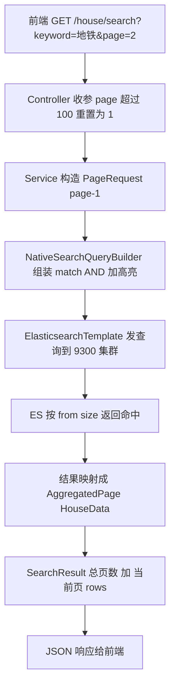

# 开放搜索能力：一个 GET /house/search 接口串起 Spring Data Elasticsearch 的查询与分页

2010 条房源已经在 `haoke` 索引里躺好了，数据侧全部就绪。最后一步是把搜索能力包装成对外的 RESTful 接口，让前端用「一个关键词 + 一个页码」就能拿到结果。接口本身不长，坑却不少：整合走 9300 端口、页码与 ES 的 `from` 相差一、页数与每页条数必须后端卡死，还有 Redis 与 Elasticsearch 共存导致的 netty 冲突启动报错。这一篇从依赖配到实测，把接口跑通。

## 先给结论

- 工程引入 `spring-boot-starter-data-elasticsearch`，配置走 `spring.data.elasticsearch.` 前缀，端口是 9300 不是 9200：这套整合走 Java 传输协议，9200 是 REST 接口专用。
- 查询结果映射到 `HouseData` 实体：`@Document(indexName = "haoke", type = "house", createIndex = false)`，索引已建好，`createIndex` 必须关掉；`@Id` 标注的字段对应文档 `_id`。
- Service 里 `PageRequest.of(page - 1, ROWS)` 的减一不能忘：页码从 1 开始，ES 的 `from` 从 0 开始，不减一时第一页直接跳过前十条，只有一页数据时表现为「查不到结果」。
- `matchQuery("title", keyword).operator(Operator.AND)` 要求分词后的词全部命中，配合标题高亮返回。
- 每页条数 `ROWS = 10` 由后端写死、页数上限 100 由 Controller 卡口，两者都是防线：前者防止一次请求拖走全量数据，后者避开 `from + size` 深分页的性能悬崖。

## 一、接入准备：starter 与 9300 配置

接口继续开发在对外提供服务的 api-server 工程里。pom 追加一个起步依赖，版本照例交给父工程仲裁：

```xml
<!-- Spring Boot 整合 Elasticsearch 的起步依赖 -->
<dependency>
    <groupId>org.springframework.boot</groupId>
    <artifactId>spring-boot-starter-data-elasticsearch</artifactId>
</dependency>
```

配置文件里加上集群连接信息，这个工程同时还挂着 Redis、MongoDB、Dubbo 等一串中间件配置，ES 相关的是最后两行：

```properties
# Elasticsearch 集群配置
spring.data.elasticsearch.cluster-name=es-haoke-cluster
spring.data.elasticsearch.clusterNodes=192.168.1.7:9300,192.168.1.7:9301,192.168.1.7:9302
```

端口在这里最容易翻车：前面练低级、高级 REST 客户端时用的都是 9200，这套 Spring Data 整合却必须写 9300。原因是通道不同，REST 客户端走 HTTP 接口监听的 9200，Spring Data Elasticsearch 走的是 Java 传输协议监听的 9300。集群名也要与集群真实名字一致，节点靠名字认亲，三个节点的 9300、9301、9302 依次列全。

## 二、两个 VO：映射文档与包装响应

查询结果要从文档变成对象，先定义映射用的 `HouseData`：

```java
@Document(indexName = "haoke", type = "house", createIndex = false)
public class HouseData {

    @Id
    private String id; // 文档 _id，导入时由 ES 自动生成

    private String title;
    private String image;
    private String orientation;
    private String houseType;
    private String rentMethod;
    private String time;
    private String rent;
    private String floor;
    private String url;

    // getter/setter 省略
}
```

三个细节。**第一，`createIndex = false` 必须写。** 索引与 mapping 在上一节已经手工建好，实体类不再负责建索引；默认值下工程启动会按实体自动建一次，精心设计的 mapping 就被默认结构覆盖了。**第二，`@Id` 标的字段等价于文档 `_id`。** 导入时没指定 ID，ES 自动生成的那一串，查询结果会回填到这里。**第三，其余字段不加 `@Field` 注解也能完成映射。** 字段名对得上就按默认规则映射，与上一节 mapping 里的字段一一对应。

响应包装类 `SearchResult` 给前端两样东西：总页数与当前页数据：

```java
public class SearchResult {

    private Integer totalPages; // 总页数
    private List<HouseData> rows; // 当前页数据

    public SearchResult(Integer totalPages, List<HouseData> rows) {
        this.totalPages = totalPages;
        this.rows = rows;
    }

    // getter 省略
}
```

## 三、Controller：页数上限这道防线

Controller 很薄，收参数、卡规则、转发 Service：

```java
@RestController
@RequestMapping("house/search")
@CrossOrigin // 支持跨域
public class SearchController {

    @Autowired
    private SearchService searchService;

    @GetMapping
    public SearchResult search(@RequestParam("keyword") String keyword,
                               @RequestParam(value = "page", defaultValue = "1") Integer page) {
        if (page > 100) { // 页数超过 100 一律回到第 1 页
            page = 1;
        }
        return this.searchService.search(keyword, page);
    }
}
```

三个注解各有分工：`@RestController` 让返回值直接序列化成 JSON，不用再写 `@ResponseBody`；`@RequestMapping("house/search")` 定下接口路径；`@CrossOrigin` 放开跨域限制，前端页面与接口不同源时才能调通。

页数上限那一行判断是正经业务防线，背后是两笔账。**第一笔防爬虫。** 不设上限，脚本从第 1 页翻到第 N 页就能把 2010 条数据整站拖走。**第二笔保性能。** ES 的分页靠 `from + size` 实现，取第 100 页时协调节点要向每个分片索要前 1010 条、汇总后再截取，翻得越深，拉的数据越多，查询越慢。100 这个数字不是固定的，50 也好 200 也好，项目里要与产品把需求谈清楚再定。

## 四、Service：NativeSearchQueryBuilder 组装查询

具体查询逻辑在 Service 里。每页条数定义成常量，不开放给前端传参：

```java
@Service
public class SearchService {

    @Autowired
    private ElasticsearchTemplate elasticsearchTemplate;

    public static final Integer ROWS = 10; // 每页条数，后端写死

    public SearchResult search(String keyword, Integer page) {
        // 分页：ES 的 from 从 0 开始，页码 1 要减成 0
        PageRequest pageRequest = PageRequest.of(page - 1, ROWS);
        SearchQuery searchQuery = new NativeSearchQueryBuilder()
                .withQuery(QueryBuilders.matchQuery("title", keyword)
                        .operator(Operator.AND)) // 分词后的词要求全部命中
                .withPageable(pageRequest)
                .withHighlightFields(new HighlightBuilder.Field("title")) // 标题高亮
                .build();

        AggregatedPage<HouseData> housePage = this.elasticsearchTemplate
                .search(searchQuery, HouseData.class);
        return new SearchResult(housePage.getTotalPages(), housePage.getContent());
    }
}
```

这段代码有两处值得逐字看。**`page - 1` 是本节最隐蔽的坑。** 前端传「第 1 页」，ES 的 `from` 语义却是「跳过多少条」，第 1 页应该跳过 0 条。不减一，第一页就从第 11 条开始取，现象非常迷惑：数据明明只有十几条，查询却返回空，怀疑索引、怀疑分词，实际就是页码没减。**`operator(Operator.AND)` 收紧了 match 的匹配口径。** 关键词分词后默认是「命中任意词即返回」（OR），改成 AND 后要求所有分出的词都在标题里，结果更准，代价是召回变少，按业务预期选。

整体链路从请求到响应是这样流转的：



最关键的一环是 G：`ElasticsearchTemplate.search` 把文档 JSON 映射成 `HouseData` 对象，`getTotalPages()` 与 `getContent()` 恰好对应 `SearchResult` 的两个字段，一次查询喂满响应。

## 五、启动联调：netty 冲突与接口实测

工程是微服务体系里的一环，依赖的服务要先起：注册中心、Dubbo 服务提供者与管理服务依次启动，配置文件里的各中间件地址同步改成本机环境，缺一个都起不来。都就绪后启动 api-server，第一次启动大概率撞上报错，大意是可用处理器数量不可用、可用的只有三个。这是 netty 冲突：工程里的 Redis 客户端与 Elasticsearch 客户端都内嵌了 netty，两边对「可用处理器数」的判断打架。解法是在启动类加一行系统属性：

```java
@SpringBootApplication
public class DubboApiApplication {

    public static void main(String[] args) {
        // redis 与 elasticsearch 的 netty 版本冲突，关掉 ES 对处理器数的检测
        System.setProperty("es.set.netty.runtime.available.processors", "false");
        SpringApplication.run(DubboApiApplication.class, args);
    }
}
```

`System.setProperty` 必须放在 `SpringApplication.run` 之前，启动参数要在容器初始化前生效。加上这行重新启动，服务正常就绪，用 Postman 实测：

```bash
curl "http://127.0.0.1:18080/house/search?keyword=上海&page=1"
```

返回的 JSON 里 `totalPages` 为 2；把关键词换成「地铁」，总页数 42，约 420 条，与导入后直接搜 ES 得到的 419 条命中在同一量级；搜「新村」能翻出多个带「新村」的小区房源，翻到第 2 页、第 3 页数据正常换页；把 `page` 传成 1000，返回的是第 1 页内容，防线生效。接口开发到此完成，前端页面接上这组参数就能按关键词翻页搜房源了。

## 常见误区

- **配置端口写成 9200。** Spring Data Elasticsearch 整合走 9300 的传输协议端口，写成 9200 表现为连不上、反复超时，与 REST 客户端的 9200 不是一回事。
- **`createIndex` 忘记关。** 实体默认会按注解自动建索引，工程一启动，手工设计好的 `haoke` mapping 被默认结构覆盖，`index: false`、IK 分词器配置全部作废。
- **页码不减一。** `PageRequest.of(page, ROWS)` 会跳过第一页数据，数据量小的时候直接返回空，排查方向却容易被带偏到分词与索引上。
- **每页条数开放给前端。** rows 参数一旦可传，一次请求返回上万条既拖垮 ES 也让数据被抓走，每页条数必须后端常量写死。

## 面试可能被问到的问题

1. 面试官追问：「为什么 Spring Data Elasticsearch 用 9300，REST 客户端用 9200？」
   答：9200 是 ES 的 HTTP REST 接口端口，低级、高级 REST 客户端都走它；9300 是 Java 传输协议端口，老的 TransportClient 及早期 Spring Data 整合都走它。通道不同端口不同，配置错端口就是连不上的死循环。

2. 面试官追问：「`from + size` 分页为什么越翻越慢？你们怎么控制？」
   答：取第 N 页时协调节点要向每个分片请求前 from+size 条，汇总排序后再截取，N 越大各分片吐出的数据越多。控制手段是业务层限制页数上限，本课在 Controller 里把超过 100 页的请求重置回第 1 页，同时禁用了前端指定每页条数。

3. 面试官追问：「match 查询的 operator 参数有什么作用？」
   答：match 会对关键词分词，OR（默认）要求命中任意一个词，AND 要求所有词都命中。AND 精确率高召回率低，适合「结果宁缺毋滥」的搜索场景，本课按标题搜房源用的就是 AND。

4. 面试官追问：「`@Document` 的 `createIndex = false` 什么时候必须设？」
   答：索引已由 DBA 或初始化脚本按定制 mapping 建好时必须设。否则应用启动时自动建索引，会把定制的分词器、`index: false` 等设置全部覆盖成默认结构，而且索引已存在时这类问题往往静默不易察觉。

5. 面试官追问：「Redis 和 Elasticsearch 整合后启动报 netty 相关异常，什么原因？」
   答：两个客户端都依赖 netty，各自启动时对 `availableProcessors` 的设置相互冲突。解法是在 Spring Boot 启动前设置系统属性 `es.set.netty.runtime.available.processors=false`，让 ES 不再重复设置处理器数。注意属性必须早于容器初始化生效。

6. 面试官追问：「搜索接口除了分页与高亮，还应该做哪些防护？」
   答：关键词长度与非法字符校验，防止超长输入拖垮查询；页数与每页条数后端卡死；频控或验证码对抗脚本翻页爬取；必要时对搜索日志做监控，异常流量及时告警。本课做了页数与条数两个最基本的卡口。

## 配套资料

- 接口的搜索对象数据（真实资料，2010 条房源已导入 `haoke` 索引，实测「地铁」命中约 420 条）：
  `materials/code/03/day15-房源数据抓取以及实现房源搜索/day15-房源数据抓取以及实现房源搜索/资料/抓取的房源数据/data.json`
- day15 资料包未提供 api-server 工程源码：文中 Controller、Service、VO 与启动类代码为按本课写法补全的示例，包名已改为中性的 `com.example.haoke`，集群名沿用本课环境改名后的 `es-haoke-cluster`
