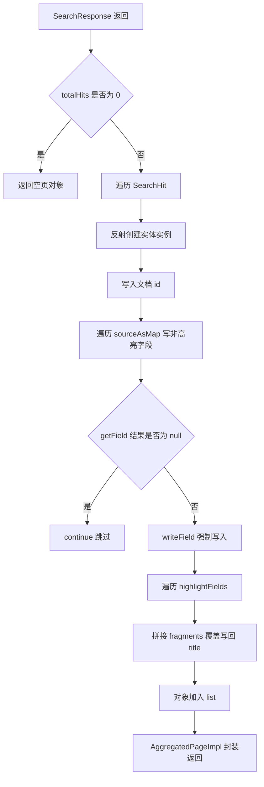

# 自动映射装不下高亮：用 SearchResultMapper 与反射把高亮字段回填实体

搜索接口能按关键词返回房源列表了，但明明在查询构建器上指定了标题高亮，返回的 `title` 里却没有 `<em>` 标签。原因不在 ES，响应里高亮数据好好地躺着，而是 Spring Data Elasticsearch 的自动映射不搬运它。出路是把映射接管过来：手写一个通用的 SearchResultMapper，用反射回填非高亮与高亮字段。

## 先给结论

- 自动映射只处理 `_source` 到实体的字段拷贝，高亮结果挂在 SearchHit 的另一块数据里，指定了 `withHighlightFields` 也不会出现在实体上。
- 出路是 `queryForPage` 第三个参数传自定义 `SearchResultMapper`；一旦传了 mapper，自动映射整体失效，所有字段都要自己映射。
- 回填用反射做通用化：`ReflectUtils.newInstance(clazz)` 建实例，`FieldUtils.writeField` 按字段名写值，末位参数 `true` 是强制写入私有字段的开关。
- 三个必须处理的点：文档 `_id` 要单独回填；实体没有的字段（如 `url`）要先 `getField` 判空跳过；高亮值是 fragment 数组，要拼接全部片段再覆盖写入。
- 没有命中数据时返回空页对象而不是 null，响应结构保持一致。

## 一、自动映射为什么拿不到高亮

上一节的查询是这样的：

```java
SearchQuery searchQuery = new NativeSearchQueryBuilder()
        .withQuery(QueryBuilders.matchQuery("title", keyword)
                .operator(Operator.AND))          // match 查询，分词后要求全部命中
        .withPageable(pageRequest)                // 分页
        .withHighlightFields(new HighlightBuilder.Field("title")) // 对 title 高亮
        .build();
```

指定了高亮字段，ES 的原始响应里也确实带着高亮：每个 SearchHit 上除了 `_source`，还有一块 highlight 区域，存放被标签包裹的片段。问题出在封装环节：自动映射只把 `_source` 抄进实体，highlight 区域看都不看，实体上的 `title` 永远是原始文本。高亮要手动处理，而且一接手就是全部字段。

## 二、自定义 SearchResultMapper：把映射接管过来

模板给了口子：`queryForPage` 支持第三个参数传 `SearchResultMapper` 实现，返回什么由调用方决定。先看骨架：

```java
AggregatedPage<HouseData> housePage = this.elasticsearchTemplate.queryForPage(searchQuery,
        HouseData.class, new SearchResultMapper() {
            @Override
            public <T> AggregatedPage<T> mapResults(SearchResponse response,
                                                    Class<T> clazz, Pageable pageable) {
                // 没有命中也要返回分页对象，不能返回 null
                if (response.getHits().totalHits == 0) {
                    return new AggregatedPageImpl<>(Collections.emptyList(), pageable,
                            response.getHits().totalHits);
                }
                List<T> list = new ArrayList<>();
                for (SearchHit searchHit : response.getHits().getHits()) {
                    // 逐条映射，见下一节
                }
                return new AggregatedPageImpl<>(list, pageable, response.getHits().totalHits);
            }
        });
```

签名注意两点：`mapResults` 收响应对象、目标类型、分页对象，pageable 要原样带回，它是模板组装分页信息的依据；`AggregatedPageImpl` 的构造传当前页数据、pageable、总命中数，总命中数取 `response.getHits().totalHits`，总页数由模板按每页条数换算。空命中分支返回同样的空页对象，响应结构恒定不变。

## 三、反射回填：通用 mapper 的核心

mapper 要做到任何实体类都能用，就不能写死 `new HouseData()`，而是反射建实例、按字段名写值。hit 循环体如下：

```java
T obj = (T) ReflectUtils.newInstance(clazz); // 反射创建实体实例

// 文档 _id 不在 _source 里，单独回填
try {
    FieldUtils.writeField(obj, "id", searchHit.getId(), true);
} catch (IllegalAccessException e) {
    e.printStackTrace();
}

// 非高亮字段：遍历 _source 逐个写入
for (Map.Entry<String, Object> entry : searchHit.getSourceAsMap().entrySet()) {
    Field field = FieldUtils.getField(clazz, entry.getKey(), true);
    if (null == field) {
        continue; // 响应里有实体没有的字段，跳过
    }
    try {
        FieldUtils.writeField(obj, entry.getKey(), entry.getValue(), true);
    } catch (IllegalAccessException e) {
        e.printStackTrace();
    }
}

// 高亮字段：拼接全部片段后覆盖写入
for (Map.Entry<String, HighlightField> entry : searchHit.getHighlightFields().entrySet()) {
    StringBuilder sb = new StringBuilder();
    for (Text fragment : entry.getValue().getFragments()) {
        sb.append(fragment.toString());
    }
    try {
        FieldUtils.writeField(obj, entry.getKey(), sb.toString(), true);
    } catch (IllegalAccessException e) {
        e.printStackTrace();
    }
}
list.add(obj); // 每条 hit 处理完统一入集合
```

逐段拆解。**ReflectUtils.newInstance 是「传 Class 返回实例」的小工具**，等价于 `clazz.newInstance()`，JDK 9 之后推荐改用 `clazz.getDeclaredConstructor().newInstance()`。**FieldUtils 来自 commons-lang3**，`writeField` 与 `getField` 的最后一个布尔参数都是 forceAccess，true 表示绕过 private 强制读写，私有字段少了它读不到也写不进。**高亮覆盖写在非高亮之后**，title 先被写入原始文本，再被带 `<em>` 标签的高亮串覆盖，前端拿到的就是高亮版本。**fragment 要循环拼接**：ES 可能按片段切分高亮结果，只取第一个会丢内容。

整段流程如图：



核心路径是 G 到 L 的顺序：先抄原文再覆盖高亮，顺序反了高亮会被原始值冲掉。

## 四、调试实录：三个真实的坑

mapper 写完跑不通，断点跟下来撞到三个坑。

**第一，url 字段写入报错。** 抓取时把详情页地址 `url` 写进了索引，`_source` 里有、HouseData 上没有，不加判断地 `writeField` 直接抛异常。补上 `getField` 判空，null 就 continue。

**第二，判空加了，字段却读不到。** obj 里仍然没有数据，再跟一轮才发现 `getField` 少传了 `true`：私有字段不加 forceAccess 拿到的 field 是 null，全走了 continue。

**第三，id 一直为空。** 其他字段都有了，`id` 还是 null：`_source` 里根本没有 id，它只存在于 `searchHit.getId()`。在循环体最前面单独补一行回填。

## 常见误区

- **没命中数据时 return null。** 前端拿到的是空指针或反序列化失败，正常空结果应是 `rows` 为空数组，应返回空页对象。
- **writeField 或 getField 不传 forceAccess。** 私有字段读不到、写不进，表现为映射出的对象全空且不报错，只能靠断点发现。
- **list.add 写进字段循环里。** 每写一个字段就 add 一次，同一对象重复入集合。add 应放在 hit 循环内、字段循环外，每条 hit 只进一次。
- **高亮只取第一个 fragment。** 长标题被切分成多段时内容丢失，要用 StringBuilder 把 fragments 全部拼起来。

## 面试可能被问到的问题

1. 面试官追问：「为什么自定义了 SearchResultMapper 之后自动映射就失效了？」
   答：mapper 是模板留给调用方的接管入口，传入实现后结果转换整体委托给它，模板不再做字段映射，高亮与普通字段都要自己处理。

2. 面试官追问：「反射写私有属性是怎么做到的？」
   答：commons-lang3 的 FieldUtils.writeField 传 forceAccess 为 true，内部等价于先 setAccessible(true) 再赋值；原生写法就是拿到 Field 后 setAccessible 再写入。

3. 面试官追问：「ES 高亮结果的原始结构长什么样？」
   答：每个 SearchHit 上有独立的 highlightFields 区域，是字段名到 HighlightField 的映射，值是 Text 数组，元素是插入高亮标签后的片段；它与 _source 是两块数据，自动映射不搬运。

4. 面试官追问：「为什么用泛型加反射写 mapper，而不是直接操作 HouseData？」
   答：泛型加反射让 mapper 与具体实体解耦，换索引、换实体类代码原样可用。代价是失去编译期字段检查，字段名拼错要到运行时才发现。

5. 面试官追问：「高亮标签 em 是谁定义的，能换吗？」
   答：ES 默认 pre_tags 与 post_tags 是 em 标签对，构建 HighlightBuilder.Field 时可链式指定 preTags、postTags，换成带 class 的 span 后前端按 class 着色。

6. 面试官追问：「AggregatedPage 和普通 Page 有什么区别？」
   答：AggregatedPage 是 Spring Data Elasticsearch 的扩展接口，在分页信息外还能携带聚合结果；queryForPage 签名要求返回它，用 AggregatedPageImpl 构造即可。

## 配套资料

- 搜索数据源：`materials/code/03/day15-房源数据抓取以及实现房源搜索/day15-房源数据抓取以及实现房源搜索/资料/抓取的房源数据/data.json`（`url` 字段正是调试时写入报错的那一列）
- day15 资料包未含 api-server 源码：SearchService、SearchResultMapper 匿名实现与 HouseData 为按本课写法补全的示例，包名沿用上一节的 `com.example.haoke`
