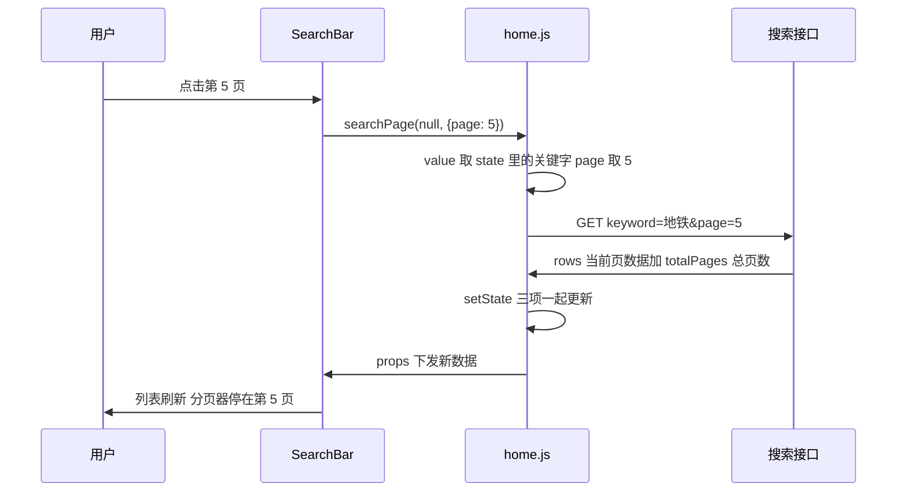

# 搜索结果翻上页码：from/size 分页与前端分页器的完整联动

搜索、高亮都通了，还差最后一环：结果一多，页面上仍然是第一页的十条，用户没有翻页的手段。这一篇把分页器接进结果浮层，页码变化重新带参查询，顺带解决翻页时关键字丢失的问题，day15 的搜索闭环在此收束。

## 先给结论

- 后端在接口开发时已支持 `page` 参数：Service 里 `PageRequest.of(page - 1, ROWS)` 换算成 ES 的 from，mapper 把 `totalHits` 带回，模板换算出 totalPages，前端要的页码与总页数都是现成的。
- 前端用 semantic-ui-react 的 Pagination 组件，`totalPage > 1` 才渲染，单页结果不给分页条。
- 翻页回调把页码交回 home 的 `search`，与输入框共用同一条查询链路：`data.value` 有值取输入框，`data.page` 有值取页码，两个入口一套代码。
- 关键字必须记进 state：翻页触发时 `data.value` 不存在，靠 `this.state.searchKeyword` 补上，否则拼出 `keyword=undefined`。
- `defaultActivePage` 是非受控用法，新搜索后分页器停留在旧页码，需要页码跟随搜索重置时改用受控的 `activePage`。

## 一、后端盘点：分页的原料早就备好了

接口那一节定下的契约是 `GET /house/search?keyword=xx&page=n`，Service 内部两行关键代码：

```java
public static final Integer ROWS = 10; // 每页条数，后端写死

// 页码从 1 开始，ES 的 from 从 0 开始，必须减一
PageRequest pageRequest = PageRequest.of(page - 1, ROWS);
```

自定义 mapper 返回的 `AggregatedPageImpl(list, pageable, totalHits)` 里，第三个参数是总命中数，模板按每页条数向上取整换算出 totalPages，Controller 一并返回给前端。也就是说前端翻页需要的两样东西，页码语义与总页数，在高亮改造之前就全部就绪，这一篇只做接线。

## 二、Pagination 组件：单页不显示

SearchBar 里引入组件并做条件渲染：

```jsx
import { Icon, Item, Pagination } from 'semantic-ui-react';

{this.props.totalPage > 1 ? (
    <Pagination
        defaultActivePage={1}   // 默认停在第 1 页
        firstItem={null}        // 不要首页按钮
        lastItem={null}         // 不要末页按钮
        totalPages={this.props.totalPage}
        onPageChange={this.handlePageChange}
    />
) : null}
```

`totalPage` 从 home 经 props 传下来，home 的 state 里初始化为 0：只有一页数据时分页条毫无意义，`> 1` 的判断把这种场景挡掉。

翻页回调：

```javascript
handlePageChange = (e, { activePage }) => {
    // 解构出目标页码，交回 home 的 search，复用查询链路
    this.props.searchPage(null, { page: activePage });
};
```

onPageChange 的回调第二个参数里带着 activePage，解构出来后包成对象传回去，与输入框触发时的数据形状对齐，home 那边就不用写两套判断。

## 三、home.search 合并两个入口

输入框 onChange 与翻页现在走同一个 search 方法，方法内部要分辨「谁触发了我」：

```javascript
search = (event, data) => {
  // 输入框触发：data.value 有值；翻页触发：data.page 有值
  let value = data.value ? data.value : this.state.searchKeyword;
  let page = data.page ? data.page : 1;
  this.searchHandle();
  axios.get('http://127.0.0.1:18080/house/search?keyword=' + value + '&page=' + page)
    .then((response) => {
      this.setState({
        searchData: response.data.rows,
        totalPage: response.data.totalPages, // 总页数喂给分页器
        searchKeyword: value                 // 关键字记进 state，翻页不丢
      });
    });
};
```

props 的接线加一路：

```jsx
<SearchBar searchData={this.state.searchData}
           totalPage={this.state.totalPage}
           searchPage={this.search}
           hideSearchBar={this.hideSearchBar}/>
```

全链路走一遍：



两条支线在这里汇合：输入框支线带 value 与 page=1，翻页支线带 page 与 state 里的旧关键字，都落到同一次 axios 请求上。实测搜「1」出现分页条，点第 5 页，网络面板里 `keyword=1&page=5`，关键字未丢、页码正确换页；换搜「地铁」，四十多页照样逐页可达。

## 四、翻页丢关键字：一个必须用 state 补的洞

单独看 search 的取值逻辑，容易误以为 `data.value ? ... : ...` 是多余防御，实际它是翻页场景的命脉。翻页触发时 semantic-ui 传来的 data 里只有页码没有输入内容，而输入框此刻可能已被清空、焦点早已离开，关键字唯一的存活副本就是上一次搜索时存进 state 的 searchKeyword。这也是为什么 setState 时专门多写一项把它记下来：数据的生命周期要覆盖它的所有使用方，关键字的使用方除了本次查询，还有下一次翻页。

深分页的边界在接口那一节已经卡好：页数上限 100、每页条数写死，翻到 101 页会被重置回第 1 页。分页器翻得再欢，也翻不出 ES 的 from + size 性能悬崖。

到这里 day15 的主链路闭环：WebMagic 抓房源、图片上 OSS、数据导入 `haoke` 索引、RESTful 搜索接口、前端搜索框、高亮、分页，每一环都在前面的某一节里落地。讲义在分页之后还排了热词搜索一节，需求是结果过多或仅有一条时展示最多五个热词、按搜索量排序，视频没有展开，基于现有链路加一张热词索引即可自行尝试。

## 常见误区

- **翻页后关键字丢失。** search 里只取 `data.value`，翻页时拿到 undefined，请求变成 `keyword=undefined`。关键字存 state，翻页时兜底取用。
- **不判断 totalPage 就渲染分页条。** 只有一页结果也显示一页的分页器，观感多余。`totalPage > 1` 再渲染。
- **页码不减一。** 后端写成 `PageRequest.of(page, ROWS)` 会让第 1 页直接跳过前十条，翻页功能表现为内容错位一页。
- **分页器停在旧页码。** `defaultActivePage` 只在首次挂载生效，输入新关键字搜索后分页器仍指向旧页。改用受控的 `activePage` 配合 state，搜索时把页码重置为 1。

## 面试可能被问到的问题

1. 面试官追问：「ES 的 from + size 分页为什么深翻就慢？」
   答：取第 N 页时协调节点要向每个分片索要前 from+size 条，汇总排序后丢弃前面的只留一页，N 越大搬运越多。默认 max_result_window 是 10000，更深的翻页要换 scroll 或 search_after，本课用页数上限从业务侧绕开悬崖。

2. 面试官追问：「页码到 from 的换算为什么要减一？」
   答：ES 的 from 语义是跳过多少条，第 1 页应跳过 0 条，而用户与前端约定的页码从 1 开始，所以 from = (page - 1) * size。不减一，第 1 页就从第 size + 1 条开始取。

3. 面试官追问：「总页数是怎么算出来的？」
   答：总命中数 totalHits 由自定义 mapper 传入 AggregatedPageImpl，模板按每页条数向上取整得到 totalPages，Controller 随数据一起返回。前端不做任何总页数计算，只负责展示与传递。

4. 面试官追问：「受控与非受控组件在分页器上的差异？」
   答：defaultActivePage 是非受控，当前页由组件自己维护，外部搜索关键字变化它感知不到，页码不会自动回 1；activePage 配合 onChange 是受控，当前页由 state 驱动，新搜索时把页码 state 重置即可让分页器同步归位。

5. 面试官追问：「搜索关键字除了存 state 还能怎么持久化？」
   答：更通用的做法是写进 URL 的 query 参数，配合 history 的 push 或 replace，刷新页面、分享链接、前进后退都能恢复搜索状态，分页页码同理；state 方案只覆盖不刷新的场景。

6. 面试官追问：「翻页时高亮要重新处理吗？」
   答：不用特殊处理。每一页都是一次全新的查询，ES 对当前页命中结果重新生成高亮，mapper 对每条 hit 统一回填，分页与高亮在链路上互不干扰，天然可组合。

## 配套资料

- 搜索数据源：`materials/code/03/day15-房源数据抓取以及实现房源搜索/day15-房源数据抓取以及实现房源搜索/资料/抓取的房源数据/data.json`（2010 条房源是分页翻页的实体数据）
- day15 资料包未含前端工程与 api-server 源码：Pagination 接线、search 方法与 Service 分页片段为按本课写法补全的示例，接口契约与 `/house/search` 系列保持一致
