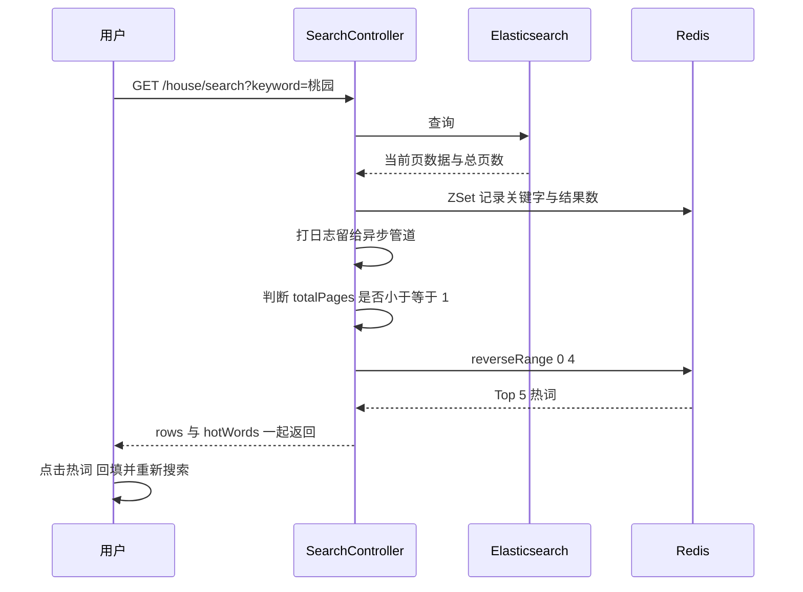

# 热词功能落地：ZSet 记分、TopN 下发与前端点击回填的完整接线

方案分析已经把路铺好：搜索时记录关键字与结果数，结果少时从 Redis 取 Top 5 随响应返回。这一节把两条路的代码全部写进 `SearchController`，再把前端的建议区接上，热词功能从需求走到可点可搜。

## 先给结论

- 存储用 Redis 有序集合：成员是关键字，分数是该词命中的结果数，`reverseRange` 取下标 0 到 4 就是 Top 5。
- 结果数不能直接用总页数，要按 `(totalPages - 1) * ROWS + 当前页条数` 换算，且 `totalPages` 可能是 0，必须用 `Math.max` 兜底成至少 1，否则减出负数。
- 记录发生在每次搜索里，写 Redis 与记日志（异步方案的半程）各一行；读取只在 `totalPages <= 1` 时发生。
- 响应对象 `SearchResult` 扩一个 `Set<String> hotWords` 字段，前端 state 加同名数据，Label 渲染建议区。
- 点击热词走与翻页相同的复用路径：把词当普通输入值传回 home 的 search，输入框的 value 绑定 state 后，回填与搜索由同一次点击完成。

## 一、存储选型落码前先定两件事

有序集合的成员唯一、每个成员挂一个 double 分数、整体按分数有序，这三条性质对热词是量身定做：同一个关键字反复出现时只占一个成员，分数用来排序，倒序区间查询直接给出榜单。

写入用 `add(key, member, score)` 覆盖式设分。本课口径是分数等于该词当次搜索的结果数，覆盖正合适；换成「按搜索次数」口径时，把 `add` 换成 `incrementScore` 累加即可。key 定义成常量，值随意但全工程要统一：

```java
private static final String REDIS_KEY_HOT_WORDS = "haoke_hot_words"; // 热词 ZSet 的 key，名字可自定
```

## 二、Controller：记录、换算、判断、取词

改造后的 `SearchController` 是这一节的主角，记录与查询两个动作都在这里完成：

```java
@RestController
@RequestMapping("house/search")
@CrossOrigin // 支持跨域
public class SearchController {

    private static final Logger LOGGER = LoggerFactory.getLogger(SearchController.class);

    private static final String REDIS_KEY_HOT_WORDS = "haoke_hot_words"; // 热词 ZSet 的 key

    @Autowired
    private SearchService searchService;

    @Autowired
    private RedisTemplate redisTemplate;

    @GetMapping
    public SearchResult search(@RequestParam("keyword") String keyword,
                               @RequestParam(value = "page", defaultValue = "1") Integer page) {
        if (page > 100) { // 页数超过 100 一律回到第 1 页，防线沿用
            page = 1;
        }
        SearchResult search = this.searchService.search(keyword, page);

        // 1. 换算结果总数：总页数减一乘每页条数，再加当前页实际条数
        int total = (Math.max(search.getTotalPages(), 1) - 1) * SearchService.ROWS
                + search.getRows().size();

        // 2. 同步方案：写入 ZSet，成员是关键字，分数是结果数
        this.redisTemplate.opsForZSet().add(REDIS_KEY_HOT_WORDS, keyword, total);

        // 3. 异步方案半程：只记一行结构化日志，聚合交给后续日志体系
        LOGGER.info("搜索关键字为 {}, 结果数量为 {}", keyword, total);

        // 4. 结果少（无结果或仅一页）才查热词，取下标 0 到 4 共 5 个
        if (search.getTotalPages() <= 1) {
            Set<String> hotWords = this.redisTemplate.opsForZSet()
                    .reverseRange(REDIS_KEY_HOT_WORDS, 0, 4);
            search.setHotWords(hotWords);
        }
        return search;
    }
}
```

几处细节值得停下来看。

**结果数换算里埋着一个负数陷阱。** `SearchResult` 带回来的是总页数不是总条数，总数要自己拼：满页部分用「页数减一乘每页条数」，零头用当前页实际条数补上。问题是零结果时总页数是 0，`(0 - 1) * 10` 直接算出负数，分数就成了 `-10`。`Math.max(search.getTotalPages(), 1)` 把页数下限卡在 1，无结果时总数按当前页条数（0）计，干净落地。

**倒序区间的下标是 0 到 4。** `reverseRange` 按分数从大到小排，区间闭包含头含尾，0 到 4 恰好 5 个，与需求的上限对齐。下标从 0 开始这一点与数组一致，写顺手了容易惯性多写一位。

**日志行是异步方案的契约。** 格式固定为「关键字在前、数量在后」，后续的日志消费端按这个格式解析，格式一变消费端就瞎，改格式必须两边同步。

整条链路串起来是这样：



写入在每次搜索时执行，读取只在结果少时发生，两条动作对同一个 ZSet 一写一读，榜单就这样滚动起来。

## 三、VO 扩展与实测

`SearchResult` 加一个字段，Set 天然去重，正好承接 ZSet 取出的成员：

```java
public class SearchResult {

    private Integer totalPages;      // 总页数
    private List<HouseData> rows;    // 当前页数据
    private Set<String> hotWords;    // 热词，结果少时后端填充
    // 构造器与 getter 省略
}
```

重启服务实测。第一次搜「1」时 ZSet 里只有刚写入的这条记录，响应里 `hotWords` 可能是空或 null，属正常现象，榜单要靠多搜几轮喂出来。搜「111」，结果只有一条，触发热词查询；再搜「小区」这类结果多的词喂榜，回头再搜「111」，响应里已经能看到「小区」排在建议里。榜单是活的，搜索行为越多，Top 5 越能代表「能搜出大量结果的词」。

## 四、前端整合：建议区、点击与回填

前端三步。**第一步，SearchBar 里渲染建议区**，结果少且 `hotWords` 有值时，每个词一个 Label：

```jsx
{this.props.hotWords && this.props.hotWords.length > 0 ? (
    <div>
        <span>搜索的结果较少，建议搜索：</span>
        {this.props.hotWords.map((word, idx) => (
            <Label as='a' key={idx} onClick={this.handleHotSearch}>{word}</Label>
        ))}
    </div>
) : null}
```

**第二步，点击回调复用搜索链路**，与翻页的 `handlePageChange` 并排：

```javascript
handlePageChange = (e, { activePage }) => {
    this.props.searchPage(null, { page: activePage });
};

handleHotSearch = (e, data) => {
    // Label 的文本就是热词，当作输入值传回去
    this.props.searchPage(null, { value: data.children });
};
```

**第三步，home 的 state 与回填**。state 初始化 `hotWords: []`，axios 回调多 setState 一路：

```javascript
axios.get('http://127.0.0.1:18080/house/search?keyword=' + value + '&page=' + page)
    .then((data) => {
        this.setState({
            searchData: data.rows,
            totalPages: data.totalPages,
            hotWords: data.hotWords // 建议区数据源
        });
    });
```

还有一处隐蔽但必须做的：把搜索框输入框的 `value` 绑定到 `this.state.searchKeyword`。点击热词后 search 里 `setState` 更新了 `searchKeyword`，state 一变，受控的输入框跟着显示热词，回填才真正可见。不绑这一步，搜索结果换了，输入框里还是旧词，用户会怀疑搜的到底是哪次。

到这里点一下「小区」：输入框文字变成小区、请求带着新关键字发出、结果区刷新，热词闭环完成。day15 的搜索链路连热词在内全部走通。

## 常见误区

- **结果数直接用总页数当分数。** 页数与条数差着一个量级，「111」和「小区」都记成 1 分，榜单失去区分度。按满页乘条数加零头换算。
- **不处理零页数。** 零结果时 `(0 - 1) * ROWS` 得负分，负分成员永远沉底还好，就怕后续换口径时脏数据作祟。`Math.max(totalPages, 1)` 一行兜住。
- **`add` 与 `incrementScore` 用反。** 结果数口径用 `add` 覆盖，次数口径用 `incrementScore` 累加，反过来则榜单要么只记得最后一次、要么虚高离谱。
- **输入框不受控。** 点击热词后只有结果刷新、输入框原地不动，回填体感断裂。输入框 `value` 绑 state，靠 setState 驱动同步。

## 面试可能被问到的问题

1. 面试官追问：「为什么取热词用 `reverseRange` 而不是 `range`？」
   答：ZSet 默认按分数升序，`range` 从低分取起；热词要的是分数最高的前 N 个，`reverseRange` 按分数从大到小返回区间，下标 0 到 4 即 Top 5，避免取全量再排序。

2. 面试官追问：「记录热词的写入失败会怎样？」
   答：当前这次搜索的热词数据丢了，榜单短暂少一个样本，功能无损。写入应包 try-catch 降级，失败打告警不阻断搜索；这也是同步方案接入生产前的必要保护。

3. 面试官追问：「多个服务实例并发写同一个 ZSet 会有问题吗？」
   答：没有并发覆盖问题，ZSet 的成员是唯一的，`add` 只更新该成员的分数，Redis 单线程处理命令保证每次写原子生效。真要按搜索次数累加口径，`incrementScore` 也是原子操作，多实例写无需加锁。

4. 面试官追问：「`hotWords` 首次搜索是 null，前端怎么处理？」
   答：榜单冷启动阶段数据还没喂出来，返回 null 属正常。前端渲染前判空，空数组或 null 都不渲染建议区；后端也可以在无热词时返回空集合，把 null 挡在服务端，前端判断更省心。

5. 面试官追问：「热词榜单想区分今天与本周，实现要改哪里？」
   答：给 ZSet 的 key 加时间维度，例如 `haoke_hot_words:20241015` 按天滚动，写入按当天 key，读取按所需窗口取对应 key，旧 key 设 TTL 过期；业务代码里改的是 key 的拼法，结构与接口不动。

6. 面试官追问：「这套热词统计在高并发下会成为瓶颈吗？」
   答：单次搜索多一次 Redis 命令，ZSet 的写与区间读都是常数量级操作，Redis 单节点扛十万级 QPS 无压力。真正的风险在同步写入把可用性耦合进来，量大之后切异步日志管道，搜索接口只留一行日志输出。

## 配套资料

- 搜索的实体数据：`materials/code/03/day15-房源数据抓取以及实现房源搜索/day15-房源数据抓取以及实现房源搜索/资料/抓取的房源数据/data.json`（2010 条房源，「111」「小区」「桃园」等实测关键字均出自它）
- day15 资料包未含 api-server 工程与前端工程源码：文中 Controller、VO 与前端组件代码为按本课写法补全，接口契约、`ROWS` 常量与页数上限沿用搜索接口系列
