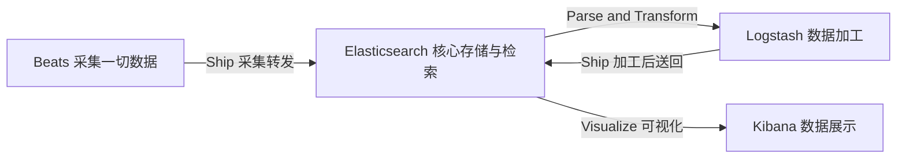

# ES 学完还不够：Beats 采集、Logstash 加工、Kibana 展示补齐最后一公里

好客租房的搜索功能做完，Elasticsearch 的存储与检索已经用得顺手了。但退后一步看整套系统，有三个不对劲一直悬着：索引里的房源是 Java 代码手动灌进去的，那些没法用代码「灌」的数据，比如每台服务器的日志、每个容器的资源占用，谁来收？检索结果只能在调试工具和业务页面里看，想直观看到数据长什么样、趋势如何，没有一个界面；还有，采集来的原始日志格式五花八门，谁在入库前把它们整形？day16 要学的三样东西，正好一一对上这三个问题。

## 先给结论

- Elastic Stack 不止 Elasticsearch：采集靠 Beats，加工靠 Logstash，存储检索靠 Elasticsearch，可视化靠 Kibana，day16 把剩下三块补齐，基础栈就学完整了。
- Beats 是轻量采集器家族，本章学两个：Filebeat 收日志文件，Metricbeat 收系统与服务指标。
- Kibana 让数据以界面形式呈现，探索数据、做仪表盘都不用写查询代码。
- Logstash 擅长对读到的数据做自定义加工，需要解析转换时把它插在 Beats 与 Elasticsearch 之间。
- 数据流向记住两条路：轻采集直达 ES，重加工先过 Logstash，最终都在 Kibana 看见。

## 一、三个缺口，分别由谁填上

**缺口一：采集。** 应用数据有代码往 ES 里写，系统日志和指标是另一回事。日志散落在每台机器、每个容器里，靠人上去 `tail` 文件既慢又漏；CPU、内存、Redis 这类中间件的运行指标，更是没有任何现成入口。缺一个能部署到数据源头、持续把数据搬走的角色。

**缺口二：可视化。** 到目前为止所有查询都靠发请求看 JSON，判断数据对不对全凭肉眼扫字段。运营想看搜索词的走势、运维想看集群的负载，不可能让每个人都发请求。缺一个把索引数据变成图表的界面层。

**缺口三：加工。** ES 存进去什么就能搜出什么，但采集来的原始日志往往一行混着时间、级别、线程、消息，结构化程度参差。直接入库，字段全是散文本，检索价值大打折扣。缺一个入库前的加工管道，能解析、转换、富化。

三个缺口对应三个角色，本章的学习模块就是这么排的：了解 Beats、Filebeat 入门、Metricbeat 入门、Kibana 入门、Logstash 入门。

## 二、一张图看清数据怎么流

官方给的 Elastic Stack 组成图，数据流向是这样的：



图上有两条链路值得盯着看。**轻链路**是 Beats 直接 Ship 到 Elasticsearch，采集器把数据送到存储检索引擎，一切在源头就绪时走这条；**重链路**是数据先进 Logstash 做解析与转换，再送回 Elasticsearch，需要自定义加工时走这条。无论哪条路，末端都汇到 Kibana 的可视化。PPT 里还有一处标注值得留意：Beats 一侧写着「Metricbeat 服务指标」，说明指标数据也是采集进来的，不是 ES 自己产生的。

三个角色按「管什么」列表对比：

| 角色 | 定位 | 解决的问题 | 部署位置 |
|---|---|---|---|
| Beats | 轻量采集器家族 | 把日志、指标从源头搬出来 | 数据源头，与业务同机 |
| Logstash | 服务端数据管道 | 解析、转换、富化原始数据 | 独立服务器，采集与存储之间 |
| Elasticsearch | 存储与检索引擎 | 数据落库、供查询 | 集群，已在 day13 学过 |
| Kibana | 可视化平台 | 界面化探索与展现数据 | 独立部署，面向使用的人 |

## 三、带着问题学每个组件

本章五个模块，每个都从「解决什么问题」进入，比记目录有用得多。

**Filebeat，日志文件怎么被持续盯住？** 它的职责是盯着日志文件的变化，新写一行就采集一行，做到不漏、不重。学它的架构（harvester 与 spooler 的分工）、部署安装、配置文件的写法，以及内置 Module 怎么开箱读取常见组件的日志，课程安排了读取 Redis 日志的实操。

**Metricbeat，指标数据从哪来？** CPU、内存、磁盘这类系统指标，Redis、MySQL 这类服务指标，它按周期轮询然后送去存储。学完部署与收集系统指标，再通过 Redis Module 体会指标采集的模块化。

**Kibana，数据怎么变成看得见的图？** 介绍与安装之后，重点在数据探索和仪表盘：Metricbeat 仪表盘、Filebeat 仪表盘各练一遍，指标曲线和日志列表都是现成的。

**Logstash，原始数据怎么整形？** 它是服务端管道，学简介、部署、与 Filebeat 的整合、数据发送到 Elasticsearch，核心是把 input、filter、output 三段式的处理链搭起来。

## 四、先把最小链路的形状看一眼

具体部署后面每课都会拆开讲，这里先给一条最小链路的配置形状，感受一下各组件的分工（资料包未含本课源码，以下为按本课写法补全的示例）：

```yaml
# filebeat.yml 的最小骨架：采什么，送到哪
filebeat.inputs:
  - type: log
    enabled: true
    paths:
      - /var/log/*.log        # 盯住这个目录下的日志文件

output.elasticsearch:
  hosts: ["http://192.168.1.7:9200"]   # 直接送往 Elasticsearch
```

```text
# logstash 管道的形状：input 进，filter 加工，output 出
input  { beats { port => 5044 } }            # 接收 Filebeat 送来的数据
filter {
  grok { match => { "message" => "%{TIMESTAMP_ISO8601:time} %{LOGLEVEL:level} %{GREEDYDATA:msg}" } }
}
output { elasticsearch { hosts => ["http://192.168.1.7:9200"] } }
```

Filebeat 的配置回答「采什么、送到哪」，Logstash 的配置回答「数据怎么加工」，两份文件各管一段，拼起来就是从日志文件到 Elasticsearch 的完整通路。


本章学完，这条从日志产生到图表呈现的通路就完整了，好客租房项目里散落的容器日志也将有处可去。

## 常见误区

- **用 Logstash 替代 Beats 去源头采集。** Logstash 依赖 JVM，资源占用重，装到每一台业务机器上不现实；Beats 为采集而生、开销极小。常见组合是每台机器跑 Beat，Logstash 集中部署做加工。
- **把 Kibana 当存储。** Kibana 只查询与展示，数据全在 Elasticsearch 里，ES 上的索引删了，Kibana 里就什么都没有。
- **指望 Beats 做复杂加工。** 采集器只负责收与转发，解析、转换、富化是 Logstash filter 的活，把加工需求压给 Beat 属于用错工具。
- **以为 Kibana 的图表要自己写代码。** 常规的探索与仪表盘都是界面操作，Filebeat、Metricbeat 还自带现成仪表盘，本章后段就会用到。

## 面试可能被问到的问题

1. 面试官追问：「Elastic Stack 由哪几部分组成，数据怎么流动？」
   答：Beats 负责在数据源头轻量采集，Logstash 负责服务端的解析转换，Elasticsearch 负责存储与检索，Kibana 负责可视化。数据流是 Beats 采集后可直接送 Elasticsearch，也可先经 Logstash 加工再入 Elasticsearch，最终通过 Kibana 展现。

2. 面试官追问：「Beats 和 Logstash 功能重叠吗，什么时候两个都用？」
   答：都做数据搬运，但定位不同。Beats 轻量，部署在每台源头机器上做采集；Logstash 重量级，依赖 JVM，擅长解析与转换。日志量大且需要结构化加工时，用 Filebeat 在源头采、送到 Logstash 加工、再入 ES，两者是上下游配合而非替代关系。

3. 面试官追问：「Kibana 在架构里扮演什么角色？」
   答：它是 Elastic Stack 的可视化层，对 Elasticsearch 的数据做界面化探索、检索与仪表盘呈现，也承担部分集群管理功能。它本身不存业务数据，所有数据来自背后的 Elasticsearch。

4. 面试官追问：「为什么 Beats 能做到轻量？」
   答：它的职责被压缩到只做采集与转发，不承担解析、存储；实现上不依赖 JVM，资源占用小，可以作为常驻进程跟业务部署在同一台机器甚至容器里，这是它区别于 Logstash 的关键。

## 配套资料

- 本课为 day16 导览，课程资料包 `materials/code/03/day16-ElasticStack学习之Beats、Kibana、Logstash/` 解包后未含源码文件，文中两段配置为按本课写法补全的可运行示例
- Elasticsearch 环境与分词器背景可对照 day15 资料：`materials/code/03/day15-房源数据抓取以及实现房源搜索/day15-房源数据抓取以及实现房源搜索/资料/集群添加IK分词器.md`
