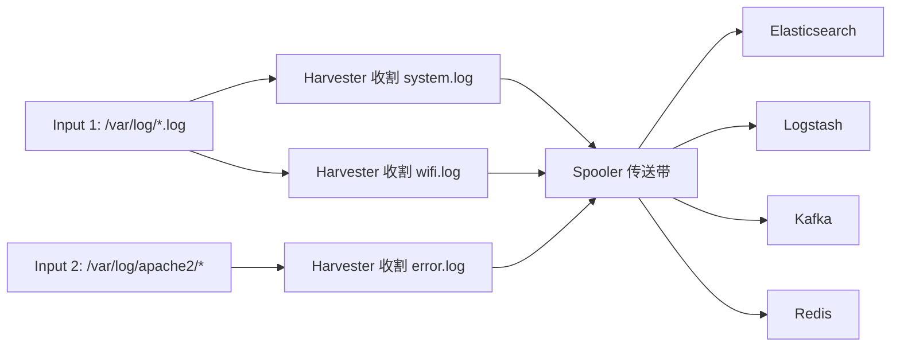
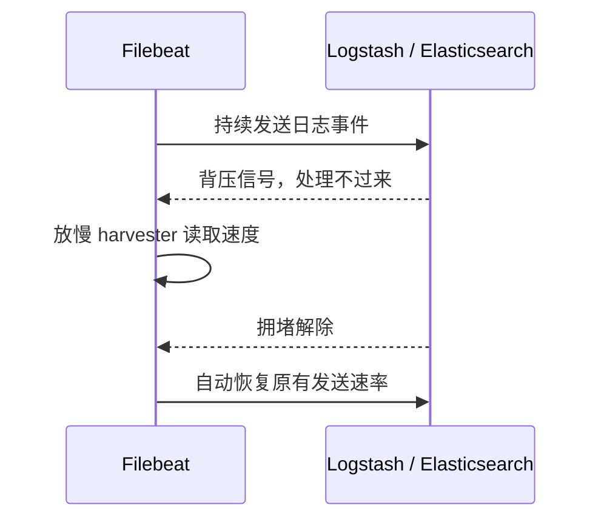
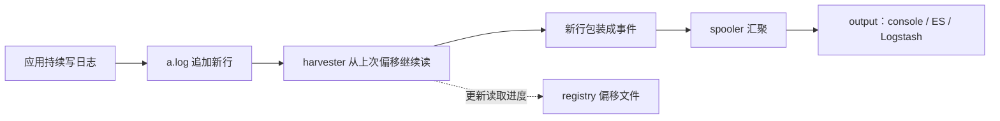
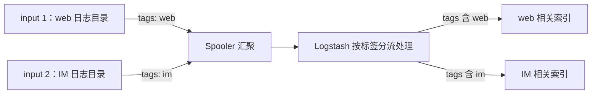
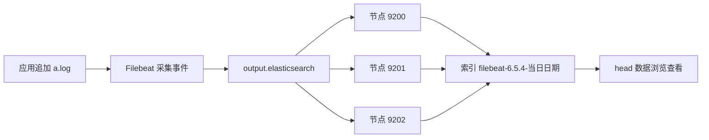
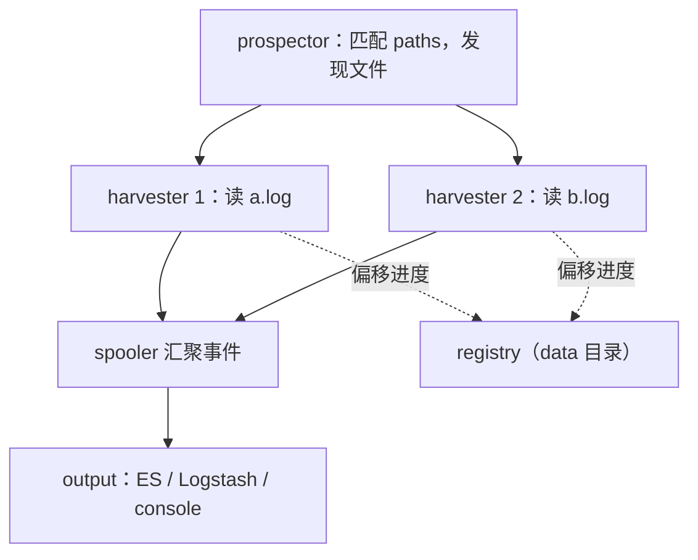
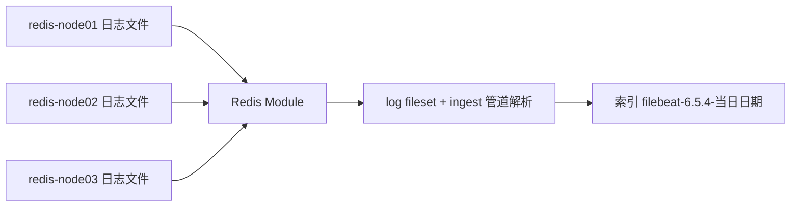

# Filebeat入门学习之七讲：轻量日志采集器的原理、部署、配置进阶与 Module 实战

## 先给结论

Filebeat 是 Elastic Stack 里贴着应用跑的轻量型日志采集器：Go 语言编写、单个二进制即可运行、常驻开销很小，解决的是查看日志要登录服务器的人肉操作。全系列七讲从定位与内部原理讲到部署上手、采集日志文件、给事件打标分流、直连 Elasticsearch，再用开箱即用的 Module 收尾，构成一条完整的入门动线。
原理层先立住三件套与一本账：input 指定日志路径，harvester 逐行收割每个文件，spooler 汇聚后转发下游；registry 文件记录每个文件读到的偏移量，重启续采、不重发历史，对下游还背压敏感，日志洪峰压不垮存储端。动手层层层递进：解压即用跑通第一个事件 JSON，把 stdin 换成 log input 盯住日志目录做增量采集，tags 与 fields 给每条事件贴上业务身份并多 input 分流，output 换成 Elasticsearch 后按天建索引直接可检索。
工作原理一讲把 prospector 与 harvester 的分工、registry 状态落盘、至少一次投递语义和 `-d publish` 调试参数讲透；Module 一讲用三条命令启用 Redis 模块，体验连解析管道都现成的采集方式。
七讲依次是：
- 简介：轻量转发器的定位、解决的痛点、三件套架构与 registry 背压。
- 部署安装跑通第一个应用：解压、六行最小配置与事件 JSON 字段。
- 读取日志文件：log input、通配符路径与增量采集的边界。
- 自定义标签和字段：tags、fields 与多 input 分流，打标尽量在采集端做。
- 输出到 Elasticsearch：换 output 段、索引按天出现与多节点分摊。
- 工作原理：prospector 与 harvester 分工、registry 偏移与至少一次投递。
- Module 实战：三条命令启用模块、两个目录的分工与 Redis 日志采集。

## 第1部分：Filebeat 简介：把日志采集搬到应用机器上的轻量转发器

应用发布上线之后想看一眼日志，流程往往是这样：开发机上没有日志，日志在服务器上，又没有权限直接登录，只能去找运维，让运维把日志文件拉出来再发过来。三五台服务器还能忍，成百上千台的时候，这套人肉操作既繁琐又消耗人力物力。Filebeat 就是为这个场景准备的：把它部署到应用所在的那台机器上，日志会被持续采集并送进可视化界面，从此查日志不再需要绕道运维。

### 一、它解决什么问题

**第一，传统查日志的方式绕不开登录服务器。** 排查问题时最常用的动作是 `tail -f` 动态盯日志，前提是人能登上那台机器。权限管理严格的团队连登录资格都没有，只能走「找运维拉文件」的流程，一来一回，问题早凉了。

**第二，Filebeat 把采集动作前置到应用机器上。** 部署好之后它会不断收集本机的日志文件，发送到下游存储，在 Kibana 的 Logs 界面里直接滚动展现，体验上等效于在界面里做了一次 `tail -f`，还附带搜索与按条件过滤。与 Kubernetes 整合之后，容器日志同样能在界面里动态查看，这对以容器为单位部署的应用非常关键。

**第三，日志由此变成可检索的数据。** 日志进了 Elasticsearch 之后，按关键字、按主机、按时间段筛选都是秒级操作，这是文件时代的 grep 无法比拟的。

### 二、内置模块与开箱即用的仪表盘

Filebeat 的官方口号是「让简单的事情简单化」，支撑这句话的是它的内置模块。针对 Apache、Nginx、MySQL、System 这类常见组件，官方把采集路径、解析规则、索引模板、Kibana 仪表盘打包成了 module，启用后数据进来即是结构化的，展示也是现成的：

| 模块 | 自带仪表盘能看到什么 |
|---|---|
| System | 系统指标、syslog、SSH 登录、sudo 命令、新增用户与用户组 |
| Nginx | 访问来源世界地图、响应码随时间变化、错误率趋势 |
| MySQL | 慢查询趋势、错误日志分布、慢日志与错误级别占比 |
| 容器与云服务 | 容器日志采集，数据可存入 Elastic Cloud 云服务 |

这些仪表盘的价值不在「好看」，而在把运维最关心的曲线（错误率、慢查询、响应码分布）直接画了出来，接手系统的第一天就能看懂它在运行期发生了什么。

### 三、架构：input、harvester、spooler

Filebeat 的架构可以用一张图说清，图中两条独立的 input 各管一个日志目录，最终汇入同一个 spooler：



图的关键在中间的 Spooler：无论上游有多少个 input、多少个文件，数据都汇到这一处，再统一发往下游；下游四个箭头表示输出目标是可选择的，一次配置一个，不是同时发四个。

**第一，input 负责回答「日志在哪里」。** 每个 input 指定一个目录路径，路径支持通配符，写 `*.log` 就意味着目录下所有以 `.log` 结尾的文件都会被读取。input 可以配置多个，比如 Nginx 日志和应用日志分开两个 input，各自指定各自的目录。

**第二，harvester 负责收割。** 这个直译成「收割机」的组件与文件一一对应，每个被监听的文件都有一个 harvester 常驻逐行读取，一行日志就是一个事件。文件只要有新增内容，harvester 就会读到并交给 spooler。

**第三，spooler 负责汇聚转发。** 它像一个传送带，把所有 harvester 的产出集中起来发往下游，Elasticsearch、Logstash、Kafka、Redis 都在官方支持之列。两个名词起得很形象：一个收割、一个传送，数据就被源源不断地运走了。

### 四、registry 与背压：稳字当头

架构图之外还有两个不在图上的机制，决定了 Filebeat 能不能在生产环境站住脚。

**第一，registry 记录采集进度。** Filebeat 会在本地 data 目录维护一个 registry 文件，记录每个文件已经读到的字节偏移量。进程重启、机器重启之后，harvester 从 registry 里记录的位置继续读，之前采集过的内容不会重发一遍。这个设计配合日志轮转场景才有意义：日志文件按天切割、旧文件被压缩删除，registry 保证每一行日志恰好被采集一次。

**第二，背压敏感协议保护下游。** 数据发送到 Logstash 或 Elasticsearch 时，Filebeat 使用一种背压敏感的协议与下游协商节奏。下游繁忙时会告诉 Filebeat「慢一点，读取速度降下来」，Filebeat 随即减慢收割速度；拥堵一旦解除，又自动恢复到原来的传输速率。整个过程不需要人工介入：



这条机制说明 Filebeat 不是莽夫式的搬运工，它知道自己和下游是一个整体：下游压力大就减产，压力正常就全速，数据链路的稳定性优先于单点的吞吐。日志洪峰来临时，最先崩溃的往往不是采集端，而是存储端，背压协议恰好把这个风险拦在了源头。

## 第2部分：跑通第一个 Filebeat：解压、六行配置、看第一份事件 JSON

Filebeat 的安装没有安装向导，也没有依赖要装：下载一个压缩包，解开就是一个可执行文件加一堆配置模板。真正决定「能不能跑起来、往哪儿发数据」的是那份 YAML 配置。这里用最小的一组配置跑通第一遍：从标准输入读一行字，Filebeat 把它加工成一条完整的 JSON 事件再打回控制台，跑通这一遍，后面采集日志文件、写 Elasticsearch 都只是换配置的事。

### 一、下载与解压

官网下载页按操作系统选择安装包，Linux 64 位对应的包名形如 `filebeat-6.5.4-linux-x86_64.tar.gz`。课程习惯统一放在 `/haoke/beats` 目录下管理：

```bash
mkdir /haoke/beats                 # 统一存放 Beats 家族的目录
cd /haoke/beats
tar -xvf filebeat-6.5.4-linux-x86_64.tar.gz
cd filebeat-6.5.4-linux-x86_64
ls
```

解压完的目录里值得关注的就两样：`filebeat` 可执行文件，以及 `filebeat.yml` 默认配置文件。默认配置内容很长，第一次不必通读，等要找某个配置项时把它当字典查。解压后产生的原始压缩包可以删掉，目录本身就可以干活了。

### 二、写一份最小配置

新建 `haoke.yml`，内容六行多一点，输入用标准输入 `stdin`，输出用控制台 `console`：

```yaml
filebeat.inputs:
  - type: stdin
    enabled: true                  # 默认 false，不写 true 就不采集
setup.template.settings:
  index.number_of_shards: 3        # 写入 Elasticsearch 时的分片数，console 输出阶段暂不生效
output.console:
  pretty: true                     # 输出做格式化美化
  enabled: true                    # 启用该输出
```

三个段落各管一件事。`filebeat.inputs` 定义从哪里读，`type: stdin` 表示读标准输入，也就是启动后在命令行敲进去的内容。`setup.template.settings` 预置索引模板参数，`index.number_of_shards: 3` 指定将来写入 Elasticsearch 时的分片数，本例输出到控制台用不上它，但后面把输出换成 Elasticsearch 时这一项就必须有了。`output.console` 定义发到哪里，`pretty: true` 让 JSON 事件换行缩进、肉眼可读。

两个坑值得提前踩。**其一，`enabled` 不写等于不干活。** 每个 input 默认是禁用状态，这是官方故意留的开关，忘掉它，进程照常启动、日志照常打，就是永远没有事件出来。**其二，从 PDF 或网页复制配置要重排缩进。** 课件里的示例直接复制过来时，`enabled` 一行常常顶到行首、层级缩进丢成不对齐，YAML 对缩进极其敏感，错一格就解析失败，`enable` 与 `enabled` 这类少一个字母的笔误也混在其中，逐行核对一遍层级再启动。

### 三、启动与第一次输入

```bash
./filebeat -e -c haoke.yml
```

`-e` 把 Filebeat 自身的运行日志输出到控制台，`-c` 指定刚才写的配置文件。启动成功后日志里能看到加载 input 的记录，随后进程不退出，光标停在那里等输入：

```bash
2019-01-15T14:31:44.803+0800 INFO log/harvester.go:254 Harvester started for file: -
```

在命令行敲一个 `hello` 回车，控制台立刻吐出一条 JSON 事件（主机名已改为中性的 `node01`）：

```json
{
  "@timestamp": "2019-01-15T06:31:56.023Z",
  "@metadata": {
    "beat": "filebeat",
    "type": "doc",
    "version": "6.5.4"
  },
  "offset": 0,
  "message": "hello",
  "prospector": {
    "type": "stdin"
  },
  "input": {
    "type": "stdin"
  },
  "beat": {
    "name": "node01",
    "hostname": "node01",
    "version": "6.5.4"
  },
  "host": {
    "name": "node01"
  },
  "source": ""
}
```

输入的是字符串，输出的是 JSON，中间发生了什么：


### 四、读懂事件 JSON 的字段

**`message` 是关键字段。** 它装的就是原始输入的那一行内容，无论输入的是日志行还是别的什么，原封不动落在 `message` 里，后续在 Kibana 里检索主要就是查它。其余字段是 Filebeat 附送的上下文：

| 字段 | 含义 |
|---|---|
| `@timestamp` | 事件产生的时间戳 |
| `@metadata` | 元信息：采集器是 `filebeat`、文档类型 `doc`、版本 `6.5.4` |
| `offset` | 这一行内容在数据源中的字节偏移 |
| `prospector` / `input` | 采集来源类型，此处均为 `stdin` |
| `beat` | 采集器自身信息：名字、所在主机名、版本号 |
| `host` | 采集器所在主机的名字 |

对比一下输入和输出就能体会到 Filebeat 的价值：一行裸字符串进去，出来的是自带时间、来源、主机信息的结构化数据，正是这些附加字段让日志进了 Elasticsearch 之后可以按主机筛、按时间排、按版本统计。这些字段由 Filebeat 内置的事件模板定义，换成采集日志文件时结构不变，变的只是 `input` 类型与 `source` 内容。

## 第3部分：让 Filebeat 盯住日志文件：log input、通配符路径与增量采集

标准输入的例子只能证明链路通了，生产上真正要采的是磁盘上的日志文件。把输入从 `stdin` 换成 `log`，指一条通配符路径，Filebeat 就变成了一个常驻的日志盯梢者：文件新增一行，它立刻读到一行、送出一行。这节课把上一份控制台配置改造两处，验证「写入即采集」，并把背后的 registry 偏移机制说透。

### 一、从 stdin 到 log：改两处配置

新建配置文件 `haoke-log.yml`，把输入段换成文件采集：

```yaml
filebeat.inputs:
  - type: log                       # 输入类型换成日志文件
    enabled: true
    paths:
      - /haoke/beats/logs/*.log     # 通配符匹配目录下全部 .log 文件
setup.template.settings:
  index.number_of_shards: 3
output.console:
  pretty: true
  enabled: true
```

`paths` 下面的横杠是 YAML 列表语法，想同时采多个位置就多写几条横杠，比如应用日志和 Nginx 日志各占一条。通配符的意义在于不必逐个枚举文件名：今天新增一个 `b.log`，明天轮转出 `a.log.1`，只要落在匹配范围内都会被接住。

准备测试现场：建一个空的日志文件。空文件没有任何内容，Filebeat 启动后只会登记它，不会产生事件。

```bash
cd /haoke/beats
mkdir logs && cd logs
touch a.log
```

### 二、写入即采集：现场验证

启动方式与上一课相同，只是换了配置文件：

```bash
./filebeat -e -c haoke-log.yml
```

启动日志里两行值得核对，第一行确认监控目录被识别，第二行确认具体文件已被收割机接管：

```bash
2019-01-15T17:08:58.137+0800 INFO log/input.go:138 Configured paths: [/haoke/beats/logs]
2019-01-15T17:08:58.137+0800 INFO log/harvester.go:254 Harvester started for file: /haoke/beats/logs/a.log
```

另开一个终端往 `a.log` 追加一行 `123`，控制台立刻送出一条事件，原文落在 `message` 字段；再追加一行 `456`，紧接着又是一条 `message` 为 `456` 的事件（事件结构为节选）：

```json
{
  "@timestamp": "2019-01-15T09:09:31.400Z",
  "message": "123",
  "source": "/haoke/beats/logs/a.log",
  "offset": 0,
  "input": { "type": "log" },
  "beat": { "name": "node01", "version": "6.5.4" }
}
```

把整个动作连起来看：



虚线那一条是关键：harvester 每读到一处都会把进度写回 registry，图里省略的重复路径由此被剪断，读过的行不会被读第二遍。应用程序只要在不停写日志，Filebeat 就在不停感知变化、往下游送数据，这正是「采集器贴着应用跑」的具体形态。

### 三、registry 与增量采集的边界

**registry 文件记录采集进度。** 它位于 Filebeat 的 data 目录下，逐文件记录字节偏移与文件状态。进程重启后，harvester 按记录的位置继续读，上次采集过的行不会重发；配合日志按天轮转，能做到每一行日志恰好被采集一次。

**偏移只前进，覆盖写不算新增。** 课程里现场验证过这个边界：向文件覆盖写入一段与旧内容等长的文本（总长度没有超过 registry 里已记录的偏移），控制台迟迟没有事件；换成在文件末尾追加新行，事件立刻出现。原因就是增量逻辑只认「偏移之后的新内容」，测试时追加要用 `>>`，别用 `>` 反复截断重写。

**新文件自动纳入监控。** 通配符范围内的目录里新建一个 `.log` 文件，Filebeat 会为它启动一个新的 harvester，不需要重启或改配置。

### 四、把输出切到 Elasticsearch 或 Logstash（示例）

采集侧练熟之后，输出端只改 `output` 段。本课资料包未含这部分源码，以下为按本课写法补全的可运行示例，两种输出二选一：

```yaml
# 直送 Elasticsearch
output.elasticsearch:
  hosts: ["http://192.168.1.7:9200"]

# 或先送 Logstash 加工，5044 是 Logstash 的 beats 输入端口
# output.logstash:
#   hosts: ["http://192.168.1.8:5044"]
```

直送适合格式规整、无需加工的日志；需要解析转换时送 Logstash，加工完再入 Elasticsearch。切换输出不需要动 input 的任何配置，采集与转发解耦的好处在这里体现得最直接。

### 五、新版本里的 filestream input（示例）

课程使用的 6.5.4 版本用 `type: log` 声明文件输入；7.16 之后的版本官方推荐改用 `type: filestream`，偏移管理更可靠，且要求每个输入带唯一 `id`。写法一脉相承（以下为按新版本官方写法补全的示例）：

```yaml
filebeat.inputs:
  - type: filestream              # 7.16 起替代 log
    id: haoke-app-log             # 每个输入必须有唯一 id
    enabled: true
    paths:
      - /haoke/beats/logs/*.log
```

增量读取、registry 续采这些行为不变，老配置迁移时主要是把 `type: log` 换成 `type: filestream` 并补上 `id`。

## 第4部分：给日志贴上业务标签：Filebeat 的 tags、fields 与多输入分流

采集到的每条日志进了下游之后，第一个问题就是「这条日志是谁写的」。单机单应用时靠主机名还能分辨，一台机器上同时跑着 Web 服务和 IM 服务、日志又混在相近目录里的时候，光看内容猜来源既低效又容易错。Filebeat 在 input 层提供了两个打标手段：`tags` 标签和 `fields` 自定义字段，配置几行，采集出来的每条事件就自带业务身份，下游分流、过滤、聚合全都有的放矢。

### 一、tags：给每条事件发一张业务胸牌

在上一课的采集配置基础上，给 input 加一行 `tags`（值为中括号包住的字符串数组）：

```yaml
filebeat.inputs:
  - type: log
    enabled: true
    paths:
      - /haoke/beats/logs/*.log
    tags: ["web", "im"]            # 该 input 采出的每条事件都带这两个标签
output.console:
  pretty: true
  enabled: true
```

启动后往 `a.log` 追加一行 `123`，输出的事件里多了一个顶层 `tags` 字段（事件结构为节选）：

```json
{
  "@timestamp": "2019-01-15T09:15:20.101Z",
  "message": "123",
  "tags": ["web", "im"],
  "source": "/haoke/beats/logs/a.log",
  "input": { "type": "log" },
  "beat": { "name": "node01", "version": "6.5.4" }
}
```

`tags` 的定位是粗粒度的业务归类。下游拿到数据后，Logstash 可以按标签决定走哪条处理分支，Kibana 里可以按标签一键筛出某一类日志，标签的取值完全由业务语义决定，比如 `web`、`im`、`order`。

### 二、fields：需要结构化信息时用自定义字段

标签之外还有第二种方式，`fields` 以键值对写入任意自定义字段：

```yaml
filebeat.inputs:
  - type: log
    enabled: true
    paths:
      - /haoke/beats/logs/*.log
    tags: ["web", "im"]
    fields:
      from: haoke-im               # 自定义字段：日志来自 IM 服务
      app: im-server
    fields_under_root: false       # 默认值，先看收进子对象的效果
output.console:
  pretty: true
  enabled: true
```

追加一行 `789`，事件里出现了 `fields` 子对象，两个字段收在其中：

```json
{
  "message": "789",
  "tags": ["web", "im"],
  "fields": {
    "from": "haoke-im",
    "app": "im-server"
  },
  "source": "/haoke/beats/logs/a.log",
  "offset": 8
}
```

把 `fields_under_root` 改成 `true` 再启动，往文件追加一行 `111`，这次事件根节点上直接出现了 `from` 与 `app`，不再有 `fields` 这层壳：

```json
{
  "message": "111",
  "tags": ["web", "im"],
  "from": "haoke-im",
  "app": "im-server",
  "source": "/haoke/beats/logs/a.log",
  "offset": 12
}
```

两种放法数据内容相同，差别在字段路径。收在 `fields` 子对象下，好处是不会与事件的其他顶层字段撞名，代价是检索时要多打一层路径；挂到根节点后字段名直接可用，但自定义字段若与内置字段同名就会出问题。要不要上提，按字段的重要程度与撞名风险权衡。

### 三、多 input 分流：一台机器上的多类日志

一台机器往往不止一种日志。标准做法是每个日志类别一个 input，各配各的标签与字段，来源在采集的瞬间就被区分开（配置为按本课写法补全的示例）：

```yaml
filebeat.inputs:
  - type: log
    enabled: true
    paths:
      - /haoke/beats/logs/web/*.log
    tags: ["haoke", "web"]
  - type: log
    enabled: true
    paths:
      - /haoke/beats/logs/im/*.log
    tags: ["haoke", "im"]
    fields:
      module: im-server
output.logstash:
  hosts: ["http://192.168.1.8:5044"]
```

两条 input 的产出汇入同一个 spooler 发往下游，但每条事件都带着自己的身份，下游按标签拆开处理：



图里能看清这条设计原则：区分来源的工作在 input 层一次性完成，spooler 与输出通道始终保持单一，复杂度没有从采集端转移到下游。反过来，如果采集端不打标，Logstash 就只能靠路径正则、主机名去反推日志是谁写的，规则分散且脆弱。

### 四、打标位置的原则

**第一，能早打就早打。** 采集端离数据源头最近，它最清楚这批日志属于哪个系统、哪个环境。标签随事件一路走到存储，中间任何环节都可以直接使用，不必重复推断。

**第二，粗标签用 tags，细信息用 fields。** tags 只回答「属于哪一类」，fields 回答「具体属性是什么」。拿它组合出「业务线 + 服务 + 模块」的三级身份，多台机器、多套环境的大规模采集也能保持字段体系清晰。

## 第5部分：把日志直接写进 Elasticsearch：Filebeat 的 output.elasticsearch 配置与按天索引

控制台输出只是采集验证用的临时手段，进程一停数据就没了，更谈不上检索。日志采集真正的终点是 Elasticsearch：数据进了索引，才能被 Kibana 检索、聚合、画图。这节课把上一课的控制台输出换掉，让 Filebeat 直连 ES 集群，顺带说清楚索引名为什么长成 `filebeat-6.5.4-2019.01.15` 这个样子。

### 一、换一个 output 段：从控制台到 ES

复制上一课的采集配置，命名为 `haoke-es.yml`，去掉 `output.console` 段，补上 ES 输出（配置与课件一致）：

```yaml
# haoke-es.yml
filebeat.inputs:
  - type: log
    enabled: true
    paths:
      - /haoke/beats/logs/*.log
    tags: ["haoke-im"]
    fields:
      from: haoke-im
fields_under_root: false
setup.template.settings:
  index.number_of_shards: 3          # 指定索引的分片数
output.elasticsearch:                # 指定 ES 的配置
  hosts: ["192.168.1.7:9200", "192.168.1.7:9201", "192.168.1.7:9202"]
```

`setup.template.settings` 这个键名已经暗示了它的作用方式：Filebeat 连上 ES 后会把自带的索引模板写进去，分片数 3 就声明在这份模板里，之后由模板创建的 `filebeat-*` 索引都按 3 个分片来。

启动命令与以前完全一样，只是换了配置文件：

```bash
./filebeat -e -c haoke-es.yml
```

启动日志里能看到连接成功的标志（日志为节选）：

```bash
Connection to backoff(elasticsearch(http://192.168.1.7:9200)) established
Connected to Elasticsearch version 6.5.4
```

### 二、索引什么时候出现：写入第一条数据之后

有一个现象值得提前打预防针：进程启动、连接成功之后，去 head 界面刷新索引列表，`filebeat` 开头的索引并不存在。ES 侧的索引不是连接建立时创建的，而是第一条事件到达时才按模板建出来。

往 `/haoke/beats/logs/a.log` 追加一行 `222`：

```bash
echo 222 >> /haoke/beats/logs/a.log
```

刷新索引列表，一个名为 `filebeat-6.5.4-2019.01.15` 的索引出现了。这个名字由三段拼成：Beat 类型、Beat 版本号、日期，并且是**每天一个新索引**，昨天采的数据在昨天的索引里，今天追加的行进今天的索引。按天切分带来的好处很实际：日志有天然的保留周期，过期索引直接删掉即可，不影响正在写入的当天索引。

打开这个索引看分片：0、1、2 三个分片，正好对应配置里的 `number_of_shards: 3`。再点「数据浏览」，能看到写进来的文档，`message` 字段就是追加的 `222`，之前追加过的 `456` 也在。文档结构（节选，字段随 tags 与 fields 配置而定）：

```json
{
  "@timestamp": "2019-01-15T09:38:05.752Z",
  "@metadata": { "beat": "filebeat", "type": "doc", "version": "6.5.4" },
  "input": { "type": "log" },
  "beat": { "name": "node01", "hostname": "node01", "version": "6.5.4" },
  "source": "/haoke/beats/logs/a.log",
  "offset": 16,
  "message": "222",
  "host": { "name": "node01" },
  "tags": ["haoke-im"],
  "fields": { "from": "haoke-im" }
}
```

采集、写入、落索引的整条链路如下：



图里值得盯住的是中间那段扇出：一个 Filebeat 实例对着三个节点写，索引只有一个。事件被分摊到不同节点的不同分片上，对外仍然是一个完整的索引。

### 三、hosts 写三个节点意味着什么

**第一，负载均衡。** `hosts` 数组里的节点会轮流承接写入请求，避免所有事件压在一个节点上。集群本来就把数据摊在多个分片里，采集端把请求也摊开，写入路径才是顺的。

**第二，故障转移。** 某个节点宕机时，Filebeat 会把后续事件发往其余可用节点，采集不中断。日志采集器的部署位置往往在各业务机器上，不应该因为 ES 集群抖动而反复启停，多节点列表正是为这种场景准备的。

**第三，连接失败要看日志。** 端口写错、网络不通时，启动日志会持续出现连接重试的信息，事件积压在内存队列与 registry 之间等待重发，直到输出恢复。排查时先看有没有 `Connected to Elasticsearch` 这一行。

## 第6部分：Prospector 与 Harvester：Filebeat 工作原理与 registry 偏移机制

用 Filebeat 采日志时，有几个问题迟早会撞上：程序重启后它是从文件头重读，还是接着上次的位置继续？输出端 Elasticsearch 宕机了，中间这段日志会不会丢？文件被重命名甚至删除，采集会不会中断？这些问题都指向同一件事：Filebeat 内部靠什么机制记住「我读到哪了」。这节课把 prospector、harvester、registry 三件套讲透。

### 一、两个核心组件：谁找文件，谁读文件

**prospector（探测器）负责管理 harvester，并查找需要读取的文件来源。** 配置里的 `filebeat.inputs` 就是它：input 类型为 log 时，prospector 按配置的 `paths` 匹配目录下所有文件，并为每个匹配到的文件启动一个 harvester。新增文件落进匹配范围，就再启动一个 harvester，全程不需要重启。

**harvester（收割机）负责读取单个文件。** 它一次只处理一个文件，逐行读、逐行送，读到文件末尾就停在那里等新内容。文件在读取过程中被重命名或删除，harvester 也不会立刻放手，会继续把这个文件读完（读到最后已知位置），保证已经在读取中的内容不丢。

两者的分工可以这样记：



图里两条虚线是理解 Filebeat 的钥匙：每个 harvester 的读取进度都汇入同一个 registry 文件，组件的生命周期可以随文件增删而起落，进度却始终落盘留存。顺带一提，7.16 之后官方推荐用 `filestream` 输入类型替代 log，概念上新版官方文档把 prospector 统一叫 input，职责划分没变。

### 二、状态保存在哪：data 目录下的 registry

文件被读了多少字节，这个进度如果只存在内存里，进程一重启就归零，于是要么从头重采、要么不知所踪。Filebeat 的做法是双份保存：运行期间每个 prospector 在内存里持有文件状态，同时定期把状态刷新到磁盘上的注册文件，即安装目录下的 `data/registry`。

打开这个文件，内容是逐文件的记录（节选示意，字段随版本略有差异）：

```json
[
  {
    "source": "/haoke/beats/logs/a.log",
    "offset": 16,
    "timestamp": "2019-01-15T09:52:10.312Z",
    "type": "log"
  }
]
```

`source` 是文件路径，`offset` 是 harvester 已经读到的字节偏移量，外加记录时间与类型。进程重启后，Filebeat 从 registry 里把每个文件的上次状态恢复出来，harvester 从记录的位置之后继续读：第一行不会被重发，重启前没读完的也不会丢。

偏移量按字节记录还带来一个边界行为：只有文件在已记录偏移之后新增的内容才算新数据。用 `>` 覆盖重写文件，长度没有超过旧偏移，不会产生事件；用 `>>` 追加新行，事件立刻出现。测试日志采集时务必用追加。

### 三、至少一次投递：输出不可用时的行为

registry 里的偏移不仅是「读到了哪」，还是「发到了哪」的依据。输出端是 Elasticsearch 或 Logstash 时，如果输出挂了不能接收，Filebeat 会跟踪并记录最后成功发送的那一行；等输出恢复可用，再从那个位置继续读取、继续发送。对下游来说，输出端短暂宕机只是数据晚到，不是数据消失。

**投递语义是至少一次，不是恰好一次。** 偏移的落盘发生在事件被输出端确认之后，如果 Filebeat 在「已发送」与「更新 registry」之间的窗口里崩溃，重启后会从旧偏移重发一段，下游就可能收到重复事件。换来的好处是任何崩溃场景都不丢数据，日志采集宁可重复、不可丢失，重复靠下游按事件去重消化。

### 四、启动参数：-e、-c 与 -d publish

前面启动一直用 `./filebeat -e -c haoke-es.yml`，三个参数各司其职：

```bash
./filebeat -e -c haoke-es.yml -d "publish"
```

- `-c`：指定配置文件路径。
- `-e`：把 Filebeat 自身的运行日志输出到标准输出；默认情况下这些日志写进 logs 目录下的文件，调试时加 `-e` 直接在终端看更方便。
- `-d "publish"`：按选择器输出 debug 级别日志，`publish` 对应事件发布环节，能打印出每条即将发送的事件全文。

带上 `-d "publish"` 之后，往 `a.log` 追加一行 `333`，控制台除了运行日志还会打出 publish 的 debug 记录，事件内容一目了然：

```json
{
  "@timestamp": "2019-01-15T10:20:33.100Z",
  "message": "333",
  "source": "/haoke/beats/logs/a.log",
  "offset": 20,
  "input": { "type": "log" }
}
```

这条输出把「数据如何被发送」的细节完全摊开，排查「某行日志为什么没采到」「字段为什么不对」时非常有用。注意它是逐事件全量打印，日志量巨大，生产环境运行时不带这个参数。

## 第7部分：一键启用开箱即用：用 Filebeat Module 采集 Redis 日志

前几课的采集配置都是手写的：paths 写一遍、字段打一遍，换个中间件再写一遍。可 Redis 的日志和 Redis 的日志长一个样，你采 Redis 和我采 Redis 的配置注定雷同，这类重复劳动正适合抽成模板。Filebeat 为常见中间件内置了 Module 机制，启用、指个路径就能采，连日志解析管道都是现成的。这节课以 Redis 为例走完整个 Module 流程。

### 一、Module 解决什么问题

手动配置的问题不在难，在于重复：接 MySQL 的日志要手写一份 input，接 Redis 又要再写一份，而同类中间件的日志格式完全一致，路径、解析规则本就该是一套标准答案。Module 把这套标准答案固化下来：每个模块声明了自己要采哪几类数据（fileset）、日志路径默认在哪、进 ES 时用什么 ingest 管道解析、在 Kibana 里配什么看板。使用者只需启用模块、按需覆盖个别参数。

用一句话区分两个概念：Module 是「采谁的方案」，fileset 是「方案里的每一类数据」。Redis 模块就带两个 fileset，`log` 读日志文件，`slowlog` 通过 Redis 的 SLOWLOG API 拉慢查询记录，本课演示 log，slowlog 关闭。

### 二、查看与启用：三条命令

```bash
./filebeat modules list
```

输出按启用状态分成两段（本课环境为节选）：

```bash
Enabled:

Disabled:
apache2
auditd
elasticsearch
haproxy
icinga
iis
kafka
kibana
logstash
mongodb
mysql
nginx
osquery
postgresql
redis
suricata
system
traefik
```

默认全军覆没在 disabled 区。启用 Redis 并复查：

```bash
./filebeat modules enable redis
./filebeat modules list
# Enabled:
# redis
```

启用的真实动作很朴素：`modules.d/` 目录下每个模块对应一个 `yml.disabled` 文件，enable 把后缀 `.disabled` 去掉，主配置加载 `modules.d/*.yml` 时它就生效了。这也是排查「模块为什么没生效」的第一步：看文件后缀还在不在。

### 三、两个目录的分工

```bash
modules/
└─ redis/        # 模块本体：manifest 清单、log/slowlog 的 fileset 配置、ingest 管道定义
modules.d/
└─ redis.yml     # 启用状态与用户参数（未启用时为 redis.yml.disabled）
```

`modules/` 里的内容是模块的实现，包括模块清单、各 fileset 的默认配置、发往 ES 的 ingest 管道 JSON，以及 Kibana dashboard 的定义，这些不用改也不该改。`modules.d/` 才是用户的配置面，参数覆盖都在这里做。日志能被解析成结构化字段，靠的正是模块自带的 ingest 管道，这是手写 input 拿不到的待遇。

编辑 `modules.d/redis.yml`，指定三个节点的日志路径：

```yaml
module: redis
log:
  enabled: true
  var.paths:
    - /haoke/redis-data/node01/*.log
    - /haoke/redis-data/node02/*.log
    - /haoke/redis-data/node03/*.log
slowlog:
  enabled: false    # 慢查询日志需连接 Redis 经 SLOWLOG API 拉取，本课不演示
```

### 四、先让 Redis 产生日志文件

Redis 默认是不写日志文件的，不解决这一点，模块启用得再正确也采不到东西。课程环境里 Redis 以 Docker 容器运行，重建容器时加上 `--logfile` 与 `--loglevel` 启动参数（命令为按本课操作整理的示例，三个节点同构）：

```bash
docker create --name redis-node01 \
  -v /haoke/redis-data/node01:/data \
  -p 6379:6379 redis:5.0.2 \
  --cluster-enabled yes \
  --cluster-config-file nodes-node-01.conf \
  --loglevel debug \
  --logfile nodes-node-01.log
```

Redis 的日志级别有 debug、verbose、notice、warning 四档，debug 信息量最大，开发测试阶段用它正合适，日志文件会按参数指定的名字落在数据目录里。容器启动后，`/haoke/redis-data/node01/nodes-node-01.log` 开始持续增长，文件大小肉眼可见地往上翻。

### 五、接入主配置并验证

新建主配置 `haoke-redis.yml`，重点不在 input，而在模块加载段（配置为按本课写法整理）：

```yaml
# haoke-redis.yml
filebeat.config.modules:
  path: ${path.config}/modules.d/*.yml   # 加载 modules.d 下已启用的模块
  reload.enabled: false

setup.template.settings:
  index.number_of_shards: 3

output.console:
  pretty: true
  enabled: true                          # 先打控制台验证
```

启动并观察：

```bash
./filebeat -e -c haoke-redis.yml
```

控制台开始滚动输出 Redis 的日志事件，事件结构里 `message` 就是日志原文，`source` 指向节点日志文件，`offset` 是偏移量，并且带有 Redis 模块的标识字段（节选，字段随版本略有差异）：

```json
{
  "message": "2219:M 15 Jan 20:05:01.120 * Background saving started by pid 2227",
  "source": "/haoke/redis-data/node01/nodes-node-01.log",
  "offset": 1024,
  "input": { "type": "log" },
  "fileset": { "module": "redis", "name": "log" }
}
```

没有手写任何一条 input，日志就这样被采出来了。验证通过后把 `output.console` 换成前面写好的 ES 输出段，再跑一遍：head 里 `filebeat` 开头的索引文档量猛涨，翻看 `source` 字段，来源全是三个 Redis 节点的日志文件。



图里模块把「读文件」与「解析」打包了：三个节点的日志从各自路径汇入同一个模块，经 fileset 与 ingest 管道变成结构化事件再入索引。换一个中间件，比如 Nginx 或 MongoDB，无非是 `modules enable` 换个名字、`modules.d` 里换个路径，骨架不动。

### 六、默认配置已经替你加载了模块

官方自带的 `filebeat.yml` 里本来就写着 `filebeat.config.modules` 这一段，指向 `modules.d/*.yml`。所以对标准部署而言，启用模块后连主配置都可以不改，直接启动即可；官方文档演示 Kafka 模块时就是「enable 完直接跑」的路数。唯一要记得的是模块自带的 Kibana dashboard 需要 `setup` 命令加载，那一步等学到 Kibana 再展开。

## 常见误区

- **把 Filebeat 当 Logstash 用。** 它只做采集与转发，正则解析、字段抽取、富化转换这些重加工是 Logstash filter 的职责，压给采集端既慢又违背轻量定位。
- **以为断电重启会重发全部日志。** registry 已把每个文件的偏移量落盘，重启后从断点续采，不会把历史日志灌一遍。
- **以为 paths 越宽越好。** 每个「被监听的文件」对应一个常驻 harvester，paths 写得太宽、扫进海量小文件，会白白消耗资源，路径要尽量收窄。
- **把背压理解成丢数据。** 背压是减速不丢数据，下游恢复后 Filebeat 会把积压内容补发完，无需人工对账。
- **解压完直接跑默认配置。** `filebeat.yml` 默认输出指向本机 9200 端口的 Elasticsearch，本地没起 ES 就是一串连接失败；input 也未启用，不会产生事件。要用自己写的配置加 `-c` 启动。
- **`enabled` 忘了改 `true`。** 进程正常启动、无报错，只是永远没有事件输出，排查半天发现是采集被默认禁用了。
- **复制课件配置导致缩进错乱。** YAML 靠缩进表达层级，从 PDF 复制后 `enabled` 顶到行首、层级错位都会直接解析失败，配置项名拼错（`enable` 少个 d）同理。
- **把 `-e` 和 `-c` 的职责记混。** `-e` 只管把运行日志打到控制台方便观察，`-c` 才是指定配置文件；丢了 `-c`，Filebeat 读的是默认的 `filebeat.yml`。
- **路径写错却没有报错。** `paths` 指向不存在的目录时进程照常启动，只是永远没有事件；启动日志里找不到 `Configured paths` 与 `Harvester started` 这两行，就该回头查路径。
- **空文件等出事件。** 文件没有内容就没有新偏移，自然没有事件，先往里写一行再观察。
- **用 `>` 覆盖重写来测试。** 覆盖后文件长度不超过已记录的偏移，Filebeat 不会当成新内容，测试追加一律用 `>>`。
- **忘了 `enabled: true`。** log 输入同样默认禁用，现象与 stdin 例子一模一样：进程活着，事件为零。
- **把 tags、fields 写到 output 段。** 它们是 input 条目的配置，作用域是「这个 input 采出的每条事件」，写在输出层级既打不上标，还可能因非法配置项报错。
- **以为自定义字段直接就在根节点。** 默认 `fields_under_root: false`，字段收在 `fields.from` 这样的嵌套路径下，Kibana 里检索要按嵌套路径查，查不到先看这个开关。
- **自定义字段与内置字段撞名。** `message`、`host`、`beat` 这些名字已被事件结构占用，挂到根节点的自定义字段再用这些名字会产生覆盖风险，命名加业务前缀更稳妥。
- **标签当万能筐。** tags 是字符串数组，只承担分类职责；需要数值、日期参与聚合运算的信息应放进 fields，交给索引的 mapping 管理。
- **启动后找不到索引就以为配置错了。** 索引在第一条事件写入时才创建，先往监控的日志文件追加一行，再去 head 里刷新索引列表。
- **只写一个节点地址也能跑，但失去了容错。** 单节点写法在演示环境没问题，那个节点一挂采集就卡住；生产环境把集群节点都列上。
- **6.x 里直接改索引名却不管模板。** 自定义 `index` 名称时，自带的 `filebeat-*` 模板匹配不上新索引名，模板加载与分片设置都会失效，需要同时处理 `setup.template` 相关配置，入门阶段先用默认命名。
- **以为 `fields_under_root: false` 时自定义字段在根节点。** 此时 `from` 收在文档的 `fields` 子对象下，检索路径是 `fields.from`；想直接从根节点查就改成 `true`，这一点与上一课的结论一致。
- **以为 registry 记录的是行号。** 它记的是字节偏移量，按字节才能对齐追加写与轮转等文件变化，按行号在文件被截断重写时会彻底失真。
- **以为删除或重命名正在采集的文件会中断采集。** harvester 会继续把文件读完，进度照常登记；真正丢数据的场景反而是手动删掉 `data/registry`，那会让所有文件从偏移 0 重采一遍，历史日志整批重发。
- **生产环境带着 `-d "publish"` 跑。** 每条事件都会全量打印一遍，磁盘和终端都扛不住，这个参数只用于排查。
- **以为 Filebeat 保证不重复。** 它保证的是至少一次：输出确认与偏移落盘之间的崩溃窗口会产生重发，去重要在下游做，而不是指望采集端恰好一次。
- **以为 enable 完就万事大吉。** 模块只是方案，还得有日志真的在产生（Redis 要先开 `--logfile`），以及 output 段真的配好了，三个条件凑齐数据才动。
- **以为模块配置写在哪都行。** 参数必须写在 `modules.d/` 对应的 yml 里，`modules/` 目录是模块实现，改那里等于改官方源码，升级即失效。
- **手改文件名后忘了 YAML 格式。** 把 `redis.yml.disabled` 复制改名后，缩进错了模块静默不生效，用 `modules list` 复查状态、启动日志里看模块是否被加载。
- **把 slowlog 当成读文件。** `log` 与 `slowlog` 是两个 fileset，slowlog 需要通过 `var.hosts` 连上 Redis 实例调 SLOWLOG API 拉取，不是盯某个文件。

## 面试可能被问到的问题

1. 面试官追问：「Filebeat 为什么能做到轻量？」
   答：职责上它只负责采集与转发，不含解析、存储这类重逻辑；实现上用 Go 编写，不依赖 JVM，编译为单个二进制常驻运行，内存与 CPU 开销很小，所以能部署在每一台业务机器甚至容器里。

2. 面试官追问：「描述一下 Filebeat 的内部架构。」
   答：配置里的每个 input 指定一组日志路径，支持通配符；每个被监听的文件由一个 harvester 逐行收割，一行日志构成一个事件；所有 harvester 的输出汇入 spooler，由它统一发送到 Elasticsearch、Logstash、Kafka 或 Redis 等下游。

3. 面试官追问：「registry 是干什么的？」
   答：registry 是本地的采集进度文件，记录每个文件采集到的偏移量与状态。进程重启后 Filebeat 按它续采，保证每行日志恰好被采集一次，也是日志轮转场景下不丢不重的基础。

4. 面试官追问：「什么是背压敏感协议？」
   答：Filebeat 与 Logstash、Elasticsearch 之间的流量协商机制。下游繁忙时通过协议通知 Filebeat 降低读取与发送速度，拥堵解除后自动恢复原速率，避免日志洪峰压垮存储端，也避免数据丢失。

5. 面试官追问：「Filebeat 和 Logstash 是什么关系？」
   答：上下游分工而非替代。Filebeat 在每台机器上做轻量采集，Logstash 在服务端做解析、过滤、富化等重加工，然后入库 Elasticsearch。数据规整时 Filebeat 也可以直送 Elasticsearch，跳过 Logstash。

6. 面试官追问：「Filebeat 怎么部署？」
   答：解压即用，官方包解开后是单个可执行文件加默认配置文件。实际使用时另写一份自己的 YAML 配置声明 input 与 output，启动命令里用 `-c` 指定，`-e` 让运行日志打到控制台，没有编译、安装依赖这些步骤。

7. 面试官追问：「input 的 `enabled` 配置有什么要注意的？」
   答：它默认是 `false`，每个 input 必须显式写成 `true` 才会启用。漏掉时 Filebeat 不会报错，只是没有数据被采集，是入门阶段最常见的「进程活着但没事件」问题。

8. 面试官追问：「往 Filebeat 敲一行字符串，为什么输出是一大段 JSON？」
   答：Filebeat 把每行输入包装成事件，除了原文所在的 `message`，还附加 `@timestamp` 时间戳、`@metadata` 元信息、字节偏移、来源类型以及采集器与主机信息，输出目标是 Elasticsearch 时这些字段直接构成文档结构，为检索与聚合提供了维度。

9. 面试官追问：「`setup.template.settings` 里的 `index.number_of_shards` 是干什么的？」
   答：它预置索引模板的分片数，真正生效的时机是把输出切换到 Elasticsearch 之后，决定采集的数据落到几个主分片上。输出到控制台的阶段它不起作用，提前写上是为了后面切输出时不再改配置。

10. 面试官追问：「Filebeat 采集日志文件时，input 怎么配？」
   答：`type` 设为 `log`（7.16 之后推荐 `filestream`），`paths` 用通配符指定日志路径，`paths` 是列表可以写多条；每个输入要显式 `enabled: true`，输出端在 `output` 段选择 Elasticsearch、Logstash 等目标。

11. 面试官追问：「Filebeat 怎么保证日志不重复采集、重启不丢进度？」
   答：靠 registry 文件。它逐文件记录已读取的字节偏移并落盘，harvester 从记录位置继续读，进程或机器重启后自动续采，每一行日志恰好被采集一次。

12. 面试官追问：「日志按天轮转后，Filebeat 如何处理新旧文件？」
   答：通配符匹配到新日志文件就为新文件启动 harvester，旧文件读完最后一行后按策略关闭；registry 里两个文件的偏移各自独立，轮转不丢数据也不重复采集。

13. 面试官追问：「为什么覆盖写文件内容，Filebeat 没有采集到？」
   答：采集是按偏移增量的，只读取已记录偏移之后新增的内容。覆盖重写若没有让文件在偏移之后增长，不会产生事件；向文件末尾追加新行才会被立即读取。

14. 面试官追问：「filestream 和 log input 有什么区别？」
   答：filestream 是 7.16 之后官方推荐替代 log 的文件输入类型，核心改进是偏移与文件状态的记录更可靠，并强制为每个输入配置唯一 id，避免同一文件被不同输入重复采集；增量采集与 registry 机制两者一脉相承。

15. 面试官追问：「tags 和 fields 有什么区别？」
   答：tags 是字符串数组形式的标签，粒度粗，用于业务归类与下游分流；fields 是键值对的自定义字段，能携带结构化的业务属性。两者都声明在 input 层，随该 input 采集的每条事件输出。

16. 面试官追问：「fields_under_root 是干什么的？」
   答：控制自定义字段在事件中的位置。默认 false 时字段收在事件的 fields 子对象下，检索路径是 fields.from 这种嵌套形式；设为 true 后字段直接挂到事件根节点，检索路径变短，但要避免与内置字段撞名。

17. 面试官追问：「为什么建议在采集端打标，而不是在 Logstash 里统一补？」
   答：采集端离源头最近，最清楚日志属于哪个业务和模块，标签随事件走完全链路，所有下游环节直接可用。到 Logstash 再补，只能靠路径正则、主机名等信息反推，规则分散在不同环节，维护成本高也容易推断错。

18. 面试官追问：「一台机器上跑着多个服务，日志怎么区分来源？」
   答：配置多个 input，每个 input 指向各自服务的日志目录，并配置不同的 tags 与 fields。事件在采集瞬间就带上身份，下游按标签过滤或分流到不同处理分支，输出通道不需要为多服务增加配置。

19. 面试官追问：「自定义字段进了 Elasticsearch 之后要注意什么？」
   答：字段名会成为索引 mapping 的一部分，同名不同类型的字段在不同输入间冲突会导致写入失败，命名要有业务前缀约定；fields_under_root 的选择也会改变 mapping 里的字段路径，上线前应统一定义而不是各机器随手写。

20. 面试官追问：「Filebeat 直连 Elasticsearch 时，output 段要配什么？」
   答：`output.elasticsearch` 下配置 `hosts` 数组，列出集群各节点的 9200 地址；分片数等索引级设置通过 `setup.template.settings` 声明在索引模板里。采集侧 input 配置不变，切换输出只动 output 段。

21. 面试官追问：「`filebeat-6.5.4-2019.01.15` 这种索引名是怎么来的？」
   答：默认索引命名是 `{Beat 类型}-{Beat 版本}-{日期}`，按天创建一个索引。好处是日志按天然时间窗口切分，保留策略好执行，过期索引直接删除即可。

22. 面试官追问：「hosts 里写多个节点有什么用？」
   答：一是负载均衡，写入请求分摊到各节点；二是故障转移，某节点不可用时自动改发其余节点，采集不中断。节点列表来自集群实际部署，通常把 9200 到 9202 的三个节点都写上。

23. 面试官追问：「索引分片数在哪里指定？」
   答：Filebeat 启动时会把自带的索引模板写入 ES，`setup.template.settings.index.number_of_shards` 设置模板里的分片数，之后按模板创建的 `filebeat-*` 索引都沿用这个值。

24. 面试官追问：「Filebeat 发现 Elasticsearch 不可用时会发生什么？」
   答：事件会留在发送队列里等待重试，日志中出现连接重试记录；输出恢复后自动续传。配合 registry 记录的读取偏移，数据不会因为输出端短暂宕机而丢失，这也是下一课工作原理的核心内容。

25. 面试官追问：「prospector 和 harvester 的职责分别是什么？」
   答：prospector 负责发现文件并管理 harvester，log 类型会匹配 paths 下所有文件并为每个文件启动一个 harvester；harvester 负责读取单个文件内容，逐行发送，文件被重命名或删除时继续读完。新版官方文档中 prospector 已统一称为 input。

26. 面试官追问：「Filebeat 怎么记住读到了文件的哪个位置？」
   答：内存里每个 prospector 持有文件状态，同时定期刷新到磁盘的 registry 注册文件（data 目录下），逐文件记录路径与字节偏移量。重启后从 registry 恢复状态，从上次偏移之后继续读。

27. 面试官追问：「输出端 Elasticsearch 挂了，日志会丢吗？」
   答：不会丢。Filebeat 跟踪最后成功发送的位置，输出恢复后从那里继续发送。投递语义是至少一次，发送确认与 registry 落盘之间的崩溃窗口可能造成少量重复，需要下游去重。

28. 面试官追问：「把 data/registry 删了会怎样？」
   答：所有文件的偏移记录清零，Filebeat 会把监控范围内每个文件从头采集一遍，历史日志整批重发到输出端，产生大量重复数据。除非刻意重采，否则不要动这个文件。

29. 面试官追问：「`-e` 和 `-d "publish"` 有什么区别？」
   答：`-e` 控制自身运行日志输出到标准输出，默认写 logs 目录；`-d` 指定 debug 选择器，`publish` 会打印每条待发送事件的完整内容，属于排障手段，生产环境不开启。

30. 面试官追问：「Filebeat 的 Module 和手写 input 有什么区别？」
   答：Module 把某类中间件的采集方案固化了，内置默认路径、fileset 划分、ingest 解析管道和 Kibana 看板定义，启用后只需覆盖少量参数；手写 input 一切从零，日志解析还要自己想办法，重复配置多。常见中间件优先用 Module。

31. 面试官追问：「`modules enable` 命令实际做了什么？」
   答：把 `modules.d/` 目录下该模块的 `yml.disabled` 文件改名为 `yml`。主配置的 `filebeat.config.modules.path` 指向 `modules.d/*.yml`，改名后即被加载；disable 则是反向改名。

32. 面试官追问：「modules 和 modules.d 两个目录有什么区别？」
   答：`modules/` 存放模块本体，包括清单、fileset 配置与 ingest 管道定义，属于实现；`modules.d/` 存放启用状态与用户参数，属于配置面。升级 Filebeat 会覆盖前者，用户定制应只写在后者。

33. 面试官追问：「启用 Redis 模块后为什么一条数据都采不到？」
   答：按依赖链排查：Redis 默认不写日志文件，需要启动参数开启 `--logfile`；确认日志文件路径与 `var.paths` 匹配；确认模块真的处于 enabled 状态；再看 output 段是否配置正确。任何一环断了都是零输出。

34. 面试官追问：「Module 采集的日志是怎么变成结构化数据的？」
   答：模块为每个 fileset 定义了 ingest 管道，事件写入 ES 时由管道按日志格式解析出时间、级别等字段；事件里带有 `fileset.module` 与 `fileset.name` 标识标明来源，这让同一份 Filebeat 采出的多类日志天然可区分。

## 配套资料

- 本课为概念与架构讲解，课程资料包 `materials/code/03/day16-ElasticStack学习之Beats、Kibana、Logstash/` 解包后未含源码文件，文中架构图与配置写法为按本课 PPT 与讲解整理
- 采集到的日志最终写入 Elasticsearch，集群背景可对照：`materials/code/03/day15-房源数据抓取以及实现房源搜索/day15-房源数据抓取以及实现房源搜索/资料/集群添加IK分词器.md`
- 课程资料包 `materials/code/03/day16-ElasticStack学习之Beats、Kibana、Logstash/` 解包后未含安装包与源码文件（安装包原随 day13 资料包提供，`materials/code/03/day13-ElasticStack学习之Elasticsearch入门/` 解包后同样为空），文中配置与命令为按本课课件与操作步骤整理的可运行示例，安装包可从 Filebeat 官网下载页按操作系统选取
- 课程资料包 `materials/code/03/day16-ElasticStack学习之Beats、Kibana、Logstash/` 解包后未含源码文件，文中采集配置为按本课课件与操作步骤整理的可运行示例，输出到 Elasticsearch 与 Logstash 的配置、filestream 写法为按主流官方写法补全并已注明
- 输出端 Elasticsearch 的集群环境可对照：`materials/code/03/day15-房源数据抓取以及实现房源搜索/day15-房源数据抓取以及实现房源搜索/资料/集群添加IK分词器.md`
- 课程资料包 `materials/code/03/day16-ElasticStack学习之Beats、Kibana、Logstash/` 解包后未含源码文件，文中 tags、fields 配置与事件 JSON 为按本课课件演示与讲解整理，多 input 分流与输出配置为按本课写法补全的可运行示例
- 打标后的日志进入 Elasticsearch 的索引与分片背景可对照：`materials/code/03/day15-房源数据抓取以及实现房源搜索/day15-房源数据抓取以及实现房源搜索/资料/集群添加IK分词器.md`
- 课程资料包 `materials/code/03/day16-ElasticStack学习之Beats、Kibana、Logstash/` 解包后未含源码文件，文中 `output.elasticsearch` 配置、事件文档 JSON 为按本课课件演示与操作步骤整理，多节点容错行为说明按官方文档语义补全并已注明
- ES 集群环境与 head 插件的背景可对照：`materials/code/03/day15-房源数据抓取以及实现房源搜索/day15-房源数据抓取以及实现房源搜索/资料/集群添加IK分词器.md`
- 课程资料包 `materials/code/03/day16-ElasticStack学习之Beats、Kibana、Logstash/` 解包后未含源码文件，文中 prospector 与 harvester 职责、registry 记录结构为按本课课件演示与讲解整理，registry JSON 为节选示意，至少一次投递语义按官方文档说明补全并已注明
- ES 集群环境的搭建背景可对照：`materials/code/03/day15-房源数据抓取以及实现房源搜索/day15-房源数据抓取以及实现房源搜索/资料/集群添加IK分词器.md`
- 课程资料包 `materials/code/03/day16-ElasticStack学习之Beats、Kibana、Logstash/` 解包后未含源码文件，文中模块列表、`redis.yml` 配置为按本课课件演示整理，Docker 重建 Redis 的命令为按本课操作步骤整理的示例，ingest 管道说明按官方文档语义补全并已注明
- ES 集群与索引背景可对照：`materials/code/03/day15-房源数据抓取以及实现房源搜索/day15-房源数据抓取以及实现房源搜索/资料/集群添加IK分词器.md`
