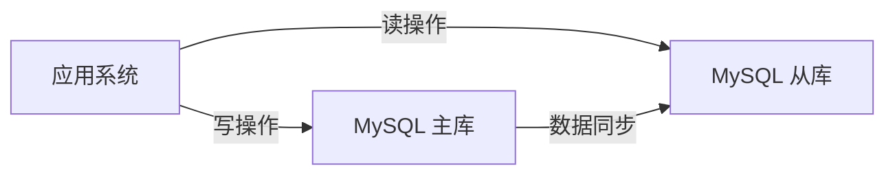
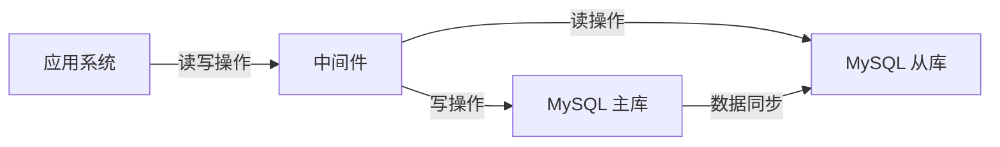
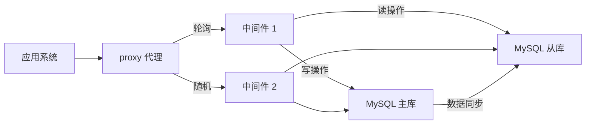

# 主写从读只是起点：读写分离、中间件与负载均衡的三级演化

单节点数据库要扩容，多数人第一反应就是读写分离：加一台从库，读走从库，写走主库。可动手时立刻遇到三个
更细的问题：应用程序怎么知道该连哪台？主从之间的数据怎么保持一致？给中间件做完一层又冒出一层，复杂度
怎么一直在转圈？这一课把主从读写分离的完整架构链路一次讲透，从程序内路由讲到中间件，再到负载均衡，
顺带交代这套架构与生俱来的弱一致性缺陷。

## 先给结论

- 读写分离又称主从架构：主库负责写，从库负责读，适合读多写少的应用；两条硬要求是主从数据完全一致、
  写必须落主库而读必须落从库。
- 不引入中间件时，应用要配两个 `DataSource`，靠 Spring 的 AOP 在 Service 层前按方法名约定分流读写，
  复杂度由应用自己扛。
- 引入中间件后，应用只连中间件一个入口，读写判断下沉到中间件，应用复杂度回到单库水平；代价是中间件
  成为新的性能瓶颈。
- 为中间件做集群之后，应用又要面对多个中间件节点，于是在应用与中间件之间加 proxy 代理做负载均衡，
  分发策略常用随机或轮询。
- 代理只做转发不做业务逻辑，压力小，通常不需要集群；中间件要做读写路由甚至分库分表，压力大，必须集群。
- 主从同步是异步完成，属于弱一致性：写主库成功不代表从库已同步，极端情况会丢数据，交易类业务不能接受，
  这是后续引入 PXC 集群的直接原因。

## 一、读写分离：主库管写，从库管读

开发中的应用对数据库普遍是读多写少：读是查询请求，量级大；写是插入、更新、删除，占比小得多。压力
集中在读上，扩容思路也就顺理成章：搭一个 MySQL 集群，一个节点当主库专门负责写入，其余节点当从库
专门负责读取，这就是读写分离架构，也叫主从架构。

这套架构对应用系统有两条硬性要求。

**第一，读库与写库的数据必须完全一致。** 如果不一致，刚写入主库的数据在读库里查不到，业务立刻出错。
一致性靠主从同步来保证，主节点的数据变化必须同步到从节点，图里那根同步线是整套架构的生命线。

**第二，写操作必须写到主库，读操作必须到从库。** 这不是风格偏好而是逻辑必然：从库一旦也能写入，
两边数据必然分叉，一致性要求就再也无法满足。读写动作各走各的门，才有了「分离」二字。



这张图是读写分离的最小骨架：应用系统把写操作发给主库、读操作发给从库，主库与从库之间靠同步保持一致。
从库并不限于一台，同步线可以同时指向多个从库，读请求也能摊到多个从库上，读的扩展能力正是这套架构的
价值所在。

数据库层从单节点变成了多节点，麻烦随之转移到应用侧：应用必须连接两个数据库节点，并且在程序内部
判断当前是读操作还是写操作，再决定用哪个 `DataSource`。

## 二、程序内路由：AOP 按方法名分流

应用连接两个 MySQL 节点，就要创建两个数据源；区分读写的动作，可以借助 Spring 的 AOP 实现。
典型分层里请求依次经过 Controller、Service、DAO，在 Service 层前面加一个切面，请求进入 Service
之前先被拦截，看它调用的方法名落在哪一类：以 `query`、`find`、`get` 开头的判定为读操作，
以 `save`、`insert`、`update`、`delete` 开头的判定为写操作，然后分别路由到读库或写库的数据源。
没有切面时，请求沿 Controller、Service、DAO 一路直达唯一数据库，读写不分；加了切面，读写
在 Service 入口处就分了道。

以下为按本课思路补全的可运行示例，演示这套路由的写法：

```yaml
# 应用同时配置写库与读库两个数据源
spring:
  datasource:
    write:
      url: jdbc:mysql://192.168.1.10:3306/haoke?useSSL=false
      username: root
      password: root
    read:
      url: jdbc:mysql://192.168.1.11:3306/haoke?useSSL=false
      username: root
      password: root
```

```java
// 切面在 Service 方法执行前判断读写，切换到对应数据源
@Aspect
@Component
public class ReadWriteRouteAspect {

    @Before("execution(* com.example.service..*.*(..))")
    public void route(JoinPoint jp) {
        String name = jp.getSignature().getName();
        if (name.startsWith("query") || name.startsWith("find") || name.startsWith("get")) {
            DataSourceHolder.useRead();   // 读操作，路由到读库数据源
        } else {
            DataSourceHolder.useWrite();  // 写操作，路由到写库数据源
        }
    }
}
```

这套方案要求 Service 层的方法名遵守命名规律，本质是把路由规则硬编码进了命名约定。它能跑通，
但维护成本压在应用代码上，方法名一偏离约定，读写就会路由错向。课程里点到思路为止，实际工程更常用
中间件把这件事接过去。

## 三、中间件架构：把路由判断下沉

在应用与数据库之间架设一层中间件，问题立刻简化：应用只连接中间件，不再连接多个数据库节点；应用也
无需再区分读写操作，把请求原样发给中间件即可；中间件按配置的规则区分读写，读操作转发到从节点，
写操作转发到主节点，底层的 MySQL 主从之间依旧做数据同步。



对应用来说，开发复杂度降回了与单节点 MySQL 相同的水平，变化的只是连接对象从 MySQL 换成了中间件。
写法上通常也只是把 JDBC 连接地址指向中间件端口，例如 MyCat 就以 MySQL 协议对外提供服务，
应用几乎无感。这类产品后续会专门展开，这里只谈架构不谈具体实现。

新的问题同样出现在中间件自己身上：原本请求直达 MySQL，现在全部请求都汇聚到中间件，由它代理转发给
主或从。转发本身不重，但连接管理、SQL 解析、读写判断都压在这一层，它成为整个系统最容易出现性能
瓶颈的位置。

缓解办法是把中间件也做成集群，架设多个中间件节点分担压力，每个节点承接的请求量小了，系统性能
得到保障。可紧接着又绕回原点：应用需要连接多个中间件节点，多数据源的复杂度重新回到了应用系统，
和应用程序直连多个 MySQL 是同一个困境。

## 四、负载均衡架构：proxy 补齐最后一块

在应用系统与中间件之间再加一个 proxy 代理，由代理完成负载均衡，架构就闭环了。



应用系统把读写请求统一发给代理，代理按策略分发到多个中间件节点：随机策略是随手挑一个转发，
轮询策略是按顺序轮流，第一个请求给中间件 1，第二个给中间件 2，如此循环。请求进入中间件后，
再按读写规则转发给主库或从库。

这里有一步很容易想歪：代理和中间件的作用看起来差不多，是不是可以互相替换？两者的差别在职责重量上。

**代理是轻的。** 它只做请求转发，不处理任何业务逻辑，请求来了按规则分发即可，没有读写判断，
没有 SQL 解析，自身压力小，通常一个节点就够，不需要集群。

**中间件是重的。** 它要在内部做读写区分等逻辑处理，连接、解析、路由全要消耗资源，压力天然大，
所以必须做集群。压力的来源不是「转发」这个动作，而是转发之前那些判断。

至此，主从复制的高可用架构才算搭建完成：底层主从复制解决读写分担，中层中间件集群保证路由层高可用，
顶层代理完成负载均衡，让每个中间件节点拿到合理均衡的请求量，发挥出整体最大性能。依然强调，这里讲的
是架构形态，具体用什么产品实现，属于后面的课程。

## 五、绕不开的软肋：异步同步带来的弱一致性

主从之间的同步是异步完成的，这意味着这套架构是弱一致性的。拆开看时序：应用把数据写入主库，主库
在本地落盘成功后，立即向应用返回写入成功，事务已经提交；而此刻数据还没有同步到从库，同步在后台
慢慢进行。

两个后果由此产生。

**写入后立刻读，可能读不到。** 数据只在主库上，从库还没同步到，从库查询拿不到刚写入的那条数据。
对「写完立刻展示」的场景，用户会觉得数据丢了。

**同步失败时，数据可能真丢。** 同步过程中出现错误或网络中断，主库可能认为从库已经从这个位点同步过，
而实际上从库根本没收到这段更新，这部分数据就丢了。

对数据安全性要求高的应用，这套架构并不合适。以支付类项目为例，交易信息与订单数据不能容忍任何丢失，
主从架构在这种业务面前显然不合格。解决方向是强同步的 PXC 集群，原理放在后面专课讲解。

弱一致性不代表这套架构没有价值。对数据安全性要求不高的应用，主从读写分离依然是最经济的选择，
读压力分摊、写路径不变，绝大多数互联网业务的第一版数据库集群都是从它开始的。

## 常见误区

- **以为从库也能随手写几条数据。** 从库一旦接受写入，主从数据必然分叉，之后无论怎么同步都无法收敛。
  写入口必须只有主库一个，从库只接受复制。
- **把主从架构当成数据不丢的灾备方案。** 异步复制有一个时间窗口，同步期间宕机或网络中断，从库可能
  缺一段数据。要数据不丢，需要强同步方案而不是普通主从。
- **把代理和中间件混为一谈。** 代理只按规则转发请求，不做读写判断；中间件承担 SQL 路由等逻辑，
  是压力汇聚点。压力重的中间件要集群，压力轻的代理通常不用。
- **切面路由的方法名约定被破坏。** 某个写方法偏偏以 `get` 开头，切面就把它当读操作路由到从库，
  写入被静默丢弃或报错。约定式路由必须有命名规范兜底，并有越界告警。

## 面试可能被问到的问题

1. 面试官追问：「读写分离架构对应用有哪两条硬性要求，为什么？」
   答：一是读库与写库数据必须完全一致，否则刚写入的数据在读库查不到，业务出错；二是写操作必须写主库、
   读操作必须读从库，因为从库一旦可写，两边数据必然不一致。这两条共同构成主从架构正确工作的前提。

2. 面试官追问：「不引入中间件，在应用内部怎么实现读写分离？」
   答：应用配置读、写两个 `DataSource`，借助 Spring 的 AOP 在 Service 层前加切面，按方法名前缀判断
   读写：`query`、`find`、`get` 开头走读库，`save`、`insert`、`update`、`delete` 开头走写库。
   代价是方法命名被约定绑架，维护成本压在应用侧。

3. 面试官追问：「中间件架构解决了什么问题，又带来了什么新问题？」
   答：它把读写判断从应用下沉到中间件，应用只连中间件一个入口，复杂度回到单库水平。新问题是所有请求
   都经过中间件转发，中间件成为系统性能瓶颈，需要多个中间件节点分摊，由此又产生应用连接多个节点的问题。

4. 面试官追问：「代理和中间件职责相近，为什么代理一般不需要集群？」
   答：代理只做请求转发，不做任何逻辑处理，没有读写判断和 SQL 解析，自身资源消耗小、压力轻，单节点
   通常够用；中间件要在内部完成路由判断，是请求汇聚点，压力大，必须集群保可用与性能。

5. 面试官追问：「主从同步是异步的，会带来什么风险？」
   答：主库写入成功并返回事务提交时，数据可能尚未同步到从库，形成弱一致性。轻则写后立刻读读不到，
   重则同步期间网络中断导致主库误以为已同步、从库实际缺数据，造成数据丢失。支付、订单等不能容忍丢
   数据的业务不适合这套架构，需要 PXC 这类强同步集群。

6. 面试官追问：「什么样的业务适合选主从读写分离？」
   答：读多写少、对数据安全性要求不高、能容忍主从短暂不一致的业务，如资讯展示、搜索浏览类场景。
   它能显著分摊读压力、扩展读能力，且改造代价小，是数据库集群的入门形态；强一致业务则要换 PXC 或
   混合方案。

## 配套资料

- 本课无配套源码包：`materials/code/03/day17-MySQL集群解决方案(主从复制、PXC集群、MyCat、HAProxy)/`
  下仅有解压清单 `_extracted.json`（记录解压文件数为 0）。读写分离的两条要求、AOP 路由思路、中间件与
  负载均衡的架构演进均按本课课件与讲解整理；文中的 `yaml`、`java` 片段为按本课写法补全的示例，
  便于对照理解。
