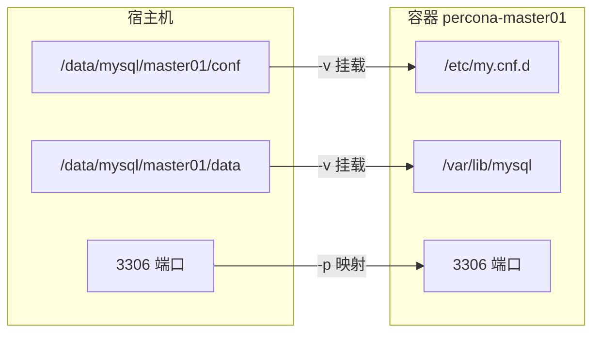

# 动手搭主库：两行配置、一个容器、一个复制账号

> 🔒 安全提示：文中示例的口令/密钥均为课程教学环境演示口径，生产环境的安全要求见《安全与合规须知》。

原理课听懂了 binlog 流转三步曲，真到动手时卡住的人反而最多：容器里的 MySQL，配置文件和数据落在宿主机哪里？同步账号明明建了，客户端却一直弹 1055 错误，账号到底建成没有？`show master status` 吐出一张表，里面哪些信息要抄下来给从库用？这一课把主库从零搭到就绪，这几个疑问逐个落地。

环境延续课程设定：Linux 虚拟机 IP 为 `192.168.1.18`，MySQL 用它的衍生版 Percona，镜像版本 `5.7.23`，全程 Docker 操作。

## 先给结论

- 主库搭建只有四步：建目录、写 `my.cnf`、起容器、建复制账号，每步都有对应的验证手段。
- 配置与数据全部用 `-v` 挂载在宿主机：`conf` 目录挂到容器 `/etc/my.cnf.d`，`data` 目录挂到 `/var/lib/mysql`，容器销毁重建，配置与数据都不丢。
- `my.cnf` 核心两行：`log-bin=mysql-bin` 开启二进制日志，`server-id=1` 作为节点标识，全拓扑唯一。
- 复制账号必须授予 `replication slave` 权限，建完执行 `flush privileges` 刷新生效。
- `show master status` 输出里的 `File` 与 `Position` 是从库同步的起点，搭从库前必须记下这两个值。

## 一、目录规划：conf 与 data 分开挂

登录虚拟机后建工作目录，宿主机上的目录结构决定了容器里 MySQL 的配置与数据落点：

```bash
mkdir -p /data/mysql/master01
cd /data/mysql/master01
mkdir conf data
chmod 777 * -R
```

`mkdir` 带上 `-p` 是因为 `/data/mysql` 这一层父目录还不存在，不带参数直接报创建失败。`conf` 放配置，`data` 放数据；目录名叫 `master01` 而不是 `master`，暗示这套方案里将来可能有多个主节点。`chmod 777 * -R` 把权限放开到最大，这是因为挂载目录的属主是宿主机的 root，而容器内运行 MySQL 的用户不是它，权限不够容器初始化时会写不了数据目录。

两个目录挂进容器后的对应关系长这样：



图里最值得盯的是配置目录的挂载点：不是 `/etc/my.cnf` 这个单文件，而是 `/etc/my.cnf.d` 这个目录，Percona 镜像读的是它。挂错位置，配置文件写了等于白写。

## 二、my.cnf：核心就两行

进入 `conf` 目录创建配置文件：

```properties
[mysqld]
log-bin=mysql-bin #开启二进制日志
server-id=1 #服务id，不可重复
```

`log-bin` 一行身兼两职：开启二进制日志，并指定日志文件名前缀为 `mysql-bin`，实际落盘会生成 `mysql-bin.000001` 起步、序号递增的一组文件。这是主从复制的凭据来源，主库没有 binlog，从库就无东西可抄。`server-id` 是节点在复制拓扑里的身份标识，主库定为 1，后面从库必须用别的值，配重了链路建不起来。

## 三、创建并启动容器

```bash
docker create --name percona-master01 -v /data/mysql/master01/data:/var/lib/mysql -v /data/mysql/master01/conf:/etc/my.cnf.d -p 3306:3306 -e MYSQL_ROOT_PASSWORD=root percona:5.7.23
docker start percona-master01 && docker logs -f percona-master01
```

参数逐个对号：`--name` 给容器命名；两个 `-v` 分别挂数据目录与配置目录；`-p 3306:3306` 做端口映射；`-e MYSQL_ROOT_PASSWORD=root` 指定 root 用户的密码。镜像本地没有的话，Docker 会先拉取再创建。`docker logs -f` 跟踪初始化日志，第一次启动要做数据目录初始化，等到日志出现 `ready for connections` 就绪，用客户端连 `192.168.1.18:3306`，账号 root 密码 root，能连上说明容器正常。

## 四、建同步账号：一条报错引出一个配置

主库要为从库准备一个专门拉日志的账号：

```sql
create user 'slave01'@'%' identified by '123456';
grant replication slave on *.* to 'slave01'@'%';
flush privileges;
```

`'%'` 表示不限制来源主机；`replication slave` 是复制专享权限，只够从库来拉 binlog，做不了别的操作，权限收敛得刚刚好。验证方式是查 `mysql` 库的 `user` 表，能看到 `slave01` 及其密码就说明账号真实存在了。

这里会遇到课程里出现过的坑：执行后客户端报 `[Err] 1055`（`ORDER BY` 子句的表达式不在 `GROUP BY` 里）。这个报错只是图形客户端在回显结果时的显示问题，账号其实已经建成。想彻底消掉它，回到 `my.cnf` 补一行 `sql_mode`，把默认启用的 `ONLY_FULL_GROUP_BY` 摘掉：

```properties
sql_mode = STRICT_TRANS_TABLES,NO_ZERO_IN_DATE,NO_ZERO_DATE,ERROR_FOR_DIVISION_BY_ZERO,NO_AUTO_CREATE_USER,NO_ENGINE_SUBSTITUTION
```

改完配置文件必须 `docker restart percona-master01` 才生效，重启后再查，报错消失。注意这个配置项与主从复制本身无关，属于客户端兼容性修复。

## 五、show master status：两个值记下来

```sql
show master status;
show global variables like 'binlog%';
show global variables like 'server%';
```

`show master status` 的输出是一张小表，关键就两列：`File`，当前正在写的 binlog 文件名；`Position`，当前写到的字节位点。从库的 `CHANGE MASTER TO` 就要从这对「文件 + 位点」开始同步，现在记下来，搭从库时直接抄。

后两条查询用来侧面验证配置：`show global variables like 'binlog%'` 能看到 binlog 相关的全部配置项；`show global variables like 'server%'` 里 `server_id` 显示为 1，与 `my.cnf` 写的一致，说明挂载进去的配置文件确实生效了。

## 常见误区

- **`mkdir` 不带 `-p`。** 父目录 `/data/mysql` 不存在时只建最后一层会失败，看到 `No such file or directory` 才回头补参数，白白绕一圈。
- **配置挂错挂载点。** 把 `conf` 挂到 `/etc/my.cnf` 或 `/etc/mysql`，而 Percona 镜像读的是 `/etc/my.cnf.d`，`log-bin` 写了却不生效，主库根本没有 binlog。
- **跳过 `chmod 777`。** 容器内进程对宿主机挂载目录没有写权限，MySQL 初始化数据目录时直接失败，容器反复退出。
- **被 1055 报错骗到重复建账号。** 该报错不影响 `create user` 与 `grant` 的真实执行，查 `user` 表确认即可，别当成账号创建失败。
- **改完 `my.cnf` 不重启容器。** 配置文件只在 mysqld 启动时读取，`docker restart` 之前一切修改都停在磁盘上。

## 面试可能被问到的问题

1. 面试官追问：「主库容器为什么要把 conf 和 data 挂载到宿主机？」
   答：容器是可销毁重建的，`/var/lib/mysql` 里的数据文件和 `/etc/my.cnf.d` 里的配置文件挂到宿主机后，容器即使删掉重建，配置与数据仍然保留，相当于把有状态的部分从容器生命周期里剥离出来。

2. 面试官追问：「`log-bin` 这一项做了什么？」
   答：开启二进制日志并指定文件名前缀，如 `mysql-bin`，实际生成序号递增的日志文件。binlog 记录所有数据变更事件，是主从复制、数据恢复的凭据来源，主库不开启，从库无从同步。

3. 面试官追问：「`server-id` 为什么必须唯一？」
   答：复制拓扑里每个节点靠它标识自己，主库用它区分事件由谁产生、连接上来的是哪个从库。两个节点 id 相同时复制链路无法正确建立，所以主库 1、从库 2，各不相同。

4. 面试官追问：「给从库建的同步账号需要什么权限？」
   答：授予 `replication slave` 就够了，它允许账号连接主库拉取 binlog 事件，不含其他业务权限，符合最小权限原则。建完账号执行 `flush privileges` 让授权即时生效。

5. 面试官追问：「`show master status` 的 File 和 Position 是什么，给谁用？」
   答：File 是当前正在写入的 binlog 文件名，Position 是当前写到的字节偏移。这对值是复制起点，从库执行 `CHANGE MASTER TO` 时通过 `master_log_file` 与 `master_log_pos` 填入，决定从哪个位置开始拉取重放。

## 配套资料

- 本课无配套源码包：`materials/code/03/day17-MySQL集群解决方案(主从复制、PXC集群、MyCat、HAProxy)/`
  下仅有解压清单 `_extracted.json`（记录解压文件数为 0）。
- 全部命令、`my.cnf` 内容与 SQL 均按本课课件画面与操作过程整理；课件中的同步账号为机构内部命名，
  文中改用中性的 `slave01`，`sql_mode` 取值为课件原样，仅去除了品牌词。
