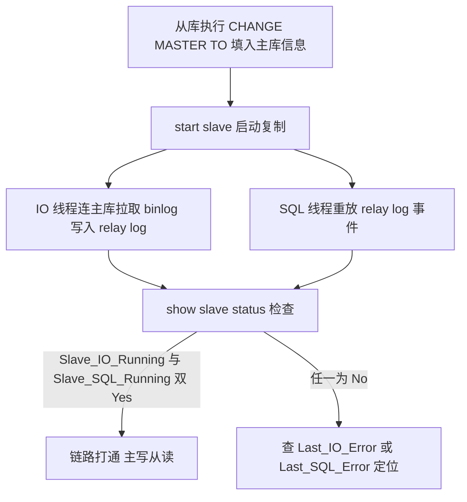

# 从库上线：CHANGE MASTER TO 对准主库位点，双 Yes 才算通

> 🔒 安全提示：文中示例的口令/密钥均为课程教学环境演示口径，生产环境的安全要求见《安全与合规须知》。

主库就绪之后轮到从库，很多人以为步骤同样繁琐，结果发现从库的配置文件里只有一个 `server-id`，真正的动作全在 SQL 里。疑问集中在三处：同一台宿主机上两个 MySQL 实例，端口怎么分？`CHANGE MASTER TO` 那一串参数从哪来，能不能凭感觉填？启动同步之后，怎么判断链路真的通了？这一课把从库接上主库，并用数据验证读写分离的效果。

环境与上一课一致：虚拟机 `192.168.1.18`，Percona `5.7.23` 镜像，Docker 部署；主库已开启 binlog、`server-id=1`，复制账号已建好。

## 先给结论

- 从库 `my.cnf` 只写 `server-id=2`（外加一行 `sql_mode` 修显示报错），其余配置全部通过 SQL 完成。
- 宿主机端口用 `3307` 映射容器内的 `3306`，一台机器跑两个实例靠宿主机端口区分，容器内部端口不变。
- `CHANGE MASTER TO` 里的 `master_log_file` 与 `master_log_pos` 必须抄自主库 `show master status` 的输出，不能手编。
- `start slave` 之后执行 `show slave status`，`Slave_IO_Running` 与 `Slave_SQL_Running` 双 Yes 才算链路打通。
- 验证方式：主库建库建表写数据，从库刷新即可见；写走主库、读走从库，主库压力就此分摊。

## 一、从库目录与配置：只差一个 server-id

目录结构与主库如出一辙，换一个名字而已：

```bash
mkdir -p /data/mysql/slave01
cd /data/mysql/slave01
mkdir conf data
chmod 777 * -R
```

`conf` 放配置、`data` 放数据，授权原因同主库：容器内进程要写宿主机挂载目录。配置文件的内容与主库对比一目了然：

```properties
[mysqld]
server-id=2 #服务id，不可重复
sql_mode='STRICT_TRANS_TABLES,NO_ZERO_IN_DATE,NO_ZERO_DATE,ERROR_FOR_DIVISION_BY_ZERO,NO_AUTO_CREATE_USER,NO_ENGINE_SUBSTITUTION'
```

从库不开 binlog，所以没有 `log-bin` 这一行，只把 `server-id` 定为 2 与主库区分。`sql_mode` 与复制无关，作用和主库那次一样：摘掉默认开启的严格分组校验，避免客户端运行语句时报 1055 显示错误。

## 二、起容器：宿主机 3307 映射容器 3306

```bash
docker create --name percona-slave01 -v /data/mysql/slave01/data:/var/lib/mysql -v /data/mysql/slave01/conf:/etc/my.cnf.d -p 3307:3306 -e MYSQL_ROOT_PASSWORD=root percona:5.7.23
docker start percona-slave01 && docker logs -f percona-slave01
```

命令与主库基本相同，两处不同值得圈出来：容器名换成 `percona-slave01`；端口映射是 `3307:3306`，宿主机用 3307，容器内仍是 3306。这直接决定了后面客户端怎么连：连从库要填 `192.168.1.18:3307`，填 3306 连上的其实是主库。第一次启动同样要等数据目录初始化完成，日志出现 `ready for connections` 再继续。

## 三、CHANGE MASTER TO：参数全是主库的信息

在从库上执行这段 SQL，把主库的「地址、账号、日志位点」登记进去：

```sql
CHANGE MASTER TO
master_host='192.168.1.18',
master_user='slave01',
master_password='123456',
master_port=3306,
master_log_file='mysql-bin.000002',
master_log_pos=648;
```

前四个参数是主库的连接信息：主机地址、上一课在主库建的复制账号与密码、主库容器内的 3306 端口。注意 `master_port` 填的是主库的 3306，不是宿主机的 3307，因为从库是容器与容器之间直接找主库。

后两个参数是整个配置的灵魂。`master_log_file` 与 `master_log_pos` 来自上一课在主库执行 `show master status` 时记下的 `File` 与 `Position`，含义是从这个日志文件的这个字节位点开始同步。课程里执行时还特别提醒：命令拷过来不要直接运行，先按自己的环境改 IP，再对着主库状态把文件名与位点改成真实值。

这一步做完，从库还只是「知道主库是谁」，链路尚未启动，接下来一个命令点燃它。

## 四、start slave 与双 Yes

```sql
start slave;
show slave status\G
```

`show slave status` 输出非常长，几十项参数里只盯两个：



`Slave_IO_Running` 对应 IO 线程，负责连主库拉 binlog；`Slave_SQL_Running` 对应 SQL 线程，负责把拉回来的日志重放成数据。两个都为 Yes，说明复制链路完整建立；任何一个为 No，跟着 `Last_IO_Error` 或 `Last_SQL_Error` 的报错文字走，绝大多数是账号密码不对、文件名抄错或主从基线不一致。

## 五、读写分离效果验证

在客户端同时开主库 3306 与从库 3307 两个连接。主库上新建数据库 `my_test`（选 utf8 编码），建一张 `tb_user` 表，两个字段：`id` 整型主键自增，`name` 变长字符 50。插入张三，切到 3307 刷新，数据已经在了；再插李四、把李四改成李四一，从库每次刷新都跟上。整条链路的分工就此清晰：

- **写操作全部落在主库。** 应用连接 3306 执行增删改，变更被记入 binlog，成为从库同步的源头。
- **读操作可以分流到从库。** 3307 上的数据与主库一致，查询、报表这类读请求转给它，主库的连接数与磁盘读压力立刻减轻。
- **复制是单向的。** 数据只从主库流向从库，从库上手工写数据不会反向同步，还会制造两边数据分叉。

这正是前几课讲的读写分离架构第一次真正跑起来：主从复制是地基，读写分离是地基上盖的房子。

## 常见误区

- **位点凭感觉填。** `master_log_file` 与 `master_log_pos` 不看主库 `show master status` 的真实输出，随手写一个，从库要么漏一段事件、要么从错误位置重放，SQL 线程直接报错停摆。
- **客户端连 3306 当成连从库。** 3307 才是从库的宿主机端口，连 3306 做的「验证」全落在主库头上，还误以为同步没生效。
- **在从库上写数据。** 复制单向流动，从库的写入既不回传主库，也会让 SQL 线程在后续重放时撞上主键冲突，链路反复中断。
- **基线不一致就开同步。** 主库有存量数据、从库是空库时直接 `start slave`，针对存量数据的操作在从库找不到记录，SQL 线程报错。先把两边数据对齐，再定位点。
- **只看 start slave 没报错就认为成功。** 启动成功不代表线程健康，必须 `show slave status` 确认双 Yes。

## 面试可能被问到的问题

1. 面试官追问：「`CHANGE MASTER TO` 的各参数分别是什么含义？」
   答：`master_host`、`master_port` 是主库地址与端口，注意端口是主库容器内的 3306；`master_user`、`master_password` 是在主库建的复制账号；`master_log_file` 与 `master_log_pos` 是同步起点的日志文件与字节位点，取自主库 `show master status` 的输出。

2. 面试官追问：「`show slave status` 里看什么？两个线程各是什么？」
   答：看 `Slave_IO_Running` 与 `Slave_SQL_Running` 是否都为 Yes。IO 线程负责连接主库把 binlog 事件拷贝到本地 relay log，SQL 线程负责重放 relay log 里的事件。任一为 No，链路就是断的，要看对应的 `Last_IO_Error` 或 `Last_SQL_Error`。

3. 面试官追问：「从库配置文件为什么几乎什么都不用配？」
   答：复制所需的全部外部信息，主库地址、账号、日志位点，都通过 `CHANGE MASTER TO` 在 SQL 层指定并保存在从库中，配置文件里只需要一个与主库不同的 `server-id`。这也是主从职责划分的体现：主库管产出日志，从库管对接。

4. 面试官追问：「怎么验证主从复制真的生效了？」
   答：主库做一系列写操作，从库端到端观察：建库、建表、插入、更新各来一遍，从库刷新后全部可见即同步正常。生产上还会关注 `Seconds_Behind_Master`，它是从库落后主库的秒数，用来衡量延迟。

5. 面试官追问：「从库可以写数据吗？」
   答：不可以。复制是主库到从库的单向流动，从库的写入不会同步回主库，还会导致后续主库事件重放时冲突，SQL 线程报错停止。从库应保持只读，写请求一律走主库，读请求分流到从库实现读写分离。

## 配套资料

- 本课无配套源码包：`materials/code/03/day17-MySQL集群解决方案(主从复制、PXC集群、MyCat、HAProxy)/`
  下仅有解压清单 `_extracted.json`（记录解压文件数为 0）。
- 命令、`my.cnf` 与 `CHANGE MASTER TO` 语句按本课课件画面与操作过程整理；课件中的同步账号为
  机构内部命名，文中沿用上一课改定的 `slave01`；日志文件与位点为课件示例值，实际以主库
  `show master status` 的实时输出为准。
