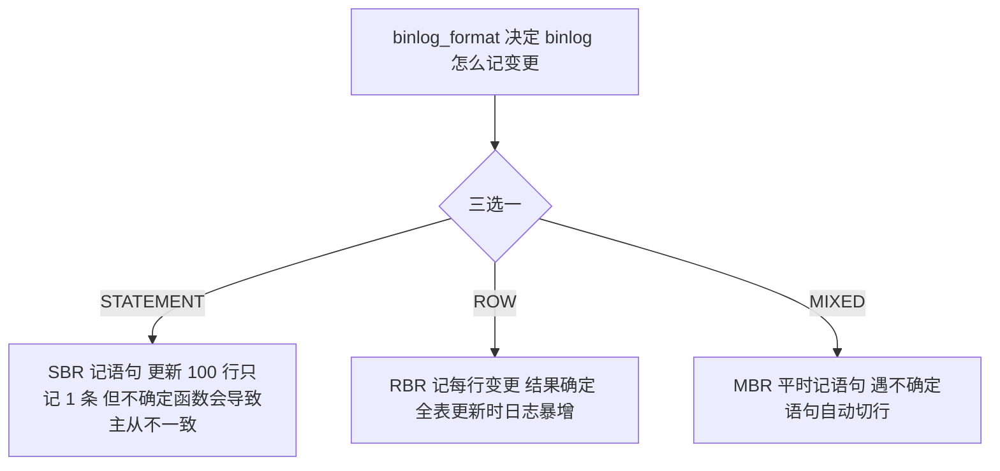
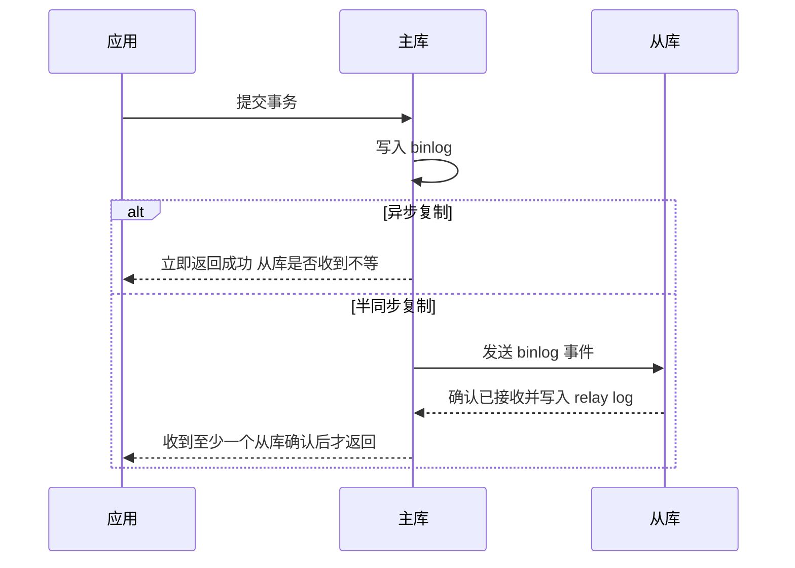

# binlog_format 三种格式怎么选：STATEMENT、ROW 与 MIXED 的取舍

> 🔒 安全提示：文中示例的口令/密钥均为课程教学环境演示口径，生产环境的安全要求见《安全与合规须知》。

`show global variables like 'binlog%'` 吐出一长串变量，其中 `binlog_format` 最关键：它决定 binlog 用什么形式记录变更，直接影响主从一致性、日志体积与 IO 开销。这个配置还有个容易让人栽跟头的地方，「主从复制的三种模式」这个词在面试里有两个完全不同的指向：一组是 binlog 的三种记录格式，另一组是复制的三种时机档位，混着答必扣分。这一课把两个维度都掰开。

## 先给结论

- binlog_format 三档：`STATEMENT` 记 SQL 语句，即 SBR；`ROW` 记行级变更镜像，即 RBR；`MIXED` 混合，即 MBR。MySQL 5.7 默认是 `ROW`。
- SBR 省日志：一条 `update` 影响 100 行也只记 1 条语句；但 `NOW()`、`UUID()` 这类结果不确定的语句，主从各自重放会得到不同结果。
- RBR 结果确定、数据最安全，代价是日志量大，全表更新时日志可能暴增。
- MIXED 平时按语句记，遇到不确定语句自动切换成行记，是课程推荐的选择。
- 另一组「三种模式」指复制时机：异步（默认）、半同步（装 `rpl_semi_sync_master` 插件）、全同步，与 binlog 格式是两个独立维度。

## 一、SBR：只记语句，省 IO 但怕不确定函数

`STATEMENT` 模式记录的是每一条会修改数据的 SQL 语句本身。它的优点来自「不记行」：

```sql
-- 影响 100 行的更新，SBR 在 binlog 里只记这一条语句
update user set age = 21 where age > 20;
```

这条语句可能命中 100 个用户，binlog 里却只有一条记录，不需要把 100 行数据的变化逐个写进去。日志量小，磁盘 IO 少，主库性能压力自然轻。

它的缺点也相当致命。假如 binlog 里记录的语句带着 `NOW()`、`UUID()`、`RAND()` 这类每次执行结果都不同的函数，从库重放时会重新计算一遍：

```sql
-- 主库在 12:00:01 执行，从库在 12:00:05 重放，两个 NOW() 不是同一个值
insert into operate_log(create_time) values (now());
```

主库执行得到一个时间，从库重放得到另一个时间，两边数据从此不一致。凡是不确定函数，都是 SBR 的雷区，而这类问题排查起来极其隐蔽。

## 二、RBR：只记行变更，结果确定但日志可能暴增

`ROW` 模式不记语句，改记「哪些数据被修改了、修改成了什么样子」，也就是每一行的变更前后镜像。重放时从库只是机械地还原数据，不存在重新计算，函数导致的不一致问题彻底消失。

代价在日志体积。同样那条影响 100 行的更新，RBR 要在 binlog 里写 100 条行变更记录；全表更新这种场景，日志量直接翻几十倍、上百倍，磁盘与 IO 压力全来了。SBR 与 RBR 的优缺点恰好互补，谁都不是完美答案，于是有了第三种。

## 三、MIXED：让 MySQL 替你选，课程推荐

`MIXED` 把前两者混合：平时按 `STATEMENT` 记，遇到可能产生不确定结果的语句，自动切换成 `ROW` 记。判断交给 MySQL，灵活且合理。

配置只有一行，回到主库的 `/data/mysql/master01/conf` 编辑 `my.cnf`，在 `[mysqld]` 段追加：

```properties
[mysqld]
log-bin=mysql-bin
server-id=1
binlog-format=mixed
```

保存后重启容器让配置生效：

```bash
docker restart percona-master01
```

重新执行 `show global variables like 'binlog%'`，`binlog_format` 已经由 `ROW` 变为 `MIXED`，格式切换完成。



## 四、换格式之后的多米诺：位点重新对齐

这一步最容易漏。主库重启后，binlog 会生成新的日志文件，`show master status` 输出的 `File` 与 `Position` 都变了（课程里文件变成 `mysql-bin.000005`，位点从头开始）。从库如果还盯着旧文件旧位点，同步要么中断要么错位，此刻写入主库的数据（比如新插的王五）不再出现在从库。

处理顺序固定三步，在从库执行：

```sql
-- 先停掉同步
stop slave;
-- 按主库 show master status 的新输出，重新登记文件与位点
CHANGE MASTER TO
master_host='192.168.1.18',
master_user='slave01',
master_password='123456',
master_port=3306,
master_log_file='mysql-bin.000005',
master_log_pos=495;
-- 再启动同步
start slave;
```

`show slave status` 确认双 Yes 之后，之前滞留的数据陆续同步过来，再插入新记录，从库照样跟上。记住这个连锁反应：主库每次重启，从库大概率要重新对位点。

## 五、另一组「三种模式」：异步、半同步、全同步

binlog 格式管「记什么」，复制模式管「主库什么时候认为同步完成」，两者别混。默认的异步复制里，主库提交事务后不等从库，binlog 什么时候同步到从库是另一回事，主库宕机时最新事务可能还没送出去，有丢数据风险。全同步要求所有节点都确认后才返回，一致性最强但延迟最高，典型实现是后面课程要讲的 PXC 集群。半同步是折中：主库等至少一个从库确认收到 binlog 再返回，超时则降级回异步。MySQL 5.7 通过插件开启，以下为按主流写法补充的示例：

```sql
-- 主库安装并开启半同步（示例为按主流写法补充）
INSTALL PLUGIN rpl_semi_sync_master SONAME 'semisync_master.so';
SET GLOBAL rpl_semi_sync_master_enabled = 1;
SET GLOBAL rpl_semi_sync_master_timeout = 3000; -- 毫秒，超时降级为异步
```



图里两条路径的差异就是三者的差异：返回给应用之前等不等、等谁。异步不等，半同步等一个，全同步等全部。

## 常见误区

- **把「复制三模式」与 binlog 三格式划等号。** 面试里这是两个问题：前者说 binlog 怎么记，后者说主库何时确认提交，混答等于两个都答错。
- **以为默认就是 MIXED。** 课程推荐 MIXED，但 5.7 出厂默认是 `ROW`，不查 `show global variables like 'binlog%'` 就凭印象作答会翻车。
- **改完格式重启主库后不管从库。** 重启后文件与位点变化，从库不重新 `CHANGE MASTER TO` 对位点，同步就停在上一个文件，表现为 IO 或 SQL 线程报错、新数据不再过来。
- **以为 MIXED 是语句和行各记一遍。** 它是按语句风险自动二选一，不是叠加记录，日志量不会翻倍。
- **以为半同步是开关自带的。** 默认只有异步，半同步要在主从两侧分别安装并启用插件，还要留意超时降级。

## 面试可能被问到的问题

1. 面试官追问：「binlog 的三种格式各是什么，有什么区别？」
   答：`STATEMENT` 记 SQL 语句，日志小，但不确定函数会让主从重放结果不一致；`ROW` 记每行的变更镜像，结果确定、最安全，日志量大；`MIXED` 平时按语句记、遇不确定语句自动切行。5.7 默认 `ROW`，课程建议 `MIXED`。

2. 面试官追问：「为什么 `NOW()` 在 SBR 模式下会导致主从不一致？」
   答：SBR 把语句原文写进 binlog，从库重放时重新执行一遍，`NOW()` 在主从两个时刻计算出的值不同，两边数据从此分叉。`UUID()`、`RAND()` 同理，凡结果不确定的语句都是 SBR 的隐患。

3. 面试官追问：「ROW 格式日志大会不会成为问题，怎么权衡？」
   答：会。全表更新、批量删除这类语句在 ROW 下逐行记录，日志可能成倍膨胀，拖累磁盘与 IO。追求强一致的场景选 ROW 或 MIXED，写多且更新集中的大表要评估日志膨胀，MIXED 的自动切换是折中方案。

4. 面试官追问：「主库改了 binlog_format 并重启，从库要做什么？」
   答：执行 `stop slave` 停同步，在主库 `show master status` 拿新的 `File` 与 `Position`，重新 `CHANGE MASTER TO` 登记位点，再 `start slave`。因为重启后 binlog 换了新文件，旧位点继续用会导致同步中断或错位。

5. 面试官追问：「异步复制和半同步复制的区别？」
   答：异步复制主库提交后立即返回，不等从库，性能最好但主库宕机时最新事务可能丢失；半同步复制在主库安装 `rpl_semi_sync_master` 插件后，至少等一个从库确认收到 binlog 才返回，超时降级回异步，用少量延迟换更高的数据安全。

6. 面试官追问：「那全同步呢，为什么生产上少见？」
   答：全同步要求所有节点都确认后才向应用返回，一致性最强，但每次提交都要等最慢的节点，延迟随集群规模放大，吞吐明显下降。生产更多用半同步加从库监控，或直接用 PXC 这类强一致集群方案承载关键数据。

## 配套资料

- 本课无配套源码包：`materials/code/03/day17-MySQL集群解决方案(主从复制、PXC集群、MyCat、HAProxy)/`
  下仅有解压清单 `_extracted.json`（记录解压文件数为 0）。
- `binlog_format` 三种格式、`my.cnf` 改法、重启与重新对位点的 SQL 按本课课件画面与操作过程整理；
  异步、半同步、全同步一节为本课主题下的知识补充，半同步插件 SQL 为按主流写法补全的示例，
  PXC 集群在后续课程展开。
