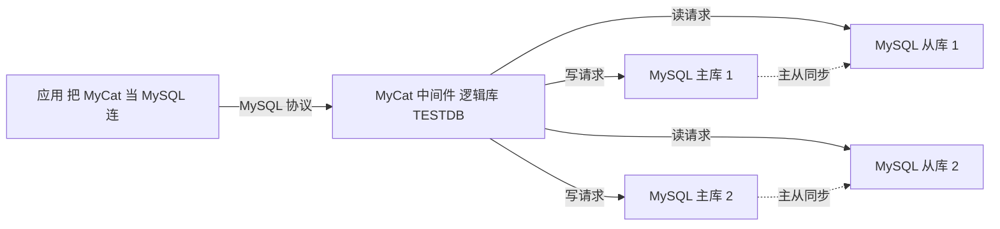

# MyCat：把一堆数据库伪装成一个的中间件

主从复制把读压力分掉了，高可用也有了着落，但两个问题原封不动：单表数据量涨到千万级，索引变深查询变慢；写请求永远集中在主库一个点上，它撑不住就是天花板。方向是分库分表，可应用直连多个数据库意味着路由、跨库 join、跨库事务全要自己写。MyCat 要解决的就是这个：在应用与数据库之间挡一层，让「一堆数据库」对外看起来就是一个数据库。

## 先给结论

- MyCat 是数据库分库分表中间件，官网给它的定位是「国内最活跃的、性能最好的开源数据库中间件」，目标直指企业级、高性能、开源。
- 它出身于阿里内部大量使用、实践检验充分的 Cobar；Cobar 后来闭源，MyCat 站在其基础上做成彻底开源的产品。
- 最关键的一点：应用连 MyCat 走的依然是 MySQL 原生协议，把 MyCat 当 MySQL 连即可，应用几乎零改造；它背后接 MySQL、Oracle、DB2 都行。
- 三个核心概念：逻辑库、逻辑表、分片。应用看到一个完整的大库，数据实际按规则散落在多个真实节点。
- 顺带能力：心跳自动故障切换、读写分离、支持 MySQL 多主从、XA 分布式事务、全局序列号。

## 一、中间件的定位：挡在应用与数据库之间

前几课搭好的主从复制架构里，读写分离要靠应用自己分流，或者交给代理。MyCat 把这件事连同分库分表一起接管：



写请求被送往各节点的主库，读请求分流到从库，主从之间照旧同步。这张图里 MyCat 扮演的角色和 Nginx 之于 Web 服务很像：应用以为自己在连一个数据库，实际上中间件按规则把请求分发到背后的集群。**应用侧走的是 MySQL 原生协议这一点要划重点。** 课件里专门强调：MyCat 背后就算换成 Oracle、DB2 等其他数据库，应用与 MyCat 之间的协议也不变，这就是它「跨语言、跨平台、跨数据库的通用中间件代理」的含义。

## 二、出身与血统：从 Cobar 到 MyCat

MyCat 基于阿里的 Cobar 研发。Cobar 在阿里内部使用率极高，稳定性与可靠性经受过大规模生产检验，这个底子决定了 MyCat 的起点。Cobar 本身闭源，所以 MyCat 从诞生起就把「彻底开源」当作旗帜：不依托任何一家商业公司，也不像某些开源项目那样把关键特性封进收费版，让开源沦为摆设。

课件对它的概括还有几条值得记：支持事务 ACID，可以视为「MySQL 集群的企业级数据库」；MySQL 官方长期不提供集群方案，Oracle 有但造价昂贵，MyCat 用开源的方式补上这块；同时融合了缓存、NoSQL、HDFS 大数据等新型数据产品的思路，定位成新一代企业级数据库中间件。背后由资深软件工程师、架构师、DBA 组成的团队持续维护，这也是它成为国内最活跃数据库中间件的原因。

## 三、核心概念：逻辑库、逻辑表与分片

用一句人话串起来：**逻辑库是 MyCat 摆在门面上的「假库」，逻辑表是「假表」，数据实际按分片规则散在背后多个真实库里。** 应用看到的始终是一个完整的库和表，跨节点的路由由 MyCat 完成。

下面这份配置是按 MyCat 1.x 主流写法补全的示例，用来把三个概念对上号：

```xml
<schema name="TESTDB" checkSQLschema="true" sqlMaxLimit="100">
    <!-- 逻辑表 orders：应用只认它，数据按 user_id 取模散到 dn1 与 dn2 -->
    <table name="orders" dataNode="dn1,dn2" rule="mod-rule"/>
</schema>
<!-- 数据节点：逻辑库背后的真实库 -->
<dataNode name="dn1" dataHost="host1" database="db1"/>
<dataNode name="dn2" dataHost="host2" database="db2"/>
<dataHost name="host1" balance="1" writeType="0" dbType="mysql" dbDriver="native">
    <!-- 心跳检测，用于自动故障切换 -->
    <heartbeat>select user()</heartbeat>
    <writeHost host="master1" url="192.168.1.18:3306" user="root" password="root"/>
    <readHost host="slave1" url="192.168.1.18:3307" user="root" password="root"/>
</dataHost>
```

`schema` 是逻辑库，`table` 是逻辑表，`dataNode` 把逻辑表映射到真实库，`rule` 指定分片规则，`dataHost` 里再挂一组主从。应用侧连的是 MyCat 暴露的端口（默认 8066），用法与连普通 MySQL 完全一样：

```sql
-- 应用侧视角：连 MyCat 之后看到的还是熟悉的 MySQL（示例为按主流写法补全）
mysql -h192.168.1.18 -P8066 -uroot -p
use TESTDB;
insert into orders(id, user_id, amount) values (1, 100, 99.00);
```

这条 `insert` 到了 MyCat 手里，会按 `user_id` 的分片规则算出该进哪个真实库；`select` 带不带分片键、join 怎么处理，MyCat 都有对应策略，多表 join、全局表、ER 关系表这些特性就是为此准备的。

## 四、为什么分库分表：单库单表的物理天花板

分库分表解决的是两个维度的问题：

- **单表维度。** InnoDB 的表数据挂在 B+ 树上，行数越多树越高，一次查询要落的页越多，索引效率持续下滑；千万级之后再加索引、改表结构都是事故级操作。
- **单机维度。** 一台 MySQL 的连接数、磁盘容量、IO 吞吐都有上限，主从复制只是把读摊开，写和存储依然压在一台机器上。

分表把行数摊薄，分库把连接与存储摊开，两者合起来把天花板抬高。代价是复杂性：跨库 join、分布式事务、全局唯一主键都要有方案，MyCat 的关键特性清单正好逐条接住这些痛点，心跳自动故障切换与读写分离、支持 MySQL 多主从、基于 NIO 的线程管理应对高并发、丰富的分片规则、XA 分布式事务、全局序列号、Web 管理控制台。分片细节与实战配置在后面几课展开，这里先把概念坐标系立起来。

## 常见误区

- **以为 MyCat 取代了 MySQL。** 它是中间件，自己不存业务数据，数据仍在背后的 MySQL 里，MyCat 只做路由、聚合与协议转换，MySQL 该做的高可用一样都不少。
- **以为它只能配 MySQL。** 官方特性里明确支持 MySQL、Oracle、DB2 等常见数据库；但无论背后是谁，应用连 MyCat 走的永远是 MySQL 协议，方向别搞反。
- **以为装上就自动分片。** 分库分表要靠 `schema.xml` 配逻辑库、逻辑表、分片规则，读写分离要配 `balance` 等参数，中间件给的是能力，不是魔法。
- **把主从复制与分库分表当二选一。** 主从复制解决读压力与高可用，分库分表解决容量与写压力，实际架构里两者叠加使用，MyCat 只是把组合的管理成本收走了。

## 面试可能被问到的问题

1. 面试官追问：「MyCat 是什么，解决什么问题？」
   答：数据库分库分表中间件，基于阿里 Cobar 研发的开源项目。它挡在应用与数据库集群之间，把分库分表、读写分离、心跳故障切换这些能力集中托管，应用按连普通 MySQL 的方式使用它，解决单表数据量过大与单机读写、存储上限的问题。

2. 面试官追问：「什么是逻辑库、逻辑表、分片？」
   答：逻辑库与逻辑表是 MyCat 对应用暴露的统一视图，应用看到一张完整的表；分片是把这张表的数据按规则拆散到多个真实库的过程，每个真实库承载其中一部分，路由与结果聚合由 MyCat 完成。

3. 面试官追问：「应用接入 MyCat 为什么几乎不用改代码？」
   答：MyCat 遵循 MySQL 原生协议，对应用来说它就是一个 MySQL 服务，连它暴露的端口即可，驱动、SQL 写法照旧。哪怕背后接的是 Oracle 或 DB2，应用侧协议也不变，这是它跨数据库代理设计的核心。

4. 面试官追问：「什么时候该考虑分库分表？」
   答：单表行数到千万级、索引深度导致查询明显变慢，或单机的连接数、磁盘、IO 接近上限，读写分离已经吃满仍不够用时。它是复杂度很高的手段，能用索引优化、读写分离、归档解决的，先不用急着拆。

5. 面试官追问：「MyCat 与主从复制是什么关系？」
   答：互补而非替代。主从复制负责节点间数据同步，提供读扩展与高可用；MyCat 负责在这套集群之上做请求分发、分片路由与故障切换，`dataHost` 里配的正是主从结构。没有复制，MyCat 的读写分离无从谈起；没有 MyCat，分库分表的路由全要应用自己做。

6. 面试官追问：「全局表是干什么的？」
   答：字典类小表，如地区、分类，每个分片上都放一份完整数据。改动少、体量小，冗余后跨分片 join 就能直接在本地完成，避免跨库聚合，MyCat 会保证各分片上全局表的一致更新。

## 配套资料

- 本课无配套源码包：`materials/code/03/day17-MySQL集群解决方案(主从复制、PXC集群、MyCat、HAProxy)/`
  下仅有解压清单 `_extracted.json`（记录解压文件数为 0）。
- MyCat 的定位、出身、优势与关键特性均按本课课件与官网摘抄内容整理；逻辑库、逻辑表、分片的
  配置与连接示例为按 MyCat 1.x 主流写法补全的示例，具体分片实战在后续课程展开。
