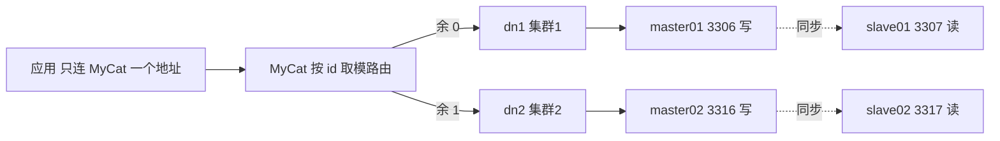
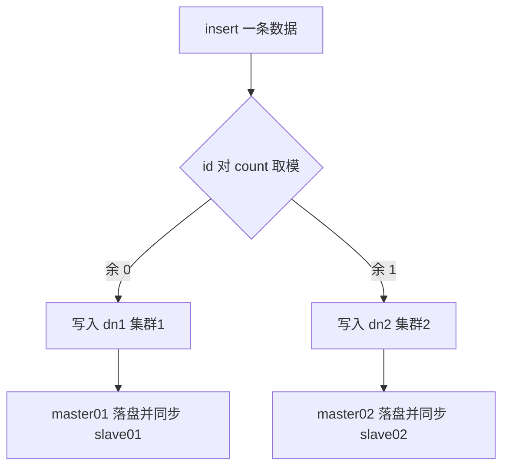

# 一张表拆进两套主从集群：MyCat 数据分片的完整落地

> 🔒 安全提示：文中示例的口令/密钥均为课程教学环境演示口径，生产环境的安全要求见《安全与合规须知》。

主从复制与读写分离跑通之后，还剩一块天花板没动过：所有数据依然只能写进同一个主节点，整个集群能存多少数据、写入能扛多大压力，由 master01 一台机器说了算。磁盘总有扩到头的一天，单机的写入能力就是上限，读写分离对此无能为力。要突破容量，就得让多套主从集群共同存储同一张表，把数据摊开，这就是数据分片。这一课把 `tb_ad` 表拆进两套主从集群，四条测试数据两两分布，完整走一遍配置与验证。

## 先给结论

- 分片解决的是「存不下」：把原本写进一个主节点的数据按规则拆到多套主从集群，总容量等于各分片之和，写入压力也随之摊开。
- MyCat 里的拆分单位是 `dataNode`，一个 `dataNode` 对应一套主从；逻辑表用 `dataNode="dn1,dn2"` 挂到两个分片上。
- 取模规则 `mod-long` 的 `count` 必须等于分片节点数：两个集群就写 2，沿用单集群时的 1 会让数据全部落进第一个节点。
- 分片与读写分离是叠加关系：每个分片内部仍是主从结构，写落各自主库，读按 `balance` 分给从库。
- 从 MyCat 查全量数据是各分片结果的简单合并，不带全局排序，要有序得自己加 `order by`。

## 一、读写分离没解决的那件事

先看清楚缺什么。原架构里只有一套主从：应用把写请求全部交给 master01，再由复制同步到 slave01。读是被摊开了，但每一条数据都住在 master01 的磁盘上，存储容量与写入吞吐始终卡在单节点。分片的思路很直接：再来一套主从，把两套集群看成一个逻辑上的大节点，让中间件决定每条数据进哪一套。

以 id 取模为例，三条数据进来就各写一条，四条数据就两套集群各存两条，两套集群的磁盘共同构成存储总量。分片之后读写分离并没有被丢掉：每一套集群内部照样是主写从读，写入先落到分片的主库，再同步给这个分片的从库。

这张图讲的是分片后的整体结构，MyCat 按取模结果把请求路由到两套集群之一。



图里两条横向链路是两套独立的主从，互相之间不同步数据；MyCat 是唯一知道「数据在谁那里」的角色。本课的节点规划如下：

| 集群 | 主机 | 端口 | 容器名称 | 角色 |
|---|---|---|---|---|
| 集群1 | 192.168.1.18 | 3306 | percona-master01 | master |
| 集群1 | 192.168.1.18 | 3307 | percona-slave01 | slave |
| 集群2 | 192.168.1.18 | 3316 | percona-master02 | master |
| 集群2 | 192.168.1.18 | 3317 | percona-slave02 | slave |

## 二、把第二套主从集群搭起来

集群1 早已就绪，要新做的是集群2 的 master02 与 slave02。步骤与第一套完全相同，换目录、换容器名、换端口而已。

```bash
# master02：目录、容器，流程与 master01 一致
mkdir -p /data/mysql/master02
cd /data/mysql/master02
mkdir conf data logs
chmod 777 * -R

docker create --name percona-master02 \
  -v /data/mysql/master02/data:/var/lib/mysql \
  -v /data/mysql/master02/conf:/etc/my.cnf.d \
  -p 3316:3306 \
  -e MYSQL_ROOT_PASSWORD=root percona:5.7.23
docker start percona-master02 && docker logs -f percona-master02

# slave02 同理，端口映射换成 3317:3306，容器名 percona-slave02
```

master02 的配置文件内容与 master01 几乎一样：

```properties
[mysqld]
log-bin=mysql-bin #开启二进制日志，主库必开
server-id=1 #服务id，集群内不重复即可
sql_mode='STRICT_TRANS_TABLES,NO_ZERO_IN_DATE,NO_ZERO_DATE,ERROR_FOR_DIVISION_BY_ZERO,NO_AUTO_CREATE_USER,NO_ENGINE_SUBSTITUTION'
```

`server-id` 又是 1，和 master01 撞了，会不会出问题？不会。服务 ID 只要求在**同一个集群**的主从之间不重复，master02 与 slave02 是一对，它们不同即可；它与 master01 那套互不相干。slave02 的配置文件里写 `server-id=2`。

之后在 master02 上建复制账号、用 `show master status` 记下日志文件与位点，再到 slave02 登记：

```sql
CHANGE MASTER TO
master_host='192.168.1.18',
master_user='slave02',
master_password='123456',
master_port=3316,
master_log_file='mysql-bin.000003',
master_log_pos=758;
start slave;
show slave status\G
```

`master_port` 这里要特别注意：集群1 的主库端口映射恰好是 `3306:3306`，容器内端口与宿主机端口相同；集群2 映射成了 `3316:3306`，从库登记主库时就必须写宿主机映射后的 3316，写 3306 连上的会是 master01。位点 758 同样只是示例，真实值必须抄自 master02 的 `show master status` 输出。双 Yes 出现，集群2 就绪。

两套集群的主库上都要建好 `haoke` 库（utf8 编码）与 `tb_ad` 表：MyCat 只负责路由，不负责建表，分片表必须在每个 `dataNode` 对应的真实库里事先存在。

## 三、schema.xml：两个 dataNode 对应两套集群

之前 MyCat 只对接了一套集群，现在要重新配置。三份文件里的核心是 `schema.xml`：

```xml
<?xml version="1.0"?>
<!DOCTYPE mycat:schema SYSTEM "schema.dtd">
<mycat:schema xmlns:mycat="http://io.mycat/">
    <!-- 逻辑表 tb_ad 挂到 dn1、dn2 两个分片上，按 mod-long 规则路由 -->
    <schema name="haoke" checkSQLschema="false" sqlMaxLimit="100">
        <table name="tb_ad" dataNode="dn1,dn2" rule="mod-long" primaryKey="id"/>
    </schema>

    <!-- 两个数据节点，分别指向两套集群 -->
    <dataNode name="dn1" dataHost="cluster1" database="haoke"/>
    <dataNode name="dn2" dataHost="cluster2" database="haoke"/>

    <!-- 集群1：3306 写，3307 读 -->
    <dataHost name="cluster1" maxCon="1000" minCon="10" balance="3"
              writeType="1" dbType="mysql" dbDriver="native" switchType="1" slaveThreshold="100">
        <heartbeat>select user()</heartbeat>
        <writeHost host="w1" url="192.168.1.18:3306" user="root" password="root">
            <readHost host="r1" url="192.168.1.18:3307" user="root" password="root"/>
        </writeHost>
    </dataHost>

    <!-- 集群2：3316 写，3317 读 -->
    <dataHost name="cluster2" maxCon="1000" minCon="10" balance="3"
              writeType="1" dbType="mysql" dbDriver="native" switchType="1" slaveThreshold="100">
        <heartbeat>select user()</heartbeat>
        <writeHost host="w2" url="192.168.1.18:3316" user="root" password="root">
            <readHost host="r2" url="192.168.1.18:3317" user="root" password="root"/>
        </writeHost>
    </dataHost>
</mycat:schema>
```

层次关系读下来只有三层：`schema` 定义应用看到的逻辑库与逻辑表；`dataNode` 是逻辑表背后的真实库，两个 `dataNode` 各指一套集群；`dataHost` 描述每套集群长什么样，`writeHost` 之下嵌 `readHost`，`heartbeat` 定期探活供自动切换使用。对比单集群配置，变化仅仅是多了一个 `dataNode`、一个 `dataHost`，再把两个名字一起挂到逻辑表上。

## 四、rule.xml：count 必须跟着分片数走

分片规则在 `rule.xml` 里定义，逻辑表引用的 `mod-long` 对应取模函数：

```xml
<tableRule name="mod-long">
    <rule>
        <columns>id</columns>
        <algorithm>mod-long</algorithm>
    </rule>
</tableRule>

<function name="mod-long" class="io.mycat.route.function.PartitionByMod">
    <!-- 分片节点数量，必须与 dataNode 个数一致 -->
    <property name="count">2</property>
</function>
```

路由判断本身非常朴素：拿分片列的值对 `count` 取模，余数就是分片下标，0 号对应 `dn1`，1 号对应 `dn2`。这条链路可以画成一张图：



单集群时代的配置里 `count` 是 1，升级到两个分片后必须改成 2。不改的话取模结果永远是 0，所有数据挤进 `dn1`，第二个节点形同虚设，分片等于没做。

## 五、启动与验证：四条数据两两分布

改完配置先别急着高兴，前台启动试一把：

```bash
cd /haoke/mycat/mycat01/bin
./mycat console          # 前台启动，报错看得最清楚
```

这次启动停在了启动失败的提示上。顺着日志往下查：

```bash
tail -n 100 ../logs/mycat.log
# 日志末尾指向端口被占用：上一个 MyCat 实例还没停，8066 未释放
jps                      # 找到 MycatStartup 对应的进程号
kill -9 进程号
./mycat start            # 重新后台启动，查看 mycat.log 确认成功
```

老实例还占着端口是新配置启动失败最常见的原因，`mycat.log` 的最后几行会直接给出答案。启动成功后连上 MyCat 执行四条插入：

```sql
INSERT INTO tb_ad (id, type, title, url, created, updated)
VALUES (1, '1', '天虹购物中心', 'http://img.haoke.com/ad/1.jpg', '2018-11-26 11:28:49', '2018-11-26 11:28:49');
INSERT INTO tb_ad (id, type, title, url, created, updated)
VALUES (2, '1', '万和天空之城', 'http://img.haoke.com/ad/2.jpg', '2018-11-26 11:28:51', '2018-11-26 11:28:51');
INSERT INTO tb_ad (id, type, title, url, created, updated)
VALUES (3, '1', '海岸城购物中心', 'http://img.haoke.com/ad/3.jpg', '2018-11-26 11:28:53', '2018-11-26 11:28:53');
INSERT INTO tb_ad (id, type, title, url, created, updated)
VALUES (4, '1', '壹方城', 'http://img.haoke.com/ad/4.jpg', '2018-11-26 11:28:55', '2018-11-26 11:28:55');
```

然后去真实库对账：master01 里是 id 为 2、4 的两条，master02 里是 1、3 的两条；从库 slave01 与 slave02 经复制后与各自的主库完全一致。四条数据两套集群各承担一半，分片生效。

回到 MyCat 执行 `select * from tb_ad`，四条都能查出来，但顺序是 2、4、1、3。原因在路由层：MyCat 把查询同时发给两个分片，各自返回各自的结果，中间件只做合并、不做跨分片排序，谁先回来谁排前面。数据没有错乱，只是没排序，业务上需要顺序就写 `select * from tb_ad order by id`。

## 常见误区

- **`count` 与分片数对不上。** 扩到两个 `dataNode` 后 `count` 还是 1，取模永远得 0，数据全进第一个节点；反过来节点比 `count` 少，部分余数找不到落点。`count` 必须与 `dataNode` 个数同步修改。
- **分片表只在一个真实库建。** MyCat 不会替你建表，哪个分片的库里没有 `tb_ad`，打到那个分片的语句就报错。每个 `dataNode` 对应的库都要建好表。
- **纠结 `server-id` 跨集群重复。** 服务 ID 的唯一性范围是单个集群的主从之间，master02 与 master01 同为 1 并不冲突，别为此把配置改乱。
- **以为分片替代了读写分离。** 分片管的是「数据存到哪」，读写分离管的是「读写发给谁」，每个分片内部照旧要 `balance` 分流，两者叠加而不是二选一。

## 面试可能被问到的问题

1. 面试官追问：「数据分片和读写分离分别解决什么问题？」
   答：读写分离把读压力从主库摊到从库，解决的是读瓶颈与单点故障；分片把一张表的数据按规则拆到多个节点存储，解决的是单机容量与写入吞吐的天花板。两者维度不同，实际架构里叠加使用：分片负责横向扩容，每个分片内部再做主写从读。
2. 面试官追问：「mod-long 取模分片的路由过程是怎样的？」
   答：MyCat 从 SQL 里解析出分片列的值，对规则配置的 `count` 取模，余数就是分片下标，直接定位到对应的 `dataNode`。写入按此路由落库，查询按分片键能命中单个分片，不带分片键则广播到全部分片再合并结果。
3. 面试官追问：「分片扩容会遇到什么问题？」
   答：`count` 一变，几乎所有数据的取模余数都变，存量数据要按新规则重新分布，也就是数据迁移。所以节点数尽量提前规划，或者选择一致性哈希这类扩容时只迁移部分数据的算法，翻倍扩容也能降低迁移量。
4. 面试官追问：「从 MyCat 查出来的数据为什么顺序不对？」
   答：查询被并发下发到多个分片，MyCat 只把各分片的结果合并返回，不做跨分片排序，返回顺序取决于各分片返回的先后。要有序就得在 SQL 里显式 `order by`，由 MyCat 对合并结果排序，或把排序下推。
5. 面试官追问：「分片键应该怎么选？」
   答：优先选查询中高频出现的列，让大多数 SQL 能带上分片键直接命中单个分片；同时该列取值要分散、基数要高，避免数据倾斜到个别节点。用 `id` 取模适合写多、按 id 点查的场景，按业务维度查询多时则要结合具体查询模式权衡。

## 配套资料

- 本课无配套源码包：`materials/code/03/day17-MySQL集群解决方案(主从复制、PXC集群、MyCat、HAProxy)/`
  目录下仅有解压清单 `_extracted.json`（记录解压文件数为 0），无源码可挂。
- 节点规划、MyCat 三份配置与四条测试数据均整理自本课讲解与画面；两套主从集群的容器命令、
  `CHANGE MASTER TO` 语句及配置文件为按本课写法与 MyCat 1.6 主流写法补全的示例，
  库名与账号已改为中性名称，位点等环境相关值以实际执行时输出为准。
