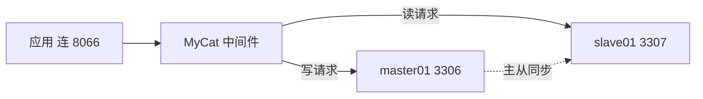

# 应用只连一个地址：MyCat 读写分离与 balance 参数选型

一主一从搭好之后，读写分离有两条路：应用自己维护两套数据源，写走 3306、读走 3307；或者把这件事整个交给中间件。前一种意味着每个项目、每种语言都要重复实现一遍分流逻辑，切换、探活、重连也得自己操心。MyCat 给的是后一种：应用只连它的 8066 端口，写请求由它转发给主库，读请求按配置分流给从库。这一课从零装起 MyCat，把三份配置文件配通，再跑通一次真正的读写分离。

## 先给结论

- MyCat 的部署就是一个解压包，`conf` 下的三份文件分工明确：`server.xml` 管用户与全局项，`schema.xml` 管数据节点，`rule.xml` 管分片规则。
- 客户端连 MyCat 的 8066 端口，账号密码由 `server.xml` 的 `user` 定义，与 MySQL 自己的账号体系完全是两回事。
- 读写分离由 `dataHost` 的 `balance` 决定：0 不开启、1 备主与从库参与读、2 读写节点随机、3 读全部走 readHost，本课选 3。
- 结构上 `writeHost` 之下嵌 `readHost`：写走主库 3306，读走从库 3307，主从同步照旧在底层进行。
- 逻辑库对应的真实库必须先在主库建好，否则连 MyCat 都会又慢又卡。

## 一、安装：一个压缩包解出来的服务

环境沿用上一套主从：虚拟机 192.168.1.18 上跑着 Docker 容器 percona-master01（3306，主）与 percona-slave01（3307，从），主从复制已验证双 Yes。MyCat 安装包上传到服务器解压即可，不依赖任何外部中间件：

```bash
cd /haoke
mkdir mycat
cd mycat
# 上传 Mycat-server-1.6.6.1-release-20181031195535-linux.tar.gz 后解压
tar -zxvf Mycat-server-1.6.6.1-release-20181031195535-linux.tar.gz
rm -rf Mycat-server-1.6.6.1-release-20181031195535-linux.tar.gz
mv mycat mycat01
```

解出来的目录里，`bin` 放启动脚本，`lib` 放依赖 jar，`logs` 放运行日志，真正要动的是 `conf`。三份配置文件各有分工，下面逐份来配。

## 二、server.xml：定义谁能连 MyCat

`server.xml` 存放全局配置项与用户信息，原文件内容很长，可以清空后只保留需要的部分：

```xml
<?xml version="1.0" encoding="UTF-8"?>
<!DOCTYPE mycat:server SYSTEM "server.dtd">
<mycat:server xmlns:mycat="http://io.mycat/">
    <system>
        <property name="useHandshakeV10">1</property>
        <property name="fakeMySQLVersion">5.6.20</property>
        <property name="sequnceHandlerType">2</property>
    </system>
    <!-- 客户端连接 MyCat 使用的账号与逻辑库 -->
    <user name="haoke" defaultAccount="true">
        <property name="password">haoke123</property>
        <property name="schemas">haoke</property>
    </user>
</mycat:server>
```

`user` 节点是最关键的部分：用户名 `haoke`、密码 `haoke123` 是给客户端连 MyCat 用的；`schemas` 限定这个账号登录后能看到哪个逻辑库，这里就是名为 `haoke` 的逻辑库。`system` 里是一些全局项，例如 `fakeMySQLVersion` 让 MyCat 对外宣称自己是一个 5.6.20 的 MySQL 服务，好让各类客户端驱动顺利握手。

## 三、schema.xml：一主一从挂进 dataHost

`schema.xml` 描述逻辑库背后接的是谁，以及读写请求怎么分：

```xml
<?xml version="1.0"?>
<!DOCTYPE mycat:schema SYSTEM "schema.dtd">
<mycat:schema xmlns:mycat="http://io.mycat/">
    <schema name="haoke" checkSQLschema="false" sqlMaxLimit="100">
        <table name="tb_ad" dataNode="dn1" rule="mod-long" primaryKey="id"/>
    </schema>

    <dataNode name="dn1" dataHost="cluster1" database="haoke"/>

    <dataHost name="cluster1" maxCon="1000" minCon="10" balance="3"
              writeType="0" dbType="mysql" dbDriver="native" switchType="1">
        <heartbeat>select user()</heartbeat>
        <!-- 写节点：3306 主库 -->
        <writeHost host="w1" url="192.168.1.18:3306" user="root" password="root">
            <!-- 读节点：3307 从库，嵌在写节点之下 -->
            <readHost host="r1" url="192.168.1.18:3307" user="root" password="root"/>
        </writeHost>
    </dataHost>
</mycat:schema>
```

结构同样三层：逻辑库 `haoke` 里挂测试表 `tb_ad`，它指向数据节点 `dn1`，`dn1` 落到主机 `cluster1`，`cluster1` 里写节点是 3306 主库、读节点是 3307 从库。这里只有一套主从，但 `balance` 已经是决定读写走向的开关，四个取值的含义值得逐个记牢：

- `balance="0"`：不开启读写分离机制，所有读请求都发到当前可用的写节点上。目标是读写分离就不能选它。
- `balance="1"`：全部的 readHost 与备用的 writeHost 参与 select 的负载均衡。典型场景是双主双从：M1 与 S1、M2 与 S2 各成一对，M1 与 M2 互为主备，此时 M2、S1、S2 都分担读请求。
- `balance="2"`：所有读请求随机发给 writeHost 与 readHost，写节点也要分摊一部分读压力。
- `balance="3"`：所有读请求随机发给 writeHost 对应的 readHost 执行，写节点完全不承担读压力。这个取值是 1.4 之后版本才加入的。

本课是标准的一主一从，选 3 最彻底：写全进 3306，读全进 3307，两个节点的职责一刀切干净。

## 四、rule.xml：单分片也要把规则配齐

逻辑表上引用了规则 `mod-long`，`rule.xml` 里就要给它一个交代：

```xml
<tableRule name="mod-long">
    <rule>
        <columns>id</columns>
        <algorithm>mod-long</algorithm>
    </rule>
</tableRule>

<function name="mod-long" class="io.mycat.route.function.PartitionByMod">
    <!-- 分片数量，当前只有一个数据节点，取 1 -->
    <property name="count">1</property>
</function>
```

当前只有一个数据节点，取模结果永远是 0，数据自然全落在 `dn1`。单分片场景这条规则配不配都行，但保持配置完整，以后往多分片扩时只需要把 `count` 与 `dataNode` 列表一起改掉。

## 五、启动、连接与验证

配置齐了，先进控制台模式试运行，再转后台：

```bash
cd /haoke/mycat/mycat01/bin
./mycat console    # 前台启动，看到 MyCAT Server startup successfully 即成功
# Ctrl+C 结束前台，改后台运行
./mycat start

# 停止方式：先拿进程号再结束
jps
kill -9 MycatStartup对应的进程号
```

客户端新建的连接填的不是 MySQL 的 3306，而是 MyCat 的 8066，用户名密码也用 `server.xml` 里定义的那一组：

```bash
mysql -h192.168.1.18 -P8066 -uhaoke -phaoke123
```

这里有个真实的坑：第一次连接会明显发慢，打开逻辑库也卡。原因是逻辑库 `haoke` 对应的真实库还没建，MyCat 在背后反复探测。到主库 3306 上把库建好（utf8 编码），再连就秒开了。建表与插数据全部通过 MyCat 连接执行：

```sql
CREATE TABLE tb_ad (
  id BIGINT NOT NULL PRIMARY KEY,
  type VARCHAR(10) NOT NULL,
  title VARCHAR(100) NOT NULL,
  url VARCHAR(200) NOT NULL,
  created DATETIME,
  updated DATETIME
);

INSERT INTO tb_ad (id, type, title, url, created, updated)
VALUES (1, '1', '天虹购物中心', 'http://img.haoke.com/ad/1.jpg', '2018-11-26 11:28:49', '2018-11-26 11:28:49');
```

验证环节把真正的 MySQL 连接打开对账：3306 主库里这条数据在，3307 从库刷新后同样在，说明写确实经 MyCat 落到了主库、复制同步正常；而 `balance="3"` 让后续的读请求随机分给 3307。整条链路如下：



应用从头到尾只面对 8066 一个地址、一套账号，读写怎么分、主从在哪，全部是 MyCat 内部的事。这就是中间件方案相对应用级分流的根本优势：分流逻辑收口在一处，应用零改造。

## 常见误区

- **以为 `balance="0"` 也能读写分离。** 0 表示不开启，读全部压到写节点上，从库空转。一主一从要 `balance="3"`，双主互备才考虑 1。
- **拿 MySQL 的 root 账号连 8066。** MyCat 的账号在 `server.xml` 里独立定义，与 MySQL 服务端账号无关，账号密码和 `schemas` 限定的逻辑库都要对上。
- **逻辑库没建真实库就去连。** 表现为连接慢、打开库卡，先在主库把同名库建好再连。
- **以为 MyCat 自己存了数据。** 它只是路由与转发，数据全在背后的 MySQL 里；从 MyCat 看到的数据，最终都要落到某个真实库上对账。

## 面试可能被问到的问题

1. 面试官追问：「MyCat 的读写分离是怎么实现的？」
   答：在 `dataHost` 配置里，`writeHost` 指向主库，其下嵌套的 `readHost` 指向从库，`balance` 参数决定读请求的分发策略。MyCat 解析 SQL 判断读写类型，写语句发给写节点，读语句按 `balance` 分给读节点，主从之间的数据一致性由 MySQL 复制保证。
2. 面试官追问：「balance 的四个取值分别是什么含义？」
   答：0 不开启读写分离，读全走写节点；1 是全部 readHost 加备用 writeHost 参与 select 负载均衡，适配双主互备架构；2 是读请求在写节点与读节点间随机分发；3 是读请求全部随机分给 readHost，写节点不承担读压力，1.4 之后版本支持。
3. 面试官追问：「读写分离之后读到了旧数据怎么办？」
   答：根源是主从延迟，`balance` 只管分流不管一致性。对一致性敏感的读，要么强制走主库（直连写节点或用 MyCat 的路由注解），要么改造业务流程为写后读主。同时监控 `Seconds_Behind_Master` 控制延迟水位。
4. 面试官追问：「MyCat 的用户和 MySQL 的用户是什么关系？」
   答：两套独立体系。MyCat 用户在 `server.xml` 的 `user` 节点定义，负责控制谁能连中间件、能看哪些逻辑库；MyCat 转发请求时用 `dataHost` 里配置的账号连真实 MySQL。客户端永远感知不到 MyCat 背后的数据库账号。
5. 面试官追问：「8066 和 9066 两个端口分别干什么用？」
   答：8066 是服务端口，应用与客户端连它执行 SQL；9066 是管理端口，连上去执行 `show @@help` 里的管理命令，可以查看心跳、连接、缓存等运行状态，是排查 MyCat 问题的重要入口。

## 配套资料

- 本课无配套源码包：`materials/code/03/day17-MySQL集群解决方案(主从复制、PXC集群、MyCat、HAProxy)/`
  目录下仅有解压清单 `_extracted.json`（记录解压文件数为 0），无源码可挂。
- MyCat 版本、安装流程、三份配置的结构与 `balance` 各取值的讲解均整理自本课视频；
  `server.xml`、`schema.xml`、`rule.xml` 与建表测试 SQL 为按本课写法与 MyCat 1.6 主流写法
  补全的可运行示例，库名、账号、表数据已改为中性名称。
