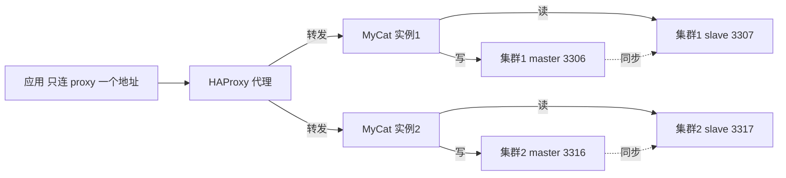

# 给 MyCat 集群一个统一入口：HAProxy 负载均衡与整体架构

双 MyCat 把性能和单点问题处理掉了，但应用侧的复杂度反弹了：连接地址从一个变成两个，流量分配与故障切换都得应用自己操心。解法不是让应用变强，而是在它前面再立一层专职的负载均衡组件，把 MyCat 集群重新收口成一个地址。这一课认识这个角色：HAProxy，并把它放回整套 MySQL 集群架构里，看清每一层到底各管什么。

## 先给结论

- HAProxy 是用 C 语言编写的开源软件，提供高可用性与负载均衡，基于 TCP/HTTP 协议做应用代理，也支持 UDP。
- 它采用事件驱动、单一进程模型支撑大并发，普通硬件上万级并发开箱即得，网上有深度调优后千万级并发的压测记录，实际性能取决于硬件与调优。
- MySQL 这类服务走四层 TCP 代理：HAProxy 只转发连接，不解析 SQL。
- 在本架构中应用只连 HAProxy，HAProxy 把请求转给 MyCat 集群，MyCat 再按规则落到 MySQL，三层各司其职。
- 负载均衡组件自己也会成为新单点，生产上通常配 Keepalived 加 VIP 做双机热备。

## 一、架构演进到这一步，缺的是入口

把这一路的演进串起来看：主从复制解决数据冗余与读扩展；MyCat 挡在应用与数据库之间做读写分离与数据分片；MyCat 做成双实例后性能与可用性上去了，应用却要同时对接两个中间件地址。每一层的问题都解决了，唯独「应用该连谁」这个问题又被翻了出来。

要让应用回到「只连一个地址」的简单状态，需要有人站在 MyCat 集群前面做分发：



这张图是整个 day17 阶段架构的最终形态：应用面对的永远只有 HAProxy 一个入口，它把请求转发给健康的 MyCat 实例；MyCat 按 `schema.xml` 的分片规则与 `balance` 的读写策略操作背后的主从集群；MySQL 层面主从同步持续进行。HAProxy 加入之后，应用侧的复杂度被彻底挡在最外层。

## 二、HAProxy 是什么

一句话概括：一个用 C 语言编写的开源（自由软件）负载均衡器，提供高可用性、负载均衡能力，支持 HTTP、TCP、UDP 协议，以及基于 TCP/HTTP 的应用程序代理。它特别适合负载较大的 Web 站点这类需要会话保持、七层处理的场景。

它的并发能力是招牌。运行在当前普通硬件上就能支撑数以万计的并发连接，靠的是事件驱动、单一进程的模型：一个进程监听所有连接，用事件循环处理成千上万的 socket，避免了一个连接一个线程的上下文切换开销。网上有对它深度调优后做到千万级并发的测试记录，但要清醒一点：千万级不是装完就有的默认值，那是一系列参数调优叠加的结果，并且与运行机器的硬件直接相关，环境不同结果不可复制。对绝大多数业务而言，知道它并发上限足够高、足以满足需求，就够了。

## 三、四层与七层：MySQL 场景怎么选

负载均衡器按工作层次分两类。四层（传输层）代理只看 IP 与端口，把 TCP 连接原样转发到后端，不理解也不改动应用层内容；七层（应用层）代理能读懂协议内容，按 URL、Cookie、请求头做路由，HTTP 反向代理是典型代表。

MySQL 流量必须走四层：客户端与服务器之间是一条长连接，里面跑的是 MySQL 私有协议，负载均衡器只需把这条连接可靠地接到某个 MyCat 实例上，任何「解析内容再路由」的动作既无必要也做不到。对应到配置里就是 `mode tcp`。

与常见方案对比着看更清楚：

| 维度 | LVS | Nginx | HAProxy |
|---|---|---|---|
| 工作层次 | 四层，内核态实现 | 七层为主，后补四层支持 | 四层与七层都完整支持 |
| 性能 | 最强，内核态转发 | 强 | 强，用户态事件驱动 |
| 后端健康检查 | 本身不提供，需 Keepalived 配合 | 有 | 有，粒度细、配置灵活 |
| 典型场景 | 大规模四层转发 | Web 反向代理、动静分离 | TCP/HTTP 负载均衡、数据库代理 |

本架构选 HAProxy 的直接理由：对 TCP 长连接代理成熟，四层模式健康检查开箱即用，一个组件就能把两个 MyCat 实例管起来。

## 四、它在配置里长什么样

HAProxy 的能力通过一份 `haproxy.cfg` 描述，本课只讲架构不动手部署，这里给一份按本课架构补全的示例，把两个 MyCat 挂进同一个入口：

```properties
# 示例：仅保留代理 MyCat 的核心段，全局段与默认段从略
listen haoke_mysql
    bind 0.0.0.0:13306        # 示例端口，避开宿主机上已有的 MySQL 实例
    mode tcp                  # 四层代理，不解析 MySQL 协议
    balance roundrobin        # 两个 MyCat 实例轮询分流
    server mycat01 192.168.1.18:8066 check inter 5s rise 2 fall 3
    server mycat02 192.168.1.18:8067 check inter 5s rise 2 fall 3
```

应用改连 13306，之后的每条连接被轮询分给 8066 或 8067 上的 MyCat。`check` 打开后端探活，`inter 5s` 每 5 秒探测一次，连续 3 次失败把节点摘除，恢复后连续 2 次成功再加回来，实例宕机时应用无感知。改完配置先用语法检查验证一遍再重载：

```bash
haproxy -c -f /etc/haproxy/haproxy.cfg   # 语法校验
systemctl reload haproxy                  # 校验通过后重载生效
```

## 常见误区

- **以为 HAProxy 只能做 HTTP 代理。** `mode tcp` 的四层代理正是它管住 MySQL、Redis 这类 TCP 服务的看家本领，数据库代理场景里七层反而用不上。
- **把负载均衡器当成 MyCat 的替代品。** HAProxy 只转发连接，不理解 SQL，分片路由与读写分离仍然由 MyCat 完成，它是叠加在 MyCat 之上的入口层，不是替代层。
- **以为千万级并发开箱即得。** 那是调优与硬件共同作用的压测结果，生产落地要按自身机器内核参数、连接数上限逐项调，不能照抄别人的压测配置。
- **忽略 HAProxy 自身的单点。** 它挡在最前面，自己挂了入口就没了，生产上用 Keepalived 加 VIP 让两台 HAProxy 互为热备，这层话题在后续高可用部署中展开。

## 面试可能被问到的问题

1. 面试官追问：「四层负载均衡和七层负载均衡的区别是什么？」
   答：四层工作在传输层，依据 IP 与端口转发 TCP/UDP 连接，不理解应用内容，性能高、通用性强；七层工作在应用层，能解析 HTTP 等协议内容，按 URL、Cookie、请求头做路由，还能做会话保持与内容改写，但解析本身有开销。
2. 面试官追问：「为什么 MySQL 集群前面用 HAProxy 而不是 Nginx？」
   答：MySQL 客户端是 TCP 长连接，走的是私有协议，四层代理即可，任何协议解析既无必要也不可行。HAProxy 的 TCP 模式成熟稳定、健康检查完善，天然适配数据库代理；Nginx 的强项在七层 HTTP 反向代理，TCP 代理是后补的能力。
3. 面试官追问：「HAProxy 怎么知道后端节点挂了？」
   答：给 `server` 行配置 `check` 开启健康检查，`inter` 控制探测间隔，`fall` 连续失败多少次判定下线，`rise` 连续成功多少次恢复上线。四层模式下默认做 TCP 连接探测，端口连不上即视为故障，摘除后不再有流量进入。
4. 面试官追问：「HAProxy 自己挂了怎么办？」
   答：它是新的关键单点，标准方案是 Keepalived 加 VIP 做双机热备：两台 HAProxy 共享一个虚拟 IP，Keepalived 通过 VRRP 选举持有者，主节点宕机后 VIP 漂移到备节点，应用连接的地址始终不变。
5. 面试官追问：「这套 MySQL 集群架构里，HAProxy、MyCat、MySQL 各自负责什么？」
   答：HAProxy 是接入层，统一入口并按负载策略把连接分给 MyCat 实例，剔除故障节点；MyCat 是路由层，负责分片路由、读写分离与结果合并，把集群伪装成一个数据库；MySQL 是存储层，负责落盘与主从复制保证数据冗余。三层叠加，每层的复杂度都不外泄。

## 配套资料

- 本课无配套源码包：`materials/code/03/day17-MySQL集群解决方案(主从复制、PXC集群、MyCat、HAProxy)/`
  目录下仅有解压清单 `_extracted.json`（记录解压文件数为 0），无源码可挂。
- HAProxy 的定位、协议支持、并发模型与整体架构图整理自本课讲解与画面；四层七层对比及
  `haproxy.cfg` 示例为按本课架构与 HAProxy 主流写法补全的示例（本课只讲介绍与架构，
  实际部署配置在后续课程展开）。
