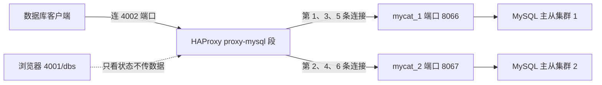

# 用 Docker 部署 HAProxy：一份配置接管两个 MyCat

上一课明确了 HAProxy 的角色：站在两个 MyCat 实例前面，统一入口、分流、探活。这一课把它真正部署出来。动手时会撞上三个具体问题：容器里的 HAProxy 怎么读到宿主机上的配置文件；管理界面和数据库代理分别落在哪个端口；健康检查的端口该写谁。任何一处想当然，都会遇到「容器起来了却连不上」或「管理页面里后端一路红」的现象。

## 先给结论

- 镜像用 `haproxy:1.9.3`，配置文件写在宿主机 `/haoke/haproxy/haproxy.cfg`，创建容器时把该目录挂进容器，容器内的 HAProxy 才读得到配置。
- 配置分四段：`global` 全局段、`defaults` 默认段、`admin_stats` 管理界面监听 4001、`proxy-mysql` 数据库代理监听 4002。
- 代理段是 `mode tcp` 加 `balance roundrobin`，连接在 8066 与 8067 两台 MyCat 之间轮流分配。
- `server` 行的 `check port` 必须写 MyCat 自己的监听端口 8066、8067，写成 3306 探测到的就是 MySQL，探活结论全错。
- 验证方式：浏览器看 4001 的统计页面，数据库客户端连 4002 用 MyCat 账号查询，数据正常返回即部署成功。

## 一、部署准备：拉镜像、建目录、写配置

```bash
# 拉取 HAProxy 镜像
docker pull haproxy:1.9.3

# 创建配置目录
mkdir /haoke/haproxy

# 创建并编辑配置文件
vim /haoke/haproxy/haproxy.cfg
```

`haproxy.cfg` 完整内容如下，端口、路径与结构均来自本课的实际部署：

```properties
# 全局段
global
    log 127.0.0.1 local2
    maxconn 4000
    daemon

# 默认参数段
defaults
    mode http
    log global
    option http-server-close
    option dontlognull
    timeout connect 10s
    timeout client 1m
    timeout server 1m
    timeout http-keep-alive 10s
    timeout check 10s
    maxconn 3000

# 管理界面：浏览器访问 4001 查看后端状态
listen admin_stats
    bind 0.0.0.0:4001
    mode http
    stats uri /dbs
    stats realm Global\ statistics
    stats auth admin:admin123

# 数据库代理：客户端连 4002，转发给两台 MyCat
listen proxy-mysql
    bind 0.0.0.0:4002
    mode tcp
    balance roundrobin
    option tcplog
    server mycat_1 192.168.1.18:8066 check port 8066 maxconn 2000
    server mycat_2 192.168.1.18:8067 check port 8067 maxconn 2000
```

逐段看关键项。`global` 里 `daemon` 让进程后台运行，`maxconn 4000` 是进程级连接上限；`defaults` 定义各类超时的兜底值，`maxconn 3000` 是单个监听的连接上限。`admin_stats` 段把管理界面开在 4001，`mode http` 走七层，`stats uri /dbs` 指定访问路径，`stats auth admin:admin123` 是登录口令（示例口令，生产环境务必换强密码）。`proxy-mysql` 段才是数据库代理：`mode tcp` 四层转发、不解析 MySQL 协议，`balance roundrobin` 轮询，`option tcplog` 记录 TCP 连接日志。两个 listen 段的名字与端口都可以自定，改名改端口后记得同步调整容器端口映射。

轮询的效果很直白：第一条连接进 8066，第二条进 8067，第三条又回到 8066，依次循环，把客户端连接摊到两台 MyCat 上。

**这里有一个本课现场踩过的坑：`check port` 写错过一轮。** 健康检查是 HAProxy 主动向后端发起的 TCP 连接，探测端口必须指向 MyCat 实际监听的 8066 与 8067。最初照模板写成了 `check port 3306`，探测对象变成了宿主机上的 MySQL，MyCat 就算挂了探测照样成功，故障会被探活机制掩盖。把两行分别改成 8066 与 8067 之后，配置才算正确。

## 二、创建容器并启动

```bash
# 创建并启动容器，核心是把配置目录挂载进去（命令为按主流写法补全的示例）
docker run -d -p 4001:4001 -p 4002:4002 \
  -v /haoke/haproxy:/usr/local/etc/haproxy \
  --name haproxy --privileged haproxy

# 改过配置后重启并跟踪日志
docker restart haproxy && docker logs -f haproxy
```

创建命令的要点只有一个：把宿主机的 `/haoke/haproxy` 挂到容器内 HAProxy 默认读取配置的位置，同时把 4001、4002 两个端口都映射出来。HAProxy 只在启动时读一次配置，之后每次改完 `haproxy.cfg` 都要 `docker restart` 才生效，日志里确认监听就绪即可。

## 三、管理页面与连接测试

部署完先看管理面，再走数据面。浏览器访问 `http://192.168.1.18:4001/dbs`，输入 `admin:admin123` 进入统计页面。现场第一次打开时 `mycat_1` 是红色 DOWN 状态，原因不在 HAProxy：两台 MyCat 还没启动。分别进两个 MyCat 实例的 `bin` 目录把它们拉起来，刷新页面，节点恢复绿色。这个页面往后就是排查入口，后端谁红先查谁，不要先怀疑代理。

数据面用数据库客户端测：新建 MySQL 连接，主机 `192.168.1.18`，端口写 4002 而不是 4001，账号用 MyCat 里配置的业务账号（示例记作 `haoke`、密码 `haoke123`，按你自己的 user 配置填写）。连接成功后执行查询，数据正常返回。此时应用面对的只是一个代理地址，连接被轮流分给两台 MyCat，两台 MyCat 各自再对接一套 MySQL 主从集群。



图里两条线要分清：管理线 4001 只承载统计页面，数据线 4002 才是应用真正的连接入口。负载均衡的两个收益在这里都兑现了：请求被分担到每个 MyCat 节点，应用的开发复杂度被压回「只连一个地址」。

## 常见误区

- **把 4001 当数据库端口连。** 4001 是 `mode http` 的管理界面，只响应统计页面；连库必须走 4002 的 `mode tcp` 代理段。
- **`check port` 照通用模板写 3306。** 探测端口必须与后端 MyCat 的监听端口一致，否则探活的对象根本不是 MyCat，节点宕机也测不出来。
- **改了配置不重启。** HAProxy 启动时读一次配置，改完 `haproxy.cfg` 必须 `docker restart haproxy`，再用 `docker logs -f` 确认。
- **后端 DOWN 就去查代理。** DOWN 的含义是探测端口连不上，多数情况是后端 MyCat 没启动或探测端口写错，先看管理页面的红绿状态，再查后端。

## 面试可能被问到的问题

1. 面试官追问：「balance roundrobin 是什么策略？」
   答：轮询。连接按顺序逐个分配到后端节点，第一条给 mycat_1、第二条给 mycat_2、第三条又回到 mycat_1，循环往复。它不感知节点负载差异，适合后端性能相近的场景；节点性能不均时可改用带权重的 static-rr 或 leastconn。
2. 面试官追问：「HAProxy 的健康检查怎么工作？」
   答：server 行配置 check 后，HAProxy 周期性向后端指定端口发起探测连接，连续失败达到阈值标记 DOWN 并摘除流量，恢复后自动加回。check port 指定探测端口，必须指向后端真实监听的服务端口，否则探活无意义。
3. 面试官追问：「管理界面是怎么配出来的？」
   答：定义一个 mode http 的 listen 段，bind 管理端口，stats uri 指定访问路径，stats auth 配置登录账号口令，浏览器访问端口加路径即可看到后端节点状态与会话统计。
4. 面试官追问：「应用只连一个 HAProxy，它自己挂了怎么办？」
   答：HAProxy 成为新的单点，生产上用 Keepalived 加 VIP 部署两台互为热备，主节点故障时虚拟 IP 漂到备节点，应用侧连接地址不变。
5. 面试官追问：「为什么数据库代理一定要 mode tcp？」
   答：MySQL 客户端与服务器之间是长连接，跑的是私有协议，四层代理只转发连接最稳妥；若用 mode http 去解析，协议对不上，连接直接失败。

## 配套资料

- 本课无配套源码包：`materials/code/03/day17-MySQL集群解决方案(主从复制、PXC集群、MyCat、HAProxy)/`
  目录下仅有解压清单 `_extracted.json`（记录解压文件数为 0）。
- `haproxy.cfg` 全文、`/haoke/haproxy` 目录、管理路径 `/dbs`、`docker restart` 命令整理自本课画面与讲解；
  `docker run` 创建命令与演示账号为按主流写法补全的示例。
