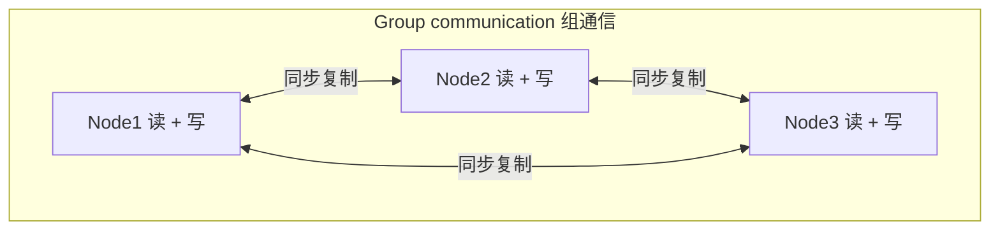

# PXC 集群简介：把异步同步的主从升级为强一致多主

主从架构留下两笔账：应用要对接多个数据库节点，这笔已经由 MyCat 这类中间件结清；主从之间靠异步同步维持一致，这笔还挂着。对数据安全性要求高的业务，主库提交成功而从库尚未同步的窗口期，就是脏读与丢数据的来源。PXC 集群就是来结这笔账的：用同步复制把「各节点最终一致」升级成「任意时刻都一致」。

## 先给结论

- PXC 全称 Percona XtraDB Cluster，是基于 Percona Server 与 Galera 组件搭建的 MySQL 高可用与扩展方案。
- 同步复制：事务要在所有节点都提交成功才算完成，任意时刻各节点数据一致，即强一致性。
- 多主架构：集群里没有主从之分，任何一个节点都既能读又能写。
- 事务在节点间并行复制，不是逐节点排队回放。
- 与主从复制的本质区别：主从只能写主节点，PXC 可以在任意节点写。

## 一、主从架构挂着的两笔账

主从架构的两张图都指向同一个细节：主库与从库之间那条同步线是异步的。主库提交事务成功就向应用返回，从库什么时候追平，取决于复制线程的进度，网络抖动、大事务都会拉长这个窗口。


窗口期内如果发生主库故障切换，未同步的数据就丢了；读从库的业务则可能读到旧值。多数业务可以容忍，资金、库存这类场景不行。应用对接多节点的问题已经交给中间件解决，剩下的这个一致性问题，就是 PXC 的切入点。

## 二、PXC 是什么

PXC 的全称是 Percona XtraDB Cluster，是面向 MySQL 用户的高可用与扩展解决方案。它的组成可以拆成两半：Percona Server 是数据库本体，由 Percona 公司维护的 MySQL 分支，协议与语法与 MySQL 一致；Galera 是同步多主复制组件，以插件形式嵌入，专门面向事务型应用，负责把一个节点上提交的事务同步到所有节点。两半合起来，数据库还是那个数据库，复制机制从异步换成了同步。

## 三、它提供四项能力

**第一，同步复制。** 事务在所有节点上提交，你在任意节点写入，其余节点同步持有同一份数据，不存在「主库有、从库还没有」的状态。

**第二，多主机复制。** 假如集群有三个节点，随便挑一个写入都可以，写入口不再唯一。

**第三，从节点并行应用事件。** 主从复制里从库回放日志容易排队堆积，PXC 在各节点并行执行同步过来的事务，是真正的并行复制，这是强一致的性能基础。

**第四，自动节点配置。** 节点加入集群自动补齐数据，数据一致性不再存在未同步的时间差。

三节点集群的协作方式：



写入 Node1 的数据经组通信同步给 Node2 与 Node3，三个节点地位完全对等，读写在任一节点发起都合法。

## 四、与主从复制的本质区别

| 维度 | 主从复制 | PXC 集群 |
|---|---|---|
| 复制方式 | 异步，主库提交即返回 | 同步，事务在所有节点提交 |
| 写入口 | 仅主节点 | 任意节点 |
| 一致性 | 弱一致，存在同步延迟 | 强一致，节点间没有时间差 |
| 复制执行 | 从库回放日志，易堆积 | 并行应用事件 |
| 节点角色 | 主从分工 | 完全对等 |

用两段现象演示对照（示例脚本）：

```sql
-- 示例：主从异步下的现象
-- 主库执行并提交成功
INSERT INTO account (id, balance) VALUES (1, 100);
-- 同一时刻到从库查，可能还没有这一行，延迟多久不确定
SELECT * FROM account WHERE id = 1;
```

```sql
-- 示例：PXC 下的同样操作
-- 在任意节点执行，提交即代表所有节点都有了
INSERT INTO account (id, balance) VALUES (1, 100);
-- 换另外两个节点的连接查，结果立即一致
SELECT * FROM account WHERE id = 1;
```

从「可能查不到」变成「换节点立刻查到」，差别就在复制方式从异步换成了同步。

## 常见误区

- **以为 PXC 是主从的万能替代。** 同步复制要等所有节点确认，写入耗时随节点数上升，整体吞吐低于主从。一致性优先、写压力可控的库选 PXC；读多写少且能容忍延迟的库，主从加中间件更划算。
- **以为多主就能对同一行随便并发写。** 两个节点同时修改同一行，后提交的事务会在认证阶段失败回滚，热点行的并发写冲突依旧要业务层规避。
- **以为强一致没有代价。** 每个事务提交都伴随节点间通信，节点之间的网络质量直接决定提交耗时，跨机房部署 PXC 要格外谨慎。

## 面试可能被问到的问题

1. 面试官追问：「PXC 的全称与组成？」
   答：Percona XtraDB Cluster。以 Percona Server 为数据库本体，叠加 Galera 组件提供的同步多主复制能力，共同构成面向 MySQL 用户的高可用与扩展方案。
2. 面试官追问：「PXC 与主从复制最本质的区别是什么？」
   答：复制方式与写入口。主从异步复制、只能写主节点，存在同步延迟；PXC 同步复制、任意节点可写，事务在所有节点提交成功才算完成，任意时刻数据强一致。
3. 面试官追问：「什么叫并行应用事件？」
   答：主从复制里从库回放日志，事务量大时排队堆积、延迟越滚越大；PXC 把同步到本节点的事务并行执行，不排队，节点间数据基本不存在时间差。
4. 面试官追问：「什么业务适合上 PXC？」
   答：数据安全性要求高、不能容忍主从延迟的资金、订单、库存类核心库；同时利用多节点可写分摊写请求。追求极致写吞吐、能容忍延迟的场景，主从结构更合适。
5. 面试官追问：「Galera 在 PXC 里承担什么职责？」
   答：以插件形式提供同步多主复制，事务提交时把写集在集群内广播，所有节点认证通过后一起提交；节点故障自动剔除、恢复后自动补齐数据，强一致与节点管理都由它实现。

## 配套资料

- 本课无配套源码包：`materials/code/03/day17-MySQL集群解决方案(主从复制、PXC集群、MyCat、HAProxy)/`
  目录下仅有解压清单 `_extracted.json`（记录解压文件数为 0）。
- PXC 定义、能力清单、三节点架构图整理自本课讲解与画面；两段 SQL 现象演示为按本课写法补全的示例。
