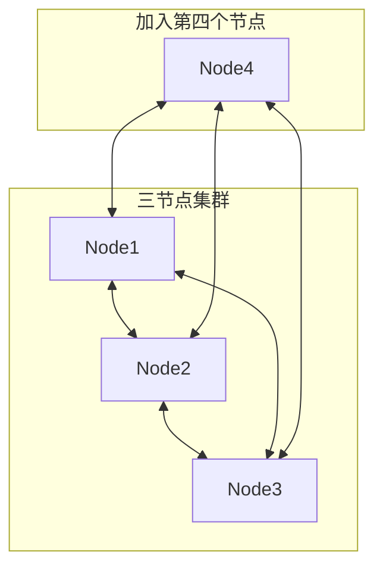

# PXC 集群的边界：规模、硬件、引擎与再启动

集群搭完不代表可以放开用。PXC 用同步复制换来强一致，同时附带了必须遵守的约束：集群规模多大合适、节点硬件要不要对齐、存储引擎能用哪些、整体停机之后怎么再拉起来。这些约束在生产事故复盘里反复出现，值得单独讲透。

## 先给结论

- 尽可能控制 PXC 集群规模：节点越多，写入要确认的对象越多，两两同步的开销越大，同步越慢。
- 所有节点的硬件配置保持一致：配置最低的节点决定全集群的同步速度。
- PXC 只支持 InnoDB 引擎，MyISAM 等其他引擎一律不支持。
- 结合 Galera 的多数派仲裁机制，节点数建议取 3、5 这类奇数（延伸结论，画面未展开）。
- 全停再启动与首次部署的启动方式不同：要先让一个节点建立集群基准，其余节点再加入。

## 一、节点越多不一定越好

有一种直觉是 PXC 规模越大越好，正好相反。回看三节点的架构图：任意一个节点的写入都要同步给其余所有节点，节点之间两两相连；每加一个节点，同步关系就多一组，写入方的每次提交也要多等一个节点的确认。节点数到十个、一百个，同步复杂度高到不可用，效率极低。



从三个节点到四个节点，同步边从三条变成六条；照这个规律往下走，节点规模与同步速度是一对直接冲突。规模按真实的高可用需求定，不贪多。

## 二、硬件一致：木桶效应最严格的地方

所有 PXC 节点的硬件配置要一致。同步复制是集体动作，一个事务要等所有节点都提交完成，最慢的那台机器决定整批事务的确认时间。一台低配机器混在集群里，全集群的写入速度就被拖到它的水平。采购按同一规格，扩容按同等配置加节点，高低混搭等于自设瓶颈。

## 三、只认 InnoDB

PXC 集群只支持 InnoDB 引擎，其他引擎都不支持，包括 MySQL 曾经的默认引擎 MyISAM。根源在复制机制：Galera 复制的是事务写集，认证、冲突处理、回滚全部建立在事务机制上；MyISAM 没有事务，写集无从谈起，自然无法参与这套同步复制。存量库迁入 PXC 前要把非 InnoDB 表清理干净：

```sql
-- 示例：迁移前检查引擎分布
SELECT TABLE_NAME, ENGINE FROM information_schema.TABLES
WHERE TABLE_SCHEMA = 'haoke' AND ENGINE <> 'InnoDB';

-- 示例：把 MyISAM 表转为 InnoDB
ALTER TABLE haoke.t_log ENGINE = InnoDB;
```

## 四、延伸：奇数节点与再启动

还有两处实际落地绕不开、但画面没有展开的点，按 Galera 的通行做法补充。

**节点数建议奇数。** Galera 用多数派（quorum）做集群决策：出现网络分区时，持有多数节点的一方继续服务，少数一方自动下线，避免裂成两个各自写各自的数据集。奇数节点在同等成本下更容易形成明确多数，偶数不仅多花一台机器的成本，还可能在故障时凑不出清晰的多数派。

**全停之后的再启动。** 首次部署时第一个节点负责初始化集群，其余节点 `CLUSTER_JOIN` 加入；集群整体停过之后再启动，不能不看顺序地把所有容器一起 start。正确做法是先启动持有最新数据的那个节点，让它先形成集群基准，确认就绪后再启动其余节点加入：

```bash
# 示例：全停后再启动的顺序（按 Galera 通行做法）
# 1. 先启动数据最新的节点，重建集群基准
docker start pxc_node1
# 2. 确认集群就绪后，再拉起其余节点
docker start pxc_node2 pxc_node3
```

顺序错了一般表现为节点互相等待、加入失败，排查时先看谁先起来、谁持有最新数据。

## 常见误区

- **节点数堆得越多越高可用。** 同步复制随节点数变慢，规模失控反而拉低整体效率；3 个起步、按需到 5 个左右是常见平衡点。
- **节点配置高低混搭。** 低配节点拖慢所有人的提交确认，集群写入速度按最低配置计算，硬件必须对齐。
- **把 MyISAM 表原样迁进 PXC。** Galera 只复制 InnoDB 写集，MyISAM 表进集群后一致性没有保障；迁入前统一转 InnoDB。
- **全停后不看顺序直接全部 start。** 集群基准由谁建立不明确，节点互相等待加入失败；先起数据最新的节点，再起其余。

## 面试可能被问到的问题

1. 面试官追问：「PXC 集群是不是节点越多越好？」
   答：不是。节点越多，每次写入需要确认的对象越多，节点间两两同步的开销越大，同步速度随规模下降。按高可用需求控制规模，一般 3 个起步，最多 5 个左右，并取奇数。
2. 面试官追问：「为什么所有节点硬件配置必须一致？」
   答：同步复制下一个事务要等所有节点提交，最慢的节点决定整体确认时间，低配节点会把全集群的写入速度拖到自己的水平，典型的木桶短板。
3. 面试官追问：「PXC 为什么只支持 InnoDB？」
   答：Galera 复制的是事务写集，认证、冲突处理、回滚都依赖事务机制；MyISAM 没有事务，无法参与这套同步复制，所以集群只认 InnoDB。
4. 面试官追问：「节点数为什么建议奇数？」
   答：Galera 用多数派仲裁决策，故障时只有多数一方继续服务。奇数节点更容易形成明确多数，偶数节点既多占一台资源，又可能在半数故障时无法判定归属。
5. 面试官追问：「整套集群全停之后怎么再启动？」
   答：先启动持有最新数据的节点，让它重建集群基准，确认就绪后再启动其余节点加入。乱序全启动会让节点互相等待，加入失败。

## 配套资料

- 本课无配套源码包：`materials/code/03/day17-MySQL集群解决方案(主从复制、PXC集群、MyCat、HAProxy)/`
  目录下仅有解压清单 `_extracted.json`（记录解压文件数为 0）。
- 三条集群约束（控制规模、硬件一致、只支持 InnoDB）整理自本课讲解与画面；奇数节点与全停再启动
  为结合 Galera 多数派机制的延伸说明，检查与启动命令为按主流写法补全的示例。
