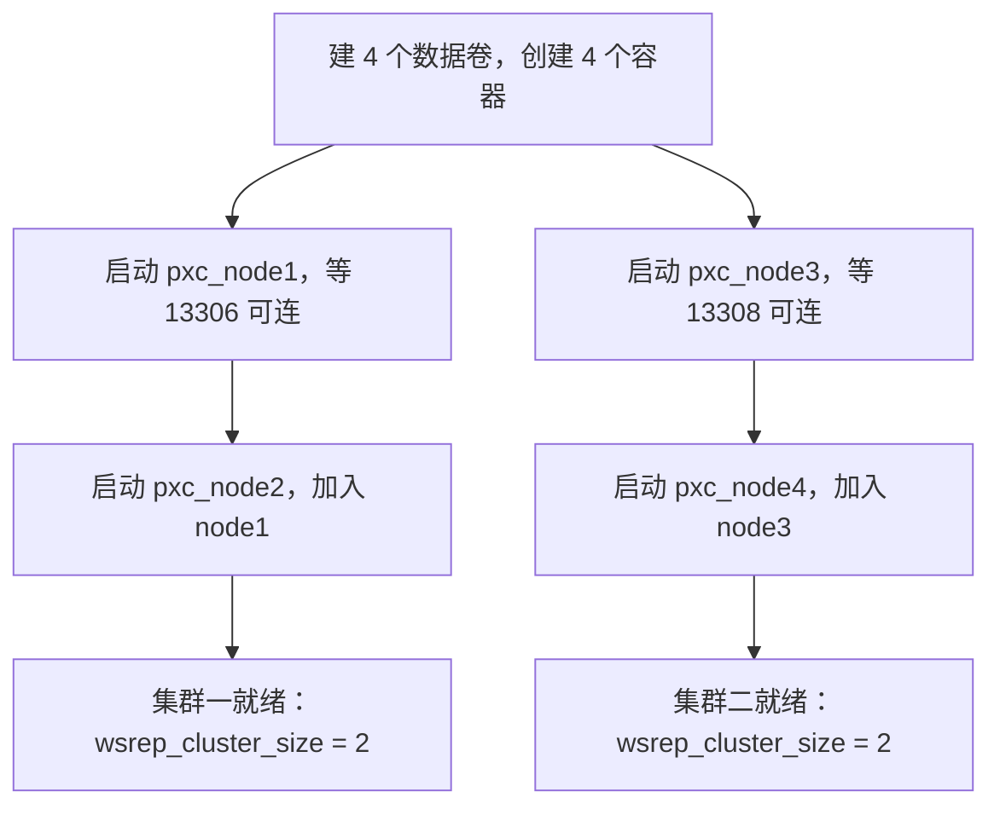

# 两套 PXC 集群落地：双分片部署、按序启动与各分片建库建表

架构图上「两套 PXC 分片」画起来就是两个方框，真动手才发现处处是单集群没遇到过的问题：原来三个节点的单集群环境怎么处置？两套集群的 `CLUSTER_NAME` 还能一样吗？四个容器能不能一把梭全启动？在集群一里建的库，集群二里会有吗？

这一课把上一课架构图里最里层的东西部署出来：清掉旧的单集群，按双分片规划重建 4 个节点、2 套集群，并在两个分片里各自初始化房源库表，为 MyCat 分片路由做好数据侧准备。

## 先给结论

- 节点规划：集群一 pxc_node1（13306，haoke-v1）、pxc_node2（13307，haoke-v2）；集群二 pxc_node3（13308，haoke-v3）、pxc_node4（13309，haoke-v4）。
- 每套集群的第二个节点带 `CLUSTER_JOIN` 指向本集群的第一个节点；第一个节点是创建者，不带该参数。
- 同一网段跑两套集群，`CLUSTER_NAME` 必须取不同名字（示例 pxc1、pxc2），从命名上隔离身份。
- 启动顺序按集群来：每套集群先启动自己的第一个节点，客户端能连上之后再启动第二个。
- 两个集群互不同步，`haoke` 库和房源表要在每个分片里各建一遍。

## 一、清场：从单集群迁到双分片

之前部署的三个节点组的是一套集群，端口 13306、13307、13308，里面还留着验证用的广告表。双分片架构里 PXC 只存房源数据，广告表要交给主从集群，所以先把表删掉，再停掉旧容器：

```bash
# 删掉旧集群里的广告表（PXC 分片只存房源）
DROP TABLE haoke.t_ad;

# 停掉并删除旧的三个 PXC 容器
docker stop pxc_node1 pxc_node2 pxc_node3
docker rm pxc_node1 pxc_node2 pxc_node3
```

然后为 4 个节点各建一个全新的数据卷。旧卷里带着原集群的 grastate 与数据，直接复用会让新节点带着旧集群的身份信息启动，排查起来非常费劲，重建最干净：

```bash
# 创建 4 个数据卷（实际存储路径：/var/lib/docker/volumes）
docker volume create haoke-v1
docker volume create haoke-v2
docker volume create haoke-v3
docker volume create haoke-v4
```

镜像与网络沿用单集群那课的成果：`percona/percona-xtradb-cluster:5.7` 已拉取并重命名为 `pxc`，网段 `172.30.0.0/24` 的 `pxc-network` 已存在，直接复用。

## 二、节点规划：一张表说清 4 个容器

| 集群 | 节点 | 宿主机端口 | 容器名称 | 数据卷 | 容器 IP |
|---|---|---|---|---|---|
| 集群一 | node1 | 13306 | pxc_node1 | haoke-v1 | 172.30.0.2 |
| 集群一 | node2 | 13307 | pxc_node2 | haoke-v2 | 172.30.0.3 |
| 集群二 | node3 | 13308 | pxc_node3 | haoke-v3 | 172.30.0.4 |
| 集群二 | node4 | 13309 | pxc_node4 | haoke-v4 | 172.30.0.5 |

集群一承载分片 1，集群二承载分片 2，两套集群之间没有同步通道，各存一半房源数据。

## 三、创建容器：CLUSTER_NAME 与 CLUSTER_JOIN 的配对关系

```bash
# 集群一第一个节点：只声明集群名，不带 CLUSTER_JOIN
docker create -p 13306:3306 -v haoke-v1:/var/lib/mysql \
  -e MYSQL_ROOT_PASSWORD=root -e CLUSTER_NAME=pxc1 \
  --name=pxc_node1 --net=pxc-network --ip=172.30.0.2 pxc

# 集群一第二个节点：增加 CLUSTER_JOIN，加入 pxc_node1 所在集群
docker create -p 13307:3306 -v haoke-v2:/var/lib/mysql \
  -e MYSQL_ROOT_PASSWORD=root -e CLUSTER_NAME=pxc1 \
  -e CLUSTER_JOIN=pxc_node1 \
  --name=pxc_node2 --net=pxc-network --ip=172.30.0.3 pxc

# 集群二第一个节点：换了集群名，自成一体
docker create -p 13308:3306 -v haoke-v3:/var/lib/mysql \
  -e MYSQL_ROOT_PASSWORD=root -e CLUSTER_NAME=pxc2 \
  --name=pxc_node3 --net=pxc-network --ip=172.30.0.4 pxc

# 集群二第二个节点：CLUSTER_JOIN 指向本集群的 pxc_node3
docker create -p 13309:3306 -v haoke-v4:/var/lib/mysql \
  -e MYSQL_ROOT_PASSWORD=root -e CLUSTER_NAME=pxc2 \
  -e CLUSTER_JOIN=pxc_node3 \
  --name=pxc_node4 --net=pxc-network --ip=172.30.0.5 pxc
```

两条规则决定这 4 条命令的形状。**同集群内名字必须一致，跨集群名字必须不同。** 单集群时代三个节点共用一个 `CLUSTER_NAME` 是「同名互认」；现在同一个网段里跑两套集群，这个名字反过来变成隔离手段，节点只认自己集群的名字，示例里集群一叫 `pxc1`、集群二叫 `pxc2`。**`CLUSTER_JOIN` 只出现在每套集群的第二个节点上。** 每套集群的第一个节点是创建者，负责初始化集群；第二个节点靠 `CLUSTER_JOIN` 声明「我加入谁」，注意 node4 加入的是 node3，不是 node1，跨集群加入会被直接拒绝。

## 四、启动：每个集群先起第一个节点

```bash
# 先启动集群一的第一个节点，跟踪日志确认初始化完成
docker start pxc_node1 && docker logs -f pxc_node1
# 用客户端连一次 13306，确认可访问后再启动第二个节点
docker start pxc_node2 && docker logs -f pxc_node2
```

单集群那课踩过的坑在这里变成双份：每个集群的第一个节点都要先完成集群初始化，才能接收本集群第二个节点的加入请求。所以流程是先起 node1、等 13306 能连上、再起 node2；集群二同样先起 node3、等 13308 能连上、再起 node4。日志里能看到 node2 以 JOINER 身份加入、完成 SST 全量同步、状态进入 SYNCED，node4 同理。



两条启动线互不依赖，可以先跑完集群一再跑集群二，也可以交错进行，唯一不能破的规矩是每条线内部必须先起第一个节点。

## 五、验证规模，再给每个分片建库建表

分两次连接，分别在两个集群里确认集群规模：

```sql
-- 分别连 13306（集群一）与 13308（集群二）执行
SHOW STATUS LIKE 'wsrep_cluster%';
-- 每套集群的 wsrep_cluster_size 都应为 2
```

两个分片互不同步，所以 `haoke` 库和房源表必须每个分片各建一遍，在集群一建完去集群二刷新是等不来的：

```sql
-- 每个分片里各执行一遍
CREATE DATABASE haoke DEFAULT CHARACTER SET utf8;
```

房源表的建表语句在两个分片里保持完全一致，MyCat 做分片路由时两边的表结构必须对得上：

```sql
CREATE TABLE `tb_house_resources` (
  `id` bigint(20) NOT NULL AUTO_INCREMENT,
  `title` varchar(100) DEFAULT NULL COMMENT '房源标题',
  `estate_id` bigint(20) DEFAULT NULL COMMENT '楼盘id',
  `building_num` varchar(5) DEFAULT NULL COMMENT '楼号',
  `building_unit` varchar(5) DEFAULT NULL COMMENT '单元号',
  `building_floor_num` varchar(5) DEFAULT NULL COMMENT '楼层号',
  `rent` int(11) DEFAULT NULL COMMENT '租金',
  `rent_method` tinyint(1) DEFAULT NULL COMMENT '租借方式：1-整租，2-合租',
  `house_type` varchar(25) DEFAULT NULL COMMENT '户型：2室1厅1卫',
  `covered_area` varchar(10) DEFAULT NULL COMMENT '建筑面积',
  `use_area` varchar(10) DEFAULT NULL COMMENT '使用面积',
  `orientation` varchar(2) DEFAULT NULL COMMENT '朝向：东、南、西、北',
  `decoration` tinyint(1) DEFAULT NULL COMMENT '装修：1-精装，2-简装，3-毛坯',
  `facilities` varchar(20) DEFAULT NULL COMMENT '设施：1-电梯，2-空调，3-暖气',
  `pic` varchar(1000) DEFAULT NULL COMMENT '图片',
  `pic_desc` varchar(200) DEFAULT NULL COMMENT '联系人',
  `contact` varchar(11) DEFAULT NULL COMMENT '手机号',
  `mobile` varchar(11) DEFAULT NULL COMMENT '手机',
  `payment_method` tinyint(1) DEFAULT NULL COMMENT '支付方式：1-付一押一，2-付三押一，3-付四押二',
  `house_status` tinyint(1) DEFAULT NULL COMMENT '状态：1-在售，2-已售，3-已租',
  `create_time` datetime DEFAULT NULL COMMENT '创建时间',
  `update_time` datetime DEFAULT NULL COMMENT '更新时间',
  `delete_flag` tinyint(1) DEFAULT '0' COMMENT '删除标识：0-未删除，1-已删除',
  PRIMARY KEY (`id`)
) ENGINE=InnoDB DEFAULT CHARSET=utf8;
```

建完在 13306、13307 各刷新一次，表都在，说明集群一内部同步正常；再连 13308、13309 确认集群二同样就绪。至此数据侧的双分片搭建完毕，MyCat 的分片规则随时可以把房源数据路由进来。

## 常见误区

- **两套集群沿用同一个 `CLUSTER_NAME`。** 名字相同在语义上就属于同一个集群，两套集群的身份从命名上就混了，节点重启或扩容时容易加错组。两套集群用两个名字，隔离从配置层面就成立。
- **四个容器一次 `docker start` 全拉起来。** 每套集群的第一个节点还没完成初始化，第二、第四个节点的加入请求全部失败。按「每集群先第一后第二」的顺序来。
- **node2 的 `CLUSTER_JOIN` 指到 pxc_node3。** 加入对象错了，节点会试图跨集群合入，被集群名校验挡下，容器反复重启。加入对象必须是本集群的第一个节点。
- **在集群一建库后去集群二等它出现。** 两个分片之间没有同步，库表是各自独立的，每个分片都要执行一遍 `CREATE DATABASE` 与建表语句。

## 面试可能被问到的问题

1. 面试官追问：「同一台机器上跑两套 PXC 集群，怎么保证互不干扰？」
   答：三个隔离手段一起用：`CLUSTER_NAME` 取不同名字，节点只认本集群身份；`CLUSTER_JOIN` 只指向本集群的第一个节点；数据卷、端口、容器一一对应独立。集群之间的数据分布由上层 MyCat 分片规则决定，集群本身不通信。

2. 面试官追问：「为什么每个集群的第二个节点要等第一个节点连上了才能启动？」
   答：第一个节点的启动过程包含集群初始化，集群结构就绪前，带 `CLUSTER_JOIN` 的节点无法完成加入握手。以第一个节点可被客户端连接作为初始化完成的判据，再启动其余节点。

3. 面试官追问：「新节点加入 PXC 时数据怎么补齐？」
   答：通过 SST 全量快照传输，从已有节点拉取完整数据副本；如果节点短暂离线后回归且差距在允许范围内，走 IST 增量传输只补缺失事务。课程里第二个节点启动日志里的 JOINER 到 SYNCED 就是这个过程。

4. 面试官追问：「每套集群只部署两个节点，有什么风险？」
   答：PXC 依赖多数派表决，两节点集群挂掉一个就失去多数派，整个集群变为只读甚至不可用，故障容忍度是零。课程环境受资源所限用两节点演示，生产环境每套集群至少三个节点，可容忍一个节点故障。

5. 面试官追问：「两个分片的表结构为什么必须完全一致？」
   答：MyCat 按分片规则把 SQL 路由到不同分片，分片对上是同一张逻辑表。任何一边表结构不一致，路由过去的 SQL 就会在那个分片上报错，出现「一部分数据写入成功、另一部分失败」的脏状态。

## 配套资料

- 本课无配套源码包：`materials/code/03/day17-MySQL集群解决方案(主从复制、PXC集群、MyCat、HAProxy)/`
  目录下仅有解压清单 `_extracted.json`（记录解压文件数为 0）。
- 节点规划表、建卷建网络、创建容器与启动顺序整理自本课讲解与画面；`tb_house_resources` 建表语句抄录自本课屏幕原文；两套集群的 `CLUSTER_NAME` 取 pxc1、pxc2 为按本课写法补全的示例（原命名沿用单集群写法时依赖 `CLUSTER_JOIN` 指定加入对象，异名隔离更稳妥）；验证用 SQL 为按本课写法补全的示例。
