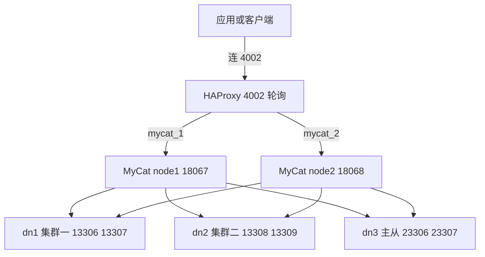

# 部署 HAProxy 层：把两个 MyCat 收成一个数据库入口

两个 MyCat 节点跑起来了，应用却又站在岔路口：连 18067 还是 18068？这一课把最后一层补上：改 HAProxy 的代理配置指向两个新节点，启动容器，从管理页面到数据面再到应用接入，把四层架构完整跑通。做完这一步，应用程序的数据库连接串只需要一个地址。

## 先给结论

- 改动只有 proxy-mysql 段的两行 server：mycat_1 指向 18067，mycat_2 指向 18068，check port 同步改；管理界面 4001 与代理端口 4002 都不动。
- 容器启动后先看管理页面 `http://192.168.1.18:4001/dbs`，两个节点 UP 再走数据面。
- 连 4002 查询 tb_house_resources 与 tb_ad 都有数据，说明 HAProxy 到 MyCat 到 MySQL 的全链路已通。
- 应用接入只改数据源地址：连接串换成 HAProxy 的 4002，四层架构对外收敛成一个连接串。

## 一、改配置：proxy-mysql 段的两行 server

HAProxy 的容器与基础配置在负载均衡那一课已经就绪，配置文件在宿主机 `/haoke/haproxy/haproxy.cfg`。当时 proxy-mysql 段指向的是旧实验实例的 8066 与 8067，综合环境里那两个实例已经退役，改成两个新节点的端口：

```properties
# 数据库代理：客户端连 4002，转发给两个 MyCat 节点
listen proxy-mysql
    bind 0.0.0.0:4002
    mode tcp
    balance roundrobin
    option tcplog
    server mycat_1 192.168.1.18:18067 check port 18067 maxconn 2000
    server mycat_2 192.168.1.18:18068 check port 18068 maxconn 2000
```

其余段落原样保留：global 与 defaults 是全局与默认参数，admin_stats 把管理界面开在 4001，访问路径 /dbs，登录账号 admin 与 admin123。轮询策略 roundrobin 保持不变：第一条连接进 18067，第二条进 18068，依次循环，把客户端连接摊到两个 MyCat 节点上。

改的时候要盯住 check port。健康检查是 HAProxy 主动向后端发起的 TCP 连接，探测端口必须与 MyCat 实际监听的服务端口一致；server 行的目标地址改了，check port 不同步的话，探活对象就不再是 MyCat，节点宕机也测不出来。

## 二、启动容器，先看管理面

```bash
# 确认容器处于退出状态
docker ps -a | grep haproxy

# 启动并跟踪日志
docker start haproxy && docker logs -f haproxy
```

HAProxy 只在启动时读一次配置，改完 `haproxy.cfg` 必须重启容器才生效。日志确认监听就绪后，浏览器打开 `http://192.168.1.18:4001/dbs`，输入管理账号进入统计页面：mycat_1 与 mycat_2 两行都是绿色 UP，说明两个后端的探测都通了。这个页面往后就是排查入口，谁红先查谁，不要先怀疑代理。

## 三、数据面验证：一个入口查到全部数据

数据库客户端新建连接：主机 192.168.1.18、端口 4002，账号用 MyCat 的业务账号。连上后打开逻辑库，tb_house_resources 与 tb_ad 两张表都在，查询也都有数据：

```sql
-- 经 HAProxy 4002 执行
SELECT id, title, rent FROM tb_house_resources;
-- 两个 PXC 分片的数据合并返回

SELECT id, title, url FROM tb_ad;
-- 主从集群的数据正常返回
```

这两条查询背后的路径值得展开：连接被轮询分给其中一个 MyCat 节点，房源查询被路由到两个 PXC 分片并合并结果，广告查询走主从集群并按 balance 3 落在读节点上。HAProxy 不理解 SQL，它只负责把连接安全地送到健康的 MyCat 上；分片与读写分离全是 MyCat 的活。全链路如下：



图里两层转发要分清：HAProxy 到 MyCat 是四层转发，只认连接与端口；MyCat 到 MySQL 是协议级代理，要解析 SQL、执行路由。两层各自扩展互不影响，这正是分层带来的弹性。

## 四、应用接入：只改一个连接串

至此应用侧的改造简化到极致：把数据源的连接地址换成 HAProxy 的 4002 就行。以 Spring Boot 工程为例（示例配置，按自己的工程填写）：

```yaml
spring:
  datasource:
    url: jdbc:mysql://192.168.1.18:4002/haoke?useUnicode=true&characterEncoding=utf8
    username: haoke
    password: haoke123
```

从应用往下数：HAProxy 挡住 MyCat 集群的地址差异，MyCat 挡住分片与主从的拓扑细节，MySQL 层的 PXC 与复制对上完全不可见。之后无论后端扩节点还是换拓扑，应用只需要认识 4002 这一个地址。至此 day17 的综合应用全部落地，整套 MySQL 集群方案从架构图变成了可以连、可以查、可以写的一套环境。

## 常见误区

- **server 行改了，check port 没改。** 探测端口还指着旧实例，探活结论与真实服务脱节，可能后端已挂而页面仍显示 UP。地址与探测端口一起改，改完到管理页面核对红绿状态。
- **把 4001 当数据库端口连。** 4001 是 mode http 的管理界面，只响应统计页面；连库必须走 4002 的 mode tcp 代理段。
- **改完配置不重启容器。** HAProxy 启动时读一次配置，`docker restart haproxy` 之前改动一律不生效。
- **以为 HAProxy 需要懂分片规则。** 它只做四层转发与探活，SQL 怎么路由、结果怎么合并都与它无关，这些问题都到 MyCat 层找答案。

## 面试可能被问到的问题

1. 面试官追问：「HAProxy 和 MyCat 在这套架构里各解决什么问题？」
   答：HAProxy 是四层负载均衡，把客户端连接轮询分给多个 MyCat 节点，并用健康检查摘除故障节点，解决中间件层的分流与统一入口；MyCat 是数据库中间件，负责分片路由与读写分离，解决数据层的扩展。一个管连接，一个管 SQL。

2. 面试官追问：「数据库代理为什么用 mode tcp？」
   答：MySQL 客户端与服务端之间是长连接、私有协议，四层代理只转发字节流最稳妥；mode http 会按 HTTP 报文去解析，协议对不上连接直接失败。所以 proxy-mysql 段配 mode tcp 加 balance roundrobin。

3. 面试官追问：「roundrobin 分的是连接还是请求？」
   答：连接。MySQL 是长连接，一条连接建立后后续所有 SQL 都走同一个后端。HAProxy 层的负载均衡粒度是连接数，单个连接内部的压力差异要到 MyCat 与 MySQL 层去看。

4. 面试官追问：「check port 为什么必须写成 MyCat 的服务端口？」
   答：健康检查是 HAProxy 发起的真实 TCP 探测，探测端口决定探测对象。写成 3306 探测到的是宿主机上的 MySQL，MyCat 挂了探测照样成功，故障会被探活机制掩盖；写成 MyCat 监听的 18067、18068，探测结果才与转发目标一致。

5. 面试官追问：「HAProxy 自己挂了怎么办？」
   答：它成了新的单点。生产上用 Keepalived 部署两台 HAProxy 互为热备，靠虚拟 IP 漂移保证应用侧连接地址不变；课程环境用单实例演示，架构的演进方向要能说清楚。

## 配套资料

- 本课无配套源码包：`materials/code/03/day17-MySQL集群解决方案(主从复制、PXC集群、MyCat、HAProxy)/`
  目录下仅有解压清单 `_extracted.json`（记录解压文件数为 0）。
- proxy-mysql 段两行 server 的目标端口 18067 与 18068、容器启动与日志命令整理自本课讲解与画面；
  配置其余段落沿用 HAProxy 部署课的成果；验证 SQL 与 Spring Boot 数据源示例为按本课写法补全。
